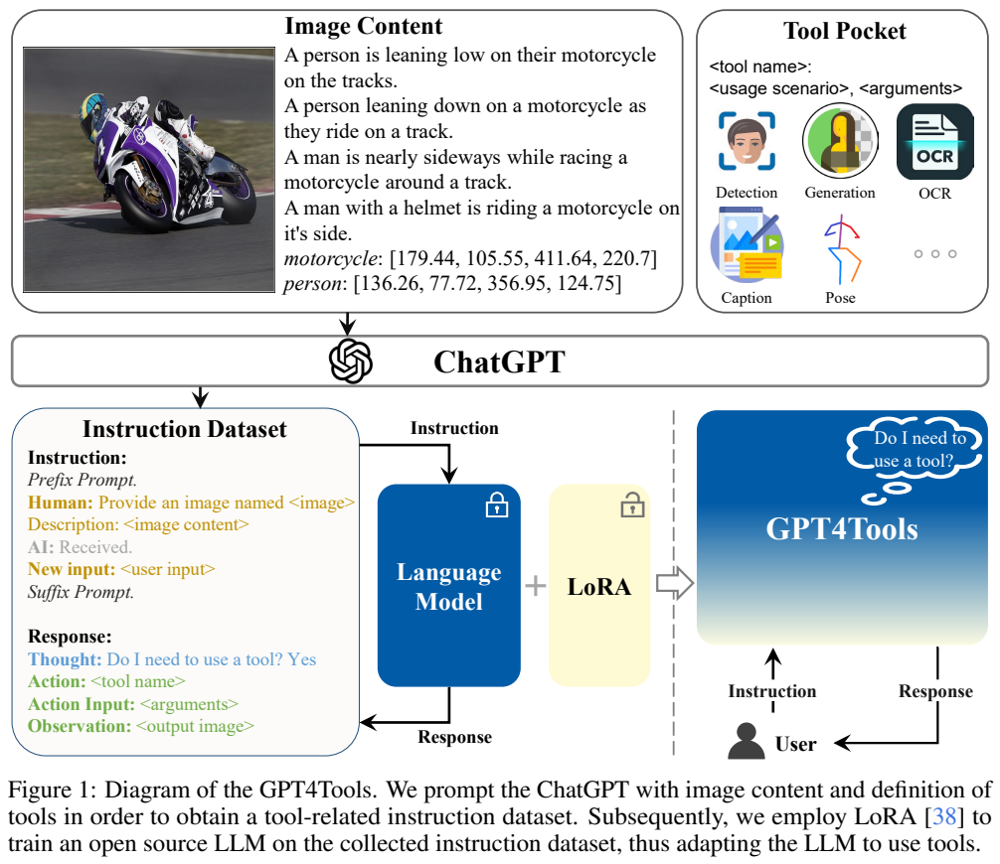
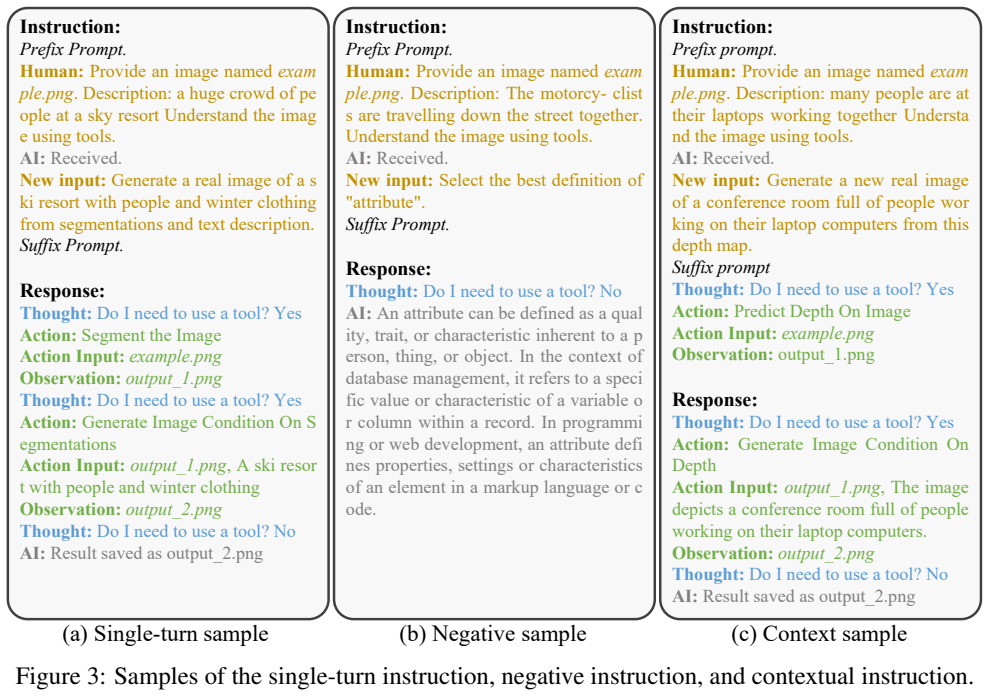
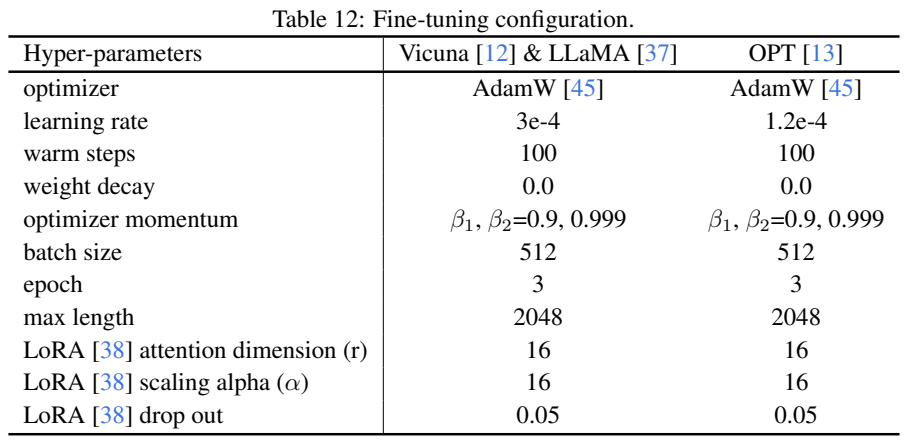
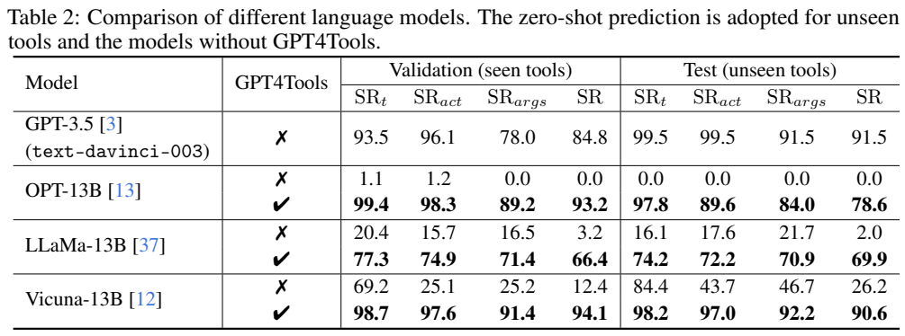

<!-- article-header:start -->
[项目首页](../../../README.md) › [模型系列](../../../reports/model-family-index.md) › [GPT4Tools](../README.md)
<!-- article-header:end -->

# GPT4Tools：通过自指令数据教开源语言模型调用视觉工具

<!-- article-toc:start -->
<a id="article-toc"></a>

**本篇目录** · [论文定位](#paper-info) · [快速概览](#overview) · [整体架构](#architecture) · [核心原理](#principles) · [数据构建](#data) · [训练流程](#training) · [实验结果](#experiments)
<!-- article-toc:end -->

<a id="paper-info"></a>

## 1. 论文信息与模型定位

**论文：** *GPT4Tools: Teaching Large Language Model to Use Tools via Self-instruction*。作者 Rui Yang、Lin Song、Yanwei Li、Sijie Zhao、Yixiao Ge、Xiu Li、Ying Shan，来自清华大学深圳国际研究生院、腾讯 AI Lab 和香港中文大学。本文固定使用 [arXiv 2305.18752v1](https://arxiv.org/abs/2305.18752v1)，2023 年 5 月 30 日提交，共 21 页，官方仓库为 [StevenGrove/GPT4Tools](https://github.com/StevenGrove/GPT4Tools)。

GPT4Tools 是文字语言模型的**多模态工具控制器**。它没有为 Vicuna 接入一个可训练图像编码器；模型通过文字描述、工具定义和调用结果间接访问图像。检测、分割、OCR、图像生成与编辑由外部模型完成。实验训练的是 LLaMA、Vicuna、OPT 等开源语言模型的 LoRA 模块。

标题并不表示实验教师就是 GPT-4。原文数据生成使用 **ChatGPT `gpt-3.5-turbo`**，主要比较基线标为 GPT-3.5 `text-davinci-003`；二者应区分。本文介绍的是 2023 年报告中的固定工具与评估方式，不补入后来函数调用接口。[原文 §3–4，PDF 第 4–7 页](https://arxiv.org/pdf/2305.18752v1#page=4)

<a id="overview"></a>

## 2. 快速概览

| 项目 | 报告实现 |
|---|---|
| 控制模型输入 | 图像的文字描述、用户指令、工具名称/用途/参数定义、对话历史 |
| 输出协议 | 是否用工具、Action、Action Input；接收 Observation 后继续或回答 |
| 数据生成 | 文字教师依据图像 caption 与对象框，合成工具相关指令和参数 |
| 数据增强 | 普通正例、无需工具的负例、截断调用链和多轮上下文样本 |
| 训练数据 | 附录精确规模为 71.4K 指令响应；23 种训练工具 |
| 未见工具测试 | 8 种新工具，推理时提供说明；652 个单轮样本 |
| 主结果 | Vicuna-13B 已见工具 SR 94.1，未见工具 SR 90.6 |

“未见工具”表示对应调用样本不在训练集，但测试会给出工具名称、用途与输入格式。模型并不是不知道接口而自行发明一个工具，零样本泛化依赖这些文字定义。

<a id="architecture"></a>

## 3. 整体架构



**原图：Figure 1，PDF 第 3 页。** 上半部分将图像内容的 caption/对象框与 Tool Pocket 交给 ChatGPT，左下转换为标准指令和响应；中间蓝色语言骨干固定、黄色 LoRA 训练；右边部署后接收用户请求。图里显示原图是为了说明信息来源，教师与控制模型主要读取文字表示。

工具口袋共 **31 项**，包含 Visual ChatGPT 中的 23 项与新增 8 项。理解类工具如描述、问答、检测、深度、法线、姿态、分割；生成类如 Stable Diffusion、ControlNet 条件生成、InstructPix2Pix 编辑，新增工具还包括超分辨率、图像质量评分和文本生成 3D 资产等。

每个工具有可读的名字、用途和参数说明。控制器生成 Action 与 Action Input，外部执行器运行对应模型，将 Observation 返回历史，再由控制器决定下一步。例如先估计深度并保存文件，再把这个路径和文字描述传给深度条件生成工具。输入路径的正确传递是这里的关键能力之一。

推理时 `<image content>` 可由图像描述工具产生；需要图像细节的任务仍应调用问答、OCR 或检测工具。模型本身没有直接看到图像 patch，不能把它的成功调用率描述成裸图像理解准确率。工具的计算、错误和可用性也属于整个系统的实际能力边界。[原文 §3.1、附录 A/B，PDF 第 5、10–14 页](https://arxiv.org/pdf/2305.18752v1#page=10)

<a id="principles"></a>

## 4. 核心创新与数学原理

**用图像内容约束自指令生成。** 原文式 (1) 为 $`Y\sim M_T(P_t\mid X_C)`$：教师 $`M_T`$ 根据图像内容 $`X_C`$ 与工具提示 $`P_t`$，生成指令、工具名和参数。$`X_C`$ 包含 caption 与对象框的文字表达，不是图像特征矩阵。它使生成任务围绕具体画面变化，减少只根据工具描述反复生成相似问题的现象。

**将调用技能转成普通序列学习。** 原文式 (2) 用自回归概率分解响应：


```math
p(X_r\mid X_C,X_{\rm inst})
=\prod_{i=1}^{L}p_\theta(x_i\mid X_C,X_{\rm inst},x_{\lt i}).
```


训练响应包括调用格式、工具名字与参数；优化这些文本的预测使模型学会什么时候调用、选哪个工具、怎样填入参数。它没有训练一个单独的工具选择分类器，也没有强化学习奖励或真实工具输出质量反向传播。

基础权重固定，LoRA 在 attention 的 query/key/value/output 投影增加低秩更新。通常可写为 $`W=W_0+BA`$，本篇采用 rank 16 和 alpha 16。这是对 LoRA 的解释，核心新内容是多模态语境的数据与工具基准，不能将整个工具栈的视觉参数说成也参与 LoRA 微调。

**把成功分解成可检查的环节。** 原文分别统计是否用工具正确 $`SR_t`$、工具名匹配 $`SR_{act}`$、参数匹配 $`SR_{args}`$。图片路径以指定后缀匹配判定，文字参数用 BLEU，单条样本将各参数分数平均为 $`\eta_i`$。整体式 (4) 是：


```math
SR=\frac1N\sum_i
\mathbf1(\text{decision correct})\,
\mathbf1(\text{tool correct})\,
\mathbf1(\eta_i\gt 0.5).
```


两步调用要求两个动作都正确。这个定义可以比只看工具名更严格，但路径/BLEU 与唯一参考调用的匹配仍不等于真实工具执行输出达到用户意图；不同合理调用路线也可能不匹配参考。报告没有把生成图像质量、分割 IoU 或每个工具的视觉答案精度纳入上述 SR。[原文 §3.2–3.3，PDF 第 6 页](https://arxiv.org/pdf/2305.18752v1#page=6)

<a id="data"></a>

## 5. 数据构建与处理



**原图：Figure 3，PDF 第 5 页。** 左例是分割后条件生成的两步调用；中例询问词义，应直接回答；右例把深度预测步骤移到输入历史，要求续接生成步骤。图中 Observation 的文件名是标准化调用轨迹内容，不能据此推断所有合成样本都实际运行过工具并验证了图片。

教师收到图像文字内容、全部候选工具定义与格式提示，为各工具生成有关画面的指令与参数。原始数据约 **70K**，过滤相似指令后保留约 **41K**，再转为含 Thought、Action、Action Input、Observation 的标准响应。原文未完整列出相似度阈值、每条样本人工审查比例和所有源图像的去重统计。

为避免模型见到任何用户请求都调用工具，作者从已有对话指令中构造 **negative samples**，响应使用无需工具的格式。为学习连续调用，截断动作链，把已完成步骤放进提示，后续步骤作为目标；再随机组合多条指令形成多轮对话。这些都是合成上下文，未证明等价于真实用户长期交互分布。

附录 A.1 写最终训练集 **71.4K**，其中 **35.7K** 为用工具的条目，并说明从 41K 原始正例重组、部分操作涉及两个工具。Figure 7 的分布图将负例比例标成 42%，与文字统计口径并不直接一致；本文不强行倒推出负例和上下文各自精确条数。

评测数据沿用生成流程后人工核验：已见工具验证集 **1170** 个样本，约每种工具 50 条，包含增强样本；未见工具测试集 **652** 个样本，只有单轮。新增工具为文字检测、通用检测、超分辨率、文字生成 3D、按对象裁剪、图像质量评分、人脸识别、人脸检测。新工具说明仍写入推理提示。

附录 Table 8 展示三类错误：格式错误、参数缺少图片路径、选择错误工具，并说明过滤必要性。报告没有给全部数据的错误率与修正自动化细节；它证明合成教师也会出错，不能把教师结果直接当人工真值。[原文 §3.1、附录 A/B/C，PDF 第 4–5、11–13 页](https://arxiv.org/pdf/2305.18752v1#page=11)

<a id="training"></a>

## 6. 训练流程与目标



**原表：Table 12，PDF 第 17 页。** 两列分别为 Vicuna/LLaMA 与 OPT，特别注意 OPT 的学习率低于正文概括的共同值。表给的是最大长度 2048，不能同时把它无条件解释成另外 2048 个输出 token 加在任意长提示之后。

| 参数 | Vicuna / LLaMA | OPT |
|---|---:|---:|
| 学习率 | $`3\times10^{-4}`$ | $`1.2\times10^{-4}`$ |
| batch | 512 | 512 |
| epoch | 3 | 3 |
| warm-up steps | 100 | 100 |
| LoRA rank / alpha | 16 / 16 | 16 / 16 |
| LoRA dropout | 0.05 | 0.05 |
| 最大长度 | 2048 | 2048 |

两列都使用 AdamW，$`\beta_1=0.9,\beta_2=0.999`$，weight decay 0。基础语言模型固定，只训练 attention 投影的 LoRA。正文 §4.1 对学习率概述为 $`3\times10^{-4}`$，本文保留附录的 OPT 例外。实验默认消融使用 Vicuna-13B，并比较 Vicuna-7B。

目标是标准自回归监督，调用格式和参数以目标文本学习；没有对外部工具执行质量做 RLHF、DPO 或奖励优化。报告未披露 GPU 数、GPU 型号、浮点精度、总训练时间、确切优化步数或所有 LR schedule 细节，本文不补造。Figure 4 绘制随训练迭代的评测变化，也不能代替完整训练日志。[原文 §3.2、§4.1、附录 D，PDF 第 6–8、17 页](https://arxiv.org/pdf/2305.18752v1#page=17)

<a id="experiments"></a>

## 7. 实验设置与主要结果



**原表：Table 2，PDF 第 7 页。** 左半是训练涉及的 23 个工具，右半是 8 个未见工具；每个开源模型两行对比微调前后。GPT-3.5 基线明确为 `text-davinci-003`，不是数据教师 `gpt-3.5-turbo`。两测试部分任务结构不同，不能仅凭右侧更高分就推断新工具更容易泛化。

| 模型 | 已见工具 SR，前 → 后 | 未见工具 SR，前 → 后 |
|---|---:|---:|
| OPT-13B | 0.0 → 93.2 | 0.0 → 78.6 |
| LLaMA-13B | 3.2 → 66.4 | 2.0 → 69.9 |
| Vicuna-13B | 12.4 → 94.1 | 26.2 → 90.6 |
| GPT-3.5 基线 | 84.8，无微调 | 91.5，无微调 |

Vicuna13B 在已见工具上比该 GPT-3.5 基线高 **9.3 个百分点**，未见工具则低 **0.9 个百分点**，所以“可比”不等于两部分都超过。它的已见工具决策/工具名/参数分数为 **98.7/97.6/91.4**，未见为 **98.2/97.0/92.2**，说明格式和选工具改善明显。OPT 的未见 SR 低于 Vicuna，LLaMA 总体也明显较弱，同样的训练数据不保证不同语言骨干得到同一效果。

Vicuna7B 已见工具 SR 从 **4.5** 提高到 **92.9**，比 13B 微调后的 94.1 低 1.2 个百分点。这个结果说明中等规模模型可学会固定协议，不能据此推出开放世界复杂智能体任务已经无需更强语言模型。[原文 Table 2/4，PDF 第 7–8 页](https://arxiv.org/pdf/2305.18752v1#page=7)

数据消融中，无图像内容条件的训练 SR 为 **36.9**；加入图像文字内容为 **81.6**，再加上下文样本为 **91.6**，再加负例为 **94.1**。这支持具体语境、续接调用与无需工具样本各有价值，但表未报告多随机种子的置信区间，t-SNE 数据分布图也不是量化泛化证明。[原文 Table 3、Figure 2/4，PDF 第 4、8 页](https://arxiv.org/pdf/2305.18752v1#page=8)

Figure 5–6 展示通过边缘/深度/姿态生成图像、编辑风格、分割领带等调用案例。它们说明控制器可以组织多种视觉工具，生成能力实际来自外部模型，不能与只能输出文字的 LLaVA 做同一架构能力归因。论文自己指出长而固定的工具提示降低计算效率，尚未处理全部调用失败、错误恢复和协议灵活性。报告的最强证据是自建基准中的调用文本匹配改善，而非任意视觉任务最终结果的 94.1% 成功保证。

<!-- article-footer:start -->
---

[← 上一篇：PandaGPT](../../pandagpt/arxiv-2305.16355/README.md) · [按发表时间浏览](../../../reports/paper-reading-guide.md#year-2023) · [下一篇：LLaVA-Med →](../../llava-med/arxiv-2306.00890/README.md)

[返回本篇目录](#article-toc) · [返回模型系列](../README.md)
<!-- article-footer:end -->
