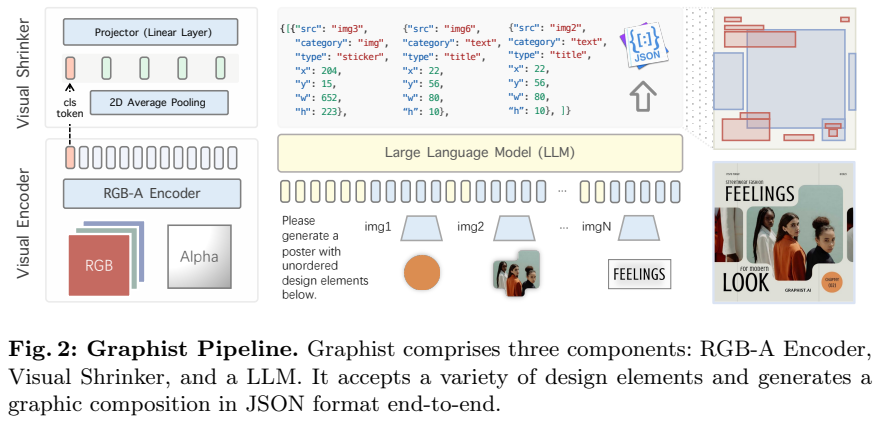
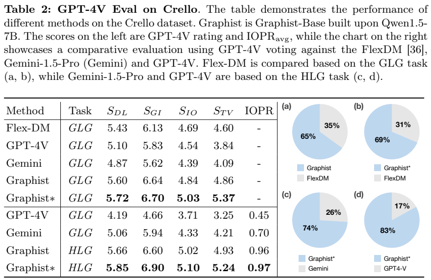
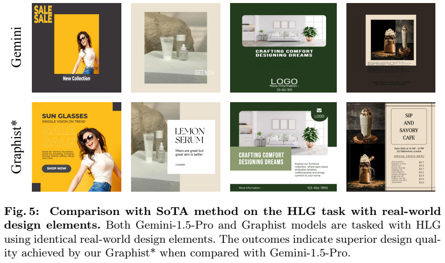
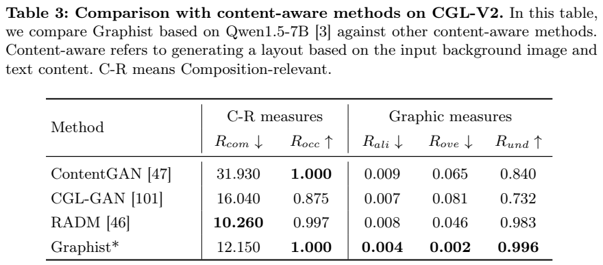
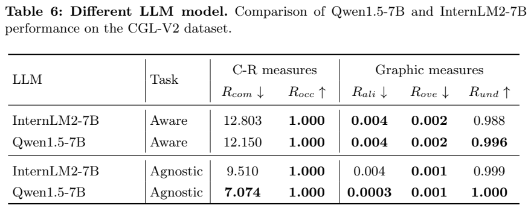
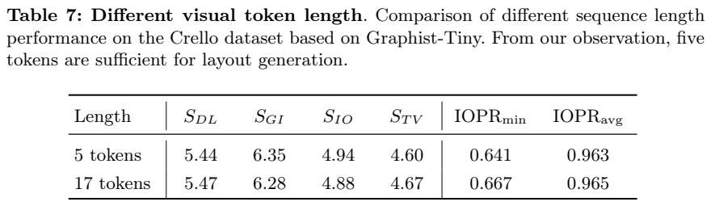

<!-- article-header:start -->
[项目首页](../../../README.md) › [模型系列](../../../reports/model-family-index.md) › [Graphist](../README.md)
<!-- article-header:end -->

# Graphist：从无序素材生成分层平面设计

<!-- article-toc:start -->

**本篇目录** · [论文定位](#paper-info) · [快速概览](#overview) · [整体架构](#architecture) · [核心原理](#principles) · [数据构建](#data) · [训练流程](#training) · [实验结果](#experiments)
<!-- article-toc:end -->

## 1. 论文信息与模型定位

**论文**：[Graphic Design with Large Multimodal Model](https://arxiv.org/abs/2404.14368)，依据 2024 年 4 月 22 日 [v1 报告](https://arxiv.org/pdf/2404.14368v1)。作者 Yutao Cheng、Zhao Zhang、Maoke Yang、Hui Nie、Chunyuan Li、Xinglong Wu、Jie Shao，来自 ByteDance 与中国科学院大学。

Graphist 是面向平面设计布局的多模态应用模型。它接收用户已有的图片、装饰和文字素材，输出各元素的坐标、大小与图层顺序，再由渲染器合成海报。其核心任务 **Hierarchical Layout Generation，HLG** 比传统 GLG 多预测图层前后关系，因此用户不必事先把素材按正确遮挡顺序排列。模型不负责凭空生成完整素材集合，评测也不针对通用视觉问答。

## 2. 快速概览

| 项目 | 方案 |
|---|---|
| 视觉输入 | 所有素材统一为 RGBA；文字可先渲染成透明背景图像 |
| 编码器 | 224×224 输入的四通道 ViT-L/14，从 CLIP 视觉塔初始化 RGB 部分 |
| 视觉压缩 | 16×16 网格平均池化为 2×2，另保留 CLS，每素材 5 个 token |
| 语言基座 | Graphist-Tiny：Qwen1.5-0.5B；Graphist-Base：Qwen1.5-7B |
| 输出 | JSON 协议，包含素材来源、类别、坐标、尺寸；列表顺序表达层次 |
| 训练 | RGBA/连接器适配 → HLG 能力学习 → 多种布局任务适配 |
| 版本边界 | Graphist 用公开数据；Graphist* 另外用内部 RGBA 与设计数据 |

方法的价值是把素材内容、空间数值与排序统一放进序列生成。压缩策略适合这里的布局任务，但不能由“5 个 token 足够排版”推导出同样预算足够完成 OCR、医学图像或复杂空间推理。

## 3. 整体架构

**读图：Figure 2，PDF 第 3 页。** 左侧把图片和 alpha 透明通道共同送入编码器；Visual Shrinker 在不丢弃 CLS 的情况下压缩 patch 网格。下方交错出现指令与多个素材的视觉 token，上方输出 JSON，右侧依协议形成布局图及最终海报。

透明通道提供素材有效区域的信息。例如文字周围大面积透明像素与字形本身有不同含义，纯 RGB 合成背景可能让模型难以区分它们。初始化时 CLIP 只覆盖原 RGB 参数，新增 alpha 输入要在第一阶段适配。

视觉编码器原始输出为 256 个网格 token 加一个 CLS。压缩后 $V\in\mathbb R^{5\times D}$，投影到语言维度 $V'\in\mathbb R^{5\times D'}$。Figure 2 把投影标为 linear layer，正文称 one MLP layer，报告没有进一步给出多层深度，本文统称投影层。多个素材的 token 可以插入输入序列各处，素材编号把视觉内容与输出条目关联起来。

## 4. 核心创新与数学原理

任务输入为无序素材集合 $M=\{M_i\}_{i=1}^n$，$M_i\in\mathbb R^{h_i\times w_i\times4}$。传统 GLG 给每个素材预测 $(x_i,y_i,w_i,h_i)$；HLG 增加图层层次 $l_i$，因此输出 $s_i=(x_i,y_i,w_i,h_i,l_i)$。几何位置正确、图层顺序错误，仍可能把标题或主体遮住；这解释了把两个问题一起建模的必要性。

Graphist 使用普通数字 token 表达坐标，参考 Shikra 的方式，不扩充专门坐标词表，也不增加坐标检测器或专属位置编解码器。JSON 序列同时承载离散顺序和数值几何信息，可由已有工具渲染与编辑。这里是对已有素材的布局生成，不是直接预测新海报的每个像素。

池化可理解为把 16×16 网格的每个 8×8 区域求均值，形成 2×2 区域描述；这是压缩操作的解释，不是新增训练目标。保留 CLS 补充全局语义，五个 token 平衡素材数量与上下文成本。训练中以 **0.75 概率随机打乱设计元素输入顺序**，减少模型对输入原序的依赖，让输出顺序由内容决定。

论文引入 IOPR 衡量重叠元素对中的逆序关系，但 v1 的文字定义称“低值好”，表中却把 Graphist 接近 0.97 的结果当作优势；公式的求和与文字也不完全清晰。本文保留这个矛盾，**不把表中 0.97 换算成已确认的 97% 排序准确率，也不擅自取 1−IOPR 修正**。可靠结论需待实现代码或作者澄清指标口径。

## 5. 数据构建与处理

公开训练采用 ShareGPT4V、Flickr30k 的图像描述以及 Crello 设计数据，第三阶段加入 CGL-V2。Crello 含元素图层顺序、空间坐标、类别等信息，可以构造 GLG 与 HLG。文字先渲染成 RGBA 素材，实现统一输入。报告未披露全部图像预处理细节、字体渲染参数及精确任务采样比例。

Graphist* 增加内部 IH-RGBA 图文数据和 **80K IH-Design** 平面设计数据。前者用于带透明通道的视觉适配，后者增加领域布局监督；内部图文集规模没有公开。因此带星号版本的收益同时涉及数据增量，不能只归因于一个网络模块。

Crello 的旧版划分为 19,095/1,951/2,375 个训练、验证、测试样本，但本文面对 v2 与当前 v4 的差异，取两版测试集交集，最终评估 **242 个作品**。CGL-V2 则报告 **60,548 训练、1,035 测试**：content-aware 输入背景及文字，content-agnostic 只输入背景，后者自行预测文字、底衬与装饰相关布局信息。

## 6. 训练流程与目标

| 阶段 | 更新参数 | 任务 | batch / 总序列长度 | 步数 |
|---|---|---|---|---:|
| 1 | patch embedding、投影层 | caption + HLG | 128 / 1536 | 10K |
| 2 | 投影层、完整 LLM | caption + HLG，增加 HLG 频率 | 64 / 2048 | 20K |
| 3 | 投影层、完整 LLM | 加 GLG 和布局任务变体 | 64 / 3584 | 20K |

第一阶段让编码器适应 alpha 通道并建立视觉语言连接；第二阶段学习核心布局映射；第三阶段用更长序列和更多任务扩展适用范围。按 Table 1，后两阶段不再列出 patch embedding 更新，编码器其余层也没有列为训练部分。报告给出 Base 训练约 5 天，Tiny 预计约 2 天，但未完整披露 GPU 配置、学习率、优化器与资源成本，不能据此核算吞吐率。

任务通过目标 JSON 或 caption 的序列预测训练。正文没有单列损失公式，也没有报告独立的坐标回归损失、图层排序损失或审美奖励学习，所以不把这种结构化输出误写成额外的多目标优化或强化学习。

## 7. 实验设置与主要结果

**读图：Table 2，PDF 第 10 页。** 左侧四项 GPT-4V 评分为布局 $S_{DL}$、图形协调 $S_{GI}$、创新 $S_{IO}$、文字可读性 $S_{TV}$；右侧为模型裁判成对投票。GLG 中公开版四项为 **5.60/6.64/4.84/4.86**，Flex-DM 为 **5.43/6.13/4.69/4.60**。加入内部数据的 Graphist* 为 **5.72/6.70/5.03/5.37**。HLG 公开版为 **5.66/6.60/5.02/4.93**，带星号版为 **5.85/6.90/5.10/5.24**。

成对投票中公开版相对 Flex-DM 获 **65%** 偏好，带星号版相对 Flex-DM **69%**；HLG 中带星号版相对 Gemini-1.5-Pro **74%**、GPT-4V **83%**。它们是本次裁判偏好占比，不是任务成功率。原表下半 GPT-4V/Gemini 的任务标签仍写 GLG，与分组上下文和图注有歧义，本文不自行更改标签。

商用模型每样本获得五次生成机会，并对常见格式做后处理；全部失败的样本跳过。最后 GPT-4V 只保留 **120** 个结果，Gemini 保留 **240** 个；其分数是不同成功子集的分数。因此数字不是同一完整测试集上的无条件公平成功率比较。摘要提到人工评分，但正文没有完整人工打分表、人数与统计协议；非专家网页试用主要为案例展示。

**读图：Figure 5/Table 3，PDF 第 12 页。** Figure 5 对比同一组真实素材的布局，Table 3 的 content-aware 结果提供定量证据。Graphist* 的 $R_{ali}=0.004$、$R_{ove}=0.002$、$R_{und}=0.996$ 在该表最佳，$R_{occ}=1.000$ 并列最佳；但越低越好的 **$R_{com}=12.150$ 落后于 RADM 的 10.260**。正文“lowest”的说法与表格冲突，应以原表数值为准。content-agnostic 的 Table 4 中，Graphist* 报告 $R_{com}=7.074$、$R_{ali}=0.0003$、$R_{ove}=0.001$、$R_{und}=1.000$，这些项目表现更强。

**读图：Table 6/Table 7，PDF 第 15 页。** 同规模 Qwen1.5-7B 相对 InternLM2-7B 在 CGL-V2 部分指标更好。Tiny 从 5 增至 17 个视觉 token 后，Crello 的布局评分 5.44→5.47、可读性 4.60→4.67，但图形协调 6.35→6.28、创新 4.94→4.88，属于混合变化，不能宣称更多 token 必然更好。Table 8 比较 RGB-A 与 RGB，前者四项评分 5.44/6.35/4.94/4.60，后者 5.24/6.14/4.62/4.22，支持透明通道在本任务的作用。

这些结果支持领域数据与 RGBA 序列建模改善素材布局，但其优势受任务、版本、成功子集及模型裁判限制。报告同时指出完整素材生成、用户意图与人类审美的一致性仍待进一步研究。

<!-- article-footer:start -->
---

[← 上一篇：BRAVE](../../brave/arxiv-2404.07204/README.md) · [按发表时间浏览](../../../reports/paper-reading-guide.md#year-2024) · [下一篇：InternVL 1.5 →](../../internvl/arxiv-2404.16821/README.md)

[返回本篇目录](#article-toc) · [返回模型系列](../README.md)
<!-- article-footer:end -->
