<!-- article-header:start -->
[项目首页](../../../README.md) › [模型系列](../../../reports/model-family-index.md) › [GROUNDHOG](../README.md)
<!-- article-header:end -->

# GROUNDHOG：从候选实体掩码中检索并合并语言所指区域

<!-- article-toc:start -->
<a id="article-toc"></a>

**本篇目录** · [论文定位](#paper-info) · [快速概览](#overview) · [整体架构](#architecture) · [核心原理](#principles) · [数据构建](#data) · [训练流程](#training) · [实验结果](#experiments)
<!-- article-toc:end -->

<a id="paper-info"></a>

## 1. 论文信息与模型定位

| 项目 | 信息 |
|---|---|
| 原文 | *GROUNDHOG: Grounding Large Language Models to Holistic Segmentation* |
| 作者与机构 | Yichi Zhang、Ziqiao Ma、Xiaofeng Gao、Suhaila Shakiah、Qiaozi Gao、Joyce Chai；密歇根大学与Amazon AGI |
| 本文依据 | [arXiv:2402.16846v1](https://arxiv.org/pdf/2402.16846v1)，2024-02-26，28页，含附录 |
| 官方项目 | [GROUNDHOG 项目主页](https://groundhog-mllm.github.io/) |
| 定位 | 单图语言与像素落地，涵盖对象、背景、部件、对象集合和视觉文字 |

GROUNDHOG把分割落地拆成“先提出候选mask”和“结合图文理解选择mask”。LLM不直接回归整张像素图，而是给候选实体评分，再合并成短语对应区域。因此既能给文本答案，也能解释哪个候选被选中、哪个未被选中。正文语言基础写LLaMA2-7B并从LLaVA1.5初始化，附录C称Vicuna-7B且用Vicuna模板；本文保留这一具体checkpoint描述差异，不擅自认定两处完全相同。

<a id="overview"></a>

## 2. 快速概览

| 设计 | 作用 |
|---|---|
| Mask2Former+ | 提出类无关的实体、部件、文字区域，共200+50+50个query |
| mask pooling | 用候选形状从CLIP与DINOv2提取内容，而不依赖proposal模型内部embedding |
| `<GRD>`/`</GRD>` | 标记可落地的短语，末层表示作为检索条件 |
| 检索与逐像素max | 多个实体可以共同组成“两只狗”等一个短语的输出mask |
| `<PTR>` | 用户点/框/其他空间提示先经SAM变mask，再作为局部语义输入 |
| M3G2 | 汇集27个已有数据集、36个子问题，统一为四类落地对话 |

主要实验共享一套权重，没有逐测试集追加FT。不过M3G2本身包含这些任务的训练数据，所以“一套权重直接评测”不等于每个任务都是未见数据域的零样本测试。报告明确限制为单图，视频与3D扩展仍未验证。

<a id="architecture"></a>

## 3. 整体架构

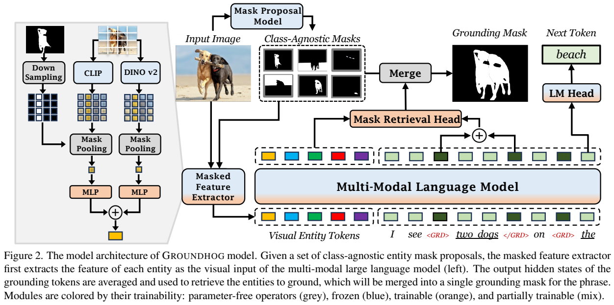

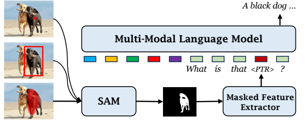

*原文Figure2与Figure3，PDF第3页，图表区域裁切。左侧两路mask pooling后相加；右侧mask retrieval给候选评分。下方用户指针经SAM转为mask，用同一特征提取器替换PTR位置。颜色表示冻结、训练或无参数算子。*

默认Mask2Former+根据图像提出候选。masked feature extractor将候选二值mask缩放到视觉特征网格，对CLIP@336与DINOv2-L/14-reg分别做卷积mask pooling，经各自MLP投影到LLM输入宽度，再**相加**成为visual entity token，不是拼接两路特征后增加一倍序列长度。提取器只需要图像和mask，不使用候选网络的特征，因而可以替换proposal模型或接收用户提供候选。

语言输出在可落地短语两侧生成GRD标记。对应查询与每个实体token的末层表示拼接，由MLP mask retrieval head产生标量分数。模型可以同时选择多个mask，不要求所有分数构成一个只选一项的softmax分类。输出分割是对已有候选的加权合并，因此候选漏掉所需部件时，语言模块通常不能凭空画出新边界。

Mask2Former+从COCO-panoptic、Swin-L backbone checkpoint起步，在原200实体query之外分别增加50部件query和50文字query。不同数据集只对有注释的对应query组做matching loss，避免把未标注的部件错误视作负例。分类标签在proposal训练中不使用，语义识别留给LLM。

| 模块 | 输入与输出 | 公开机制 |
|---|---|---|
| 候选分割 | 图像 → 类别无关mask | Mask2Former+提出实体/部件/文字区域，候选语义识别交给LLM。 |
| 实体特征提取 | mask及图像特征 → 实体token | CLIP与DINOv2分别mask pooling、MLP投影后相加；不依赖proposal内部特征。 |
| 多模态主干 | 实体token、问题及指针 → 回答 | PTR可替换为用户mask对应特征；GRD边界标记可定位短语。 |
| mask检索头 | 短语查询与实体隐藏态 → 分数 | 拼接后MLP输出各候选独立得分，允许多实体同时高分。 |
| 合并 | 得分与候选概率mask → 输出分割 | 逐像素max合并，实现短语到多实体区域的关联。 |

[模块依据：v1 §2.1–2.3，PDF第3–4页](https://arxiv.org/pdf/2402.16846v1)。

<a id="principles"></a>

## 4. 核心创新与数学原理

### 4.1 实体输入和短语查询如何对接

 第2.2节把查询定义为两端GRD末层表示相加：$`z_p=h_{\langle GRD\rangle}+h_{\langle/GRD\rangle}`$。Figure2 caption写“averaged”，而正文与Table10采用Sum，本文按后两处解释，同时注明不一致。查询与实体表示拼接评分，原文给出未编号合并式：

```math
M_{h,w}=\max_q\big(S_q\widehat M_{q,h,w}\big),\qquad S_q\in[0,1].
```

$`\widehat M_q`$是proposal的像素概率，$`S_q`$是短语对它的检索得分。若“两只狗”的两项都高分，它们的非重叠像素同时进入输出；重叠位置取max，不是求和或平均。这样避免重复候选让像素概率越加越大。模型不能把一个包含多人的粗候选自动分成精确单人，因此第2.3节强调候选应具有合适的语义原子性和足够覆盖率。

模型把同一候选同时用于输入表征和输出检索，使“读到哪个实体”与“选中哪个mask”具有可追踪的接口。用户空间提示也先转成mask，再经过同一提取器替换PTR，因此无需另训练一套点、框专用视觉编码。代价是输出精细度依赖提案集合，而不是语言端直接回归任意像素边界。 [§2.1–2.2，第3页](https://arxiv.org/pdf/2402.16846v1)

### 4.2 候选粒度决定合并能力的上限

可解释性也来自这层分解：若目标根本无合适候选，是proposal覆盖问题；若合适候选存在却评分低，是图文对齐/识别问题。它揭示的是计算链路中的候选选择，并不证明LLM所有文字推理都忠实于这条链路。

proposal既不能过粗，也不能碎到失去语义实体。多个独立对象可以经max组合成“这两只狗”，但一个覆盖两个人的粗mask无法被同一个检索分数拆开。第2.3节由此同时要求原子性和跨粒度覆盖；提升语言理解并不能单独修复候选集合缺失的部件或文字区域。 [§2.3，第4页](https://arxiv.org/pdf/2402.16846v1)

### 4.3 框监督与像素监督约束不同

有mask监督时，用Dice与BCE；只有box时，用projection loss。按附录C可整理为下列说明式，原文并未编号：

```math
\mathcal L=\mathcal L_{lm}+\mathbf1_{mask}(\mathcal L_{dice}+0.1\mathcal L_{bce})+\mathbf1_{box-only}\mathcal L_{proj}.
```

projection loss比较预测mask在x/y轴投影与真值框投影的一维Dice。它约束横纵覆盖范围，不能唯一决定框内部形状。掩码边界通过共同的mask数据和proposal网络补充学习，不能把box标注当成像素级人工真值。

Dice的标准解释为$`1-2\sum_i p_i g_i/(\sum_i p_i+\sum_i g_i)`$，实际实现通常另加平滑项；这只是帮助理解重叠优化的定义，原文未给所有数值实现细节。LoRA也可用标准$`W'=W+(\alpha/r)BA`$理解，本文不把它当作作者新提出公式。

投影监督只规定横纵方向的覆盖，许多不同内部形状可以拥有相同投影。因此混合box与mask数据时，必须区分“可学到目标范围”和“有直接边界真值”。原文把实体选择与已有proposal合并，正好允许利用这两类监督；但不能据损失写法宣称框标注已经提供像素级精度。 [§2.2–2.3，第3–4页；原有Appendix C损失解释保留](https://arxiv.org/pdf/2402.16846v1)

<a id="data"></a>

## 5. 数据构建与处理

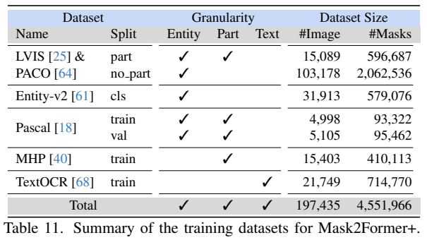

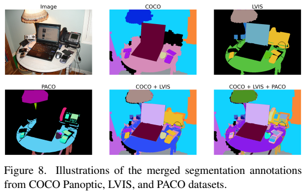

*原文Figure8与Table11，PDF第14页（附录印刷页1）。同一图像分别有COCO、LVIS、PACO注释，合并后覆盖更细部件。表中精确图像数为197,435，正文“over200K”是另一概述口径。*

proposal训练集合并COCO、LVIS、Entity-v2、Pascal、PACO、MHP-v2、TextOCR，精确表计197,435图像、4,551,966mask。同源COCO图像的LVIS/PACO注释合并，目标是互补覆盖，不能按数据集行数简单当独立图片。部件和文字的专门query弥补原COCO泛化不足。

M3G2数据池概述2.5M text-image对，四类任务是GIC图像caption落地、RES指代表达分割、GVQA带证据mask的问答、RD带空间指针的指代对话。PNG132K提供详细叙述与stuff，Flickr30K-Entities149K提供短caption和框；RefCOCO系列、PhraseCut、ReasonSeg等覆盖单对象、多对象、无对象及推理查询。已有同图表达组织为多轮对话，让模型学习上下文引用。

GVQA从VizWiz-Grounding、TextVQA-X、GQA、VQS等取得证据位置，并从LVIS、Entity-v2构造存在性、计数及可能不存在对象的查询。负例训练是POPE幻觉降低的合理来源之一。RD把指定对象转成独特指代表达，加入VG区域描述/匹配游戏、VCR、PointQA、GuessWhat，以及HierText指针文字读取。回答主要由已有注释和模板自动组织，不是所有新对话均人工写作。

附录C为小数据源增加采样权重：ReasonSeg、D-Cube、Shikra-Binary/RD10倍，HierText5倍、PNG2倍；VCR部分、GuessWhat等降采样，平衡后约**1.8M**训练样本。结论另写1.9M，和2.5M原始池/1.8M采样集不完全一致，本文按附录实际采样口径。不能将这三项写为一个一致的精确训练量。

<a id="training"></a>

## 6. 训练流程与目标

proposal模型先独立训练20K iterations、batch16、Detectron2，之后在落地模型训练中冻结。CLIP和DINOv2也冻结；训练两路MLP投影与mask retrieval head，LLM采用LoRA $`r=16,\alpha=16`$。报告称涉及全部线性层、input embedding与LM head，并称全系统可训练参数少于2%；这不是模型总参数或推理激活量减少到2%。

AdamW初始LR2e-4、cosine，平衡M3G2训练2epochs，8张A100 40GB约2天。第4.4节提到低分辨率320px训练、评估提高输入分辨率。它与CLIP pretrained checkpoint名字@336及proposal评估分辨率不是同一概念，不能把所有模型输入分辨率机械归为固定336。公开v1未完整列出batch、warmup、weight decay与最长LLM上下文，不补出惯用默认值。

学习目标同时包含语言生成和检索合并后的mask监督。Dice/projection权重各1，BCE .1，语言损失直接求和。已有mask候选虽然冻结，仍能通过检索分数和连接模块训练语言到实体的选择。一套权重用于所有主要测试任务；Table10消融则在三任务子集上重新训练，不是同一完整checkpoint随意切模块就得到的数值。

<a id="experiments"></a>

## 7. 实验设置与主要结果

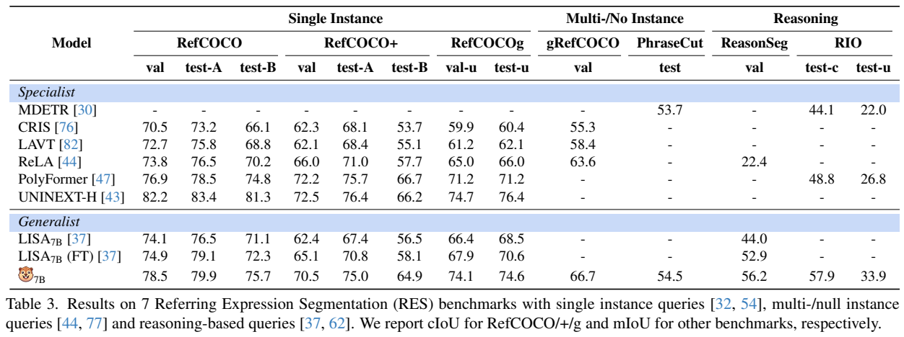

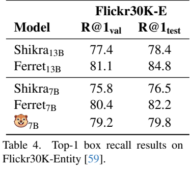

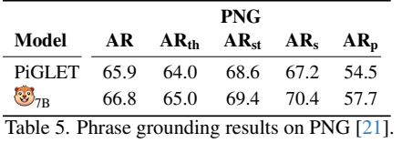

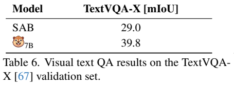

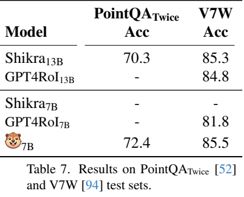

*原文Tables3–7，PDF第6页。RefCOCO系列报告cIoU，另外任务主要用mIoU、box recall或QA accuracy，不应跨列直接比较数值大小。模型行的小动物图标代表GROUNDHOG-7B。*

| 测试及指标 | GROUNDHOG | 对照 |
|---|---:|---|
| RefCOCO val cIoU |78.5|LISA7B FT74.9，但专门UNINEXT-H82.2更高|
| RefCOCO+ val cIoU |70.5|LISA FT65.1，UNINEXT-H72.5|
| gRefCOCO val mIoU |66.7|ReLA63.6|
| ReasonSeg val mIoU |56.2|LISA FT52.9|
| RIO test-c/test-u mIoU |57.9/33.9|PolyFormer48.8/26.8|
| Flickr30K-E test R@1 |79.8|Shikra13B78.4，但Ferret7B82.2/13B84.8更高|
| PNG average recall |66.8|PiGLET65.9|
| TextVQA-X val mIoU |39.8|SAB29.0；这是证据mask分数，不是文字答案准确率|
| PointQA-Twice/V7W accuracy |72.4/85.5|Shikra13B70.3/85.3|

Flickr30K只有框注释时，模型把预测mask转成框，按merged-box/All-IoU协议算recall。这不能证明那些输出mask边界在Flickr上都已获像素真值验证。Table8 grounded caption CIDEr91.3/SPICE20.4/F1all32.1，对照Ferret13B76.1/18.3/15.1；语言与落地有提升，但F1绝对值仍显示不少遗漏/错配。

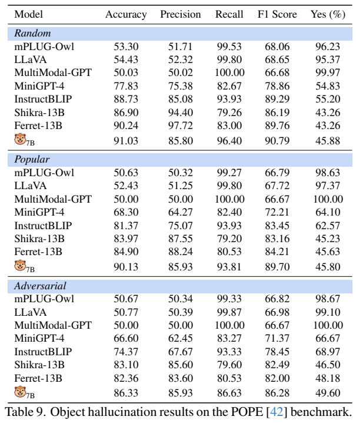

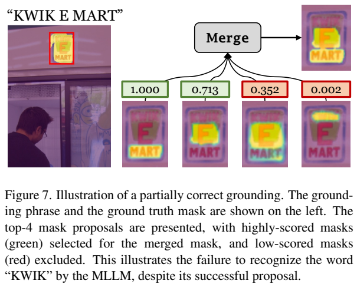

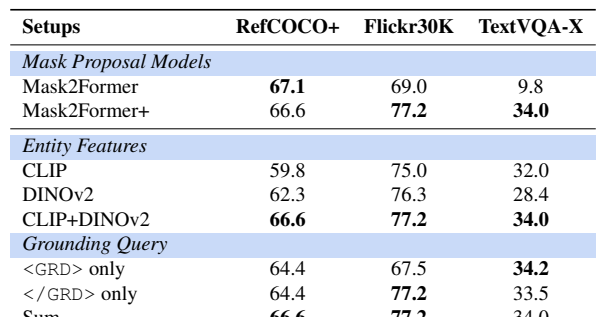

*原文Table9、Figure7、Table10，PDF第8页。右上“KWIK E MART”有候选却未正确选完整文字，说明识别失败可以与proposal漏检区别开；右下表展示分辨率及两路视觉特征的影响。*

POPE三split accuracy/F1为Random91.03/90.79、Popular90.13/89.70、Adversarial86.33/86.28，超过所列表中对照。但Random precision85.80低于Ferret13B97.72，不能说所有列全胜；二元对象存在性评估也不代表自由描述、OCR或常识全部无幻觉。

Table10消融：CLIP+DINOv2的RefCOCO+/Flickr/TextVQA-X为66.6/77.2/34.0，优于CLIP59.8/75.0/32.0和DINO62.3/76.3/28.4。Mask2Former+相比原版在TextVQA-X9.8→34.0，但RefCOCO+67.1→66.6略降。评估分辨率224–480→800–1024时54.7/67.2/27.6→66.6/77.2/34.0。Table1的proposal Any-IoU在TextVQA-X .137→.446，是挑最佳候选的覆盖性评估，不是端到端mask得分。部件/文字候选改进解释了部分收益，但更高分辨率也增加开销。

这项工作的实用优点是可替换视觉专家和定位失败来源。它依赖候选覆盖、视觉特征和既有数据的质量，尚未验证视频/3D，不能直接称为所有模态的可靠落地模型。所有结果来自原文，本文未复现运行。

<!-- article-footer:start -->
---

[← 上一篇：AnyGPT](../../anygpt/arxiv-2402.12226/README.md) · [按发表时间浏览](../../../reports/paper-reading-guide.md#year-2024) · [下一篇：ASMv2 →](../../all-seeing/arxiv-2402.19474/README.md)

[返回本篇目录](#article-toc) · [返回模型系列](../README.md)
<!-- article-footer:end -->
