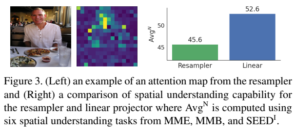
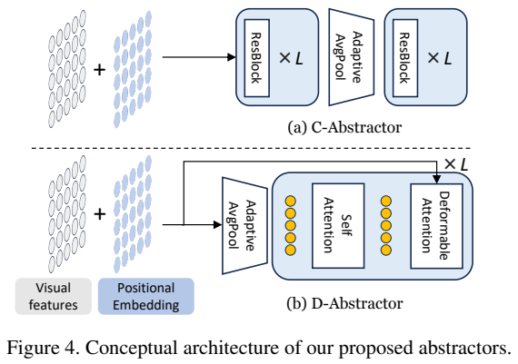
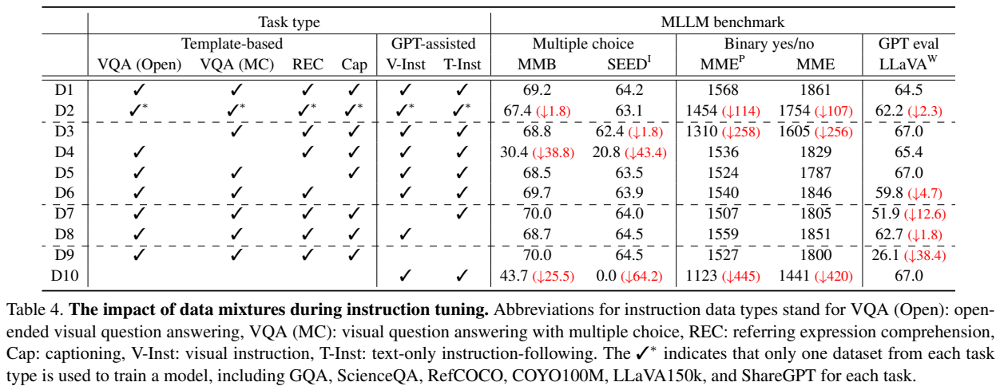
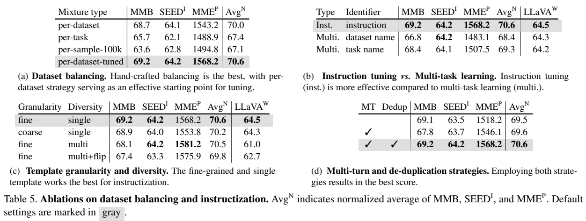
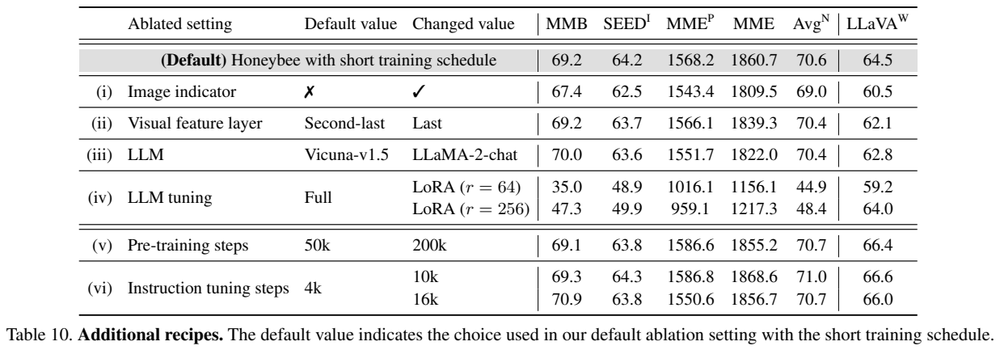
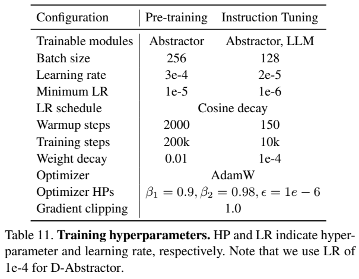
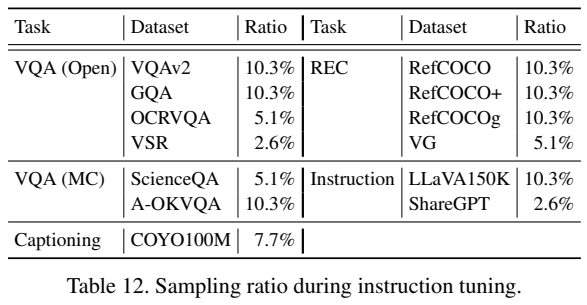
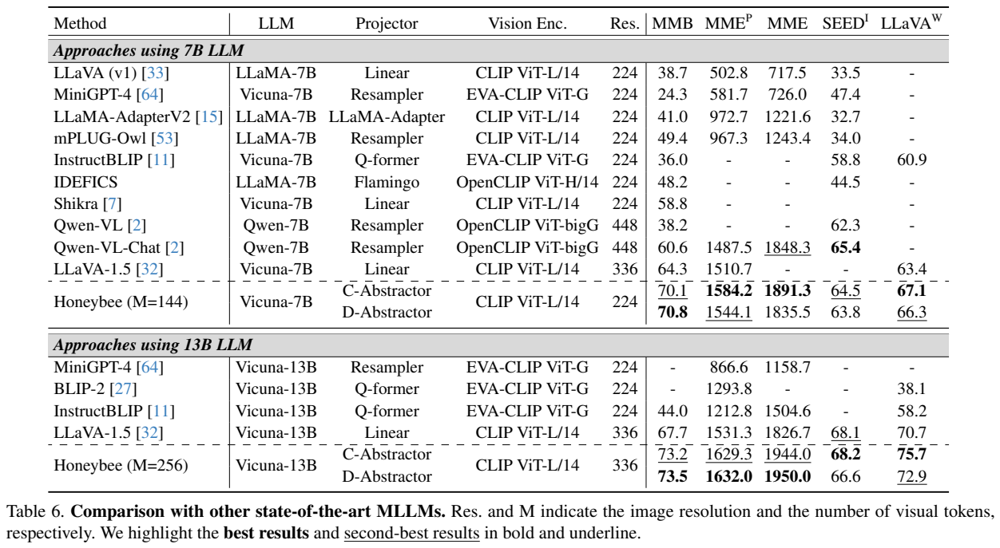
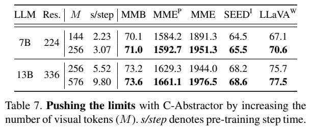

<!-- article-header:start -->
[项目首页](../../../README.md) › [模型系列](../../../reports/model-family-index.md) › [Honeybee](../README.md)
<!-- article-header:end -->

# Honeybee：保留局部视觉信息的灵活投影器与指令数据配方

<!-- article-toc:start -->

**本篇目录** · [论文定位](#paper-info) · [快速概览](#overview) · [整体架构](#architecture) · [核心原理](#principles) · [数据构建](#data) · [训练流程](#training) · [实验结果](#experiments)
<!-- article-toc:end -->

## 1. 论文信息与模型定位

《Honeybee: Locality-enhanced Projector for Multimodal LLM》由 Kakao Brain 的 Junbum Cha、Wooyoung Kang、Jonghwan Mun、Byungseok Roh 提出。本文依据 [arXiv 2312.06742v1](https://arxiv.org/pdf/2312.06742v1)（2023 年 12 月 11 日）；代码与模型入口为 [kakaobrain/honeybee](https://github.com/kakaobrain/honeybee)。

Honeybee 是面向图像理解与文字回答的多模态模型，用 CLIP 视觉编码器连接 Vicuna 语言模型。论文聚焦两个常被合并讨论的问题：如何压缩视觉 token，同时保留空间细节；如何把多种已有视觉数据组织成有效的指令训练。它没有提出图像生成、音频建模或视频训练架构。

## 2. 快速概览

| 设计问题 | Honeybee 的选择 |
| --- | --- |
| 逐 patch 线性投影的 token 数固定 | 用 abstractor 调整输出 token 数 |
| 全局注意力抽象可能偏向少量显著区域 | 提出卷积 C-Abstractor、可变形注意力 D-Abstractor |
| 各训练数据规模相差悬殊 | 人工调整每个数据集采样比例 |
| 不同数据集的回答风格不同 | 每个数据集采用细粒度指令模板 |
| 同图多轮问答容易重复答案 | 多轮合并后去掉重复目标的样本对 |

最终常规配置是 7B、224 分辨率、144 个视觉 token，以及 13B、336 分辨率、256 个视觉 token。另有增加 token 数以提高精度的配置。摘要首页的最高成绩主要来自 13B、576 token 扩展实验，不能直接归给默认 7B 模型。

## 3. 整体架构

Figure 3 左侧示例说明 resampler 的注意力可能主要落在人物等显著对象，遗漏餐具或背景区域；右侧柱状比较空间理解平均分。Figure 4 进一步给出解决方案：上方 C-Abstractor 用卷积—池化—卷积，下方 D-Abstractor 用空间采样和可变形注意力。单个注意力示例用于解释设计动机，不是对所有 resampler 的普遍失败证明。

共同输入来自 CLIP ViT-L/14 的倒数第二层。7B 输入 224×224，可得到 16×16 patch 特征；13B 输入 336×336，对应 24×24。投影器将这些特征转成 Vicuna 可接收的嵌入，与指令文字一同输入语言模型，随后生成回答。报告不使用围住图像 token 的额外 image indicator，并通过消融比较这一选择。

C-Abstractor 在池化前后各放三个 ResNet bottleneck block，包含 squeeze-excitation。自适应平均池化把二维网格变为指定尺寸，因此可选 8×8、12×12、16×16 等输出网格，token 数分别为 64、144、256。它支持的是平方数布局的灵活设置，并不表示任意无结构长度都采用同一空间排列。

D-Abstractor 使用六个块，通过查询的二维参考点与学习到的采样偏移聚合视觉特征。查询初值由视觉网格的自适应池化获得，而非纯随机初始化；参考点初始均匀覆盖整张特征图，避免集中在中心。参考点、偏移和权重随后参与学习，不是永远固定的局部窗口。[PDF 第 4、6、12–13 页](https://arxiv.org/pdf/2312.06742v1#page=12)

## 4. 核心创新与数学原理

线性投影对每个视觉位置独立变换，输出数 $`M=N`$，有利于保留位置对应，但无法压缩序列。标准 resampler 用 M 个查询向 N 个特征做 cross-attention，可以选 $`M<N`$，但每个查询可能聚焦类似显著区域。论文的创新是在抽象过程中加入局部空间结构，让压缩与局部理解共同优化。

对 C-Abstractor，可用下面的示意式解释 Figure 4，而非冒充原文新增的编号公式：

$$X_{out}=\mathrm{ResBlocks}_2\big(\mathrm{AdaptiveAvgPool}_{\sqrt M\times\sqrt M}(\mathrm{ResBlocks}_1(X_{feat}+P))\big).$$

P 为位置嵌入，卷积在池化前提取邻域上下文，池化确定序列长度，池化后的卷积进一步整理局部表示。它并不保证无损恢复全部原始细节，而是把空间归纳偏置加入可训练投影器。

D-Abstractor 的附录式（2）明确写作：

$$z^{l+1}=\sum_{k=1}^{K} A_k^l X_{feat}(p+\Delta o_k^l).$$

p 是参考点，$`\Delta o_k^l`$ 是采样偏移，$`A_k^l`$ 是注意力权重。与对全部位置密集聚合相比，它围绕参考点取若干可学习位置。均匀参考点初始化提供图像覆盖，视觉池化查询提供与内容相关的初值。Table 9 中去掉后者 AvgN 从 69.7 降至 69.2，去掉均匀参考点初始化降至 68.7。[PDF 第 12–13 页](https://arxiv.org/pdf/2312.06742v1#page=13)

语言输出仍采用原文式（1）的条件自回归分解：

$$
p(Y\mid X_{img},X_{text})=\prod_i p(w_i\mid X_{img},X_{text},w_{<i})
$$

对应回答的负对数似然是这一概率模型的训练解释，论文没有另设奖励函数或一个显式强制覆盖全图的注意力损失。

## 5. 数据构建与处理

Table 2 列出来源池：BlipCapFilt 与 COYO100M 合计 200M 图像描述样本；VQAv2、GQA、OCRVQA、VSR 等开放问答 2.2M；ScienceQA 与 A-OKVQA 选择题 0.03M；RefCOCO 系列及 Visual Genome 的指代表达数据 5.7M；LLaVA150K 与 ShareGPT 指令数据约 0.2M。来源池规模不等于训练中所有样本均被完整遍历，也不能由此称第二阶段训练 200M 独立指令。

对已有任务做 instructization 时，开放问答要求单词或短语，选择题要求选项字母，定位输出归一化框坐标 $`[x_{min},y_{min},x_{max},y_{max}]`$。RefCOCO、RefCOCO+、RefCOCOg 的区域描述模板分别强调位置、避免位置而描述外观、给出较详细描述。相似图像和问题的目标分布不同，用单一粗粒度任务标记可能难以区分这些回答要求。VSR 的陈述与真假标签被转成是非问题；描述任务则直接预测 caption。[PDF 第 5、14–15 页](https://arxiv.org/pdf/2312.06742v1#page=14)

同图多个问答可组成多轮对话。附录的去重操作保留重复目标中的一项，减少模型根据上一轮相同答案走捷径的机会；这不是对全语料做严格语义去重的证明。最终模板采用每数据集一个细粒度模板，已有 GPT 辅助指令保留原请求与回答。

Table 4 应先看左侧勾选的数据类型，再比较右侧指标。移除选择式 VQA 后，MMBench 从 69.2 降到 30.4，SEED 图像子集从 64.2 降到 20.8，说明回答形式训练对这类评测很重要。移除 caption 数据对 LLaVA-Bench 的影响更突出；移除视觉与纯文本指令后，其分数从 64.5 降到 26.1。不同指标反映的数据能力不同。

Table 5 显示手调 per-dataset 采样 AvgN 70.6，按数据集等概率为 70.0，按任务等概率为 67.4。增加模板数量没有稳定收益：fine-single 为 70.6，fine-multi 为 70.5，multi+flip 为 69.8；fine-multi 的 MME 却更高。因此结论是当前混合语料下单模板综合表现较好，不能概括为多模板总是无效。

## 6. 训练流程与目标

第一阶段冻结 CLIP 和 Vicuna，只更新新投影器，在 BlipCapFilt 与 COYO100M 之间按 1:1 采样进行图文对齐。第二阶段更新投影器与整个语言模型，视觉编码器不在 Table 11 的可训练模块中。论文使用全参数语言模型微调；LoRA 是消融设置而非最终训练配置。

| 长训练配置 | 对齐预训练 | 指令微调 |
| --- | ---: | ---: |
| batch | 256 | 128 |
| 步数 | 200K | 10K |
| 初始学习率 | 3e−4 | 2e−5 |
| 最小学习率 | 1e−5 | 1e−6 |
| warm-up 步数 | 2000 | 150 |
| 权重衰减 | 0.01 | 1e−4 |

共同使用余弦调度、AdamW，β1=0.9、β2=0.98、ε=1e−6，梯度裁剪 1.0。表注另给 D-Abstractor 学习率 1e−4，未逐阶段解释其全部覆盖范围，这里不自行补出 D 版本的完整替代配置。短实验使用 50K 预训练、4K 指令训练，主要用于消融。

附录报告单节点 8 张 A100 80GB、DeepSpeed ZeRO-2、FlashAttention v2，但长预训练使用多节点，未给出确切总节点数及 GPU 小时。序列长度、训练精度没有据表臆测。

指令采样中 VQAv2、GQA、RefCOCO 各系列、A-OKVQA 和 LLaVA150K 各约 10.3%；OCRVQA、VG、ScienceQA 各 5.1%；VSR、ShareGPT 各 2.6%；COYO100M 为 7.7%。比例按公开表保留，四舍五入后总和可能不精确等于 100%。BlipCapFilt 未加入第二阶段主要由于资源限制，而非已证明它有负作用。小数据源比例被限制，以短设置下不超过约三轮为原则。[PDF 第 13–14 页](https://arxiv.org/pdf/2312.06742v1#page=13)

## 7. 实验设置与主要结果

主要使用 MMBench-dev、MME、SEED-Bench Image-only 和 LLaVA-Bench In-the-Wild。最后一项由 GPT-4 评估开放回答，与客观选项准确率并非同一种指标。AvgN 先按各基准上限归一化，再平均。效率的 s/step 是预训练单步时间，不能当作解码 token/s 或用户请求延迟。

| 配置 | MMBench | MME 感知 | MME 总计 | SEED 图像 | LLaVA-Bench |
| --- | ---: | ---: | ---: | ---: | ---: |
| 7B C，144 token | 70.1 | 1584.2 | 1891.3 | 64.5 | 67.1 |
| 7B D，144 token | 70.8 | 1544.1 | 1835.5 | 63.8 | 66.3 |
| 13B C，256 token | 73.2 | 1629.3 | 1944.0 | 68.2 | 75.7 |
| 13B D，256 token | 73.5 | 1632.0 | 1950.0 | 66.6 | 72.9 |
| 13B C，576 token | 73.6 | 1661.1 | 1976.5 | 68.6 | 77.5 |

Table 6 中 7B C 的 SEED 64.5 仍低于 Qwen-VL-Chat 的 65.4。7B C 增至 256 token 后为 65.5，但预训练单步从 2.23 秒增加到 3.07 秒。13B C 增至 576 token 时，单步从 5.52 秒增至 9.80 秒。更细视觉表示提高成绩，压缩配置则改善效率，不能同时引用两种配置的最好数字来描述单一模型。

短设置空间理解消融中，144-token C 与 D 的归一化平均为 53.5、52.9，144-token resampler 为 43.9，256-token 线性投影为 52.6。它支持局部设计的有效性，但线性比较的 token 数更大，需要保留这一实验差别。

ScienceQA 测试整体准确率在 13B C、256/576 token 下为 93.19/94.39。所谓 generalist 指没有额外只针对 ScienceQA 再训练，**ScienceQA 本身已在混合指令训练数据中**，不能称对该任务零样本。Table 6 和附录 Table 14 还存在少量 D 版本细分总分差异，本文主比较固定采用 Table 6 数值。以上为论文报告与本文原图核验结果，没有重新运行模型。

<!-- article-footer:start -->
---

[← 上一篇：OneLLM](../../onellm/arxiv-2312.03700/README.md) · [按发表时间浏览](../../../reports/paper-reading-guide.md#year-2023) · [下一篇：Vary →](../../vary/arxiv-2312.06109/README.md)

[返回本篇目录](#article-toc) · [返回模型系列](../README.md)
<!-- article-footer:end -->
