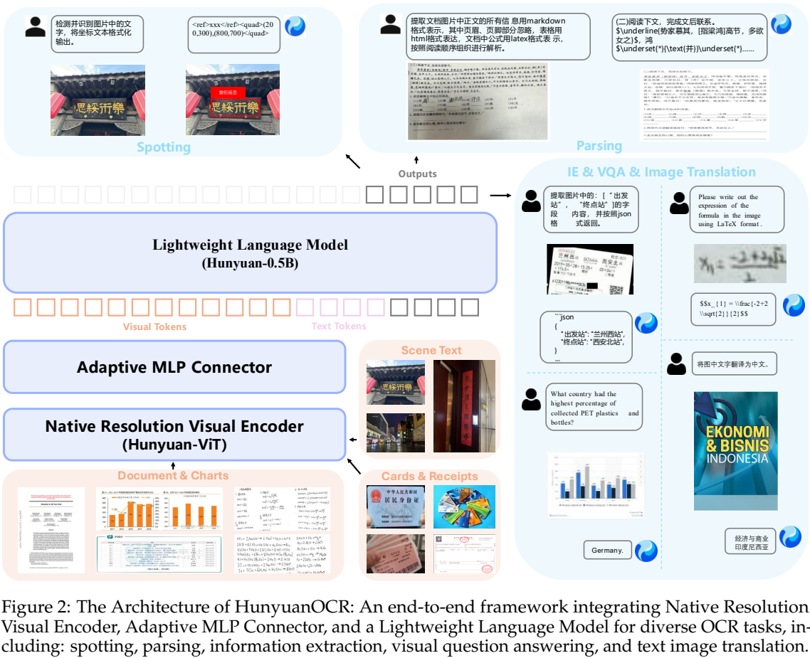
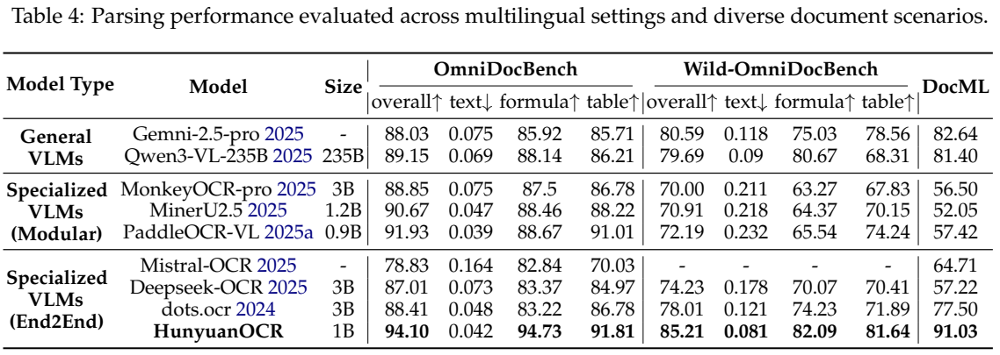

<!-- article-header:start -->
[项目首页](../../../README.md) › [模型系列](../../../reports/model-family-index.md) › [Hunyuan](../README.md)
<!-- article-header:end -->

# HunyuanOCR：以约1B参数统一文字定位、文档解析与文本理解

<!-- article-toc:start -->
<a id="article-toc"></a>

**本篇目录** · [论文定位](#paper-info) · [快速概览](#overview) · [整体架构](#architecture) · [核心原理](#principles) · [数据构建](#data) · [训练流程](#training) · [实验结果](#experiments)
<!-- article-toc:end -->

<a id="paper-info"></a>

## 1. 论文信息与模型定位

| 项目 | 信息 |
|---|---|
| 原文 | **HunyuanOCR Technical Report** |
| 团队 | Tencent Hunyuan Vision Team |
| 发表日期 | arXiv v1 提交于 **2025-11-24**；PDF 首页另印 2025-11-26 |
| 固定版本 | [2511.19575v1](https://arxiv.org/pdf/2511.19575v1) |
| 代码与权重 | [官方仓库](https://github.com/Tencent-Hunyuan/HunyuanOCR) · [官方模型卡](https://huggingface.co/tencent/HunyuanOCR) |
| 定位 | 约1B参数的端到端OCR专用视觉语言模型；图像输入、结构化文字输出 |

本文介绍原始HunyuanOCR版本。当前官方仓库已出现1.5升级，本文的架构、训练量与实验均依据固定v1报告，不混入后续DFlash和Agentic Data Flow配方。模型把定位识别、文档解析、字段抽取、文字问答和图文翻译统一为指令条件下的文字生成，目标是降低传统多模块OCR管线的部署与误差传递成本。[§1 / §3，PDF 第2–6页](https://arxiv.org/pdf/2511.19575v1#page=3)

<a id="overview"></a>

## 2. 快速概览

| 设计 | 做法 | 对使用者的含义 |
|---|---|---|
| 小型端到端模型 | 0.4B视觉编码器、可学习池化MLP、0.5B语言模型 | 同一网络处理多种文字视觉任务 |
| 原生分辨率视觉输入 | 保比例patch化与全局ViT注意力 | 更适合长文本、复杂布局，但高分辨率仍有计算成本 |
| 统一任务出口 | 坐标标签、Markdown、HTML、LaTeX、JSON | 根据提示选择输出形式；格式也进入训练与奖励 |
| 应用导向训练 | 四步预训练/SFT，再进行任务专属GRPO | 感知与格式可靠性共同优化，不能只看参数规模 |

报告给出OmniDocBench **94.10**、Wild-OmniDocBench **85.21**、OCRBench **860**。翻译能力受小型语言底座限制，在DocML上仍低于部分大模型；“统一覆盖”与“所有任务最佳”需要分开。[Tables4–6，PDF 第12–13页](https://arxiv.org/pdf/2511.19575v1#page=12)

<a id="architecture"></a>

## 3. 整体架构



*Figure2，PDF第5页。上方是输出任务，左下三层是实际视觉—语言路径；保留图中任务格式与图注。*

图像按原始比例进入Hunyuan-ViT。视觉网格经过Adaptive MLP Connector的可学习池化压缩，再对接Hunyuan-0.5B语言模型。文字提示与视觉token共同决定输出：同一文档可以被要求按阅读顺序解析，也可以被要求只返回特定字段。这里没有先强制运行独立版面检测器、再为每个元素分别选择识别模型的级联路径。[§3，PDF 第5–6页](https://arxiv.org/pdf/2511.19575v1#page=5)

| 模块 | 输入与输出 | 公开机制 |
|---|---|---|
| Hunyuan-ViT | 保比例图像patch → 高分辨率视觉特征 | 从SigLIP-v2-400M初始化，原生分辨率处理，ViT全局注意力 |
| Adaptive MLP Connector | 视觉网格 → 较短语言条件序列 | 可学习池化与空间自适应压缩，再映射至语言输入空间 |
| XD-RoPE位置接口 | 文字 / 高 / 宽 / 时间位置 → 位置旋转信息 | RoPE被划分为四个独立子空间，表达不同模态坐标 |
| Hunyuan-0.5B | 视觉token及任务文字 → 结构化回答 | 稠密语言模型，自回归输出文本和任务标签 |
| 指令与输出协议 | 任务要求 → spotting / parsing / IE / VQA / translation | 用标准提示选择不同生成目标，无需切换独立任务模型 |

一次票据字段抽取的路径是“票据图像→ViT网格→压缩连接器→视觉条件与字段名→JSON文字”。坐标、HTML表格等也是生成序列，不能把它们描述成独立连续回归头或表格解码器。固定报告没有公开连接器的完整池化核、压缩率和语言层配置，本文不从名称推断成Q-Former或固定倍率合并。

<a id="principles"></a>

## 4. 核心创新与数学原理

### 4.1 原生分辨率与压缩接口各自承担不同任务

保比例patch化减少强制拉伸造成的字形与版面变形，全局注意力让跨栏、跨区域信息在视觉编码阶段联系起来。随后连接器压缩空间位置，以降低较小LLM接收长视觉序列的成本。两者是先保留视觉证据、再学习如何压缩的分工，不能由“原生分辨率”推导语言模型保留每个原始像素。

报告将连接器描述为可学习池化及内容自适应压缩，未给出详细计算式或压缩消融。它有利于文字密集区域的信息保留是作者的设计解释，并非证明该压缩总能无损。[§3，PDF 第5–6页](https://arxiv.org/pdf/2511.19575v1#page=5)

### 4.2 XD-RoPE与结构化空间输出

XD-RoPE把位置表示分为文字、高度、宽度、时间四个子空间，使一维语言顺序与二维页面位置可以共同编码。它改变模型读取位置条件的方式，输出坐标仍通过文字标签表达，二者不能混淆。[§3，PDF 第6页](https://arxiv.org/pdf/2511.19575v1#page=6)

Spotting格式为 `<ref>文字</ref><quad>(x1,y1),(x2,y2)</quad>`，两点对应框的左上和右下顶点，坐标归一化到0–1000。因此`quad`标签在本文协议里不表示必须输出四个角。归一化的说明式为 $`x'=1000x/W`$、$`y'=1000y/H`$；$`W,H`$是图像宽高，原文没有列出该换算式的具体舍入规则。位置精度仍受图像分辨率、压缩和生成误差限制。[§4.1.1，PDF 第6页](https://arxiv.org/pdf/2511.19575v1#page=6)

### 4.3 任务适配奖励：同时约束内容与格式

Spotting先以IoU匹配预测框和真值框，再用文字的归一化编辑距离评价匹配对，未匹配项目计零。其识别部分可记为 $`r=1-\mathrm{NED}(s,\hat s)`$，NED表示归一化编辑距离；这是对原文文字规则的简记，报告没有完整展开归一化与匹配边界的所有实现。

文档解析直接按参考内容计算编辑距离型奖励；VQA由评分模型按语义正确性给0/1；翻译先由LLM给0–5分，再校准到0–1，并增加中段差异的分辨能力。不同任务不共用一把简单的“答案完全相等”尺子。结构化任务格式不合规、或输出超过最大长度，均直接给零奖励，因而奖励还塑造了可解析的输出行为。[§5.2.2–5.2.3，PDF 第10–11页](https://arxiv.org/pdf/2511.19575v1#page=10)

### 4.4 GRPO把任务评分转成策略更新

原文Eq.(1)对同一问题采样一组回答，采用组内优势、裁剪概率比和KL约束。以下为保持其含义的紧凑写法：

```math
J(\theta)=\mathbb{E}\left[\frac{1}{G}\sum_{i=1}^{G}\min\left(\rho_i A_i,\mathrm{clip}(\rho_i,1-\epsilon,1+\epsilon)A_i\right)-\beta D_{\mathrm{KL}}(\pi_\theta\Vert\pi_{\mathrm{ref}})\right],\quad \rho_i=\frac{\pi_\theta(o_i\mid q)}{\pi_{\theta_{\mathrm{old}}}(o_i\mid q)}.
```

$`q`$为图像与任务问题，$`o_i`$是组内回答，$`A_i`$来自任务奖励；$`\epsilon`$限制更新幅度，$`\beta`$控制相对参考策略的漂移。目标按最大化理解，不能把它误写成不改变符号的最小化损失。报告只说明优势由组内奖励计算，没有逐项给定所有训练超参，本文也不额外指定标准差处理、采样组大小或KL系数。[Eq.(1)，PDF 第11页](https://arxiv.org/pdf/2511.19575v1#page=11)

<a id="data"></a>

## 5. 数据构建与处理

训练语料超过2亿图文对，覆盖街景、文档、广告、手写、截图、证件票据、游戏、视频帧和艺术字体九类场景，包含130多种语言。这是训练覆盖范围；图文翻译任务明确支持的源语言是14种以上，不能将130种语言全部视作同等验证的翻译方向。[§4.1.4 / §4.2，PDF 第7–9页](https://arxiv.org/pdf/2511.19575v1#page=7)

| 管线 | 处理方式 | 作用 |
|---|---|---|
| 合成长文档 | 扩展SynthDog，控制字体、颜色、方向和段落，兼容LTR/RTL | 增加低资源语言与复杂排版覆盖 |
| 真实拍摄扰动 | 控制点变形、模糊、噪声、压缩、阴影和反光 | 模拟折页、弯曲和拍摄退化 |
| 跨任务复用 | 同图管理spotting、parsing及QA标注 | 将已有文字和结构信息转成字段、问答与翻译任务 |
| 一致性校验 | 多模型交叉验证，部分失败难例交人工处理 | 提高合成标签质量，同时保留困难样本 |
| RL数据筛选 | 按质量、多样性、采样通过率过滤 | 去掉过易/不可解、奖励无变化及容易取巧的问题 |

图像教师与自动验证仍可能产生错误；原文未公开所有来源比例、清洗阈值和教师版本。标准化格式便于奖励计算，不代表每个生成标签都经过人工核验。

<a id="training"></a>

## 6. 训练流程与目标

| 预训练步骤 | 更新部分 | token量 | 上下文 | 学习率区间 |
|---|---|---:|---:|---|
| 1：视觉语言对齐 | ViT与Adapter；LLM冻结 | 50B | 8K | 3e-4→3e-5 |
| 2：联合多模态学习 | 全部 | 300B | 8K | 2e-4→5e-5 |
| 3：长上下文 | 全部 | 80B | 32K | 8e-5→5e-6 |
| 4：应用导向SFT | 全部 | 24B | 32K | 2e-5→1e-6 |

以上来自Table2。前两步保留不超过10%的纯文本，第三步加入长文档和信息抽取，第四步用人工标注、困难样本和标准指令稳定输出。原文把这些四步统称为预训练阶段，随后进入在线GRPO后训练；不能把第四步的SFT误当作最后一个全部训练步骤。[§5，PDF 第9–11页](https://arxiv.org/pdf/2511.19575v1#page=9)

报告给出训练token量、上下文与学习率，但未列完整设备、batch、耗时及RL超参。2亿图文对与各阶段token量属于不同统计量，不能相互直接换算为epoch数。

<a id="experiments"></a>

## 7. 实验设置与主要结果



*Table4，PDF第12页。overall、formula、table越高越好，text为编辑距离型指标，越低越好；不要混淆箭头方向。*

| 任务与评测 | 报告结果 | 评测条件 |
|---|---:|---|
| Spotting内部九场景 | 70.92 | 每类100张，共900张 |
| OmniDocBench overall | 94.10 | 使用公开基准协议 |
| Wild-OmniDocBench overall | 85.21 | 打印后折弯、改变光照并重拍 |
| DocML解析 | 91.03 | 内部多语言数据，编辑距离型计分 |
| Cards / Receipts字段抽取 | 92.29 / 92.53 | 30类别、768样本，统一JSON提示与精确匹配 |
| 视频字幕提取 | 92.87 | 1000个截图样本；不是完整流式视频测试 |
| OCRBench | 860 | 公开1000样本基准 |
| DoTA英→中翻译 | 83.48 | COMET；不是识别准确率 |

数值取自Tables3–6，未在本仓库复现。HunyuanOCR在Table4的overall最佳，但OmniDocBench text编辑距离0.042略高于PaddleOCR-VL的0.039，说明总分领先不代表各分项领先。OCRBench 860低于表中Qwen3-VL-235B的920；DoTA 83.48也低于Gemini-2.5-Flash的85.60。作者建议高质量翻译可接外部翻译模型，这属于可选系统组合，不是原始端到端模型的必经步骤。[§6，PDF 第11–13页](https://arxiv.org/pdf/2511.19575v1#page=11)

Wild-OmniDocBench与DocML在固定报告中仍写未来公开，内部场景覆盖及评分细节应与公开基准分开看待。训练覆盖、任务接口和实际评测证据共同界定模型能力。

<!-- article-footer:start -->
---

[← 上一篇：Gemini 3 Pro](../../gemini/document-fd75097b0235/README.md) · [按发表时间浏览](../../../reports/paper-reading-guide.md#year-2025) · [下一篇：Qwen3-VL →](../../qwen/arxiv-2511.21631/README.md)

[返回本篇目录](#article-toc) · [返回模型系列](../README.md)
<!-- article-footer:end -->
