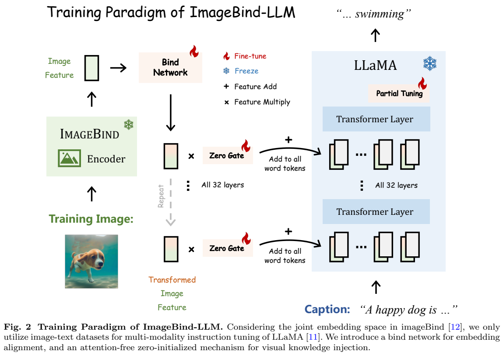
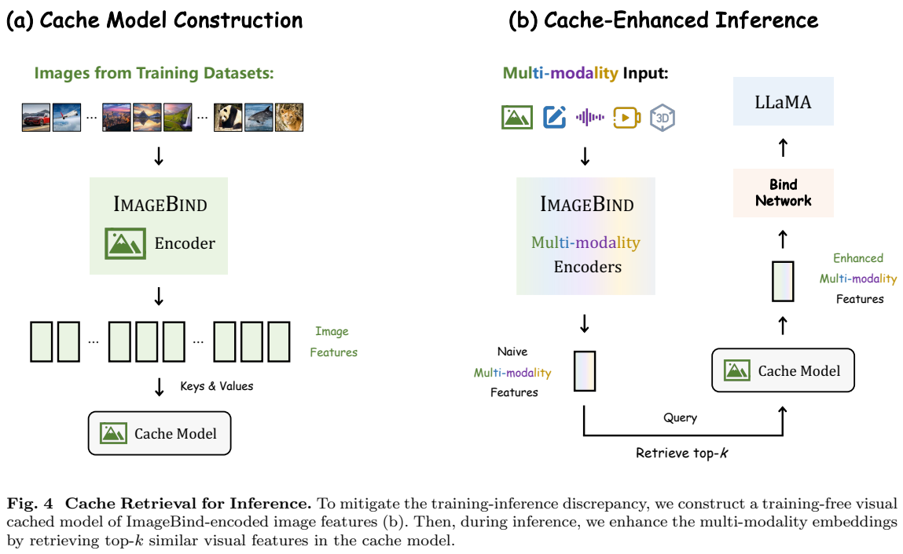
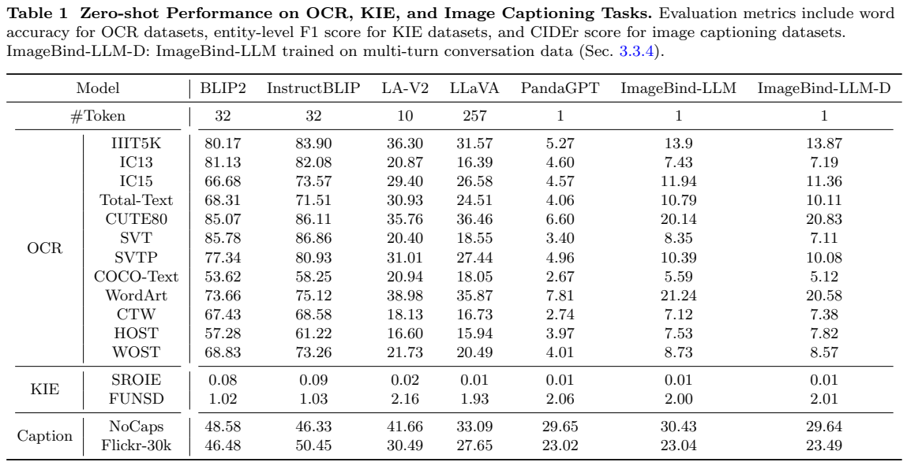
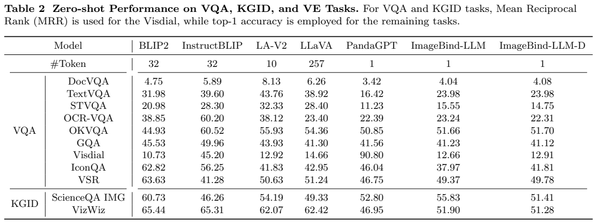
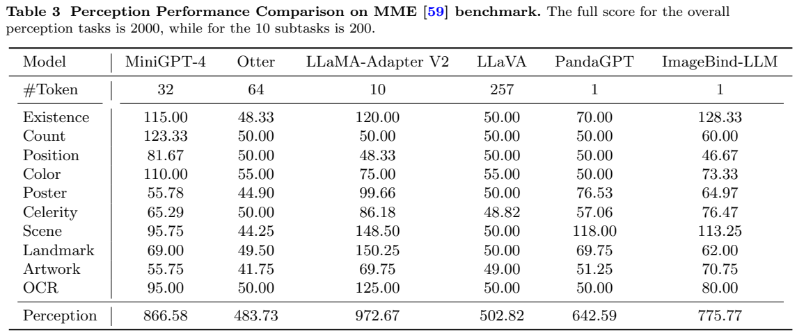
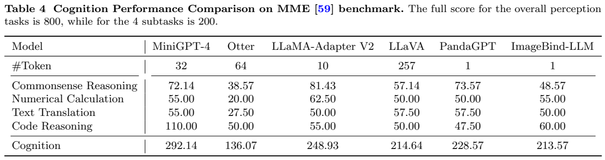

# ImageBind-LLM：借用共享嵌入空间的多模态指令模型

## 1. 论文信息与模型定位

**论文**：[ImageBind-LLM: Multi-modality Instruction Tuning](https://arxiv.org/abs/2309.03905)，本文依据 2023 年 9 月 7 日提交的 [v1 技术报告](https://arxiv.org/pdf/2309.03905v1)。作者包括 Jiaming Han、Renrui Zhang、Wenqi Shao、Peng Gao 等，来自上海人工智能实验室、香港中文大学 MMLab、vivo AI Lab 等机构。

模型将 ImageBind 的共享模态空间接入 LLaMA，面向图像、音频、视频和三维点云输入生成语言回答。它的定位是**利用已有编码器的跨模态对齐，把图文训练得到的指令能力迁移到其他输入模态**。点云使用 PointBind 的预训练三维编码器；外接生成模型、目标检测器与工具调用是扩展系统，不能理解为一个 LLaMA 自身直接生成所有模态。

## 2. 快速概览

| 项目 | 原文方案与边界 |
|---|---|
| 语言基座 | 原始 LLaMA，区别于已完成指令微调的 Vicuna；架构图展示 32 层 |
| 模态入口 | ImageBind 全局嵌入；点云由 PointBind 接入同一空间 |
| 连接器 | 线性投影加三个残差 FFN 模块组成 bind network |
| 注入 | 零初始化门控，将一个模态 token 加到各层所有语言 token |
| 训练 | 大规模图文对齐、参数高效指令微调，再用 3.5K 高质量描述继续微调 |
| 推理增强 | 检索图像特征缓存，减少图像训练与非图像推理的分布差异 |
| 主要限制 | 单个全局 token 难保留文字和空间细节；幻觉与模态混合比例敏感 |

这里的“无需其他模态训练”针对**接入 LLM 的这套训练流程**。ImageBind、PointBind 已进行过多模态预训练，并不意味着整个系统从未见过音频或点云。论文的主要定量评估也是视觉语言任务；音频、视频、点云能力主要由案例展示，证据强度不同。

## 3. 整体架构

**读图：Figure 2，PDF 第 5 页。** 左侧图像经过冻结的 ImageBind 图像编码器，输出一个全局向量；bind network 把它映射到 LLaMA 词嵌入维度。中间零门控控制注入强度，右侧展示向所有 32 层的语言 token 加入同一个条件向量。图中的“partial tuning”对应后续参数高效微调，不代表从头训练整个语言模型。

它没有把大量图像 patch 作为独立 token 放进语言上下文。连接端只保留一个全局向量，优点是注入直接、额外序列长度小，代价是文字、数量、位置等局部信息容易被压缩。论文所谓 attention-free 指**新增的模态注入操作不额外计算跨模态注意力**，LLaMA 的 Transformer 自注意力仍然存在。

推理时将输入换成对应模态的 ImageBind 编码器；点云则经过 PointBind。由同一 bind network 和语言模型完成回答。扩展的 any-to-any 系统把编码器特征接入 Stable Diffusion、Make-An-Audio、CLIP-Forge 等外部生成器；目标定位采用回答中的名词加 Grounding DINO。工具版还额外训练 GPT4Tools 数据，不应把这些能力归于基础模型无条件获得。

## 4. 核心创新与数学原理

设图像全局特征为 $F_I\in\mathbb R^{1\times C_I}$，先通过 $w_0\in\mathbb R^{C_I\times C}$ 得到 $F_I^0=F_Iw_0$。原式（1）省略归一化步骤，三个 FFN 模块采用：

$$
F_I^{i+1}=F_I^i+\big(F_I^iw_2\odot\operatorname{SiLU}(F_I^iw_1)\big)w_3,\qquad 0\le i<3.
$$

其中 $w_1,w_2\in\mathbb R^{C\times C_h}$，$w_3\in\mathbb R^{C_h\times C}$；实际模块还含 RMSNorm。门控乘法决定哪些投影维度通过，残差保留原特征。得到 $T_I$ 后，原式（2）对语言 token 采用 $T^j=T_W^j+g_{zero}T_I$。初始 $g_{zero}=0$，新增条件在训练开头不改变原语言表示，随后逐渐学会引入视觉信息。这个设计解释了稳定接入的动机，不能据此推断模型消除了幻觉。

**读图：Figure 4，PDF 第 7 页。** 左半将训练图像特征同时存为 keys 和 values；右半非图像输入先检索近邻，再把增强特征送入连接器。检索发生在语言模型之前，是特征校准，而不是从文档库检索一段文本答案。

令查询 $F_M$ 和缓存键经过 L2 归一化，取 top-$k$ 邻居后，原式（3）（4）为：

$$
S_{topk}=F_MF_{key}^{\mathsf T},\qquad
F_M^e=\alpha S_{topk}F_{value}+(1-\alpha)F_M.
$$

$S_{topk}$ 是余弦相似度，$F_{value}\in\mathbb R^{k\times C_I}$。论文公式直接加权求和，**未写 softmax 或权重归一化**，不能改写成标准注意力。$\alpha$ 平衡检索图像语义与原模态特征。作者还将多模态嵌入线性混合，但相同特征空间并不保证每种语义都能稳定共存：Figure 13 中图像/音频权重 0.5/0.5 漏掉犬吠，0.2/0.8 又漏掉天空，0.4/0.6 才同时涉及两者。

## 5. 数据构建与处理

图文预训练汇集 COCO、CC3M、CC12M、SBU、LAION-2B、COYO、MMC4 等开源来源，原文声明合计 **940M 图文对**。其中按 CLIP 对齐分数从 LAION-2B 选取 100M，从 MMC4-Core 提取 20M 高质量图文对。虽然 MMC4 原本包含交错图文，这里描述的是提取出的图文对，不能据此宣称训练完整保留了交错文档上下文。

作者承认数据噪声较多，把更完善的清洗和去重留作未来工作；报告没有公开完整去重阈值、过滤实现或各来源最终配比。语言指令来自 Alpaca、GPT4LLM、ShareGPT：Alpaca 为 52K 单轮样本；视觉指令采用 LLaVA 的 150K 样本，以及 MiniGPT-4 人工整理的 3.5K 高质量描述。基础版将多轮数据转换为单轮，表中的 **ImageBind-LLM-D** 则是另外用多轮对话训练的版本。

缓存实现采用 FAISS/Autofaiss，实施细节说默认使用 CC3M 全部图像。报告早期段落的“一百万缓存图像”与摘要的“三百万”存在口径差异，不能把它们统一当成一个已精确核定的规模。中文扩展替换为 ChineseLLaMA 并加入 52K 中文 GPT4LLM 指令，原文没有中文视觉指令训练集；它与英语基础版应分开理解。

## 6. 训练流程与目标

第一步以图像为条件预测 caption，训练 bind network 等新增接入参数，保持预训练编码器和语言基座的主体参数冻结。原文报告 **32 张 A100、3 个 epoch、总 batch 1024、学习率 $4\times10^{-4}$**。它把图像语义对齐到语言空间，并不直接监督音频、视频、点云的语言答案。

第二步混合语言与视觉指令，冻结模态编码器和 bind network，使用 LoRA、bias-norm tuning 微调 LLaMA：每个线性层加入默认 **rank 16** 的低秩模块，解冻全部归一化层，并在线性层加入可学习 bias；其他模块参数冻结。只有语言的样本用全零假图像占位。训练配置为 **8 张 A100、4 个 epoch、1 个 warmup epoch、总 batch 32、学习率 $1.25\times10^{-4}$**。

第二步之后还增加 3.5K MiniGPT-4 描述数据的高质量指令微调，用于缓解回答虚构物体的问题；作者说该步骤只需数分钟，未给足以复现实验的独立完整超参数。训练任务围绕自回归语言输出，但原文没有单列损失公式、完整优化器配置和所有 token 的损失屏蔽规则，因此不补造这些细节。缓存构建是推理前离线索引步骤，不需要重新优化模型参数。

## 7. 实验设置与主要结果

**读图：Table 1、Table 2，PDF 第 10 页。** 最后两列分别为基础版和多轮版 -D；两者均只使用一个模态 token。OCR 为单词准确率，KIE 为实体级 F1，caption 为 CIDEr；Table 2 的 VisDial 用 MRR，其他项目按本文口径用 top-1 accuracy，**这里 DocVQA 的数值不是通常榜单中的 ANLS**。所有任务通过 VQA 风格提示评估，比较的是本报告使用的早期实现与配置。

| 项目 | ImageBind-LLM | -D | 原表对照与含义 |
|---|---:|---:|---|
| IIIT5K，OCR | 13.90 | 13.87 | PandaGPT 5.27，但 InstructBLIP 83.90，视觉文字能力仍弱 |
| NoCaps，CIDEr | 30.43 | 29.64 | PandaGPT 29.65；BLIP2 48.58 |
| DocVQA，本文 top-1 | 4.04 | 4.08 | PandaGPT 3.42；LLaMA-Adapter V2 8.13 |
| TextVQA，top-1 | 23.98 | 23.98 | PandaGPT 16.42；LLaMA-Adapter V2 43.76 |
| OKVQA，top-1 | 51.66 | 51.70 | PandaGPT 50.85；InstructBLIP 60.52 |
| ScienceQA 图像子集 | 55.83 | 51.41 | PandaGPT 52.80；BLIP2 60.73 |

多轮版没有一致提高所有任务，ScienceQA 图像子集反而下降。其结果支持部分跨模态接入与问答能力，但不支持“在全部视觉任务超过其他模型”。

**读图：Table 3、Table 4，PDF 第 11 页。** 感知 10 个子任务满分合计 2000，认知 4 个子任务合计 800，二者都不是百分比准确率。ImageBind-LLM 感知 **775.77**，比 PandaGPT **642.59** 高 **133.18**，但低于 LLaMA-Adapter V2 **972.67** 和 MiniGPT-4 **866.58**。认知 **213.57** 则低于 PandaGPT **228.57**、MiniGPT-4 **292.14**，不能把感知提升推广为全面认知提升。Table 4 图注误写 perception，本表内容与末行明确为 cognition。

报告没有给出 bind network、零门控、缓存开关、top-$k$ 或混合系数的完整数值消融表，也没有音频/视频/点云大规模标准化定量评测。案例展示扩展可行性，失败页同时显示虚构物体、数量错误和比例敏感。由这些证据更稳妥的判断是：共享嵌入能降低新增输入模态的接入成本，但一个全局向量与图文训练仍不足以保证细粒度感知、可靠推理或稳定多模态融合。
