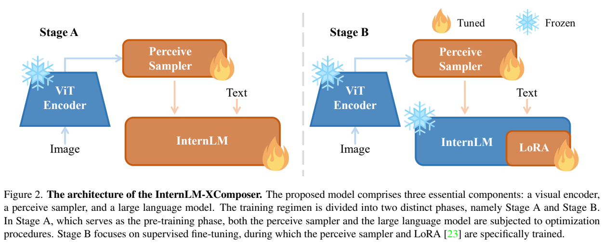
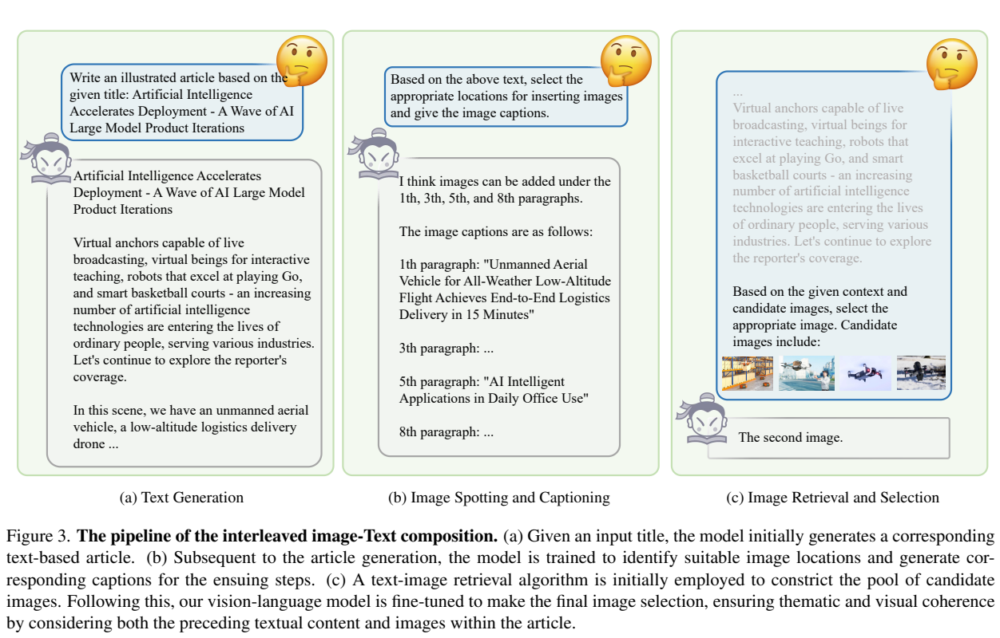
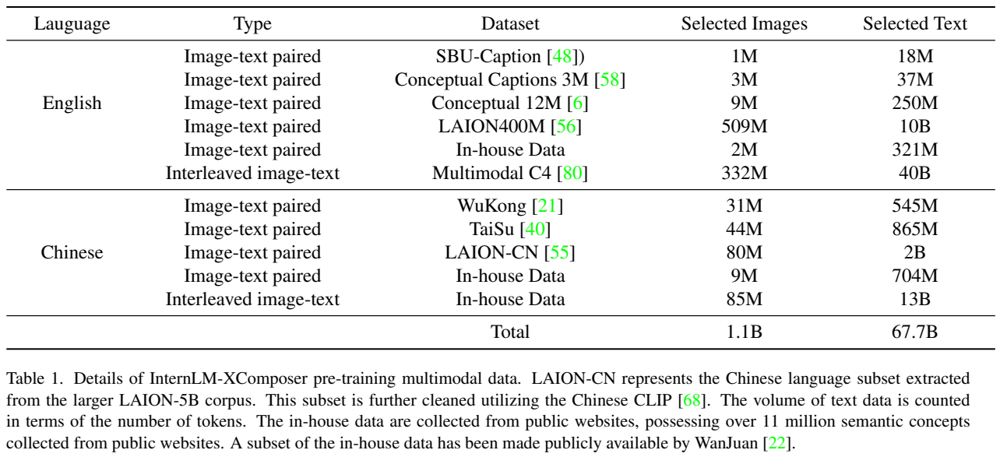
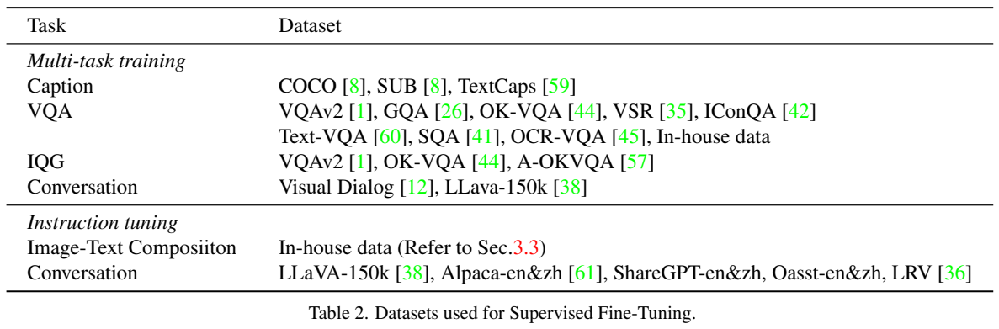
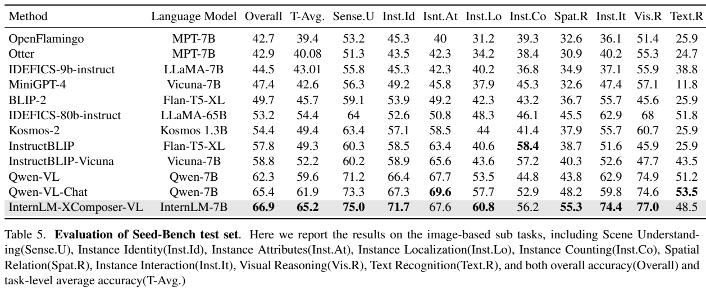
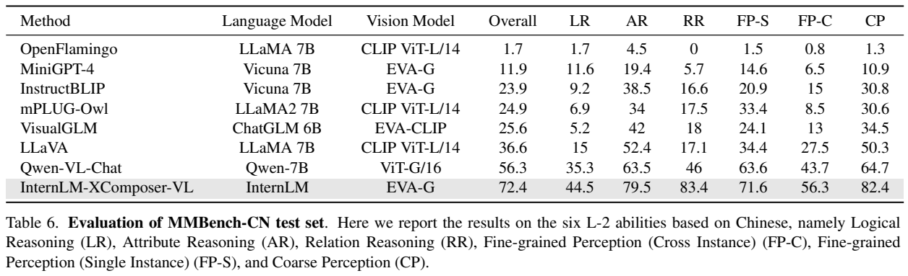

<!-- article-header:start -->
[项目首页](../../../README.md) › [模型系列](../../../reports/model-family-index.md) › [InternLM-XComposer](../README.md)
<!-- article-header:end -->

# InternLM-XComposer：把图像理解接入双语语言模型，再完成图文文章编排

<!-- article-toc:start -->

**本篇目录** · [论文定位](#paper-info) · [快速概览](#overview) · [整体架构](#architecture) · [核心原理](#principles) · [数据构建](#data) · [训练流程](#training) · [实验结果](#experiments)
<!-- article-toc:end -->

## 1. 论文信息与模型定位

| 项目 | 内容 |
|---|---|
| 原文题名 | InternLM-XComposer: A Vision-Language Large Model for Advanced Text-image Comprehension and Composition |
| 作者与机构 | Pan Zhang、Xiaoyi Dong 等，上海人工智能实验室；通讯作者 Jiaqi Wang |
| 原文版本 | [arXiv:2309.15112v1](https://arxiv.org/abs/2309.15112v1)，2023 年 9 月 26 日；本介绍依据 19 页 v1 |
| 模型家族 | InternLM-XComposer 初代；本文重点介绍报告中评测的 7B 语言骨干版本 |
| 官方代码 | [InternLM/InternLM-XComposer](https://github.com/InternLM/InternLM-XComposer) |
| 输入与输出 | 图像、中文或英文文本输入；视觉问答、对话，以及由文字和检索图片组成的文章输出 |

报告区分预训练的 **InternLM-XComposer-VL** 与进一步面向助手和图文文章调优的 **InternLM-XComposer**。第 4.1 节的主要理解基准评测采用前者；文章编排主要以案例展示，不能把视觉选择题成绩直接当成成文质量分数。

## 2. 快速概览

初代 XComposer 解决两件事：先让双语 InternLM 消化图像信息，再让它围绕用户给定的标题写文章、决定插图位置、寻找合适的图片。视觉部分用 EVA-CLIP 提取特征，Perceive Sampler 将每张图的 257 个特征压为 64 个向量，语言模型在混合序列上生成文本。

图文文章由三个步骤构成：生成文章正文；预测插图段落和用于检索的图注；使用 CLIP 召回图片，再由视觉语言模型结合已有文章和图片选出候选。这意味着本文的图片来自图库，而非通过扩散模型或离散图像 token 逐像素合成。它的价值是将视觉理解用于文章整体编排，同时保留图像问答能力。

公开的预训练数据汇总约为 11 亿图像、677 亿文本 token，另混入 100 亿纯文本 token。理解评测中，MMBench 英文测试集为 74.4、中文测试集为 72.4；SEED-Bench 图像子集总体准确率 66.9。这些是报告发布时的对比结果，不能推广为所有类别或后续模型上的优势。

## 3. 整体架构

*原文 Figure 2，PDF 第 3 页，原文图表裁图。左图表示预训练阶段，右图表示 LoRA 微调阶段；雪花、火焰对应冻结和更新参数，不能将两个阶段的冻结策略混写。*

图像统一调整到 224×224，EVA-CLIP 以 14 像素步长产生 16×16 的 patch 网格，加上分类 token，共 257 个特征。Perceive Sampler 采用加入交叉注意力的 BERT-base 结构，以 BLIP-2 的参数初始化，把视觉表示映射为 64 个可送入语言模型的向量。压缩降低了后续语言序列长度，却不会自动恢复缩放图像已经丢失的小字或细节。

InternLM 负责将这些视觉向量与文本 token 一同建模。报告介绍了 InternLM 的 7B/20B 基础系列，但主要实验明确使用 7B；不能将所有表格解读为 20B 结果。预训练会更新 sampler 与语言模型，视觉编码器保持冻结。进入监督微调后，更新 sampler 与语言模型中的 LoRA，语言模型原有权重冻结。

文章编排发生在这套理解模型之上：图像候选依然通过视觉编码器和 sampler 进入上下文，模型生成所选图片的索引。前面已经使用的图片也作为条件，帮助减少只按单段关键词检索造成的重复或主题漂移。

## 4. 核心创新与数学原理

**用少量学习查询连接图像与语言。** sampler 将图像特征作为交叉注意力的键和值，学习查询从中聚合信息。用标准注意力记号解释其基本计算：

$$
Z=\mathrm{softmax}\!\left(\frac{QK^\top}{\sqrt d}\right)V,
\qquad Q\in\mathbb R^{64\times d},\quad K,V\text{ 来自图像特征}.
$$

这里的 64 是原文输出长度；该式只是交叉注意力的标准机制说明，并非报告编号公式，也没有覆盖 sampler 的全部层。相比把 257 个视觉特征直接送进每层语言注意力，较短的视觉序列降低后续计算需求，但报告未给出对应的实测加速比例。

**插图位置与图注共同预测。** 文章被标记为 `[seg1]`、`[seg2]` 等段落，模型输出在哪些段落后插图，并为各位置写检索图注。这些标记是段落索引，跟图像分割中的 mask 或 `<SEG>` 无关。GPT-4 教师看到完整文章和原有插图位置，为该位置写与主题一致的描述；学生模型因此学习面向文章的图注，而不是机械概括上一句话。

*原文 Figure 3，PDF 第 6 页，原文图表裁图。第三列先缩小候选库，再让模型选图片；这张图说明“生成图文文章”在本报告中的具体操作路径。*

**召回与上下文选择分工。** 可以将报告的检索过程写成：

$$
s(c,I)=\frac{f_T(c)^\top f_I(I)}{\Vert f_T(c)\Vert \Vert f_I(I)\Vert },\quad
\mathcal C=\mathrm{Top}_m s(c,I),\quad
k^*=\arg\max_k p_\theta(k\mid T_{\le j},I_{\rm previous},\mathcal C).
$$

前一个相似度用于 CLIP 图文召回，后一个条件分布解释模型选择候选编号的任务。它们是本介绍对流程的形式化说明。报告未固定公布所有部署中的候选数 $`m`$，也未将整个流程写成可微的联合检索损失。图库决定可用图片的上限，选图能力与文章事实准确性仍是不同问题。

**通过 LoRA 保留基础语言模型。** 微调中标准的低秩更新可写为 $`W'=W+(\alpha/r)BA`$，其中 $`B\in\mathbb R^{d_{out}\times r}`$、$`A\in\mathbb R^{r\times d_{in}}`$。原文将 rank 与 alpha 都设为 256，作用于注意力 Q/K/V 和前馈网络。它减少需要优化的参数，但不能据此推断总显存或推理延迟下降多少。

## 5. 数据构建与处理

*原文 Tables 1、2，PDF 第 5 页，原文图表裁图，保留来源列、图像数和 token 数。大规模图文对、网页交错数据、监督问答任务承担不同作用，应分别阅读。*

Table 1 汇总英文约 506 亿、中文约 171 亿文本 token，图像约 11 亿。英文来源包括 SBU、CC3M/CC12M、LAION、内部图文数据和 MMC4；MMC4 一行列出 3.32 亿图像、400 亿 token，提供图像与长文本交错上下文。中文来源包括 Wukong、TaiSu、LAION 中文、内部图文及交错文章。内部采集覆盖超过 1100 万语义概念，这是概念覆盖描述，不是 1100 万张图像。

应保留原表的统计口径：例如名为 LAION-400M 的行写有 509M 图像，不能依据数据集名字擅自改为 400M。报告同时混入来自 InternLM 配方的 100 亿纯文本 token，以维持语言能力；数据池总量与实际训练反复采样产生的 token 总量也不能混同。中文部分使用 Chinese-CLIP 进行清理，部分数据以 WanJuan 形式发布，但没有完整公开每个过滤阈值或训练样本去重细节。

监督任务包括 COCO、SBU、TextCaps 描述，VQAv2、GQA、OK-VQA、VSR、IconQA、ScienceQA 问答，内部 OCR 数据、视觉问题生成，以及 Visual Dialog、LLaVA-150K 等对话。作者人工设计任务提示，同一图像的若干问题随机组合成多轮交互，让模型看到连续的指令和回答。

成文数据另有针对性清洗：GPT-4 判断网页文章每个段落是否有广告等噪声，删除噪声段；若一篇文章超过 30% 内容被判为噪声，则整篇移除。教师随后生成插图位置对应的检索图注，并利用网页中的原始图片安排监督选图。助手微调也使用 Alpaca、ShareGPT、Oasst 的中英文文本以及 LRV 数据缓解幻觉。报告未披露完整成文数据规模、所有人工质量审核比例或图库版权处理，不能据此补写一个完全公开可复现的数据配方。

## 6. 训练流程与目标

模型采用自回归的下一个文本 token 预测。标准形式为：

$$
\mathcal L_{\rm NTP}=-\sum_{t\in\mathcal S}\log p_\theta(y_t\mid y_{<t},I),
$$

其中 $`\mathcal S`$ 表示参与文本预测的位置；图像提供条件。原文没有逐项公开各数据类型的 loss mask，不能进一步断言所有系统提示、用户指令是否都计入损失。成文、选位置、写图注、选候选编号，都是转为文本预测的监督任务。

| 阶段 | 更新模块 | 数据和公开设置 |
|---|---|---|
| 大规模预训练 | sampler、完整 LLM；冻结 EVA-CLIP | AdamW，betas=(0.9,0.95)，epsilon=1e-8；sampler LR 2e-4，LLM LR 4e-5；cosine 调度，最小 LR 1e-5，warmup 200 步；batch 15.7M token，8,000 次迭代 |
| 视觉任务监督微调 | sampler、LLM LoRA | 表 2 的多任务指令；10,000 次迭代，全局 batch 256；sampler/LoRA LR 分别 5e-5/2e-5 |
| 助手及文章指令调优 | 延续监督微调结构 | 混合文本指令、LLaVA-150K、LRV 与成文任务；1,000 次迭代，batch 256，LR 1e-5 |

第一阶段按公开 batch 与步数相乘，约为 1256 亿训练 token；这是计算出来的处理量，不表示存在同样数量的唯一语料，也不应与 677 亿图文语料 token 直接做一对一比对。报告没有给出完整 GPU 数量、训练时间、各监督任务配比和所有优化器选项。

## 7. 实验设置与主要结果

理解评测覆盖 MME、MMBench、SEED-Bench，以及中文 MMBench-CN 和文化题 CCBench。主要结果均来自报告中的 InternLM-XComposer-VL；不同对比模型的骨干、图像编码器和训练数据并不完全相同。

| 基准及口径 | XComposer-VL | Qwen-VL-Chat | 解读 |
|---|---:|---:|---|
| MME 全部子任务总分，Table 3 | 1919.5 | 1848.3 | 为累计分数，不是百分比准确率 |
| MMBench 英文 test，总体，Table 4 | 74.4 | 61.2 | 视觉选择题能力 |
| SEED-Bench 图像子集总体，Table 5 | 66.9 | 65.4 | 不包含视频任务的综合结论 |
| SEED-Bench 图像子任务平均 | 65.2 | 61.9 | 与按样本汇总的总体指标不同 |
| MMBench-CN test，总体，Table 6 | 72.4 | 56.3 | 中英文总体分数相差 2.0 个百分点 |
| CCBench，总体，Table 7 | 47.6 | 39.3 | 中文文化知识与图像相关问题 |

*原文 Tables 5、6，PDF 第 8 页，原文图表裁图。观察总体成绩之外，也要读 Text Recognition、计数及各推理子项，优势并非均匀分布。*

具体弱项也很清楚。SEED 文字识别 48.5，低于 Qwen-VL-Chat 的 53.5；计数 56.2，低于 InstructBLIP-Vicuna 的 58.4。MMBench 逻辑推理 50.6，低于 mPLUG-Owl 的 56.8。CCBench 历史问题只有 10.3，简笔画题 55.0，也低于 Qwen-VL-Chat 的 67.0。报告正文把 MME 任务平均 137.11 写成百分号口径，表 3 实际为每任务分数均值，本介绍采用表格口径。

原文 Figures 4–7 展示英文旅行、中文旅游、历史、宣传和新闻文章，Figures 8–9 展示中英文视觉对话。这些案例说明系统可以输出多段文字并配图，却没有配套的成文盲测、事实核查分数或对检索和选图模块的量化消融。阅读时应分别判断“能组织图文内容”“图文相互匹配”“文章事实可靠”；本报告的标准基准主要支持第一层视觉理解能力，成文可靠性尚缺充分定量证据。本仓库未运行模型，所有数值均为原文结果。

<!-- article-footer:start -->
---

[← 上一篇：GPT-4V 系统卡](../../gpt/document-5cd14e1ea9af/README.md) · [按发表时间浏览](../../../reports/paper-reading-guide.md#year-2023) · [下一篇：AnyMAL →](../../anymal/arxiv-2309.16058/README.md)

[返回本篇目录](#article-toc) · [返回模型系列](../README.md)
<!-- article-footer:end -->
