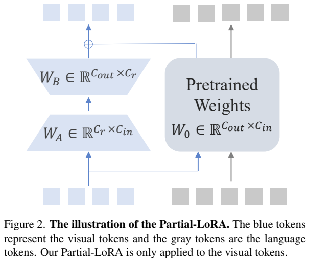
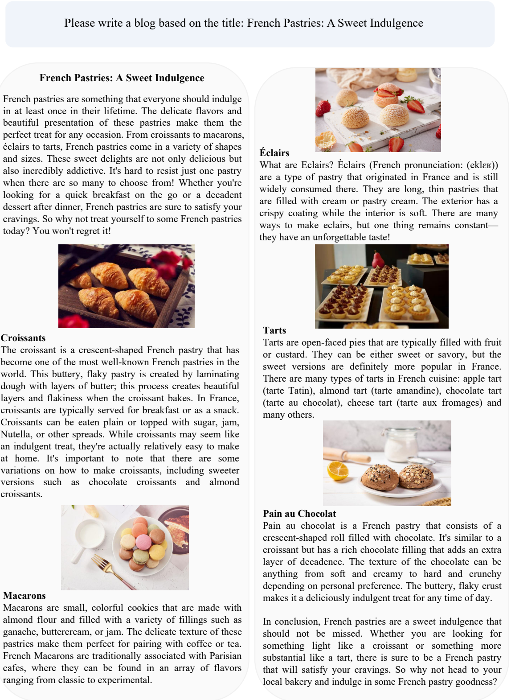
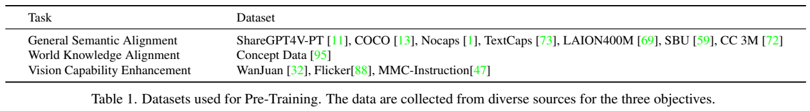
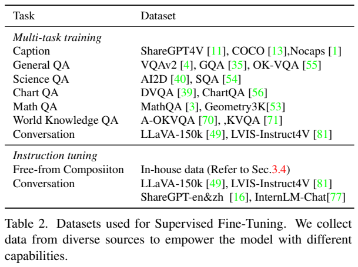
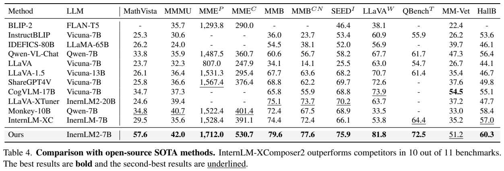
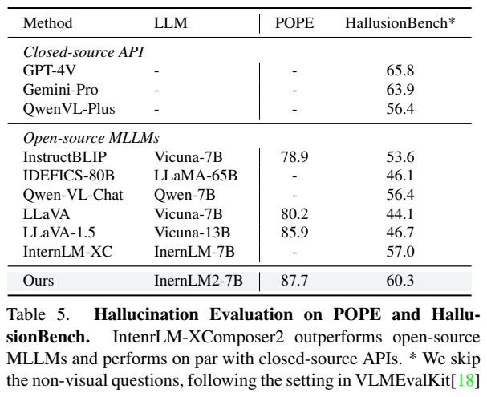
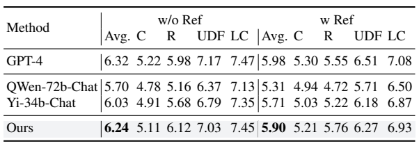

<!-- article-header:start -->
[项目首页](../../../README.md) › [模型系列](../../../reports/model-family-index.md) › [InternLM-XComposer](../README.md)
<!-- article-header:end -->

# InternLM-XComposer2：用 Partial LoRA 连接视觉理解与自由图文创作

<!-- article-toc:start -->
<a id="article-toc"></a>

**本篇目录** · [论文定位](#paper-info) · [快速概览](#overview) · [整体架构](#architecture) · [核心原理](#principles) · [数据构建](#data) · [训练流程](#training) · [实验结果](#experiments)
<!-- article-toc:end -->

<a id="paper-info"></a>

## 1. 论文信息与模型定位

**论文**：*InternLM-XComposer2: Mastering Free-form Text-Image Composition and Comprehension in Vision-Language Large Models*；**作者**：Xiaoyi Dong、Pan Zhang、Yuhang Zang 等；**机构**：上海人工智能实验室、香港中文大学、商汤等；**版本**：[arXiv:2401.16420v1](https://arxiv.org/abs/2401.16420v1)，2024 年 1 月 29 日；**项目**：[InternLM-XComposer](https://github.com/InternLM/InternLM-XComposer)。本文依据首版 23 页 PDF，不将后续 XComposer 系列能力合并进来。

模型以 InternLM2-7B-Chat-SFT 为语言底座，配合 CLIP 视觉编码器，同时面向图像问答、图表与数学理解，以及根据标题、提纲、参考图像制作图文交错文章。所谓“图文创作”包括组织文字、决定插图位置、使用检索图片或用户图片；报告没有提出直接生成图像像素的扩散解码器。[原文 §3，PDF 第 3–5 页](https://arxiv.org/pdf/2401.16420v1#page=3)

它的定位是一个较小语言底座上的多用途视觉语言模型。理解能力与创作能力共享主要网络，但创作还依赖图片来源与插入流程。读者应把“模型能理解输入图片”与“系统能交付带图片的文章”分别理解，二者的实验也采用不同评测。

<a id="overview"></a>

## 2. 快速概览

| 要点 | 首版实际内容 |
|---|---|
| 语言底座 | InternLM2-7B-Chat-SFT |
| 视觉编码器 | OpenAI CLIP ViT-L/14-336；预训练将分辨率提高到 490×490 |
| 对齐机制 | Partial LoRA：语言 token 走原线性变换，视觉 token 额外经过低秩支路 |
| 预训练 | 冻结语言模型，训练视觉编码器和 Partial LoRA；兼顾语义、世界知识与视觉专项能力 |
| 指令微调 | 多任务训练后进行自由图文创作训练，联合更新视觉编码器、语言模型及适配模块 |
| 代表结果 | MathVista 57.6、MMBench 79.6、MMMU 42.0；CreationBench 无参考平均 6.24 |
| 公开边界 | 未给出完整样本数量、全部采样权重、硬件消耗或隔离 Partial LoRA 的消融 |

一个贯穿方法的判断是：新视觉模态需要适配，但所有 token 都采用相同适配未必合适。作者让视觉位置获得额外变换，文本位置继续直接使用预训练线性层。这个设计提供参数与路由上的分工；它本身并不能证明多模态训练后所有纯语言能力都保持不变。[原文 §3.1–3.3](https://arxiv.org/pdf/2401.16420v1#page=3)

<a id="architecture"></a>

## 3. 整体架构



**读图方式**：Figure 2 的蓝色方块表示视觉 token，灰色方块表示文字 token。右侧大矩阵是共同使用的预训练权重，蓝色支路经过两个低秩矩阵后与视觉主路相加；灰色支路没有这项增量。这里展示的是解码器线性层内部的计算差异，而不是两个独立语言模型。

输入图像先由 CLIP 提取视觉特征，输入文字经分词得到文字 token；两者在语言模型序列中组合。视觉 token 进入语言解码器后，在各解码块的线性层采用 Partial LoRA。文本输出仍由语言模型逐步生成，图像信息通过序列内部的注意力参与文字生成。[原文 §3.1，PDF 第 3 页](https://arxiv.org/pdf/2401.16420v1#page=3)

视觉编码器原始配置为 ViT-L/14-336。预训练提高到 490×490，目的是增加图像细节；自由图文创作微调中又采用 224×224，以减轻创作场景的计算负担。论文并没有把所有理解评测都定义为 224 分辨率，不能将创作阶段的配置推广到整个系统。首版也未完整列出图像 token 总数、最大上下文和所有推理解码设置。

创作路径分两层：模型先根据要求形成文字，再确定适合插图的位置。默认沿用前作的图片检索流程；当用户提供参考图片，则使用这些图片。这使系统能根据“标题—段落—图片”组织内容，但图片检索质量、插图与段落一致性仍是最终产品质量的一部分。[原文 §3.4，PDF 第 5 页](https://arxiv.org/pdf/2401.16420v1#page=5)



**读图方式**：上方是标题指令，下面的文章按可颂、马卡龙、闪电泡芙等小节安排图片。它说明模型可以形成多段文字与插图的交错布局。这是作者挑选的定性示例，不能据此计算插图正确率，也不能把页面里的图片理解为模型从像素生成的结果。

语言端的具体初始化为 **InternLM2-7B-Chat-SFT**。原文把视觉 token 与文字 token 串联后交给该主干：PLoRA 在 decoder block 的线性层对视觉位置增加低秩变换，文字位置继续走原线性权重；图中的蓝、灰 token 用来标示这一参数路径差别。因而它不等同于先用一组 query 将整张图片压成摘要的 Q-Former。该节没有把视觉特征最初映射到语言嵌入的所有尺寸单独列成表，本文只说明已公开的拼接接口和层内适配，不追加猜测的投影结构。（§3.1，PDF 第3页）

<a id="principles"></a>

## 4. 核心创新与数学原理

Partial LoRA 将传统低秩适配的作用范围限定到视觉位置。对一个线性层，设原权重为 $`W_0\in\mathbb R^{C_{out}\times C_{in}}`$，偏置为 $`B_0`$，输入按视觉与文本划分为 $`x=[x_v,x_t]`$。原文给出的计算为：


```math
\hat x_t=W_0x_t+B_0,\qquad
\hat x_v=W_0x_v+W_BW_Ax_v+B_0,\qquad
\hat x=[\hat x_v,\hat x_t].
```


其中 $`W_A\in\mathbb R^{C_r\times C_{in}}`$、$`W_B\in\mathbb R^{C_{out}\times C_r}`$，本文报告的秩为 $`C_r=256`$。原文公式没有额外的 LoRA 缩放系数，介绍也不自行加入。[原文 §3.1，PDF 第 3–4 页](https://arxiv.org/pdf/2401.16420v1#page=3)

这项设计可以从两方面理解。首先，视觉表示由另一个预训练体系产生，它进入语言网络时可能需要不同于文字表示的变换；低秩支路为这种差异提供可学习的修正。其次，在语言模型冻结的预训练阶段，文字位置的线性主路不被直接改写，有利于在保留原网络的同时学习视觉输入。相对于为每层学习一个完整新矩阵，两矩阵分解使用 $`C_r(C_{in}+C_{out})`$ 个增量权重；这是由矩阵维度推导出的参数量解释，并非原文单独给出的性能公式。

“文本 token 没有额外支路”不等于“文本输出不受视觉影响”。自注意力仍会混合视觉和文字，视觉支路也会改变后续生成。进入联合 SFT 后，语言模型本身还会更新。因此，论文的语言能力保留意图需要数据与评测共同支撑，不能仅靠上面的局部公式证明。

另一项方法特点是把对齐拆为三个目标：一般语义解决“图里有什么”，世界知识连接“图中的对象是谁以及相关知识”，视觉专项解决 OCR、定位和结构化图像。它们通过不同数据与指令实现；首版没有提出三个独立损失项及其权重，也没有给出足以把效果完全归因于 Partial LoRA 的专门消融。本文不将数据目标改写成未经披露的多项数学损失。

<a id="data"></a>

## 5. 数据构建与处理





**读表方式**：上表按三个对齐目标分类，下表按多任务训练与自由创作指令分类。同一个来源可能服务不同阶段，例如描述数据先用于语义学习，再用于任务训练；表中的数据集名称不代表作者重新使用了这些数据集公开全集。

一般语义数据包括 ShareGPT4V-PT、COCO、NoCaps、TextCaps、LAION400M、SBU 和 CC3M。作者用简短或详细描述指令让图片内容转成语言。世界知识数据从前作使用的概念数据中过滤得到。由于概念介绍未必完整对应图像内容，指令改为更宽泛的“告诉我这张图的一些信息”，降低强迫文字逐项描述图像的约束。视觉专项数据来自 WanJuan、Flickr 和 MMC-Instruction，覆盖 OCR、定位、图表和表格理解。[原文 §3.2、Table 1，PDF 第 4 页](https://arxiv.org/pdf/2401.16420v1#page=4)

多任务 SFT 包含描述、一般问答、科学问答、图表问答、数学问答、世界知识问答与对话。对应数据包括 VQAv2、GQA、OK-VQA、AI2D、SQA、DVQA、ChartQA、MathQA、Geometry3K、A-OKVQA、KVQA、LLaVA-150K、LVIS-Instruct4V 等。样本组织为对话，指令通过 GPT-4 扩充，以增加表达多样性。为了保留文字能力，原 InternLM2 SFT 数据占总 SFT 数据的 10%。这个比例是正文披露的混合安排，不能替换为“整个多模态训练中 10% 是文字”。[原文 §3.3，PDF 第 4–5 页](https://arxiv.org/pdf/2401.16420v1#page=4)

自由创作使用内部数据，并混入 LLaVA-150K、LVIS-Instruct4V、ShareGPT 中英文及 InternLM-Chat 对话。创作数据围绕文体、编辑、复杂指令、用户材料四个维度，比例约为 1:1:1:1：文体包括学术文章、社交内容和诗歌；编辑要求缩短、扩写或重写；复杂指令包含标题和提纲；用户材料可提供文字与图片。这些任务教会模型把约束贯彻到长文章中，不只是回答图片里的单个问题。[原文 §3.4，PDF 第 5 页](https://arxiv.org/pdf/2401.16420v1#page=5)

报告没有公开每类最终样本数、完整过滤规则、去重阈值、训练集与各评测的污染审计，也未给出所有来源的精确采样权重。对“概念过滤”“内部创作数据”等表述，只能说明作者实施了这一处理，无法由首版恢复同一数据集。

<a id="training"></a>

## 6. 训练流程与目标

预训练冻结语言模型，更新视觉编码器和 Partial LoRA，以先完成视觉与语言的连接。原文给出的 batch size 是 **4906**，训练 **2 个 epoch**；学习率在前 1% 步数升到 $`2\times10^{-4}`$，随后余弦衰减到 0。视觉编码器采用层间学习率衰减，系数 0.90。4906 是 PDF 明确印出的数值，此处保留原样，不据常见配置改写成 4096。[原文 §3.2，PDF 第 4 页](https://arxiv.org/pdf/2401.16420v1#page=4)

SFT 包含顺序进行的多任务训练和自由图文创作训练，视觉编码器、语言模型、Partial LoRA 共同更新。论文报告联合训练 batch size **2048**、**3000 步**、最大学习率 $`5\times10^{-5}`$，语言模型学习率按 0.2 缩放，视觉编码器层间衰减系数仍为 0.90。若该最大值应用于基础学习率，语言模型的峰值相应为 $`10^{-5}`$；这是缩放关系的计算说明。首版没有分别给两个 SFT 子阶段完整独立日程，不能声称每个子阶段都训练 3000 步。[原文 §3.3–3.4，PDF 第 5 页](https://arxiv.org/pdf/2401.16420v1#page=5)

训练从图像理解过渡到按复杂指令写作，数据来源按数据量组织采样。报告以对齐及监督微调描述目标，并未完整写出损失掩码、各来源权重或所有优化器参数。为了说明这种训练的基本含义，可以把回答 token 的条件生成理解为降低 $`-\sum_t\log p_\theta(y_t\mid I,u,y_{\lt t})`$：模型在图像 $`I`$ 与指令 $`u`$ 下学习答案序列。这是本文对语言生成式监督的解释公式，不是论文明确披露的一套完整损失实现。

首版未披露 GPU 型号与数量、总 GPU 时、全部优化器超参数、数值精度、序列长度和每阶段实际 token 量。不能依据 7B 底座估算这些配置并当成作者实验。本仓库整理原文配置，没有运行模型或复现实验。

<a id="experiments"></a>

## 7. 实验设置与主要结果







**读表方式**：Table 4 将 MME 拆为感知与认知两个分数，最后一行是本文模型；Table 5 中 POPE 是三个设置的平均 F1，HallusionBench 带星号表示跳过非视觉问题；Table 6 分无 GPT-4 参考答案与有参考答案两种条件，C/R/UDF/LC 分别对应创意、丰富性、满足用户需求和逻辑连贯性。三张表的数值单位不同，不能相加或作为同一种正确率比较。

| 基准 | XComposer2 | 论文列出的 GPT-4V | 解释 |
|---|---:|---:|---|
| MathVista | 57.6 | 49.9 | 图像数学推理，本文报告较高 |
| AI2D | 78.7 | 78.2 | 科学示意图问答，数值采用 Table 3 |
| MMMU | 42.0 | 56.8 | 跨学科难题，仍有明显差距 |
| MME 总分 | 2242.7 | 1926.5 | 感知 1712.0 加认知 530.7 |
| MMBench | 79.6 | 77.0 | 多能力选择题评测 |
| MM-Vet | 51.2 | 67.7 | 综合视觉语言任务，仍落后 |
| ChartVQA | 72.6 | 78.5 | 图表理解，本文表中的 GPT-4V 更高 |

以上来自 Table 3、4；MME 一行的总分是该表报告口径。正文第 6 页另写 AI2D 78.9、MMMU 43.0，与 Table 3 的 78.7、42.0 不一致。本文以表格为准并保留这个版本差异，不合并成更高分。[原文 Table 3–4，PDF 第 5–6 页](https://arxiv.org/pdf/2401.16420v1#page=5)

开放模型比较中，Table 4 标题称 11 个基准里 10 个达到最佳。具体反例是 MM-Vet：本文 51.2，CogVLM-17B 为 54.5。相较前作，MathVista 从 29.5 到 57.6、MMBench 从 74.4 到 79.6、MM-Vet 从 35.2 到 51.2，显示整体进步；底座、数据与训练方案同时变化，这不是仅修改 Partial LoRA 的因果消融。

幻觉评测的 POPE 平均 F1 为 87.7；HallusionBench 为 60.3，高于表中的开放模型与 Qwen-VL-Plus 56.4，但低于 GPT-4V 65.8 和 Gemini-Pro 63.9。作者沿用 VLMEvalKit 跳过非视觉问题的设置，因此 60.3 不能解释为完整 HallusionBench 的总体结果，更不能当作现实使用中的“无幻觉概率”。[原文 Table 5，PDF 第 6 页](https://arxiv.org/pdf/2401.16420v1#page=6)

CreationBench 无参考平均 6.24，GPT-4 为 6.32；有 GPT-4 参考时分别为 5.90 与 5.98。本文在丰富性上无参考 6.12、有参考 5.76，分别高于表中的 GPT-4 5.98、5.55；在满足用户需求与逻辑连贯性上 GPT-4 更高。这表明优势分布在不同写作维度，并非所有指标超过闭源模型。该实验主要评估写作能力，不能替代对交错文章插图准确率的专门测试。[原文 Table 6、§4.2，PDF 第 6 页](https://arxiv.org/pdf/2401.16420v1#page=6)

首版附录给出多种创作与理解示例，但没有统计定性图例的成功率。闭源比较也缺少完整 API 版本、推理预算和置信区间，部分基准的详细切分与生成设置未展开。可以据本文确认模型在多个公开任务中具有较强竞争力，也应看到学科难题、综合任务和幻觉方面尚未全面达到闭源模型水平。

<!-- article-footer:start -->
---

[← 上一篇：Yi-VL](../../yi/document-5991ef3fff72/README.md) · [按发表时间浏览](../../../reports/paper-reading-guide.md#year-2024) · [下一篇：MoE-LLaVA →](../../moe-llava/arxiv-2401.15947/README.md)

[返回本篇目录](#article-toc) · [返回模型系列](../README.md)
<!-- article-footer:end -->
