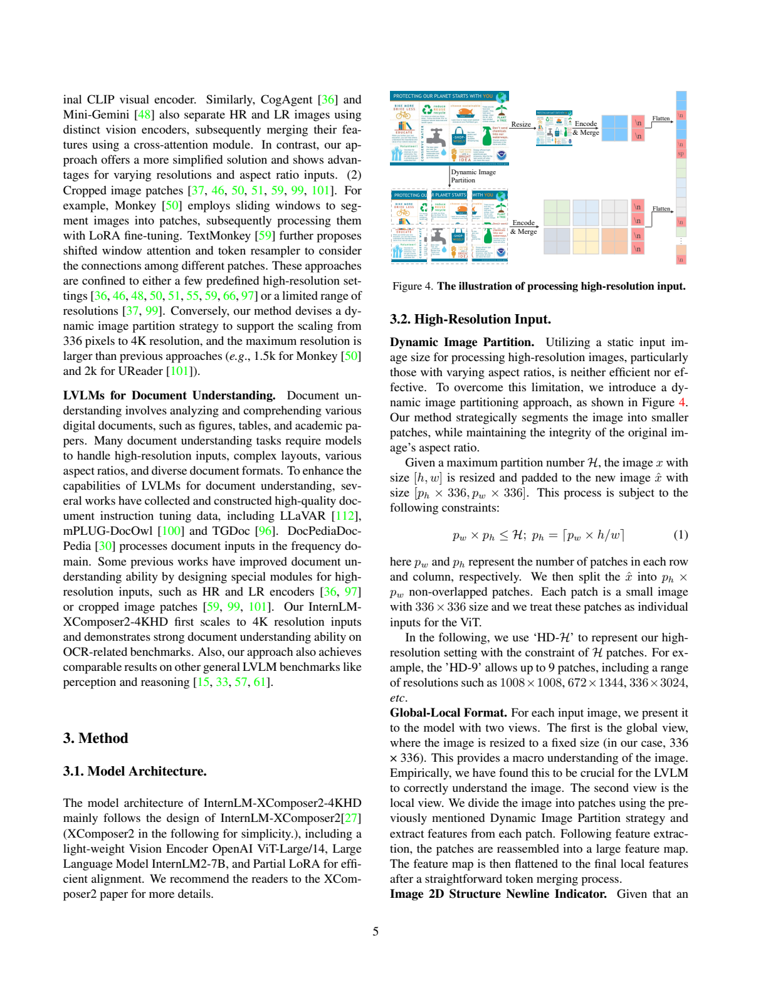
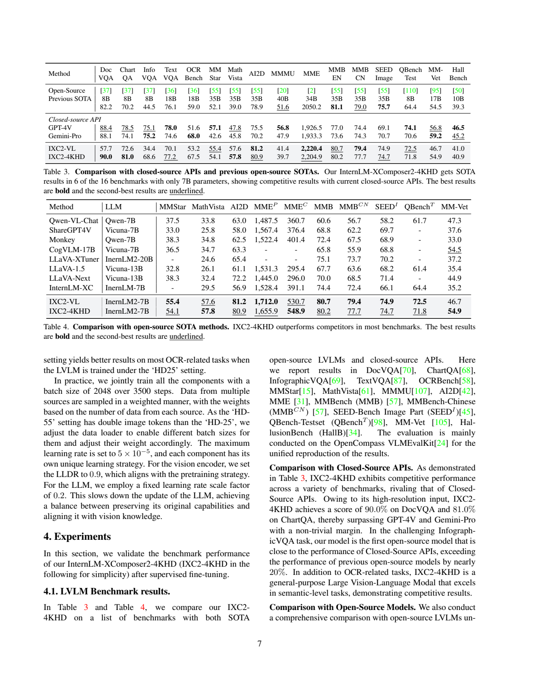
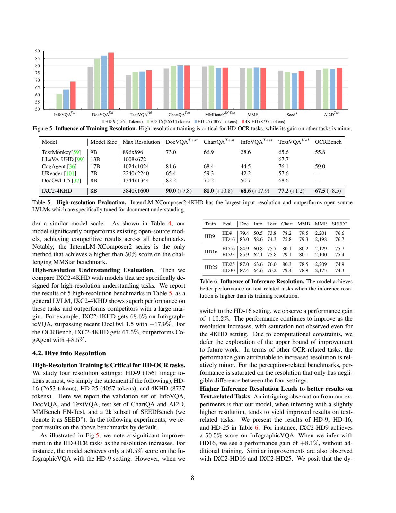
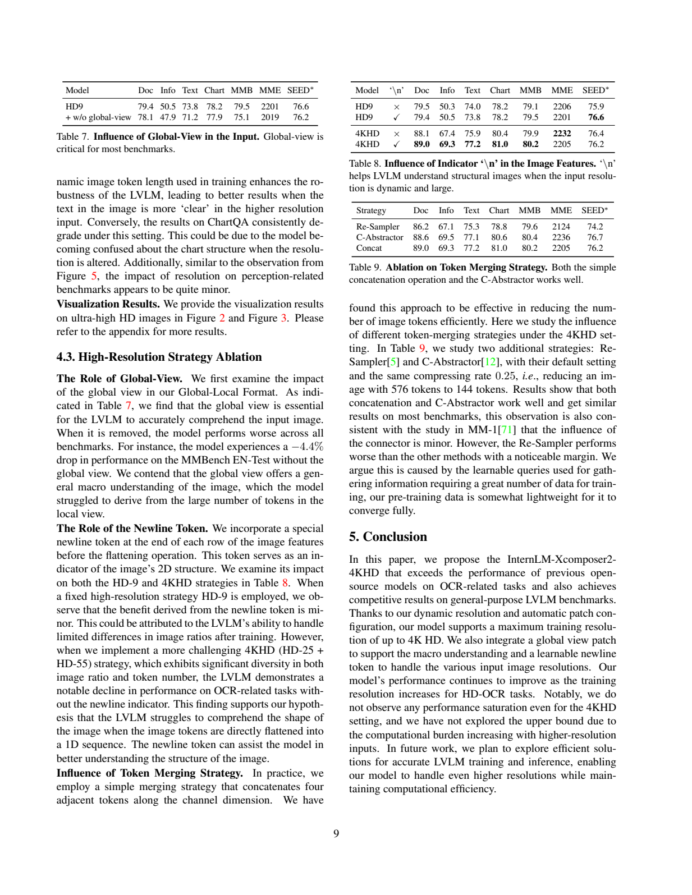

# InternLM-XComposer2-4KHD：动态分块与二维结构保留的高分辨率视觉语言模型

## 1. 论文信息与模型定位

**论文**：[InternLM-XComposer2-4KHD: A Pioneering Large Vision-Language Model Handling Resolutions from 336 Pixels to 4K HD](https://arxiv.org/abs/2404.06512)，依据 2024 年 4 月 9 日 [v1 报告](https://arxiv.org/pdf/2404.06512v1)。作者 Xiaoyi Dong、Pan Zhang、Yuhang Zang 等来自上海人工智能实验室、香港中文大学、商汤和清华大学。

它继承 XComposer2 的视觉语言架构，把重点放在**长宽比各异的高分辨率文档、图表与信息图**。语言基座为 InternLM2-7B；Table 5 将完整模型标为 8B，因此“7B”主要指语言基座，不能把视觉编码器等参数当作不存在。本文中的“4KHD”按作者口径为 **3840×1600**，不替换为通常显示屏的 3840×2160。

## 2. 快速概览

| 项目 | 原文设计 |
|---|---|
| 编码器 | OpenAI CLIP ViT-L/14-336，每次处理 336×336 块 |
| 语言模型 | InternLM2-7B，使用 Partial LoRA 对齐 |
| 输入预算 | HD-H 约束局部块数最多 H；分辨率随图像长宽比变化 |
| 双视图 | 一张 336×336 全局图，加动态分块的局部细节 |
| 压缩 | 相邻四个 token 沿通道拼接，再通过 MLP 对齐，序列长度降至四分之一 |
| 结构提示 | 每行视觉特征后插入可学习换行 token，全局/局部之间插入分隔 token |
| 训练分辨率 | 预训练 HD-25；SFT 在 HD-25 动态范围与 HD-55 间混合 |
| 能力边界 | OCR 类提升显著；其他任务不保证随分辨率上升而提高 |

这套方案没有让单次 ViT 直接处理整幅 4K 图像，而是复用固定分辨率编码器处理更多局部块。更多块会增加语言侧序列长度与计算，四分之一压缩和混合分辨率用于控制成本，并没有消除高分辨率开销。

## 3. 整体架构

**读图：Figure 4，PDF 第 5 页。** 上路把整图缩到固定尺寸，提供版面和场景总体信息；下路保留比例、缩放与补边后分块，各块经过同一 ViT。局部特征重新拼成大二维特征图，再合并 token 和逐行展开。右侧红色换行标记提供二维边界，灰色分隔标记区分全局和局部视图。

一张大图的局部块各自可见细字，却可能缺乏全文布局；全局图有布局，却可能看不清小字。两路互补，语言模型同时获得宏观结构与细节。分块后重新组装特征图也不同于把所有块任意串起来：局部顺序与行边界有明确结构约束。

架构沿用轻量视觉编码器、InternLM2 和 Partial LoRA。当前报告将 Partial LoRA 的完整设计指向前代论文，本文仅依据本报告已披露的作用和 rank 描述，不补造未在这里展开的内部路由。高分辨率能力来自输入处理、结构标记与训练策略共同调整，不能只解释为增加语言模型参数。

## 4. 核心创新与数学原理

设原图尺寸 $[h,w]$，每行块数 $p_w$、每列块数 $p_h$，原式（1）为：

$$
p_wp_h\le H,\qquad p_h=\left\lceil p_w\frac{h}{w}\right\rceil.
$$

模型保持原图长宽比进行缩放，再补边至 $[336p_h,336p_w]$，划分为不重叠的 336×336 图块。HD-9 表示最多九个局部块，并不固定一种图像形状：原文例举 1008×1008、672×1344、336×3024。$H$ 是**图块预算**，不同于 ViT 内部 patch token 数，也不直接等于总语言视觉 token 数。

ViT 每块输出 24×24=576 个网格 token，相邻四个特征沿通道拼接后得到 144 个，再由 MLP 映射到语言维度。这里采用拼接，不是均值池化：合并后通道暂时扩展，四个位置的信息由后续映射学习整合。全局视图、局部结构和行标记还增加额外 token，所以不能简单用 $144H$ 代替精确长度。原文报告 HD-9/16/25/4KHD 最高分别约 **1561/2653/4057/8737** 个视觉 token。

二维换行 token 解决的是可变宽度问题。只有一维序列而没有行边界时，相同距离的两个 token 未必处于同一行；在每行末端添加标记，可让模型识别何时转入下一行。它是学习到的结构提示，不是人工 OCR 文字或显式表格解析结果。

动态分辨率同时用于训练增强：普通任务在原尺寸与 HD-25 预算之间变化，模型不只适应一个固定 token 数。高密度文字任务用 HD-55。这样训练后可以试更高推理分辨率，但原文实验显示增益受任务影响，不能把“超出训练分辨率”解释为任意尺寸都保持正确。

## 5. 数据构建与处理

预训练沿用三类目的：通用语义对齐、世界知识对齐、视觉能力增强。Table 1 包含 ShareGPT4V-PT、COCO、NoCaps、TextCaps、LAION400M、SBU、CC3M、Concept Data；视觉增强部分包括 WanJuan、Flickr、MMC-Inst，以及 RCTW-17、CTW、LSVT、ReCTs、ArT 等文字数据。重点增加 OCR 与结构图像来源，支持高分辨率训练。

SFT 的 Table 2 按任务列出 caption、一般 QA、科学图解、图表、数学、世界知识、OCR、HD-OCR 和对话。关键来源包括 VQAv2/GQA/OK-VQA、AI2D/ScienceQA、DVQA/ChartQA/ChartQA-AUG、Geometry3K/TabMWP、A-OKVQA、TextVQA/OCR-VQA/ST-VQA、**InfoVQA/DocVQA**，以及 LLaVA-150K、LVIS-Instruct4V、英语与中文 ShareGPT 和 InternLM-Chat 数据。

InfoVQA 有一半图像长边超过 2000 像素，说明简单缩图容易损失文字细节。普通感知任务对分辨率相对不敏感，因此数据来源决定分辨率策略。多源数据按规模进行加权抽样，HD-55 因视觉 token 更多还调整 loader 的 batch 与采样权重。报告未列完整数据总量、最终权重、去重规则与清洗阈值，本文不把来源列表当作已公开完整可复现数据配方。

## 6. 训练流程与目标

**预训练**冻结 LLM 主体，微调视觉编码器及 Partial LoRA，使用 HD-25。Partial LoRA 在 decoder 各线性层采用 **rank 256**；分隔和换行 token 随机初始化。batch **4096**、**2 epoch**；前 1% 步数线性 warmup 到 $2\times10^{-4}$，之后余弦衰减到零。视觉编码器采用 layer-wise learning rate decay，系数 **0.90**，用于降低对原有视觉知识的扰动。

**SFT**联合训练各组件，batch **2048**，共 **3500 步**，最大学习率 $5\times10^{-5}$。视觉侧继续采用 0.9 层间衰减；LLM 学习率固定乘 **0.2**，相对减慢语言侧更新。HD-OCR QA 使用 HD-55，其他任务在原尺寸与 HD-25 范围间动态变化。这里公开的总 batch 不代表两种分辨率每一步都使用完全相同的实际图片数。

训练围绕视觉条件下的语言生成与监督回答。当前报告没有单列损失公式，也没有宣布独立的 OCR 坐标损失、图表结构监督或强化学习奖励，不能据题名补充这些算法。其可验证的训练贡献是冻结与解冻策略、分辨率混合、结构标记和学习率配置。

## 7. 实验设置与主要结果

**读图：Table 3/Table 4，PDF 第 7 页。** 共 16 个基准，主要使用 OpenCompass VLMEvalKit。每个“Previous SOTA”来自不同模型及尺度，不能把这行理解为单一对手。Table 4 将 MME 感知与认知分开；这些分数不是百分比准确率。

| 项目 | IXC2-VL | IXC2-4KHD | 原表闭源对照 |
|---|---:|---:|---|
| DocVQA | 57.7 | **90.0** | GPT-4V 88.4、Gemini-Pro 88.1 |
| ChartQA | 72.6 | **81.0** | GPT-4V 78.5、Gemini-Pro 74.1 |
| InfoVQA | 34.4 | **68.6** | GPT-4V 75.1、Gemini-Pro 75.2，仍低于两者 |
| TextVQA | 70.1 | **77.2** | GPT-4V 78.0，仍略高 |
| OCRBench，原表百分尺度 | 53.2 | **67.5** | GPT-4V 51.6、Gemini-Pro 68.0 |
| MathVista | 57.6 | **57.8** | GPT-4V 47.8、Gemini-Pro 45.8 |
| MMMU | 41.4 | **39.7** | GPT-4V 56.8，明显更高 |
| MMBench EN / CN | 80.7 / 79.4 | **80.2 / 77.7** | 两项均未超过前代 |
| MM-Vet | 46.7 | **54.9** | GPT-4V 56.8、Gemini-Pro 59.2 |

OCRBench 这里沿用原表的 67.5 数值口径，不写成 1000 分量表的原始计分。Table 3 中 MME 总分为 **2204.9**；Table 4 分项为 **1655.9/548.9**，小数加总存在舍入差异，本文分别引用，不重新校正。原文称超过或匹敌两款闭源 API 的若干基准，实际表中也有明显落后项，因此不是全部能力提升。

**读图：Figure 5/Table 5/Table 6，PDF 第 8 页。** 主表的 DocVQA、InfoVQA 为 test；分辨率研究使用 DocVQA/InfoVQA/TextVQA 的 **val**、ChartQA/AI2D 的 test、MMBench EN-test 和 SEED 的 **2K 子集**。例如主表 DocVQA 90.0 与消融 89.0 不能视为矛盾或随意拼接。

训练分辨率从 HD-9 升至 HD-16，InfoVQA val **50.5→60.8**，增 **10.3 个百分点**；论文行文写约 +10.2，与表值舍入略有出入。固定 HD-9 训练，仅推理换 HD-16，InfoVQA **50.5→58.6**；但 ChartQA **78.2→75.8**。HD-25 训练后推理换 HD-30，DocVQA **87.0→87.4**、InfoVQA **63.6→64.6**，ChartQA 却 **80.3→79.4**。这些结果说明清晰文字可受益，图表结构和其他任务并不必然受益。

**读图：Table 7–9，PDF 第 9 页。** HD-9 去掉全局视图，MMBench **79.5→75.1**、MME **2201→2019**；说明局部块难独自提供稳定全局理解。4KHD 加换行标记后 DocVQA val **88.1→89.0**、InfoVQA val **67.4→69.3**、TextVQA **75.9→77.2**，但 MME **2232→2205**，并非全指标变好。相同压缩率下 Concat 与 C-Abstractor 接近：InfoVQA **69.3 对 69.5**；Re-Sampler 为 **67.1**。简单拼接是一种有效选择，表格不支持它全面优于所有连接器。

本报告最强证据是高分辨率文字任务的提升及结构消融。更高分辨率的上限因计算成本未探索；超长信息图案例证明可处理部分输入，不等于任意尺寸的稳健性或准确率保证。
