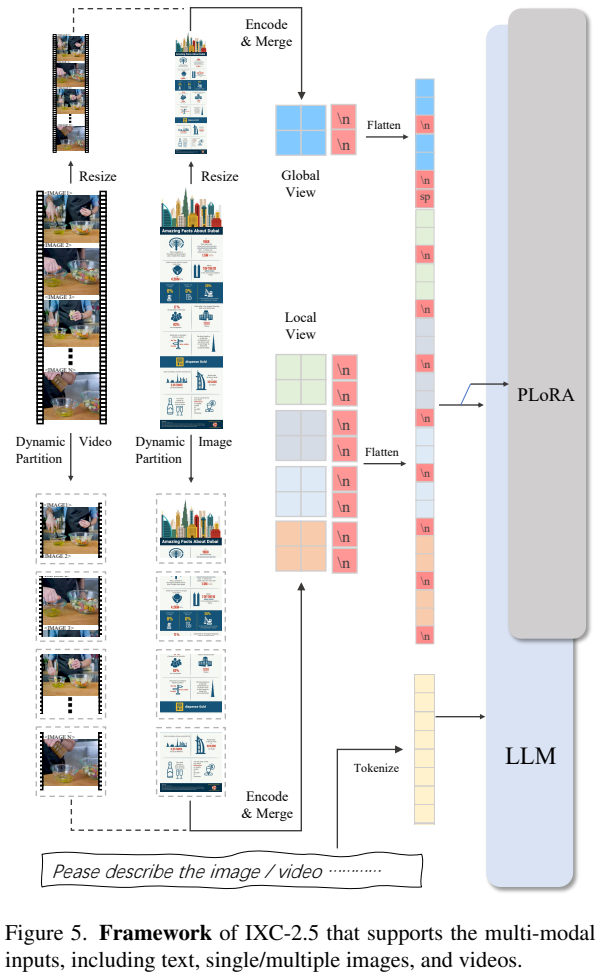
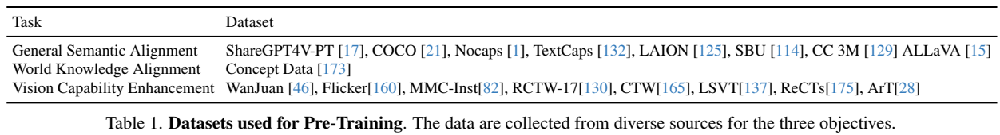
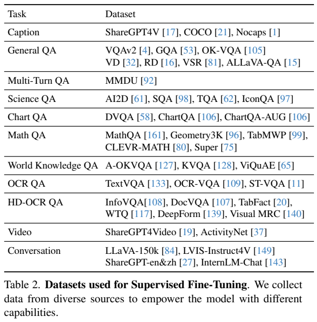
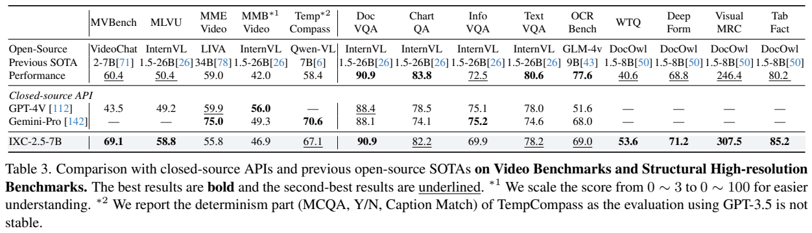
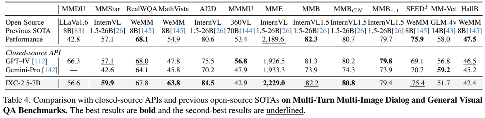
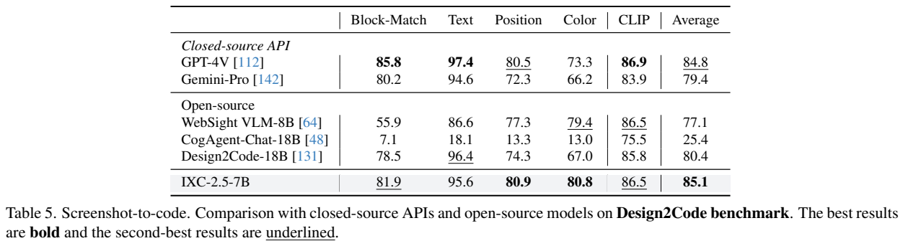

<!-- article-header:start -->
[项目首页](../../../README.md) › [模型系列](../../../reports/model-family-index.md) › [InternLM-XComposer](../README.md)
<!-- article-header:end -->

# InternLM-XComposer-2.5：统一处理高分辨率图片、视频和长篇图文交互

<!-- article-toc:start -->

**本篇目录** · [论文定位](#paper-info) · [快速概览](#overview) · [整体架构](#architecture) · [核心原理](#principles) · [数据构建](#data) · [训练流程](#training) · [实验结果](#experiments)
<!-- article-toc:end -->

## 1. 论文信息与模型定位

| 项目 | 内容 |
|---|---|
| 原文 | InternLM-XComposer-2.5: A Versatile Large Vision Language Model Supporting Long-Contextual Input and Output |
| 作者与机构 | Pan Zhang、Xiaoyi Dong、Yuhang Zang 等；上海人工智能实验室、香港中文大学、商汤、清华大学 |
| 版本 | [arXiv:2407.03320v1](https://arxiv.org/abs/2407.03320v1)，2024 年 7 月 3 日；18 页报告 |
| 家族 | InternLM-XComposer，简称 IXC-2.5；语言骨干为 InternLM2-7B |
| 官方项目 | [InternLM/InternLM-XComposer](https://github.com/InternLM/InternLM-XComposer) |
| 任务 | 高分辨率视觉理解、视频问答、多轮多图对话；使用额外 LoRA 的网页代码生成和图文文章写作 |

7B 指语言模型档位，不能理解为整个系统含视觉编码器后的精确总参数。该模型在 24K 图文交错上下文上训练，报告称通过 RoPE 外推可扩至 96K；训练长度、外推长度和长上下文中每个细节的可靠识别能力应分别判断。

## 2. 快速概览

IXC-2.5 的主要变化是把长图、多张图和视频帧都转换为带全局与局部视图的视觉序列。模型以原生 560×560 的 ViT 编码子图，保留局部细节，并让较长的语言上下文容纳这些视觉信息。视频先抽帧、沿帧的短边拼成高分辨率大图，帧编号被写进图像来提供先后顺序。

理解模型之外，网页生成分支学习从截图、自由指令或简历生成 HTML、CSS 和 JavaScript；文章分支则用少量写作指令、逐步提示扩增和 DPO 改善长篇输出。演示中的音频输入和输出由 Whisper、MeloTTS 连接，不意味着底层视觉语言模型直接学习了音频波形表示。

报告列出 28 个评测，主要覆盖视频、文档结构、通用视觉问答、多图对话及截图转代码。IXC-2.5 在 MVBench 为 69.1、MathVista 为 63.8、DocVQA 为 90.9，但 MMMU 为 42.9，明显低于表中 GPT-4V 的 56.8。“接近 GPT-4V”是部分任务的观察，不能当成完整能力等价。

## 3. 整体架构

*原文 Figure 5，PDF 第 6 页，原文图表裁图。读图时注意局部子图、缩小后的全局视图、行分隔标记和文本各自进入序列的位置；PLoRA 为视觉与语言对齐提供适配。*

视觉编码器采用 OpenAI CLIP ViT-L/14，沿用 IXC2 的 490×490 初始化，再提升到 560×560。Figure 5 将视觉过程写作 Encode & Merge，正文说明每个子图产生 400 个 token。这个 400 是送入语言侧的合并表示数，不能直接用 560/14 的网格计算后宣称原始 patch 只有 400 个。

高分辨率图像在约束下缩放、填充成由 560×560 子图组成的矩形；全局视图补充全图布局，局部视图保留细节。多图输入用 `<IMAGE i>` 标识各张图，并与文字交错。语言侧是 InternLM2-7B，主要沿用 XComposer2、4KHD 的 Partial LoRA 设计；这份报告没有重述其全部算子，因而不能仅据此补写 PLoRA 所有层的精确实现。

视频不是用专门的三维时空编码器处理：抽出的帧被拼成一个长图，再走同一动态分块流程。训练最多使用 64 帧拼图；“最多 64 帧”是训练设置，而非任何视频长度都完整编码的保证。该设计复用高分辨率图像能力，但拼图、采样密度和上下文预算仍决定哪些事件可被看到。

网页和文章能力通过额外 LoRA 适配获得，网页分支的 rank 512 与文章分支的 rank 256 不同；不应把它们写成所有任务共享同一个训练目标或适配器。

## 4. 核心创新与数学原理

**将不同宽高比统一到有上限的子图网格。** 原文 Eqs. (1)–(3) 写为：

$$
p_{w1}\left\lceil p_{w1}\frac hw\right\rceil\le H,\qquad
p_{w2}=\left\lceil\frac{ws}{560}\right\rceil,
$$

$$
p_w=\min(p_{w1},p_{w2}),\qquad
p_h=\left\lceil p_w\frac hw\right\rceil.
$$

其中 $`h,w`$ 是原图尺寸，$`s`$ 是缩放系数，$`H`$ 为最多的局部分块数量，最终图像尺寸为 $`560p_h\times560p_w`$。第一个约束控制网格面积，第二个限制与缩放后的宽度有关的子图需求，再取二者较小值。报告没有在本节展开所有边界取整或 $`s`$ 的部署选择，不能添加一个未披露的固定缩放值。预训练 $`H=12`$、监督微调 $`H=24`$，意味着局部视觉信息预算改变；总 token 还包括全局视图、分隔符与文本，不能把 $`400H`$ 当成完整上下文长度。

**把时间顺序转换为可见帧编号。** 这种视频拼图让图像编码器读取每帧内容，语言模型理解其排列和编号。编号提供顺序线索，却不同于严格按真实秒数定义的时间位置编码。报告没有公布每个评测统一的帧率与长视频采样规则，不能由模型架构推导出完整时长覆盖。

**对长篇文章进行偏好优化。** 原文 Eq. (4) 采用 DPO：

$$
\mathcal L_{\rm DPO}=-\mathbb E_{(x,y_w,y_l)\sim D^p}
\log\sigma\!\left[\beta\log\frac{\pi_\theta(y_w\mid x)}{\pi_{ref}(y_w\mid x)}
-\beta\log\frac{\pi_\theta(y_l\mid x)}{\pi_{ref}(y_l\mid x)}\right].
$$

$`x`$ 为写作提示，$`y_w,y_l`$ 分别为偏好和拒绝回答，$`\pi_{ref}`$ 为先前 SFT 模型，$`\pi_\theta`$ 为更新中的策略，$`\sigma`$ 为 sigmoid，$`\beta`$ 控制相对参考策略的偏好尺度。概率是完整回答的条件概率，可以由各回答 token 的对数概率相加得到。优化提升的是偏好回答相对于拒绝回答、相对于参考策略的差值，不要求两种回答的绝对概率朝特定方向变化。

报告观察到模型较多通过降低拒绝回答的概率获得改进，这属于训练观察，不能直接改写为损失只包含负样本。本报告虽然 DPO 更新无需独立奖励模型参与梯度计算，但数据构建确实训练了奖励模型筛选回答，因此“完全没有奖励模型”也不符合其流程。RoPE 96K 外推则仅有能力说明，没有给出完整频率调度公式或独立长上下文消融。

## 5. 数据构建与处理

*原文 Tables 1、2，PDF 第 8 页，原文图表裁图。数据列表显示覆盖任务，不提供各来源最终样本量；右栏的 5,000、80,000、2,000 是不同阶段统计。*

预训练面向一般语义、世界知识及视觉能力三类对齐，来源包括 ShareGPT4V-PT、COCO、Nocaps、TextCaps、LAION、SBU、CC3M、ALLaVA，概念数据，以及 WanJuan、Flickr、MMC-Inst 和 RCTW、CTW、LSVT、ReCTs、ArT 等文字图像集。监督数据进一步覆盖图像描述、一般问答、MMDU 多轮多图、科学、图表、数学、世界知识、OCR、结构文档、ShareGPT4Video/ActivityNet 视频和中英文对话。报告未给出可精确汇总的全部数据规模。

网页数据的处理较具体。Stack v2 的 HTML 与 CSS 合并成单文件，移除注释、JavaScript、外部链接及未引用的 CSS 样式，再渲染成截图；丢弃渲染失败样本，利用 IXC2-4KHD 评估网页质量，保留约 25 万网页。它和 WebSight v0.1/v0.2 共同用于截图转代码学习。基础截图数据删除 JavaScript，与后续交互网页任务加入 JavaScript 不是矛盾，而是分阶段的数据目标。

自由指令网页数据由 GPT-4 设计页面类型、样式和布局指令，再由 Claude-3-Sonnet 生成页面，共 18,000 个样本，使用 Tailwind CSS。简历转主页数据由 GPT-4 生成不同人物的简历，再由 Claude 生成主页及 JavaScript 事件，共 2,000 个样本；这是合成简历，不是公开用户真实简历数据。

文章分支以 IXC2 的 5,000 条写作指令为起点，由 SFT 模型改写为逐步完成任务的提示。LoRA 调优后，对每个增强提示以不同随机种子生成回答，共 80,000 条提示与回答。GPT-4o 标注其中 2,000 个回答的 chosen/rejected 及理由，训练同架构奖励模型，再标注其余回答，最终形成 30,000 对偏好数据。80,000 是单回答记录量，30,000 是偏好对数，不能混为一个数据集规模。

## 6. 训练流程与目标

理解阶段采用监督的文本生成范式。标准自回归交叉熵可解释为 $`\mathcal L_{CE}=-\sum_t\log p_\theta(y_t\mid y_{<t},I)`$，但这是本介绍的标准目标说明，报告没有单独给出完整 loss mask、任务权重或所有优化器参数。

| 阶段 | 公开设置 |
|---|---|
| 视觉对齐预训练 | 冻结 InternLM2-7B，更新视觉编码器与 PLoRA；所有 decoder block 线性层适配 rank 256；$`H=12`$，batch 4096，2 epoch；前 1% 步数升至 LR 2e-4，再 cosine 衰减到 0；视觉层级 LR 衰减系数 0.90 |
| 理解 SFT | 联合更新所有组件；$`H=24`$，最多 64 帧，最大上下文 24,000；batch 2048，4,000 步；最高 LR 5e-5，视觉层级衰减 0.9，LLM LR 乘 0.2；多源按数据量相关权重采样 |
| 网页截图转代码 | 额外 LoRA rank 512，batch 512，1 epoch；1% warmup 至 LR 1e-4，再 cosine 到 0 |
| 指令网页与简历主页 | 在上述网页 LoRA 上继续 10 epoch，其他设置保持一致 |
| 文章 SFT 与 DPO | 额外 LoRA rank 256；先对增强写作提示 SFT 得到参考模型，再用 30,000 对偏好数据 DPO |

不能把第一阶段“冻结 LLM”延续到理解 SFT，原文明确在 SFT 联合训练全部组件。文章阶段没有披露 DPO beta、学习率、batch、具体奖励模型损失和训练轮数；这些决定复现，应该保留为未公开信息。网页和文章分支的图像来源及最终文章插图方式，也没有在本报告中完整展开为一个新图像合成模块。

## 7. 实验设置与主要结果

主要理解结果在 SFT 后模型上评测，通常使用 OpenCompass VLMEvalKit；网页分支仅量化截图转代码，其他网页指令和简历主页任务缺少统一基准。Table 3 的 MMBench-Video 从 0–3 线性转换为 0–100；TempCompass 只报告 MCQA、Yes/No、Caption Match 等确定性部分。不同列不能默认同一种分数。

*原文 Tables 3、4，PDF 第 9 页，原文图表裁图。开源基线的“Previous SOTA”每列是不同模型，不能当成一个统一对手；脚注限定了视频评测口径。*

| 任务 | IXC-2.5 | 原表对照 | 意义 |
|---|---:|---:|---|
| MVBench | 69.1 | VideoChat2-7B 60.4；GPT-4V 43.5 | 分别高 8.7、25.6 个百分点 |
| MLVU | 58.8 | InternVL1.5-26B 50.4 | 对长视频问题的报告成绩 |
| Video-MME，表中记 MME-Video | 55.8 | GPT-4V 59.9；Gemini-Pro 75.0 | 这一列未超过闭源对照 |
| MMBench-Video，转换后得分 | 46.9 | GPT-4V 56.0；Gemini-Pro 49.3 | 距闭源模型仍有差距 |
| DocVQA | 90.9 | InternVL1.5-26B 90.9 | 该列持平 |
| ChartQA / InfoVQA | 82.2 / 69.9 | InternVL1.5 83.8 / 72.5 | 不是所有高分辨率任务最优 |
| MMDU | 56.6 | LLaVA1.6-8B 42.8；GPT-4V 66.3 | 多图多轮有提升，仍低于 GPT-4V |
| MathVista / MMStar | 63.8 / 59.9 | GPT-4V 47.8 / 57.1 | 两项均高于表中对照 |
| MMMU / HallusionBench | 42.9 / 42.4 | GPT-4V 56.8 / 46.5 | 复杂学科及幻觉诊断仍较弱 |
| MME | 2229.0 | InternVL1.5 2189.6 | 累计分数，不是准确率百分比 |

*原文 Table 5，PDF 第 10 页，原文图表裁图。文本、位置、颜色、CLIP 和 block-match 分别反映页面复现的不同方面。*

Design2Code 平均为 85.1，GPT-4V 为 84.8；差 0.3 分，没有公开显著性区间。IXC 的位置 80.9、颜色 80.8 高于 GPT-4V 的 80.5、73.3，但 block-match 81.9、文本 95.6、CLIP 86.5 低于对照 85.8、97.4、86.9。均分略高不能等同于页面完全一致或 JavaScript 功能正确。

正文与摘要称在 16 项达到或超过相应对照，Figure 1 图注则写 15 项，本介绍保留这处统计差异而以逐表成绩为准。文章 DPO 没有给出与 SFT、CoT 独立比较的量化成文评测，96K 外推也缺少单独的可靠性曲线；因此报告更充分支持理解任务和截图复现能力，而非所有扩展应用的完整验证。本仓库未运行模型，数值均为报告原始结果。

<!-- article-footer:start -->
---

[← 上一篇：OMG-LLaVA](../../omg-llava/arxiv-2406.19389/README.md) · [按发表时间浏览](../../../reports/paper-reading-guide.md#year-2024) · [下一篇：EVLM →](../../evlm/arxiv-2407.14177/README.md)

[返回本篇目录](#article-toc) · [返回模型系列](../README.md)
<!-- article-footer:end -->
