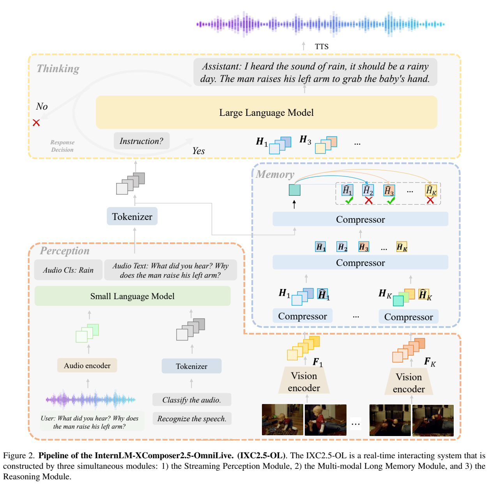
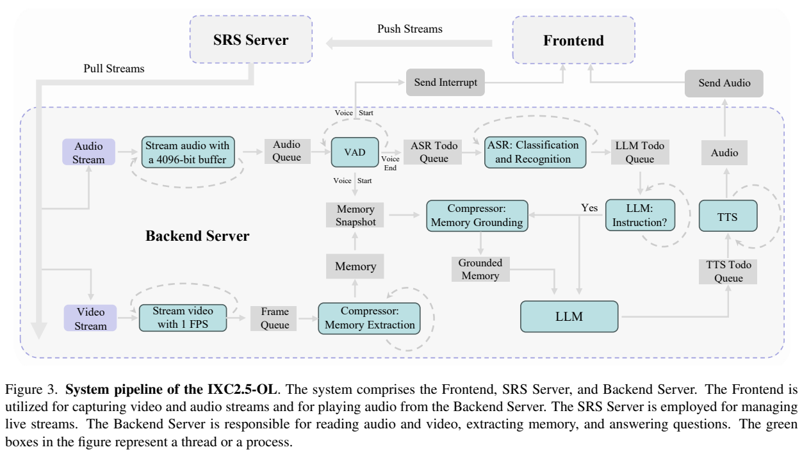
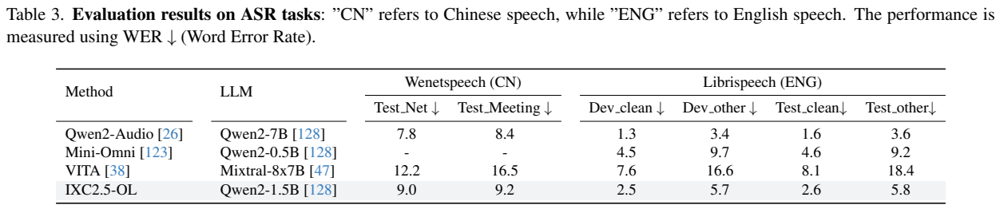
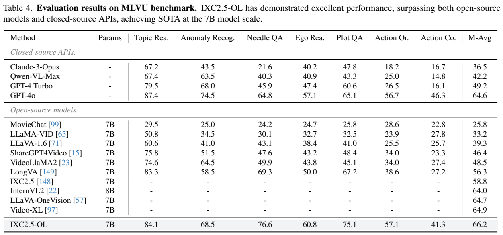
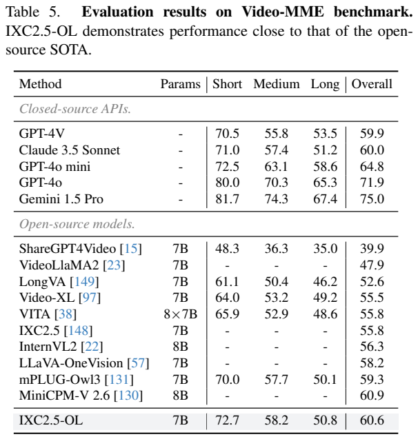
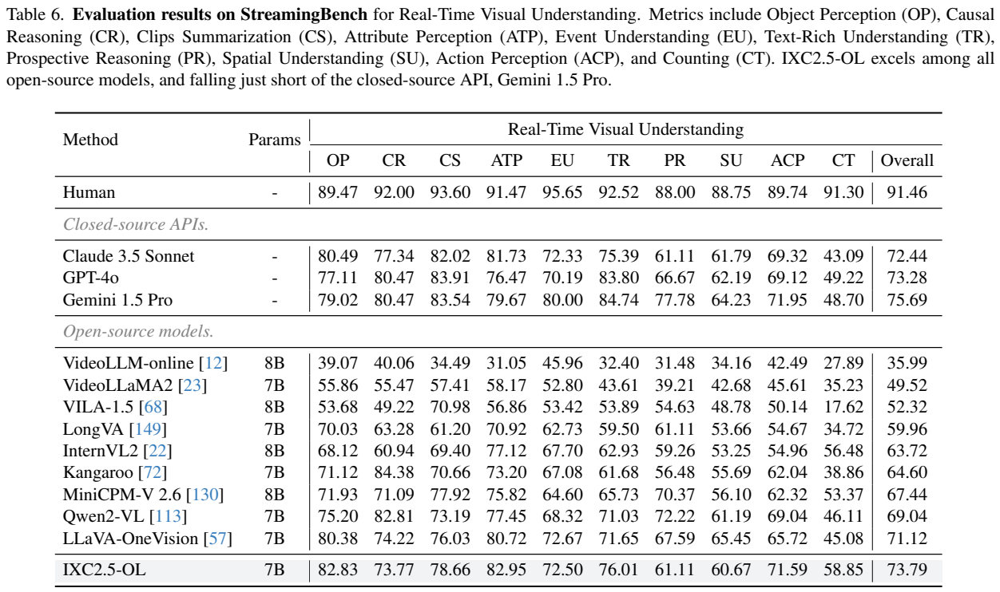
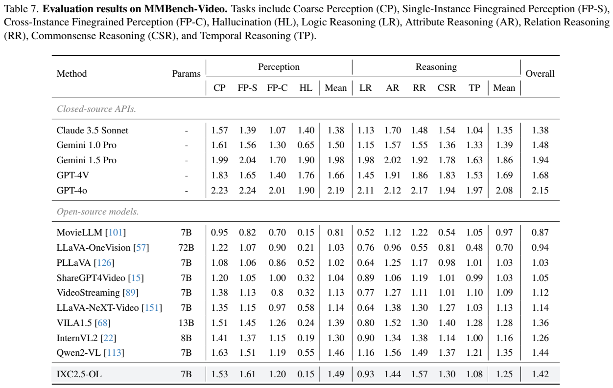

<!-- article-header:start -->
[项目首页](../../../README.md) › [模型系列](../../../reports/model-family-index.md) › [InternLM-XComposer](../README.md)
<!-- article-header:end -->

# InternLM-XComposer2.5-OmniLive：把流式感知、长记忆与推理解耦

<!-- article-toc:start -->
<a id="article-toc"></a>

**本篇目录** · [论文定位](#paper-info) · [快速概览](#overview) · [整体架构](#architecture) · [核心原理](#principles) · [数据构建](#data) · [训练流程](#training) · [实验结果](#experiments)
<!-- article-toc:end -->

<a id="paper-info"></a>

## 1. 论文信息与模型定位

**论文**：*InternLM-XComposer2.5-OmniLive: A Comprehensive Multimodal System for Long-term Streaming Video and Audio Interactions*；**作者**：Pan Zhang、Xiaoyi Dong、Yuhang Cao、Yuhang Zang、Rui Qian 等；**机构**：上海人工智能实验室、香港中文大学等；**版本**：[arXiv:2412.09596v1](https://arxiv.org/abs/2412.09596v1)，2024 年 12 月 12 日；**代码与模型**：[官方项目](https://github.com/InternLM/InternLM-XComposer/tree/main/InternLM-XComposer-2.5-OmniLive)。本文依据首版 16 页报告。

OmniLive 面向持续的视频、声音输入及语音交互。它希望在回答用户时继续感知环境，并从历史视频中找回相关片段。核心方案是一个由专门模块组成的系统：音频理解、视频感知、压缩记忆、视觉语言推理和语音合成分别工作，再由队列与中断机制连接。因此，“Omni”在此首先体现系统支持多种模态，不代表首版已用一个统一端到端模型联合训练全部视听输入与声音输出。[原文 §1、§2，PDF 第 1–3 页](https://arxiv.org/pdf/2412.09596v1#page=1)

论文明确把跨模态联合训练列为未来方向。它还将降低系统延迟列为后续工作；报告中的实时架构不能直接换算为已测得的响应毫秒数或长时间服务稳定性。

<a id="overview"></a>

## 2. 快速概览

| 组件或结果 | 首版披露 |
|---|---|
| 音频感知 | Whisper 编码器、投影器、小语言模型，输出事件类别与语音转写 |
| 视频感知 | CLIP-L/14 编码实时帧 |
| 记忆模块 | 基于 Qwen2 小模型，学习片段压缩、记忆整合和相关片段检索 |
| 推理模块 | 改进的 InternLM-XComposer2.5，加记忆投影器 |
| 交互输出 | 文字回答经独立 TTS 转为声音；语音开始可中断播放 |
| 在线采样与基准 | 系统视频采样为 1 FPS；视频基准使用每视频 64 个抽样帧 |
| 主要结果 | MLVU 66.2、MVBench 68.7、StreamingBench 73.79、Video-MME 60.6 |

原文方法称音频与记忆小模型为 **Qwen2-1.8B**，ASR 结果表及正文又写 **Qwen2-1.5B**。这里保留不一致，不将两种标注伪装成统一配置。视频表中的 7B 对应主要视觉语言推理模型，不能理解为包含全部小模型、编码器和 TTS 的系统总参数量。[原文 §3.1–3.3、Table 3，PDF 第 3–7 页](https://arxiv.org/pdf/2412.09596v1#page=3)

<a id="architecture"></a>

## 3. 整体架构



**读图方式**：左下角音频路径先识别背景声音与语音内容；右下角视觉路径编码各视频片段。右侧记忆区域逐级压缩，并按问题筛选片段；上方语言模型使用声音转写、相关视觉片段和记忆回答。最上方波形来自后续 TTS。图中多个 Compressor 方块表示压缩过程，不是为每段视频新增一个独立大模型。

音频模块用 Whisper 将输入变成连续特征，投影到小语言模型的输入空间，再输出“声音类别”和“语音文本”。这样，雨声、敲门声或笑声能够以文本形式交给推理模块。视频模块独立使用 CLIP-L/14，避免在首版中让视听联合训练彼此干扰。记忆模块存储视觉细节与跨片段摘要，推理模块通过额外投影器读取记忆，同时看检索到的原片段。[原文 §3.1–3.3，PDF 第 3–5 页](https://arxiv.org/pdf/2412.09596v1#page=3)



**读图方式**：绿色方框代表线程或进程。视频持续进入 Frame Queue，再进行记忆提取；音频经过 VAD、ASR、指令判断、记忆检索、回答和 TTS。Voice Start 的箭头一方面中断前端播放，另一方面保存当时的记忆快照。快照使问题绑定到用户开始说话附近的环境状态，而不任由之后的视频覆盖它。

前端通过摄像头与麦克风采集，SRS 接收和分发实时流，前后端通过 WebSocket 传输声音与中断信号。后端每秒取一帧视频。语音结束后，整段语音进入 ASR 队列；推理模型先判断是否为需要回答的指令，避免对“嗯”“好”等输入立即作答。正文把音频缓冲写成 **4096-bit**，图中也采用该标注，本文不擅自改为字节或毫秒。语音合成可使用 F5-TTS、MeloTTS 等独立系统。[原文 §3.4，PDF 第 5–6 页](https://arxiv.org/pdf/2412.09596v1#page=5)

这种异步设计让感知在推理过程中继续运行，但系统仍存在串行依赖：完整语音片段须先转写，再判断与检索，再生成、合成。它与单一模型直接产生流式语音的机制不同，延迟需要实测各环节与队列调度才能确定。

<a id="principles"></a>

## 4. 核心创新与数学原理

记忆模块的目标是降低历史视频对主推理上下文的占用，而不是无限保存全部原始 token。对第 $`k`$ 段视频，视觉特征记为 $`F_k\in\mathbb R^{TN\times C}`$，其中 $`T`$ 为帧数、$`N`$ 为每帧特征数量、$`C`$ 为通道维度。短期记忆 $`H_k\in\mathbb R^{TP\times C}`$ 由空间下采样初始化，另有全局记忆 $`\hat H_k\in\mathbb R^{1\times C}`$。原文压缩写为：


```math
H_k,\hat H_k=\mathrm{Compressor}([F_k\circ H_k\circ\hat H_k]).
```


$`\circ`$ 表示序列拼接。利用语言网络的自回归与特征聚合，指定记忆位置吸收片段信息。短期记忆保留较多局部细节，全局向量提供较粗的片段摘要。[原文 §3.2，PDF 第 4–5 页](https://arxiv.org/pdf/2412.09596v1#page=4)

对多个片段，再将短期与全局记忆拼接输入 Compressor，产生：


```math
\bar H_1,\ldots,\bar H_k=\mathrm{Compressor}([H_1\circ\cdots\circ H_k\circ\hat H_1\circ\cdots\circ\hat H_k]),
\qquad \bar H\in\mathbb R^{k\times C}.
```


长期表示以每片段一个向量描述历史，从而比全部帧特征紧凑。其长度仍随片段数量 $`k`$ 增长；首版没有给出无限时长下的固定容量、淘汰策略或信息保真保证。

检索时，将长期记忆与分词后的问题送入 Compressor，取最后一个 token 的特征作为记忆空间中的问题表示，再计算它与各片段全局记忆的相似度。最相关的片段及对应短期记忆被交给推理模块。原文没有在这里明确给出相似度函数、固定 top-k 或检索损失权重，本文不补写成已披露的余弦 softmax 公式。[原文 §3.2，PDF 第 5 页](https://arxiv.org/pdf/2412.09596v1#page=5)

另一项关键是处理“隐式指代”。“我饿了，哪里能热三明治”未直接说微波炉，需要根据功能寻找此前看到的物体；“这是什么”只用代词，需要偏向当前场景。检索数据因此不仅训练名词匹配，还训练语义用途与时间指代。指令预测则在生成之前增加是否回答的判断，系统不必对每段声音都输出长回答。

<a id="data"></a>

## 5. 数据构建与处理

音频预训练专注 ASR，Table 1 列 GigaSpeech、WenetSpeech。SFT 加入转写与声音分类，涵盖 LibriSpeech、VCTK、AISHELL-1/4、MD-RAMC、ASCEND、KeSpeech、DASR 和 CommonVoice；CommonVoice 只取英文和中文。分类使用 FSD50K、AudioSet，并构建 **475 条静音样本**。静音类别提供“未发生明显声音”这一训练情形，但论文没有公布分类阈值或证明所有安静环境都能正确识别。[原文 Table 1，PDF 第 3 页](https://arxiv.org/pdf/2412.09596v1#page=3)

记忆压缩使用多个来源的短视频描述，并沿用 VideoStreaming 的 prefix captioning 任务。记忆整合与检索还使用已有视频定位数据，以及自行构建的“语义隐式问题”“指代隐式问题”。Table 2 列出 ShareGPT4Video、Ego4D、ActivityNet 与两类隐式 QA；主推理模型的视频数据包括 ShareGPT4Video、ActivityNet、FunQA、TrafficQA、VideoChat2-IT、LLaVA-Video。[原文 §3.2、Table 2，PDF 第 5 页](https://arxiv.org/pdf/2412.09596v1#page=5)

这些数据承担不同任务：描述帮助压缩记忆保留可表达信息，定位数据连接问题与时间片段，隐式 QA 扩展检索依据，推理 QA 则学习依据片段作答。不能把它们合成一个未经披露的“全模态统一预训练集”。首版未给出隐式 QA 的最终条数、全部生成与审核方法、来源混合比例、完整去重以及评测污染检查。音频表中的分来源样本数也不能直接相加解释为独立用户或小时数。

<a id="training"></a>

## 6. 训练流程与目标

报告明确说明音频模块分预训练和 SFT 两阶段：先学习语音转写，再加入分类及更丰富的语音场景。记忆模块分三个训练任务，即视频片段压缩、记忆整合、片段检索；推理模块从改进的 XComposer2.5 初始化并加入记忆投影器。推理输入显式包括问题、相关视频片段、相关记忆，再生成回答。[原文 §3.1–3.3，PDF 第 3–5 页](https://arxiv.org/pdf/2412.09596v1#page=3)

这解释了各部分学习什么，但首版没有公开可完整复现的训练配方：没有统一列出学习率、batch size、训练步数、优化器、冻结组件、显卡数和总训练成本；也没有给出多个任务损失的联合权重。Whisper 或 CLIP 已预训练这一事实，不足以推断它们在本文训练中全部冻结或全部更新。

为帮助理解生成式监督，可以将转写或问答理解为在输入特征与指令下学习目标文字；将检索理解为让问题表示与正确片段更相关。这只是任务含义的解释。原文没有给出完整损失公式，因此本文不写出具体对比损失、分类头或梯度停止规则作为作者方法。

推理时的队列、中断、记忆快照和 TTS 属于运行流程，而不是额外训练阶段。首版系统把声音转换为文本后交给推理模型，视频通过特征记忆与原片段输入；跨全部模态的联合训练是未来工作。本仓库只整理报告，没有运行或测量系统。

<a id="experiments"></a>

## 7. 实验设置与主要结果







**读表方式**：Table 3 的 WER 带向下箭头，越低越好；Table 4 的 M-Avg 为七个多选任务的汇总；Table 5 按短、中、长视频区分。ASR 的 9.0 与视频的 66.2 不是同一种分数。音频结果表的 1.5B 标注也与方法部分 1.8B 有差异。

| 评测 | 本文结果 | 对照与范围 |
|---|---:|---|
| WenetSpeech Test Net / Meeting WER | 9.0 / 9.2 | 优于表中 VITA 12.2 / 16.5，逊于 Qwen2-Audio 7.8 / 8.4 |
| LibriSpeech Test clean / other WER | 2.6 / 5.8 | 优于 Mini-Omni 4.6 / 9.2，逊于 Qwen2-Audio 1.6 / 3.6 |
| MLVU M-Avg | 66.2 | 表中 GPT-4o 64.6、Video-XL 64.9 |
| Video-MME overall | 60.6 | MiniCPM-V2.6 60.9、GPT-4o 71.9、Gemini1.5Pro 75.0 |
| MVBench Avg | 68.7 | InternVL2 64.5、GPT-4o 57.5，均为本文表中的配置 |
| MMBench-Video overall | 1.42 | Qwen2-VL 1.44、GPT-4o 2.15；不是百分比正确率 |

视频基准使用每视频 **64 个抽样帧**。MLVU 视频为 3 分钟至 2 小时，本文只评七个多选任务；并非 MLVU 全部九类任务。Video-MME 的短、中、长结果分别为 72.7、58.2、50.8，随视频变长仍明显下降。因此，长记忆设计不意味着长视频信息没有损失。[原文 §4.2、Table 4–8，PDF 第 7–9 页](https://arxiv.org/pdf/2412.09596v1#page=7)





**读表方式**：Table 6 覆盖对象、因果、片段总结、属性、事件、文字、前瞻、空间、动作和计数；整体高不表示每项都最好。Table 7 将感知与推理分别汇总，开放答案由 GPT-4 评估，分数受评审设置影响。

StreamingBench 本身包含 18 项任务、900 个视频、4500 个人工 QA，本文采用实时视觉理解部分。整体 **73.79**，高于表中的 LLaVA-OneVision 71.12 与 GPT-4o 73.28，低于 Gemini1.5Pro 75.69、人类 91.46。差值 2.67 是相对 LLaVA-OneVision 的百分点增加。细项前瞻推理 61.11、空间理解 60.67，仍低于若干对照；不能把整体结果写成所有流式能力最佳。[原文 Table 6，PDF 第 8 页](https://arxiv.org/pdf/2412.09596v1#page=8)

MMBench-Video 采用 600 个视频、2000 个 QA，时长 30 秒至 6 分钟，依赖 GPT-4 对开放答案评分。本文感知均分 1.49，高于表中 Qwen2-VL 1.46，但推理均分 1.25 低于其 1.35，整体 1.42 也略低于 1.44。作者对感知表现的描述不能扩展成所有开放问答能力领先。

这些实验支持模块组合在语音转写、常规视频与实时视觉任务中的有效性，尚不能直接验证连续数日记忆检索、端到端响应时延或交互中断成功率。报告缺少专门的记忆组件消融、量化检索精度、实时吞吐曲线和长时间部署实验。系统分工是方法贡献，实际服务成本与长期可靠性仍需要额外测量。

<!-- article-footer:start -->
---

[← 上一篇：StreamChat](../../streamchat/arxiv-2412.08646/README.md) · [按发表时间浏览](../../../reports/paper-reading-guide.md#year-2024) · [下一篇：Apollo →](../../apollo/arxiv-2412.10360/README.md)

[返回本篇目录](#article-toc) · [返回模型系列](../README.md)
<!-- article-footer:end -->
