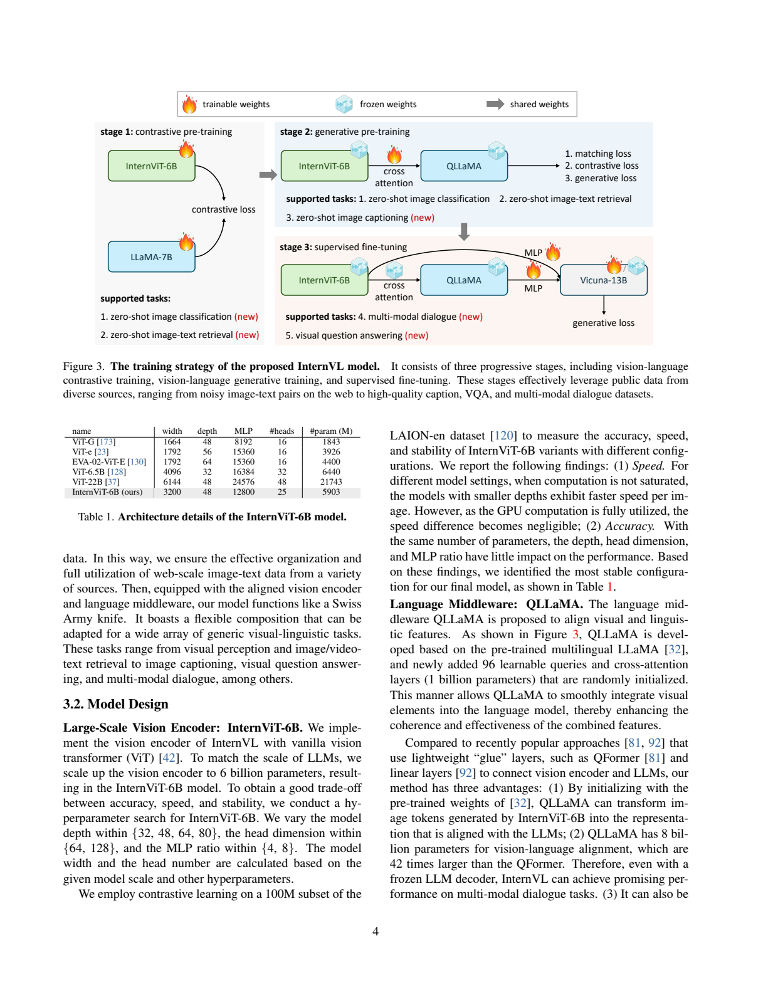
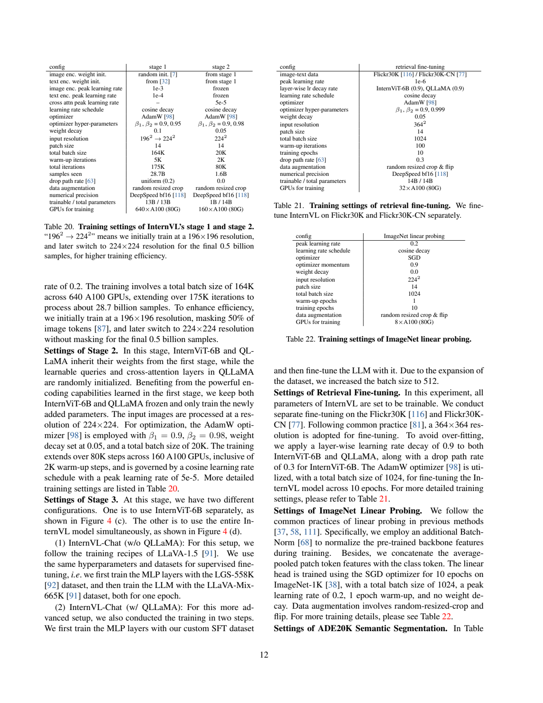
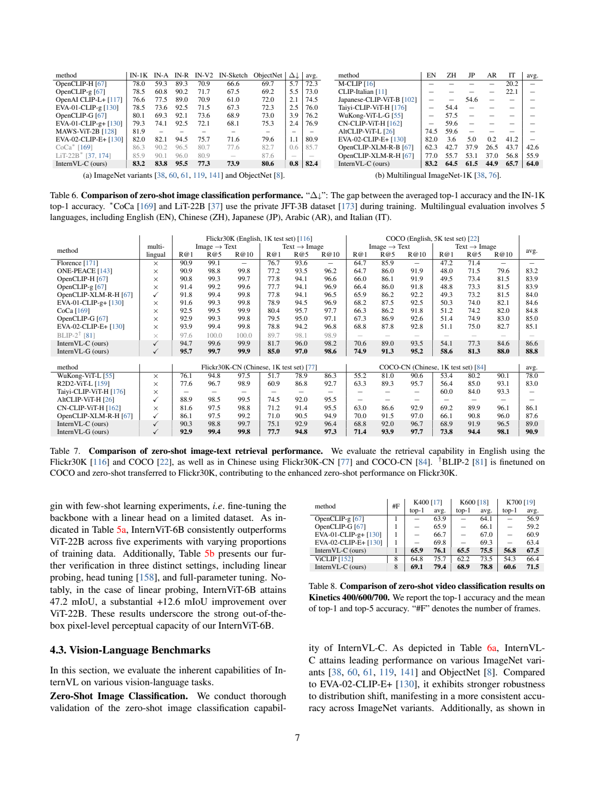
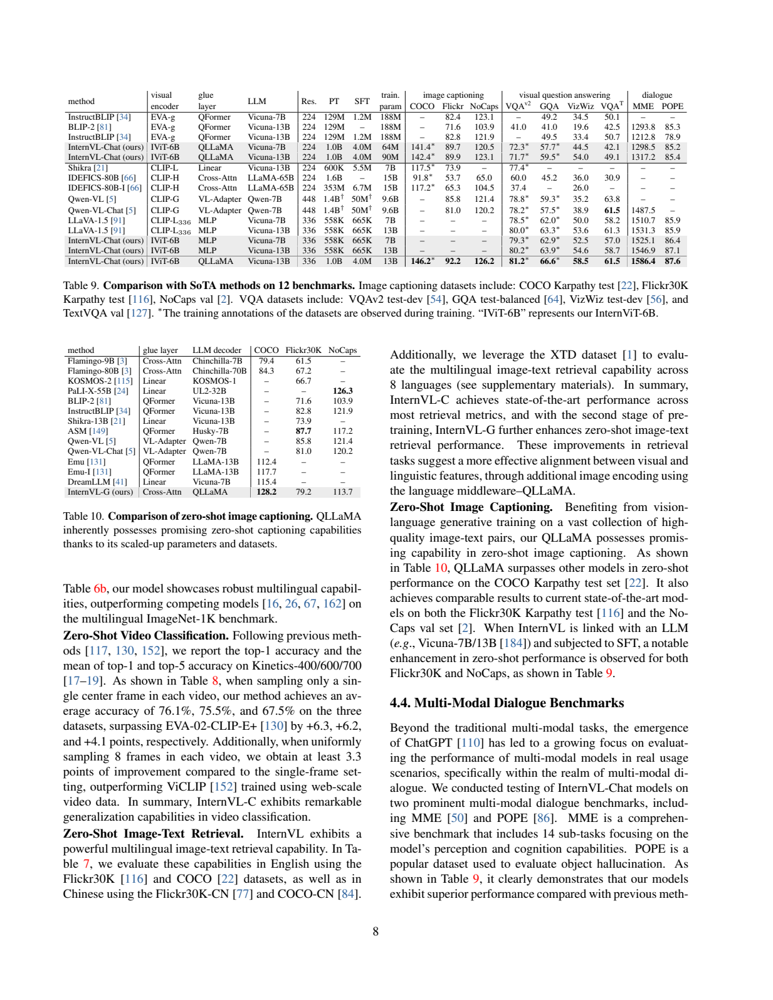

# InternVL：扩展视觉骨干并逐步对齐语言模型

## 1. 论文信息与模型定位

**论文**：[InternVL: Scaling up Vision Foundation Models and Aligning for Generic Visual-Linguistic Tasks](https://arxiv.org/abs/2312.14238)，本文依据 2023 年 12 月 21 日的 [v1 报告](https://arxiv.org/pdf/2312.14238v1)，不是后续 InternVL2/3 的训练配方。作者 Zhe Chen、Jiannan Wu、Wenhai Wang、Weijie Su 等，机构包括南京大学、上海人工智能实验室 OpenGVLab、香港大学、香港中文大学、清华大学、中国科学技术大学、商汤。

原始 InternVL 是一套视觉语言基础模型：**InternViT-6B 视觉编码器 + 8B QLLaMA 语言中间件**，可以作为分类/分割骨干、图文检索模型、caption 模型，再接入 Vicuna 等解码器形成聊天系统。它关注视觉骨干与语言模型之间的参数规模、表示空间和连接能力；不能把全部检索、分割与聊天指标归给同一个单一配置。

## 2. 快速概览

| 组件或版本 | 具体含义 |
|---|---|
| InternViT-6B | 实际约 5.903B，48 层、宽度 3200、25 注意力头、MLP 12800 |
| QLLaMA | 多语言 LLaMA-7B 初始化，新增 96 queries 和约 1B 交叉注意力参数，总约 8B |
| InternVL-C | 视觉编码器全局特征与文本 EOS 特征比较，偏向对比任务 |
| InternVL-G | 由 QLLaMA queries 再组织视觉特征，支持生成与检索 |
| InternVL-Chat | 可仅使用 InternViT+MLP，也可使用完整 InternVL 后接 LLM |
| 渐进对齐 | 先在噪声大数据上做对比学习，再在高质量 caption 上学匹配与生成 |
| 数据规模 | 第一阶段 4.98B 可用图文对；第二阶段 1.03B；SFT 约 4M |

这里的 QLLaMA 是重要的可复用中间件，规模远大于常见轻量连接器。它既编码文本，也用查询向量重组视觉表示；将它统称成一个小线性投影，会遗漏论文主要设计。

## 3. 整体架构

**读图：Figure 3/Table 1，PDF 第 4 页。** 左边对比训练同时更新 InternViT 与文本 LLaMA；右上冻结已有主体，仅训练新交叉注意力等接入参数；右下新增 MLP 与聊天解码器。图中解码器同时标有冻结和训练，表示不同 SFT 配置，而不是它在全部阶段都冻结。

InternViT 使用标准 ViT、patch size 14，从随机初始化训练，**不是直接沿用一个 CLIP 权重的 6B 放大版**。图像 $I\in\mathbb R^{H\times W\times3}$ 输出空间特征 $F\in\mathbb R^{H/14\times W/14\times D}$，可以接密集预测头，也可池化后用于分类。最终配置由同规模架构搜索选出，作者比较深度、注意力头维度和 MLP 比例，兼顾速度与稳定性。

QLLaMA 从已预训练的多语言 LLaMA 初始化，加入随机初始化的 96 个可学习查询和交叉注意力。查询读取视觉特征，把多位置信息组织成适合语言空间的表示。生成时查询特征作为 QLLaMA 的视觉前缀逐 token 生成 caption；聊天时又通过 MLP 接一个外部语言解码器。因此原始 InternVL 的中间件与最终 Vicuna 解码器是两个不同组件。

## 4. 核心创新与数学原理

首先是**参数和表示的共同扩展**。视觉骨干约 6B、中间件约 8B，避免仅靠随机初始化的小连接器承担全部跨模态对齐。第一阶段同时更新视觉与多语言文本编码器；第二阶段继承第一阶段语言权重，再训练查询和交叉注意力。这样先得到可比较的全局空间，再学习如何从图像组织生成条件。

对比任务中，InternVL-C 对视觉特征 attention pooling 得到 $I_f$，文本取 QLLaMA 的 EOS 表示 $T_f$，通过相似度做分类或检索；InternVL-G 则对查询特征池化。训练使用 CLIP 式对称交叉熵：同批正配对为目标，其他图文组合构成负例。用解释性记号可写 $\mathcal L_{CL}=\tfrac12(\mathcal L_{I\to T}+\mathcal L_{T\to I})$；这是对原文目标的归纳，报告未给该编号公式或全部温度细节。

第二阶段明确采用 BLIP-2 风格三项目标之和：

$$
\mathcal L_{stage2}=\mathcal L_{ITC}+\mathcal L_{ITM}+\mathcal L_{ITG}.
$$

ITC 保持图文可比表示，ITM 判断图文配对，ITG 学图像条件下逐 token 生成文本。它们补充不同监督，不把匹配理解成生成，也不将查询重组理解成人工物体检测。报告没有展开三项具体实现的全部掩码和负样本采样规则，本文不补造。

第二个创新是**按监督要求筛数据**。全局对比允许较多噪声，而生成需要可读、完整且与图像相关的 caption；先宽后严使两类训练各自使用合适数据。第三是组件组合：视觉骨干可独立承担像素级任务，对齐后的全模型可接多种 LLM，这与只发布聊天权重的工作范围不同。

## 5. 数据构建与处理

第一、二阶段来源包括 LAION-en、LAION-multi、LAION-COCO、COYO、Wukong、CC12M、CC3M、SBU。原始汇总 **6.03B** 图文对，第一阶段清洗后 **4.98B**，第二阶段再筛至 **1.03B**。LAION-COCO 的 663M caption 由 BLIP-L/14 与 CLIP 相关流程生成；不能把这些都描述为人工标注。多语言来源给文本塔提供跨语言表示训练。

第一阶段考虑六类质量因素：CLIP 相似度、水印概率、不安全概率、审美分、图像分辨率、caption 长度；过滤极端样本，并去掉与 ImageNet-1K/22K、Flickr30k、COCO 重复的数据。下载失败也影响保留量。第二阶段更严格检查 caption 的长度、完整性、可读性，过滤乱码、模板菜单/报错、重复文本、冒犯语言、占位文本、源码等。报告给出规则类型，但没有完整阈值与所有去重实现。

SFT 约四百万样本覆盖 caption **588K**、VQA **1.1M**、OCR **294K**、grounding **323K**、grounded caption **284K**、conversation **1.4M**。来源包括 COCO/TextCaps、VQAv2/GQA/OKVQA、ChartQA/DocVQA/InfoVQA、RefCOCO 系列、LLaVA、SVIT、VisDial、LRV-Instruction。只用各数据训练集；非对话标注转换为问答格式，SVIT 同一图像的问答合并为对话，LLaVAR 仅用 20K 高质量数据。

TextCaps 训练使用 OCR token，说明本文不能概括成所有数据管线完全无 OCR 辅助。表中“seen samples”是重复抽样后的累计曝光数，区别于不同图文对的 4.98B/1.03B。

## 6. 训练流程与目标

**读图：Table 20，PDF 第 12 页。** 左表第一、二阶段列分别有训练参数与总参数、数据曝光、GPU 和优化器；右侧 retrieval fine-tuning 和 linear probing 是下游任务配置，不能混入基础模型预训练。

| 配置 | 对比预训练 | 生成预训练 |
|---|---|---|
| 可训练 / 总参数 | 13B / 13B | 1B / 14B，仅新查询/交叉注意力等 |
| GPU | 640×A100 80GB | 160×A100 80GB |
| batch / 步数 | 164K / 175K | 20K / 80K |
| 样本曝光 | 28.7B | 1.6B |
| AdamW $\beta_1,\beta_2$ | 0.9, 0.95 | 0.9, 0.98 |
| weight decay | 0.1 | 0.05 |
| 峰值学习率 | 视觉 $10^{-3}$，文本 $10^{-4}$ | 新参数 $5\times10^{-5}$ |
| warmup | 5K 步 | 2K 步 |

两阶段均余弦衰减、bf16。第一阶段先用 196×196 并遮盖 50% 图像 token；最后 0.5B 曝光改为 224×224、不遮盖，drop path 0.2。第二阶段固定 224×224、drop path 0，已有视觉与语言主体冻结，仅新增约 1B 参数更新。

SFT 有不同设置：**224 分辨率的冻结解码器适配**只训练约 64M/90M 接入参数；**336 分辨率完整微调配置**在 Table 9 列 7B/13B 可训练参数。附录说明无 QLLaMA 版先以 LGS-558K 训练 MLP，再用 LLaVA-Mix-665K 微调 LLM，各一 epoch；含 QLLaMA 版先训练 MLP、再微调 LLM，采用自建 SFT 数据且 batch 增至 512。不能统一声称 InternVL-Chat 永远冻结语言模型。

检索微调另外以 364×364、batch 1024、10 epoch、峰值 $10^{-6}$、层间衰减 0.9 更新全模型；英语和中文 Flickr30k 分别微调。这些带 -FT 的结果应与 zero-shot 结果分开。

## 7. 实验设置与主要结果

**读图：Table 6–8，PDF 第 7 页。** Table 6 是 top-1；Table 7 按 Image→Text/Text→Image 分 R@1/5/10；Table 8 的 avg 是 **top-1 与 top-5 平均**，不是同名数据集的 top-1。例如八帧 K400 top-1 **69.1**，avg **79.4**，不能引用后者作为分类准确率的 top-1。

视觉骨干线性探测 ImageNet-1K **88.2**，仍低于使用私有 JFT 的 ViT-22B **89.5**；ADE20K 冻结骨干线性头 **47.2 mIoU**，ViT-22B 为 **34.6**。分割全量微调+UperNet 则为 **58.9 对 55.3**，这是不同监督条件，不能把它写成零样本分割。

InternVL-C 零样本 ImageNet-1K **83.2**，EVA-02-CLIP-E+ **82.0**；五种语言平均 **64.0**，英语83.2、中文64.5、日语61.5、阿拉伯语44.9、意大利语65.7。多语言并不等于各语言能力一致。

| 零样本检索，R@1 | InternVL-C | InternVL-G |
|---|---:|---:|
| Flickr30k 1K，图→文 / 文→图 | 94.7 / 81.7 | **95.7 / 85.0** |
| COCO 5K，图→文 / 文→图 | 70.6 / 54.1 | **74.9 / 58.6** |
| Flickr30k-CN 1K，图→文 / 文→图 | 90.3 / 75.1 | **92.9 / 77.7** |

生成预训练后的 G 比 C 更强，但 BLIP-2 的 Flickr30k **97.6/89.7** 更高；原表注明其已在 COCO 微调，比较前应读脚注。视频检索八帧是各帧独立编码后平均嵌入，不含时序注意力，MSR-VTT 1K 上 G 的视频→文/文→视频 R@1 **42.4/46.3**。这些证据不能证明完整时序关系理解。

**读图：Table 9/Table 10，PDF 第 8 页。** 上表 224 与 336 分辨率、QLLaMA 与 MLP、训练数据和可训练参数各不相同；星号明确标出训练见过相应数据集训练标注。最高配置为 **336、QLLaMA、Vicuna-13B、约4M SFT**：COCO **146.2 CIDEr**、Flickr30k **92.2**、NoCaps **126.2**；VQAv2 **81.2**、GQA **66.6**、VizWiz **58.5**、TextVQA **61.5**、MME **1586.4**、POPE **87.6**。COCO/VQAv2/GQA 带 seen 标记，不能全称零样本。TextVQA 仍低于 Qwen-VL **63.8**。

Table 10 的 **InternVL-G 自身零样本 caption** 是 COCO **128.2**、Flickr30k **79.2**、NoCaps **113.7**；不是 Table 9 聊天 SFT 后的分数，也没有全面超过 PaLI-X 的 NoCaps **126.3**。224 仅轻量适配的 Vicuna-13B 版本 MME **1317.2**，亦不能与最高配置混为一谈。

组件消融 Table 12 在较简设置中报告：相同 665K 数据与 Vicuna-7B，InternViT+MLP 的 MME **1022.3**，换成 QLLaMA **1227.5**；换约4M数据后 **1298.5**。这支持中间件与领域数据各有增益，但大数据版不是控制所有变量的单组件消融。规模搜索准确率相近，说明选择还考虑稳定性/吞吐；附录 A100 批量128图文编码测试，336输入 C 为40.1ms、G为50.4ms，G更慢。它们是编码测试，不是聊天端到端 token 吞吐。

整体证据支持大视觉骨干、语言初始化中间件与渐进对齐的可复用性。其分类、检索、分割和聊天结果来自不同模式、监督与数据，读者应按任务选配置，而不是由“32 个基准”推断一个模型在所有条件全面领先。
