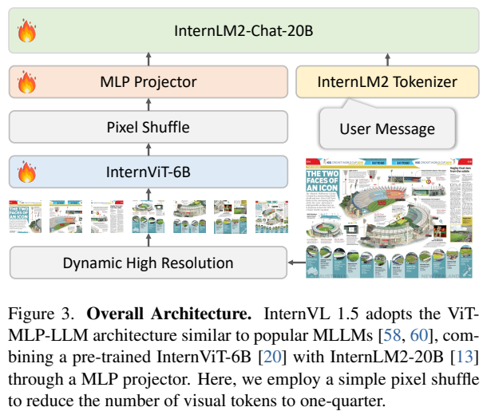
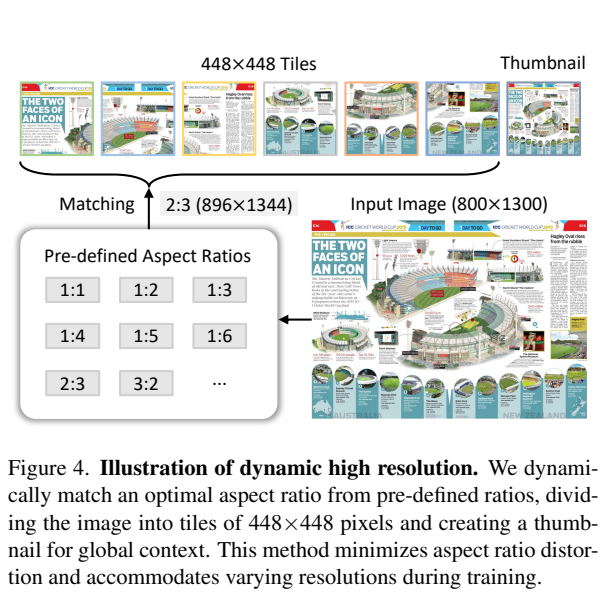
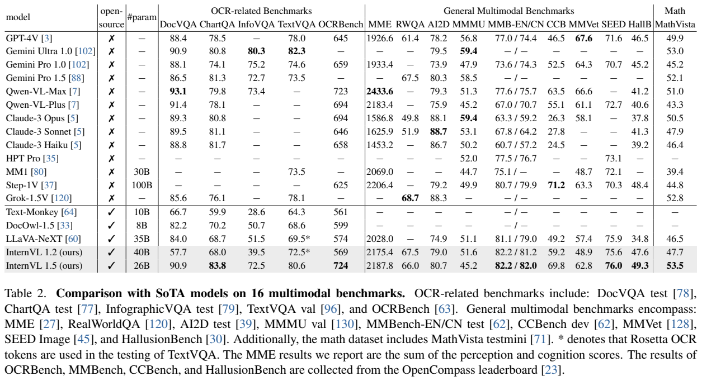
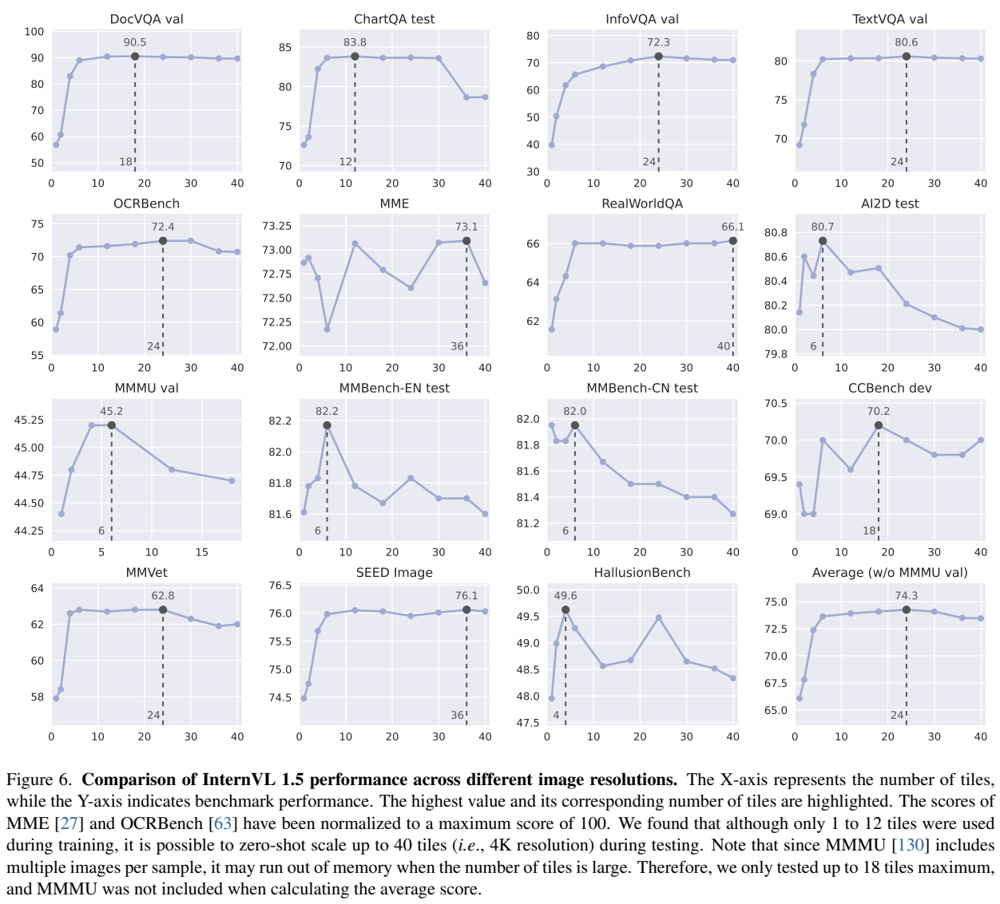

<!-- article-header:start -->
[项目首页](../../../README.md) › [模型系列](../../../reports/model-family-index.md) › [InternVL](../README.md)
<!-- article-header:end -->

# InternVL 1.5：用大视觉骨干、动态分块和双语数据改善多模态理解

<!-- article-toc:start -->

**本篇目录** · [论文定位](#paper-info) · [快速概览](#overview) · [整体架构](#architecture) · [核心原理](#principles) · [数据构建](#data) · [训练流程](#training) · [实验结果](#experiments)
<!-- article-toc:end -->

## 1. 论文信息与模型定位

| 项目 | 内容 |
|---|---|
| 原文题名 | How Far Are We to GPT-4V? Closing the Gap to Commercial Multimodal Models with Open-Source Suites |
| 作者与机构 | Zhe Chen、Weiyun Wang、Hao Tian、Shenglong Ye 等；上海人工智能实验室、商汤、清华、南京大学、复旦、香港中文大学 |
| 版本 | [arXiv:2404.16821v1](https://arxiv.org/abs/2404.16821v1)，2024 年 4 月 25 日；18 页报告 |
| 模型家族 | InternVL 1.5；报告以约 26B 档系统对比前代约 40B 的 InternVL 1.2 |
| 官方资源 | [OpenGVLab/InternVL](https://github.com/OpenGVLab/InternVL)、[InternVL-Chat-V1-5 权重](https://huggingface.co/OpenGVLab/InternVL-Chat-V1-5) |
| 定位 | 中英文图像理解和对话，重点增强 OCR、文档与图表；本文没有图像合成模块 |

核心组合是 InternViT-6B 与 **InternLM2-Chat-20B**。这里采用聊天版本的语言骨干，而非基础版本。题名强调向 GPT-4V 靠近，实际结论应依据各基准：OCR 和中文任务显著增强，但跨学科和多轮对话仍有差距。

## 2. 快速概览

InternVL 1.5 没有设计一个完全不同的生成架构，而是在 ViT—投影器—LLM 这条常见路径上改进视觉能力、分辨率处理和训练数据。视觉编码器继续训练，使其从自然图文分布适应 OCR 与文档；输入图像按宽高比切成 448×448 子图，加一张缩略图；高质量中英文监督让模型直接学习中文视觉问答。

训练最多使用 12 个局部子图，测试可增至 40 个。每个子图经像素重排后为 256 个视觉 token，最大测试视觉长度加上缩略图达到 10,496。增加分块不是免费提升：OCR 的细字可读性改善，但有些一般问答任务只需要较低分辨率，过多分块反而略降成绩。

报告的 DocVQA test 为 90.9、ChartQA test 为 83.8、TextVQA val 为 80.6；MMMU val 为 45.2，低于前代的 51.6 和 GPT-4V 的 56.8。新系统变得更擅长文档，并未在所有任务上全面优于更大语言骨干的前代。

## 3. 整体架构

*原文 Figure 3，PDF 第 3 页原文图表裁图。像素重排位于 ViT 之后、投影器之前；图中的模块训练符号需要结合两阶段训练解释。*

输入首先执行动态高分辨率分块，每个 tile 由 InternViT 编码。像素重排将空间 token 数量减为四分之一，MLP 把视觉特征维度映射到语言模型输入空间，与分词后的用户信息一同进入 InternLM2-Chat-20B。MLP 在连接新视觉与语言骨干时随机初始化；报告没有单独公开其全部隐藏宽度和激活函数。

视觉骨干经历版本延续。InternVL 1.2 发现倒数第四层特征较适合多模态任务，于是丢弃末三层，将原 48 层骨干减为 45 层，并将分辨率从 224 提升至 448。在与 Nous-Hermes-2-Yi-34B 配合时更新视觉编码器和 MLP，得到 InternViT-6B-448px-V1.2。1.5 继续训练该骨干，改为动态分辨率，并接入 InternLM2-20B。6B 是沿用的模型名称及规模档位，不是截去三层后重新逐参数核算的精确数。

视觉骨干从 Yi-34B 迁移到 InternLM2-20B 后仍有效，说明这种视觉训练不只适用于一种语言模型。报告展示的是这两套实际系统之间的迁移，并没有证明视觉表示可无条件接入所有 LLM。

## 4. 核心创新与数学原理

**按宽高比匹配有限网格。** 给定原图宽高比 $`a=W/H`$，可用如下记号解释第 3.3 节的匹配：

$$
\mathcal G=\{(u,v)\in\mathbb N_+^2:uv\le12\},\qquad
(u^*,v^*)\in\arg\min_{(u,v)\in\mathcal G}\vert a-u/v\vert .
$$

这是本介绍的流程形式化，原文没有编号公式。集合有 35 个整数网格组合；不同组合可能宽高比相同，例如 1×1 和 2×2，所以不能说存在 35 个互不相同的比例。比例并列时，原文依据面积选择以避免放大到输入面积的两倍以上，未在报告中给出完整程序级边界规则。图像缩放至 $`448u^*\times448v^*`$ 后再切块。

*原文 Figure 4，PDF 第 4 页，原文图表裁图。示例变为 896×1344 后切成六个子图；缩略图展示完整布局，局部图提供更清楚的文字和细节。*

**把局部空间组织压进特征通道。** 每个 448×448 tile 的 14 像素 patch 网格有 32×32=1024 个位置；空间降采样的 pixel shuffle 将相邻位置重排到通道，使空间长度变为 16×16=256。其标准张量解释为：

$$
F\in\mathbb R^{32\times32\times C}
\longrightarrow F'\in\mathbb R^{16\times16\times4C}
\longrightarrow Z\in\mathbb R^{256\times d_{LLM}}.
$$

这说明重排本身与简单平均池化不同；最终映射仍要靠 MLP 学习如何使用邻域信息。该式是标准重排维度推导，不是原文新损失或编号公式。

若有 $`n>1`$ 个局部 tile 并加入缩略图，视觉长度为 $`256(n+1)`$：12 个 tile 对应 3328，40 个对应 10496。最低分辨率输入则只需 256，不能机械计算成两张重复图的 512。语言模型的注意力以图文总长度 $`L`$ 计算，标准全注意力的交互项为 $`O(L^2)`$；分块虽然保留细节，也增加上下文和显存。该复杂度仅解释取舍，不是报告的吞吐实测。

**在多模态训练中继续学习视觉编码器。** 前期互联网图文对并不充分覆盖中文文本、表格等分布，持续训练将视觉特征与真实目标任务对齐。它的依据主要是版本改进和下游结果；作者关于“大 LLM 需要大视觉模型”的比较还存在数据和分辨率差别，不能作为单变量因果定律。

## 5. 数据构建与处理

Table 1a 将预训练数据分为图像描述 53.9%、检测/定位 5.2%、大规模 OCR 32.0%、小规模 OCR 8.9%。这些是任务数据比例，而非中英文各自占比。描述来源有 LAION 英文/中文、COYO、GRIT、COCO、TextCaps；检测包括 Objects365、GRIT、All-Seeing。大型 OCR 来自 Wukong、LAION-COCO 和 Common Crawl PDF，中文和英文图像分别用 PaddleOCR 生成文字监督。自动 OCR 结果不等于人工无误标注。

小型 OCR 数据覆盖 MMC-Inst、LSVT、ST-VQA、RCTW、ReCTs、ArT、SynthDoG、COCO-Text、ChartQA、CTW、DocVQA、TextOCR、PlotQA 和 InfoVQA 等。其特点是补充具体文字场景与结构任务；报告没有给出清洗后每一来源精确条数、自动 OCR 的错误率或所有过滤阈值。

监督微调增加视觉问答、科学图、数学、知识问答、文档、定位与对话。代表来源有 VQAv2/GQA/OKVQA、AI2D/ScienceQA/TQA、GeoQA+/TabMWP/MathQA/Geometry3K、KVQA/A-OKVQA/ViQuAE、RefCOCO/+/g 和 Visual Genome、LLaVA-150K、LVIS-Instruct4V、ALLaVA、SVIT 等。纯文本 OpenHermes2.5、Alpaca-GPT4、ShareGPT、COIG-CQIA 用于保留语言能力。

中文数据不仅来自中文原始语料，也由英文翻译构建。开源 LLM 或 GPT-3.5 接受提示，将英文标签和对话转换为自然中文，保留专名、术语、引语等。Table 1 中英文原生来源被标为 zh 时表示已经翻译，例如 COYO、GRIT；不能误认为它们原本就是中文数据集。报告说明流程可扩展到其他语言，但实际主要验证的是中英文。

## 6. 训练流程与目标

| 阶段 | 更新参数 | 公布的训练内容 |
|---|---|---|
| 预训练/视觉继续学习 | InternViT 与 MLP；LLM 不作为该阶段更新目标 | 图文描述、检测、OCR 等混合；训练 tile 数 1–12，上下文 4096 |
| 全模型监督微调 | 视觉、MLP、LLM 全部参数 | Table 1b 多任务数据；上下文 4096；使用 LLaVA 1.5 的回答格式 |
| 推理分辨率扩展 | 推理设置，不是额外训练阶段 | 可将局部 tile 上限增至 40，测试更大图像 |

报告采用视觉条件下的文本回答训练。可用标准自回归目标解释为：

$$
\mathcal L_{CE}=-\sum_{t\in\mathcal A}\log p_\theta(y_t\mid y_{<t},Z_{image},q),
$$

其中 $`\mathcal A`$ 是监督文本位置，$`q`$ 为指令。该式是标准任务解释；报告未单独列出损失公式，也未公开所有任务的 mask 和 loss 权重。不能因视觉骨干来源于对比预训练，就将本报告两阶段训练写成重新采用 CLIP 对比损失。

原文没有完整公布学习率、batch、步数、epoch、优化器、GPU 数量和耗时。训练上下文 4096 与最高分辨率测试的 10496 个视觉 token 属于不同运行设置，但报告没有详细展开推理时上下文扩展的操作，不能补写一种固定 RoPE 扩展算法。这些是复现信息的实际空缺。

## 7. 实验设置与主要结果

报告使用 18 个基准，Table 2 为 16 个多模态基准，Table 3 另列 ConvBench 与 MMT-Bench；主要采用 VLMEvalKit。DocVQA、ChartQA、InfoVQA 用 test，TextVQA 用 val，MMMU 用 val，MMBench 中英文用 test，CCBench 用 dev，MathVista 用 testmini，SEED 仅图像子集。MME 为感知与认知分数之和，OCRBench 为累计分数。

*原文 Table 2，PDF 第 6 页，原文图表裁图，保留表头、全部模型行与脚注。TextVQA 星号表示测试中额外使用 Rosetta OCR token；InternVL 1.5 的该项没有星号。*

| 指标 | InternVL 1.2 | InternVL 1.5 | GPT-4V（表 2） |
|---|---:|---:|---:|
| DocVQA test | 57.7 | 90.9 | 88.4 |
| ChartQA test | 68.0 | 83.8 | 78.5 |
| InfoVQA test | 39.5 | 72.5 | 未列 |
| TextVQA val | 72.5，额外 OCR | 80.6 | 78.0 |
| OCRBench | 569 | 724 | 645 |
| MMBench EN / CN test | 82.2 / 81.2 | 82.2 / 82.0 | 77.0 / 74.4 |
| CCBench dev | 59.2 | 69.8 | 46.5 |
| MathVista testmini | 47.7 | 53.5 | 49.9 |
| MMMU val | 51.6 | 45.2 | 56.8 |
| RealWorldQA | 67.5 | 66.0 | 61.4 |

新版本减少语言骨干规模后，跨学科 MMMU 和 MMT-Bench 都下降：MMT 总体由 63.4 变为 59.0，排除视觉识别子任务后的指标由 58.2 变为 56.2。多轮 ConvBench 的 pairwise R1 为 17.65，而 GPT-4V 为 39.51；direct R1 为 5.60，而 GPT-4V 为 7.09。前者是与人类回答比较的胜率，后者是直接评分，二者不能当成同一种准确率。

*原文 Figure 6，PDF 第 8 页，原文图表裁图。所有子图和坐标完整保留；MME、OCRBench 被归一化到满分 100，MMMU 因多图样本显存限制最多测到 18 tile，且不参与平均。*

DocVQA val 的最高点为 18 tile、90.5，InfoVQA val 与 TextVQA val 在 24 tile 附近取得 72.3、80.6；ChartQA 在 12 tile 为 83.8，继续增大反而下降。MMBench 中英文和 AI2D 在 6 tile 左右最好，HallusionBench 在 4 tile 最好。曲线平均最高为 24 tile、74.3，但混合任务并排除 MMMU，不能把它当作全部能力的统一准确率，更不能把 val 曲线数值替换到 test 结果表。

关于大视觉骨干，作者比较了使用约 34B LLM 的 InternVL 1.2 与 LLaVA-NeXT，观察到多个一般任务较好，然而两者数据和输入分辨率不同，原文也明确比较并不完全公平。对比支持大视觉骨干可能有帮助，尚不足以证明收益全部来自视觉参数数量。本仓库未运行模型，所有结果取自报告；个别展示案例和模型答复也不能替代系统性事实验证。

<!-- article-footer:start -->
---

[← 上一篇：Graphist](../../graphist/arxiv-2404.14368/README.md) · [按发表时间浏览](../../../reports/paper-reading-guide.md#year-2024) · [下一篇：CuMo →](../../cumo/arxiv-2405.05949/README.md)

[返回本篇目录](#article-toc) · [返回模型系列](../README.md)
<!-- article-footer:end -->
