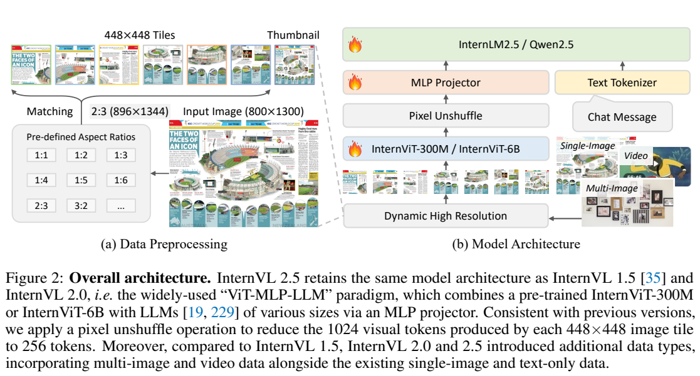
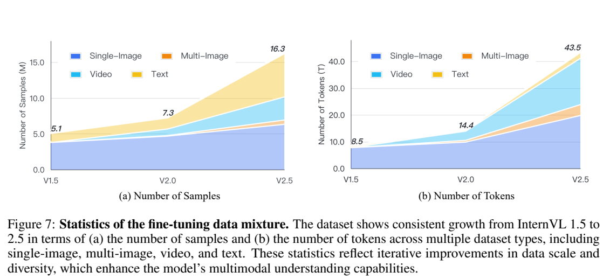
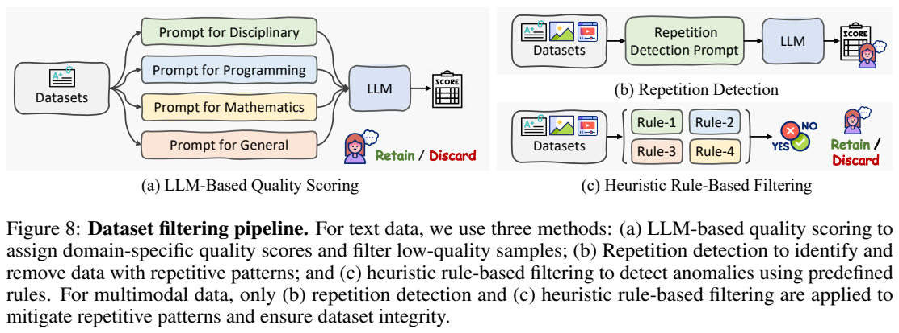
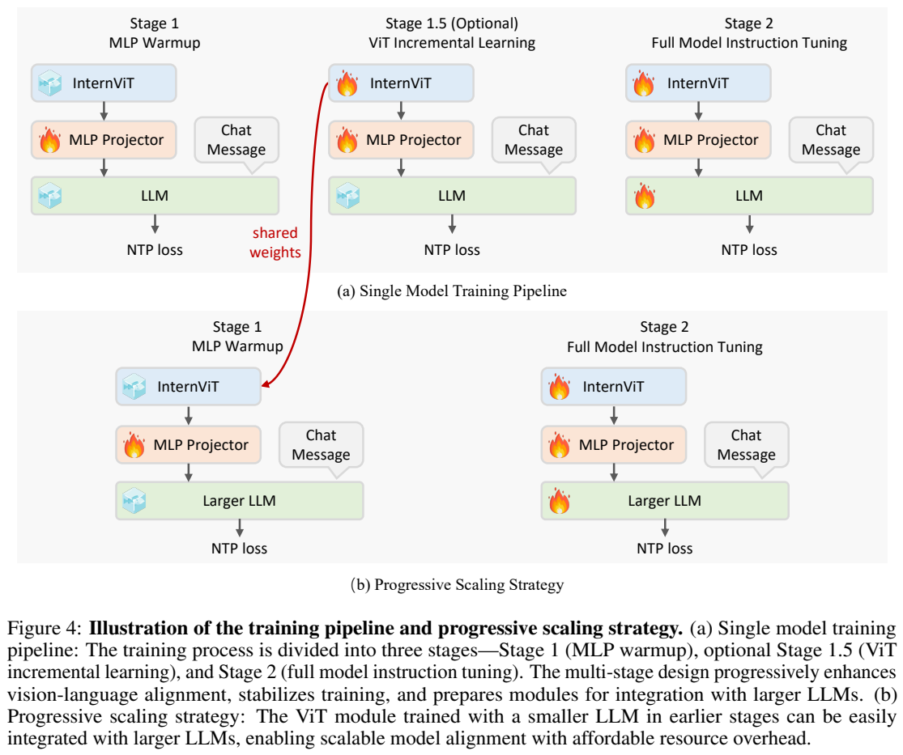
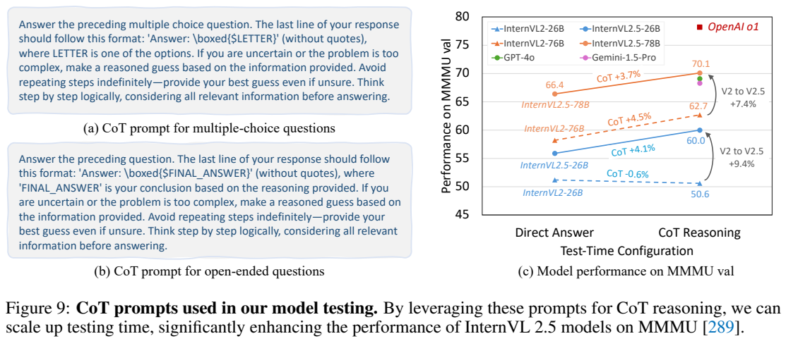

<!-- article-header:start -->
[项目首页](../../../README.md) › [模型系列](../../../reports/model-family-index.md) › [InternVL](../README.md)
<!-- article-header:end -->

# InternVL 2.5：复用视觉主干、清理训练数据与扩展测试时推理

<!-- article-toc:start -->
<a id="article-toc"></a>

**本篇目录** · [论文定位](#paper-info) · [快速概览](#overview) · [整体架构](#architecture) · [核心原理](#principles) · [数据构建](#data) · [训练流程](#training) · [实验结果](#experiments)
<!-- article-toc:end -->

<a id="paper-info"></a>

## 1. 论文信息与模型定位

[Expanding Performance Boundaries of Open-Source Multimodal Models with Model, Data, and Test-Time Scaling](https://arxiv.org/abs/2412.05271) 是 InternVL 2.5 系列技术报告，作者包括 Zhe Chen、Weiyun Wang、Yue Cao 等，主要来自上海人工智能实验室及合作高校、商汤研究院。本文依据 **2412.05271v1，2024 年 12 月 6 日**，不混入后来的 InternVL 3 系列。[PDF 第 1 页](https://arxiv.org/pdf/2412.05271v1#page=1)

它沿用 ViT–MLP–LLM 结构，覆盖从约 1B 到 78B 的单图、多图、视频与纯文本理解模型。主要变化是视觉编码器增量学习、较大语言主干的渐进复用、更广且更干净的指令数据，以及 CoT 等测试时策略。报告没有新增音频编码通道，视频理解以采样帧和可用字幕为输入，不能从“视频基准是多模态”推断模型直接处理音轨。

<a id="overview"></a>

## 2. 快速概览

| 关键点 | 具体设计 |
|---|---|
| 高分辨率 | 按长宽比匹配切片网格，每块 448×448，另加全局缩略图。 |
| 视觉压缩 | pixel unshuffle 把每块 1,024 个 patch token 缩为 256 个，再经两层 MLP。 |
| 视觉主干 | 300M 或名义 6B 的 InternViT；后者该版本实际约 5.5B、45 层。 |
| 渐进扩展 | 与较小 LLM 学好的 ViT 可接入较大 LLM，跳过重复的 ViT 增量阶段。 |
| 数据质量 | 清除重复、异常长句和连续零等错误，人工复核自动标记；纯文本另有领域质量评分。 |
| 长度权重 | 每个响应 token 权重为响应长度的负二分之一次方，折中 token 与样本平均。 |
| 测试时计算 | CoT 改善部分困难任务，报告最高设置成绩，视频也比较多种帧数。 |

重点是整套训练和评测配方的提升，不能把版本差异全部归因于新架构或某一项过滤操作。[PDF 第 3–15 页](https://arxiv.org/pdf/2412.05271v1#page=3)

<a id="architecture"></a>

## 3. 整体架构



**Figure 2 的读法。** 左侧把 800×1300 示例匹配到 2:3 网格，再切为 448×448 局部块并添加缩略图；右侧视觉主干、pixel unshuffle 和 MLP 连接到语言模型。局部块保留小字和细节，全局缩略图提供布局参照。图的训练标记代表总体可学习体系，具体冻结范围由训练阶段决定。

| 系列名称 | Table 2 总参数 | 语言主干 / 视觉主干 |
|---|---:|---|
| 1B | 0.9B | Qwen2.5-0.5B-Instruct / InternViT-300M。 |
| 2B | 2.2B | InternLM2.5-1.8B-Chat / InternViT-300M。 |
| 4B | 3.7B | Qwen2.5-3B-Instruct / InternViT-300M。 |
| 8B | 8.1B | InternLM2.5-7B-Chat / InternViT-300M。 |
| 26B | 25.5B | InternLM2.5-20B-Chat / InternViT-6B。 |
| 38B | 38.4B | Qwen2.5-32B-Instruct / InternViT-6B。 |
| 78B | 78.4B | Qwen2.5-72B-Instruct / InternViT-6B。 |

两类视觉编码器都取 V2.5 增量版本。大编码器宽度 3,200、45 层、25 头，使用 QK-Norm 与 RMSNorm；300M 为宽度 1,024、24 层、16 头，采用 LayerNorm，无 QK-Norm。小编码器曾从大编码器进行余弦蒸馏，再结合语言模型做下一 token 增量学习。报告也列出 InternVL2.5-Pro，但未公开其完整语言主干与规模，不能擅自填入。[PDF 第 3–4 页](https://arxiv.org/pdf/2412.05271v1#page=4)

多图每张图有 `Image-i` 标记，切片预算在同一样本中分配；视频每帧用 `Frame-i` 与图像标签，固定缩放到 448×448、不切多块。32 或 64 帧分别形成 8,192 或 16,384 个视觉 token，因此视频分辨率和帧数需要共同控制上下文成本。输入格式承载顺序，但报告没有给出像后续模型那样的绝对时间编码模块。[PDF 第 5–6 页](https://arxiv.org/pdf/2412.05271v1#page=5)

| 模块 | 输入与输出 | 公开机制 |
|---|---|---|
| 图像/多图/视频组织 | 原始媒体 → 448×448块和带编号的视觉段 | 单图动态切分，多图分配预算，视频每帧固定单块 |
| InternViT-V2.5 | 图像块 → 视觉特征 | 300M与6B两档，采用不同归一化配置；视觉权重可渐进复用 |
| pixel unshuffle与MLP | 每块1024位置 → 256个语言空间token | 空间邻域合并到通道，再投影到对应语言骨干宽度 |
| 语言主干 | 编号视觉段、文字提示 → 自回归回答 | 按档位接InternLM2.5或Qwen2.5，精确组合见本节型号表 |
| 测试时推理与聚合 | 问题 → 一个CoT或多个候选最终答案 | 提示式逐步推理/多数投票，改变推理预算而非网络主体 |

<a id="principles"></a>

## 4. 核心创新与数学原理

### 4.1 动态输入预算：从单图扩展到多图与视频

动态高分辨率先构造可用网格的长宽比集合，原文 Eq. (1–3) 可用核心形式表示为：

```math
\mathcal R=\{i/j:i\,j\in[n_{\min},n_{\max}]\},\qquad
r_{\mathrm{best}}=\arg\min_{r'\in\mathcal R}\vert W/H-r'\vert ,
```

```math
W_{\mathrm{new}}=448i_{\mathrm{best}},\qquad
H_{\mathrm{new}}=448j_{\mathrm{best}}.
```

实际集合还限制整数边长。多个网格长宽比同样接近时，作者用与原图面积的关系约束，减少低分辨率图片过度放大。超过一块时额外生成缩略图，单块时跳过。多图预算 Eq. (4) 为 $`n_{\max,i}=\max(1,\lfloor n_{\max}/N_{\mathrm{image}}\rfloor)`$；至少一块的约束意味着不能把它理解为任何图数下都绝不超过最初名义总预算。[PDF 第 5–6 页](https://arxiv.org/pdf/2412.05271v1#page=5)

多图编号与帧编号提供明确的引用边界，使“第二张图”或“第三帧”可以对应到序列中的特定片段。预算分配则是另一层约束：多图数量增加会降低每图可用切片，视频选择单块帧以换取更多时间观察。空间细节与时间覆盖因此可能相互竞争，不能把单图最高分辨率配置直接套到长视频上。[§3.1、Figure3，PDF第5页](https://arxiv.org/pdf/2412.05271v1#page=5)。

### 4.2 square averaging：折中长短回答的梯度贡献

损失重权解决长短回答之间的竞争。将原文 Eq. (5) 整理为所有响应 token 的求和形式，令第 $`i`$ 个 token 的交叉熵为 $`\ell_i`$，所属响应长度为 $`x_i`$：

```math
\mathcal L=\frac{\sum_i x_i^{-1/2}\ell_i}{\sum_i x_i^{-1/2}}.
```

token 平均使用权重 1，长回答包含更多 token，因此总贡献更大；样本平均使用每 token 的 $`1/x_i`$，每个回答贡献相等，却可能鼓励短答。square averaging 用 $`1/\sqrt{x_i}`$，一个长度 $`x`$ 的样本在未归一化前总权重为 $`\sqrt{x}`$，介于两者之间。这只是权重折中，不等于单独奖励模型生成更长思考链。随机 JPEG 质量 75–100 则模拟网页压缩，作用于图片而不对不同视频帧独立施加随机质量，以免制造不一致帧质量。[PDF 第 8–9 页](https://arxiv.org/pdf/2412.05271v1#page=8)

分母把当前批次的权重总和归一化，分子决定各token相对贡献。长度为100的回答，其每token权重比长度为25的回答小一半，但因token数为四倍，未归一化总贡献仍为两倍。这是由权重定义推得的例子，说明square averaging没有把每条样本强制等权。[§3.4、Eq5，PDF第8–9页](https://arxiv.org/pdf/2412.05271v1#page=8)。

### 4.3 渐进扩展：先在较小语言骨干上学习视觉表示

视觉主干复用是另一项技术选择。先让 InternViT 与较小语言模型适配、增强 OCR 与图表等领域表示，然后抽取视觉权重接入大模型，仅重新适配 MLP 和最终全模型指令学习。它利用视觉特征在不同 LLM 之间的可解释性减少重复训练，而非将小模型的完整语言推理过程蒸馏到大模型。[PDF 第 6–8 页](https://arxiv.org/pdf/2412.05271v1#page=6)

可迁移的是训练后的InternViT权重；更换LLM仍要重新适配连接器并进行最终指令训练。跳过大模型的中间视觉学习阶段减少了重复成本，但并没有免除大模型的全部训练，也没有证明各语言骨干对同一视觉向量的响应完全一致。[§3.3，PDF第8页](https://arxiv.org/pdf/2412.05271v1#page=8)。

### 4.4 测试时扩展：区分思考长度与候选数量

测试时 CoT 通过提示让模型逐步求解并在最后给出规范答案；多数投票则聚合多个候选最终答案。前者增加单次生成长度，后者增加多次调用，不能只以更高准确率推断成本相同。报告证明了特定题集的收益，没有提供一个在全部任务上自动选择最优思考长度的机制。[PDF 第 15 页](https://arxiv.org/pdf/2412.05271v1#page=15)

多数投票优先选择重复出现的答案，而不直接检查推理的每一步；若候选共同受到视觉识别错误影响，增加样本并不必然修正错误。论文将数据、模型和测试预算同时扩展，所以跨版本成绩变化需要结合这些条件解释，不能全部归因于参数数量。[测试时扩展分析，PDF第15页](https://arxiv.org/pdf/2412.05271v1#page=15)。

<a id="data"></a>

## 5. 数据构建与处理





**图页的读法。** Figure 7 左图是样本数，右图是序列 token 规模；Figure 8 区分领域评分、重复检测和启发式规则。纯文本使用全部三种，多模态数据主要使用后两种，不能写成所有图片都经过同样的 LLM 质量评分。右上 token 图的纵轴印为 T，但 Table 3 与正文以约 44B 表述一次微调混合 token，本篇采用训练表的 B 口径，不据图号将其扩大千倍。

微调数据从 InternVL1.5 的 5.1M、2.0 的 7.3M，扩到 2.5 的 **16.3M**。它是各样本规模，而不是全部阶段共享的预训练样本总数。按 token 统计，单图 45.92%、多图 9.37%、视频 39.79%、纯文本 4.92%；视频单样本序列长，token 比例与样本比例不相同。

预训练混合与微调混合都采用对话格式指令。前者主要训练接口或视觉侧，允许更宽范围的质量；后者解冻语言主干，强调更严格控制。数据涵盖一般 QA、描述、数学、图表、OCR、知识、grounding、文档、医学、GUI 与纯文本代码等。单图包括 DocVQA、ChartQA、AI2D 和合成页面转 Markdown，多图包括 Mantis 类关系数据和多页文档，视频包含 LLaVA-Video、EgoSchema、ShareGPT4Video 等；训练以英文与中文为主，同时加入多语 OCR 与指令。[PDF 第 12–14 页](https://arxiv.org/pdf/2412.05271v1#page=12)

过滤针对少量异常回答对后训练的放大效应。纯文本分数学、代码、学科及一般领域，以 0–10 分评分，正文给出如低于 7 的示例阈值；重复检测再结合人工审查，给出如低于 3 删除的示例；规则检查过长句、成串零和大量重复行。自动标记会误杀，因此由人工复核决定删除。多模态数据中高质量学术集豁免部分重复检查，其他样本走重复与规则管线。作者明确过滤仍不能消除语言主干原始预训练中的所有噪声。[PDF 第 10–11 页](https://arxiv.org/pdf/2412.05271v1#page=10)

数据集另有切片上限和重复系数：图像常用 6–36 或多图 12–36 块等配置，视频一帧一块，2.5 的视频训练采样从上一代 4–24 帧改为 8–32 帧；重复系数 $`r\in(0,4]`$ 控制降采样或上采样。多模态 packing 同时约束 LLM 序列长度与 ViT 图块数，打包样本之间注意力隔离、位置独立，不能把它当成增加跨样本上下文学习。[PDF 第 9–10、24 页](https://arxiv.org/pdf/2412.05271v1#page=9)

<a id="training"></a>

## 6. 训练流程与目标



**Figure 4 的读法。** Stage 1 仅 MLP 有火焰；可选 Stage 1.5 解冻 ViT 与 MLP，LLM 仍冻结；Stage 2 全部模块训练。红箭头把小 LLM 配方中学好的 ViT 送到较大 LLM，说明大版本可跳过 Stage 1.5。可选不是任意忽略视觉学习，而是已有合适视觉权重可复用。

各阶段使用下一 token 预测。Stage 1 用 ChatML 对话数据对齐随机初始化 MLP；Stage 1.5 增量提高视觉表征；Stage 2 端到端指令微调，使用统一学习率而非每模块独立学习率。报告的偏好优化等 Stage 3 为未来计划，**该版本不能写成已经实施 DPO 或 RL**。[PDF 第 7–8 页](https://arxiv.org/pdf/2412.05271v1#page=7)

| 典型配置，Table 3 | 8B | 26B | 78B |
|---|---:|---:|---:|
| Stage 1 / 1.5 / 2 token | 22B / 76B / 44B | 31B / 146B / 44B | 76B / 跳过 / 44B |
| Stage 1 / 1.5 / 2 学习率 | 2e-4 / 1e-5 / 4e-5 | 2e-4 / 1e-5 / 2e-5 | 2e-4 / — / 2e-5 |
| packed batch | 512 / 1024 / 512 | 512 / 1024 / 512 | 512 / — / 512 |
| 上下文 / 全局图块阈值 | 16,384 / 48 | 同左 | 同左 |
| 最终微调 epoch | 1 | 1 | 1 |

较小版本也不是完全相同配方：1B/2B 的最终阶段 4 epoch、约 176B token，4B 为 2 epoch、约 88B。78B 的 76B+44B 约 120B 是该版本对齐和微调处理量，继承语言模型与视觉编码器先前训练；与 Qwen2-VL 1.4T 的比较是不同继承链和训练设计下的报告统计，不能直接当成端到端从零训练的计算或金钱成本只需十分之一。本文没有补写训练 GPU 数或未给出的完整优化器设置。[PDF 第 7–8 页](https://arxiv.org/pdf/2412.05271v1#page=7)

<a id="experiments"></a>

## 7. 实验设置与主要结果



**Figure 9 的读法。** 右图横轴是直接回答与 CoT 配置，同一个 78B 模型从 66.4 到 70.1，增加 3.7 个百分点；旧 26B 的 CoT 反而下降约 0.6，说明效果依赖模型与数据质量。左侧提示要求最后输出可提取答案，并提醒避免无限重复。70.1 是测试时设置结果，不是单次直接短答分数。

| 78B 主要指标 | v1 报告成绩 | 解释与边界 |
|---|---:|---|
| MMMU val / test | 70.1 / 61.8 | 报告直接答与 CoT 中较高者，val 与 test 分开。 |
| MathVista testmini | 72.3 | 高于表中 Qwen2-VL-72B 70.5。 |
| OlympiadBench | 11.6 | 仍低于 GPT-4o 表中 25.9；38B 为 12.1，规模增大不保证每题集更好。 |
| DocVQA / OCRBench | 95.1 / 854 | DocVQA 为 ANLS，OCRBench 满分 1000；Qwen2-VL-72B 为 96.5 / 877。 |
| RefCOCO 系列平均 | 92.3 | 8B 为 87.6，依赖指代表达定位协议。 |
| Video-MME 无 / 有字幕 | 72.1 / 74.0 | Qwen2-VL-72B 有字幕 77.8，Gemini1.5-Pro 为 75.0 / 81.3。 |
| MVBench / LongVideoBench | 76.4 / 63.6 | 前者 16 帧；后者从多种帧数设置取最佳 val 结果。 |

视频的 Video-MME、MMBench-Video、MLVU、LongVideoBench 比较 16、32、48、64 帧后报告最大值；CG-Bench 为 32 帧。因此主表不是所有视频都按唯一帧数运行，也不能不计额外搜索成本。MMMU / MMMU-Pro 同样报告直接答与 CoT 的较高值。多数投票的定量例子明确针对旧 InternVL2-Llama3-76B，从 62.7 到 65.3；作者称 2.5 也观察到收益，但 v1 没有完整给出 2.5 的投票次数与对应最优分数，本篇不编造。[PDF 第 14–15、23–25 页](https://arxiv.org/pdf/2412.05271v1#page=14)

语言保留也有取舍：17 项纯文本平均，8B 从 InternVL2 的 67.2 到 70.0，原 InternLM2.5-7B 为 69.5；但 GSM8K 77.8 仍低于语言主干 85.1。幻觉 Table 9 的 HallusionBench 78B 为 57.4，略低于 Qwen2-VL 58.1；WildVision 胜率 71.4 低于 GPT-4o 80.6。报告还发现视觉编码器线性 probing 下降而强头或全量微调相对稳定，这是表征可用性的实验观察，不足以证明任何下游任务都不存在遗忘。整体结论应是系列在多项能力上扩展了开源模型性能，同时保留评测模式、数据继承和剩余差距。[PDF 第 19–21、25–29 页](https://arxiv.org/pdf/2412.05271v1#page=25)

<!-- article-footer:start -->
---

[← 上一篇：CompCap](../../compcap/arxiv-2412.05243/README.md) · [按发表时间浏览](../../../reports/paper-reading-guide.md#year-2024) · [下一篇：StreamChat →](../../streamchat/arxiv-2412.08646/README.md)

[返回本篇目录](#article-toc) · [返回模型系列](../README.md)
<!-- article-footer:end -->
