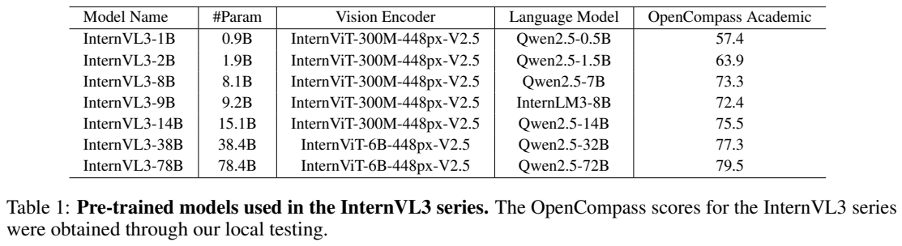
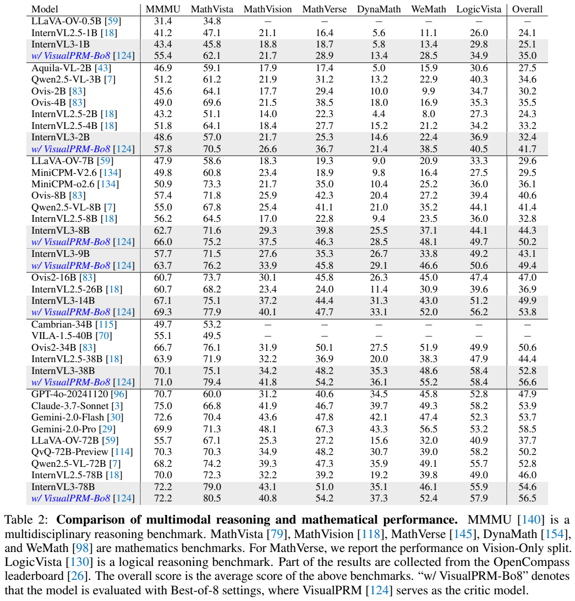
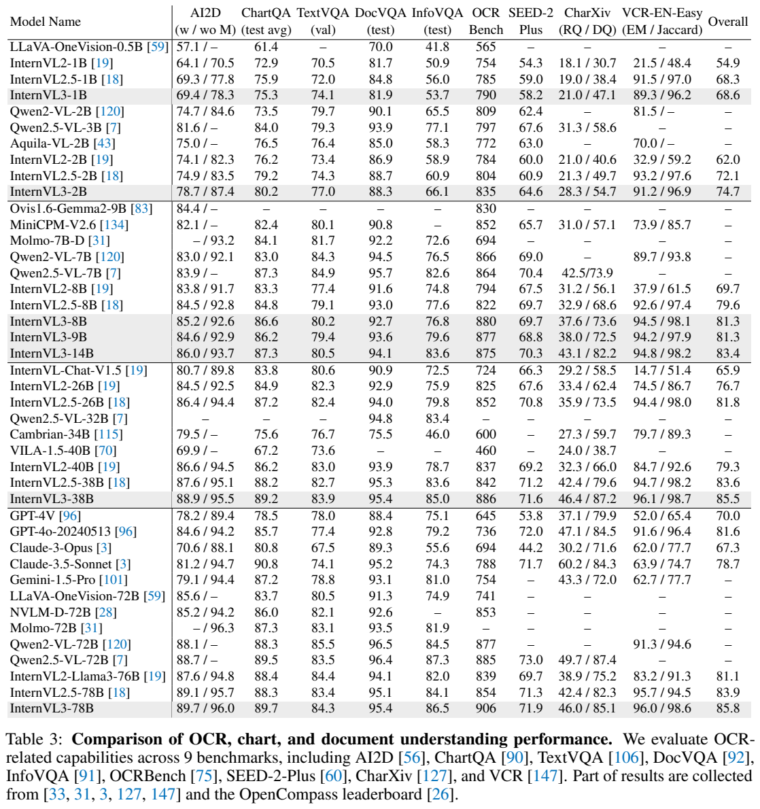
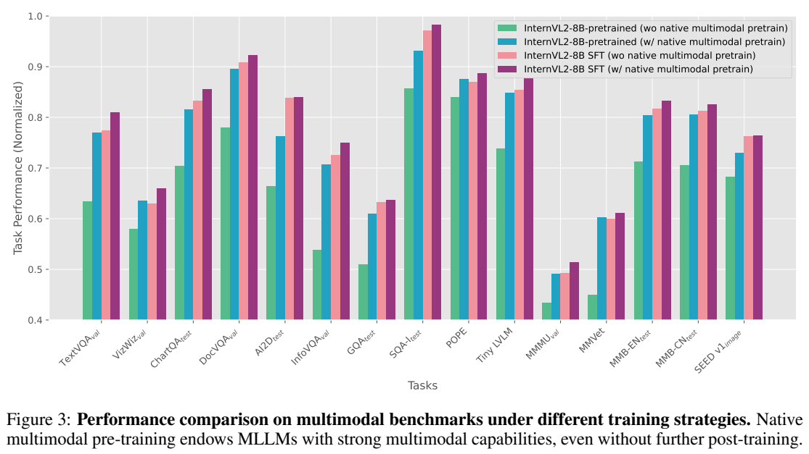
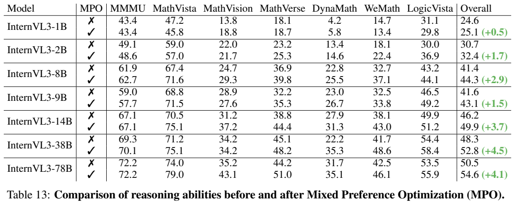

# InternVL3：联合预训练、可变视觉位置与混合偏好优化

## 1. 论文信息与模型定位

原论文为 **InternVL3: Exploring Advanced Training and Test-Time Recipes for Open-Source Multimodal Models**，Jinguo Zhu、Weiyun Wang、Zhe Chen 等，上海人工智能实验室与多所高校、商汤联合团队。[固定来源 arXiv 2504.10479v1](https://arxiv.org/abs/2504.10479v1)，2025-04-14；页码指 PDF。

InternVL3 是图像、视频与文本理解模型家族，覆盖约 1B–78B，输出文本及任务要求的定位等表示。重点是将纯语言与多模态数据放入同一预训练阶段，随后 SFT、混合偏好优化并可使用测试时扩展。论文称原生多模态，实际仍从已有视觉模型和**未指令微调的 base LLM**初始化，不能写成所有权重从零训练。

## 2. 快速概览

- 保留 ViT–MLP–LLM，448×448 tile 经 pixel unshuffle 后为 256 视觉 token。
- 联合预训练约 **200B token**，纯语言 50B、多模态 150B；共同更新视觉、连接器和语言参数。
- V2PE 为视觉 token 设置较小位置增量，控制位置跨度；主文除专门消融外，**测试统一使用 $\delta=1$**。
- SFT 数据由 16.3M 扩为 **21.7M**；MPO 约 300K，组合相对偏好、绝对质量及优选响应生成目标。
- VisualPRM-8B 可选取八个候选中最好的响应，增加推理计算与额外评判模型；不等同于单次生成。

## 3. 整体架构

**读图：Table 1、Equations 1–5，PDF 第 4 页。** 表明确每个变体的视觉与语言初始化。1B/2B/8B/14B 对应 InternViT-300M 与 Qwen2.5-0.5B/1.5B/7B/14B；9B 使用 InternLM3-8B。38B/78B 使用 InternViT-6B 与 Qwen2.5-32B/72B。实际总量为 0.9/1.9/8.1/9.2/15.1/38.4/78.4B，名称不是精确参数数值。

随机初始化的两层 MLP 将视觉特征接入语言输入空间。pixel unshuffle 将相邻空间特征合并，token 数降至四分之一，每 tile 保留 256 个表示；它降低序列计算量，也改变可直接访问的视觉粒度。图像与视频表示作为文字生成的上下文，模型不以自回归方式预测图像本身。文章没有完整复述前代的高分辨率切图上限和视频时间表示，不能把其他版本的默认值直接填入。

## 4. 核心创新与数学原理

V2PE 的位置递推（Equations 2–4）为：

$$
p_1=0,\qquad p_i=p_{i-1}+\begin{cases}1,&x_i\in\mathrm{Text}\\\delta,&x_i\in\mathrm{Vision}.\end{cases}
$$

训练逐图从 $\{1,1/2,1/4,\ldots,1/256\}$ 选 $\delta$，同一图内保持固定。它压缩视觉位置增长，**并没有删除 token**，也不把物理注意力长度自动缩短。推理可随序列选择步长，$\delta=1$ 退化为普通递增；本报告标准成绩采用该退化设置。

联合预训练的 Equations 6–7 只计算文本目标：

$$
\mathcal L=-\sum_{i:x_i\in\mathrm{Text}}w_i\log p_\theta(x_i\mid x_{<i}),\qquad w_i=l^{-1/2}.
$$

$l$ 是该样本需要计算损失的 token 数。square averaging 使样本总权重约随 $\sqrt l$ 增长，介于逐 token 平均与逐样本平均之间，以缓和长短响应的偏置。虽然视觉不成为预测目标，文本误差仍传到视觉主干。

MPO（Equation 9）为 $\mathcal L=w_p\mathcal L_p+w_q\mathcal L_q+w_g\mathcal L_g$。其中 DPO 比较 chosen 与 rejected 相对参考策略的对数概率差；BCO 分别区分好坏响应，使用历史奖励移动平均作平移；生成项继续拟合 chosen 文本。令 $r(y)=\beta\log[\pi_\theta(y|x)/\pi_0(y|x)]$，原文 DPO 项可简写为 $-\log\sigma(r(y_c)-r(y_r))$。该报告没有给出全部权重、$\beta$ 等数值，不能自行指定。

VisualPRM 按解题步骤预测正负符号，把生成“+”的概率作为每步分数，再平均以选候选。它是过程监督的外部评判，不是模型凭多数投票必然正确；误判或多个候选共享错误仍会影响结果。

## 5. 数据构建与处理

多模态预训练继承 InternVL2.5 的描述、问答、数学、图表、OCR、文档、知识、对话和医学材料，增加 GUI、工具、3D 场景与视频。纯语言主要取自 InternLM2.5 语料并补充开放文本，以弥补多模态目标文本短、分布窄的问题。总预算固定时实验选择**语言:多模态=1:3**，不能把 150B 多模态 token 解释为 150B 图像。

SFT 增加长上下文、科学图、创意写作、多模态推理等，使用 JPEG 随机压缩与多模态 packing。MPO 按 MMPR v1.2 管线从问答、科学、图表、数学、OCR 和文档产生偏好对；8B/38B/78B 的 SFT 模型生成 rollouts，各尺度使用同一约 300K 数据。VisualPRM400K 再补充 InternVL3 的 8B/38B rollouts。v1 说明开放数据清单仍在整理，没有完整来源配比、去重阈值及污染审计，不能声称全部样本已逐一可重建。

## 6. 训练流程与目标

先将已预训练 ViT 与 base LLM、随机 MLP 联合优化；随后以高质量示范做 SFT，再用 MPO 的正负响应改进推理。原生预训练明确更新**所有层**，并非只调连接器；SFT/MPO 的精确冻结清单与完整超参数本版本未充分列出，本文不推测。

基础设施基于 InternEVO，针对 ViT、MLP、LLM 分别安排分片及数据、张量、序列、流水并行，动态平衡视觉与文字负载，并支持最高 32K 序列的训练。报告称相近尺度比前代加速 50%–200%，但没有逐模型完整硬件、时长与吞吐表；“框架可扩展到数千 GPU”不等于每个变体实际用了此规模。测试时 Best-of-N 与训练是独立环节。

## 7. 实验设置与主要结果

**读图：Table 2，PDF 第 9 页。** 蓝色行加 VisualPRM Best-of-8。以此表为准，8B 的 MMMU/MathVista 是 **62.7/71.6**，加 Bo8 为 66.0/75.2；78B 是 **72.2/79.0**，Bo8 为 72.2/80.5。Figure 1 的摘要数字与此表个别值不同，例如 8B MMMU、78B MathVista；本文保留明确配置的表值，不拼接最高数值。

| 指标 | InternVL2.5-78B | InternVL3-78B | 具体来源 |
|---|---:|---:|---|
| MMMU | 70.0 | 72.2 | Table 2，标准生成 |
| MathVista | 72.3 | 79.0 | Table 2，标准生成 |
| ChartQA | 88.3 | 89.7 | Table 3，test avg |
| DocVQA | 95.1 | 95.4 | Table 3，test |
| InfoVQA | 84.1 | 86.5 | Table 3，test |
| OCRBench | 854 | 906 | Table 3，原分数尺度 |
| MMBench EN/CN | 88.3/88.5 | 89.0/88.7 | Table 5 |

**读图：Table 3，PDF 第 10 页。** AI2D 的两列设置、CharXiv 的 RQ/DQ、VCR 的 EM/Jaccard 都应分别看。78B 的 DocVQA 95.4、InfoVQA 86.5 仍低于 Qwen2.5-VL-72B 的 96.4/87.3；ChartQA 89.7 低于 Claude-3.5-Sonnet 90.8。它有广泛进步而非每项领先。

Table 8 的视频评测对 Video-MME、MMBench-Video、MLVU、LongVideoBench **分别测试 16/32/48/64 帧并报告最高结果**，不能写成固定 64 帧全部成绩。MVBench 固定 16，CG-Bench 固定 32。78B Video-MME 无/有字幕为 72.7/75.7，低于 Qwen2.5-VL-72B 的 73.3/79.1；MVBench 为 78.7、MLVU 79.5、LongVideoBench 65.7。MMBench-Video 1.81 又低于前代 1.97。

**读图：Figure 3、Table 13，PDF 第 18 页。** 前图在 InternVL2-8B 上替换预训练策略，固定架构、初始化和数据以检查策略贡献。后表 MPO 使 78B 七项平均从 50.5 到 54.6，MMMU 72.2 保持不变；8B 平均从 41.4 到 44.3。平均增加不代表每项增加，小尺度数学等仍有回退。

Table 12 的 8B 预训练模型 V2PE 步长 1/4 平均 75.9，无 V2PE 为 75.2，是专门消融而非主模型最终指标。纯语言 Table 11 的 78B MMLU 86.9 高于对应 Qwen Chat 84.4，但 HumanEval 82.3 低于 87.2，MBPP 76.7 低于 86.8。GUI 表还出现“72B”命名和正文称 8B 超过 90.3、实际 81.4 的不一致，本文不据此制造优势。证据支持联合学习、偏好目标和测试时选择的价值，仍有文档、视频、定位及语言子任务不足；以上为原文报告，未复现。
