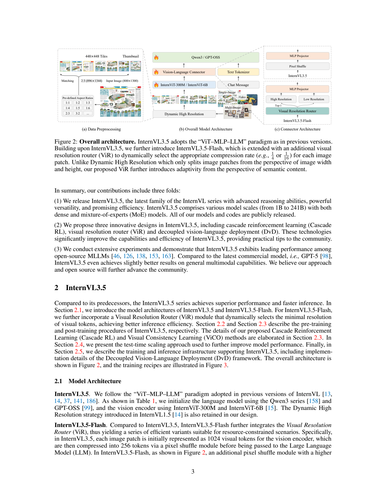
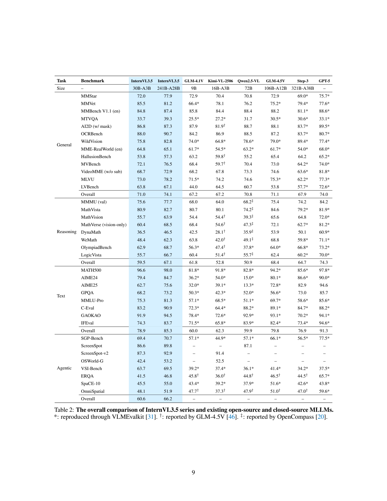
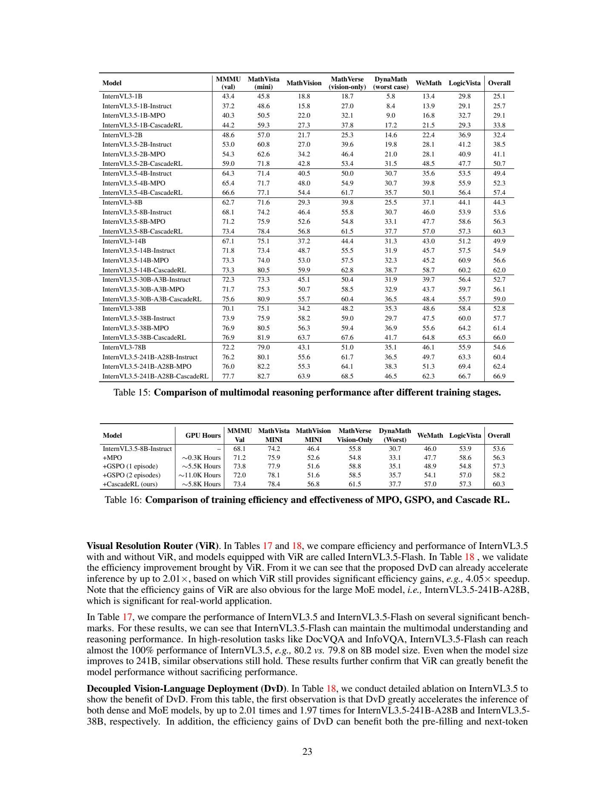
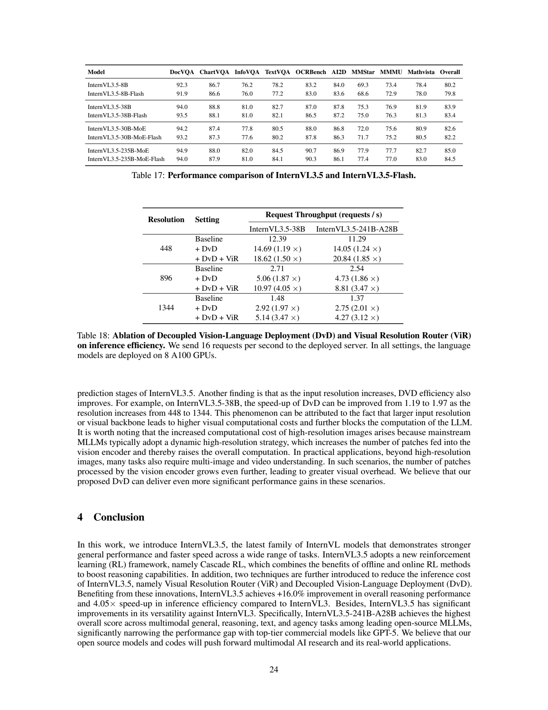

# InternVL 3.5：级联强化学习与自适应视觉压缩

## 1. 论文信息与模型定位

| 项目 | 内容 |
|---|---|
| 原文 | InternVL3.5: Advancing Open-Source Multimodal Models in Versatility, Reasoning, and Efficiency |
| 作者与机构 | Weiyun Wang、Zhangwei Gao、Lixin Gu 等；上海人工智能实验室 InternVL Team |
| 版本 | [arXiv:2508.18265v1](https://arxiv.org/abs/2508.18265v1)，2025 年 8 月 25 日；34 页报告 |
| 官方项目 | [OpenGVLab/InternVL](https://github.com/OpenGVLab/InternVL) |
| 旗舰权重 | [InternVL3_5-241B-A28B](https://huggingface.co/OpenGVLab/InternVL3_5-241B-A28B) |
| 家族与任务 | InternVL 3.5，含稠密和 MoE 模型；图像/视频/多图理解、文本推理、GUI、空间问题及 SVG；Flash 为视觉 token 压缩版本 |

模型覆盖约 1B–241B。语言骨干改用 Qwen3 系列及 GPT-OSS，不再是所有档位都用 InternLM。旗舰的“241B-A28B”表示约 241B 总参数、约 28B 激活参数档位，不能写为每次推理仅存储 28B 权重；MoE 总权重仍要被部署。

## 2. 快速概览

本报告的三项主要设计分别作用于不同环节。**Cascade RL** 先在固定偏好数据上做 MPO，再用模型实时生成的回答做 GSPO，让推理训练兼顾成本与成绩。**Visual Resolution Router（ViR）** 对每个子图判断需保留 256 个还是可压到 64 个视觉 token；配合 Visual Consistency Learning（ViCO），使压缩后的回答分布尽量接近原模型。**Decoupled Vision-Language Deployment（DvD）** 把视觉编码与语言生成放在独立服务器上，以异步流水线提高并发利用率。

推理进步很明显：8B 在七项推理平均分上由前代 44.3 提升到 60.3，差 16.0 个百分点；旗舰 MMMU val 为 77.7、MathVista mini 为 82.7。与此同时，许多 OCR、视频或普通理解指标没有同步上涨；报告也承认强化文本与推理可能略损伤部分感知能力。

Flash 的九项指标平均分例如 8B 为 79.8，对应非压缩模型 80.2。部署实验最高 4.05× 出现在 38B、896 分辨率、同时采用 DvD 与 ViR 的吞吐设置。这些结论分别针对推理、压缩保真和服务器吞吐，不能合成“质量无损、任何硬件都快四倍”。

## 3. 整体架构

*原文 Figure 2，PDF 第 3 页，完整原页。左边依宽高比切分 448×448 子图，右边比较固定压缩与根据语义选择压缩率的 connector。*

基础模型沿用动态高分辨率 ViT—MLP—LLM 路径：448×448 子图产生 1024 个原始视觉 token，pixel shuffle 后变为 256，再经 MLP 接入语言模型。Flash 额外提供压到 64 个 token 的分支，路由器用 Top-1 选择其一。报告中的 patch 在这里是一个输入子图，而不是 ViT 内最小的 14 像素 patch，两种粒度不能混用。

| 报告模型档位 | 视觉 / 语言初始化 | Table 1 列出的总参数 |
|---|---|---:|
| 1B / 2B / 4B / 8B / 14B | InternViT-300M + Qwen3-0.6B/1.7B/4B/8B/14B | 1.1 / 2.3 / 4.7 / 8.5 / 15.1B |
| 38B | InternViT-6B + Qwen3-32B | 38.4B |
| 20B-A4B | InternViT-300M + GPT-OSS-20B | 21.2B，约 A4B |
| 30B-A3B | InternViT-300M + Qwen3-30B-A3B | 30.8B，约 A3B |
| 241B-A28B | InternViT-6B + Qwen3-235B-A22B | 240.7B，约 A28B |

6B 视觉骨干在该表实际约为 5.5B，名称不是精确参数数目。Flash 减少的是送入 LLM 的视觉序列；它仍先经同一 ViT 编码为 1024 token，不能据此宣称 ViT 本身的计算也减少四倍。

DvD 把 ViT、MLP 及 Flash 的 ViR 放在视觉服务器，LLM 放在语言服务器。视觉特征以 BF16 经 TCP 单向传输，可选 RDMA。视觉编码、传输、语言预填充与解码可在并发工作之间重叠；同一请求仍需要其视觉特征作为条件，分离部署不会消除这种依赖。

## 4. 核心创新与数学原理

**离线偏好训练为在线采样提供起点。** 原文 Eq. (3) 的 MPO 为：

\[
\mathcal L_{MPO}=w_p\mathcal L_p+w_q\mathcal L_q+w_g\mathcal L_g,
\]

其中偏好项采用 DPO，质量项采用 BCO，生成项采用语言建模损失。报告未列出这些项的具体权重。离线回答能在不同模型间复用，成本较低；随后 GSPO 根据当前模型生成的新回答继续训练，避免只能学习固定候选分布。

**GSPO 在回答级使用长度归一化的重要性比率。** Eqs. (4)–(6) 定义同一问题下的组内优势及比率：

\[
\hat A_i=\frac{r(x,y_i)-\operatorname{mean}_j r(x,y_j)}{\operatorname{std}_j r(x,y_j)},\qquad
s_i(\theta)=\left[\frac{\pi_\theta(y_i\mid x)}{\pi_{old}(y_i\mid x)}\right]^{1/|y_i|}
=\exp\!\left(\frac1{|y_i|}\sum_t\log\frac{\pi_\theta(y_{i,t}\mid x,y_{i,<t})}{\pi_{old}(y_{i,t}\mid x,y_{i,<t})}\right).
\]

这里奖励衡量整个回答，几何平均让不同长度回答的重要性权重更可比。原文 Eq. (5) 写成以下 clipped surrogate 的期望：

\[
J_{GSPO}=\mathbb E\!\left[\frac1G\sum_i
\min\{s_i\hat A_i,\operatorname{clip}(s_i,1-\epsilon,1+\epsilon)\hat A_i\}\right].
\]

原文把它标为 \(\mathcal L_{GSPO}\)，但表达式是要最大化的策略收益形式；若用梯度下降实现损失，需要取负号。本介绍用 (J) 表示收益以避免方向混淆。旧策略用于采样及重要性修正，不等于固定参考模型；作者明确在线阶段没有 reference-model 约束，不能额外加一个原文未使用的 KL 正则。奖励细节、零标准差组的处理和 clip 数值未在本报告完整展开。

**先学会压缩，再学会决定哪里压缩。** ViCO 的一致性阶段冻结原 InternVL3.5 为高分辨率教师，学生输入每个子图的 256 或 64 token，最小化 Eq. (7)：

\[
\mathcal L_{ViCO}=\mathbb E_\xi\frac1N\sum_i
D_{KL}\big[\pi_{ref}(\cdot\mid y_{<i},I)\;\|\;\pi_\theta(\cdot\mid y_{<i},I_\xi)\big],
\qquad \xi\in\{1/4,1/16\}.
\]

KL 比较的是下一 token 的概率分布，教师始终使用 256 token 的视觉表示；同一图像的各子图在一致性训练时用同一个随机压缩率。它不是只让两个模型的最终字符串相同，也不是教师自己随机切到低分辨率。

路由训练根据 Eq. (8) 的低/高压缩 loss 比值 (r_i=\mathcal L_{ViCO}(I_{1/16})/\mathcal L_{ViCO}(I_{1/4})) 构建二分类标签：比值低于阈值时选 64，否则选 256。阈值由滑动窗口历史比值的某个百分位动态确定，目标标签分布保持平衡，并非固定取 1。此时冻结 ViT、MLP、LLM，只训练路由器。

对于 (n_h) 个高保真子图及 (n_l) 个低 token 子图，语言侧视觉长度可写作 (256n_h+64n_l)。这是计数解释，报告的整体约 50% token 减少取决于实际路由分布，而非每个子图都固定减半。

## 5. 数据构建与处理

原生预训练混合约 1.16 亿样本、2500 亿 token，纯文本与多模态数据比例约 1:2.5，上下文上限 32K。多模态来源沿用 InternVL3 的描述、问答、数学、科学、图表、OCR、定位、文档、多轮与医疗数据；文本部分来自 InternLM 系列语料并补充公开数据。图像随机 JPEG 压缩用于适应真实输入质量变化。

SFT 约 5600 万样本、1300 亿 token，纯文本与多模态比例约 1:3.5。除了沿用广泛视觉指令，还加入 Thinking 模式的推理数据：大推理模型生成详细过程，筛查答案事实正确性、推理清晰度、冗余和格式。报告没有公开所有教师身份及每个过滤阈值。新能力数据覆盖 GUI 交互、具身/空间交互、SVG 理解与代码生成，SVG 输出是向量图形描述代码，不是扩散式位图合成。

离线 RL 使用 MMPR-v1.2 的约 20 万偏好对。在线问题由原有 rollout 估计正确率，选择正确率在 0.2–0.8 的问题，再补充近期数据，形成约 7 万问题的 MMPR-Tiny。20 万对和 7 万问题有不同单位，也不能当成 27 万条互不重叠的新人工标注。沿用原 rollout 进行筛选减少额外采样费用，但在线训练本身仍生成当前策略回答。

ViCO 一致性阶段复用 SFT 类型数据，路由训练采用富含 OCR/VQA 的子集。Figure 3 给出 ViCO 约 300 亿 token 的训练量，但未逐一公开一致性与路由子阶段样本量、任务比率或质量审核协议。

## 6. 训练流程与目标

原文 Eqs. (1)–(2) 对文本位置做下一个 token 预测：

\[
\ell_i=-\log p_\theta(x_i\mid x_{<i}),\qquad
\ell_i'=\frac{w_i}{\sum_jw_j}\ell_i,\quad w_i=N^{-1/2}.
\]

前缀可含文本或视觉 token，但损失只预测文本；对话样本只计算回答 token。(N) 是该样本参与损失的 token 数。square averaging 为该样本每个监督 token 赋 (1/\sqrt N) 权重，相比纯按 token 平均缓和长回答优势，又保留比每样本等权更多的长度贡献；不能直接称为每样本完全等权。

| 阶段 | 参数与目标 |
|---|---|
| 原生预训练 | 视觉、连接器、LLM 联合更新；NTP + square averaging，约 250B token，32K 上下文 |
| SFT | 同类目标，高质量对话与推理、新能力数据；约 130B token，32K 上下文 |
| Cascade RL 第一步 | 固定偏好数据 MPO：DPO + BCO + LM |
| Cascade RL 第二步 | 当前策略采样 GSPO，组内奖励优势与回答级 importance ratio，无固定参考模型约束 |
| Flash 一致性 | 固定高保真教师；更新整个学生模型，学习两种压缩率下的输出一致性 |
| Flash 路由器 | 主体 ViT、MLP、LLM 冻结，仅二分类 router 更新 |

训练主要基于 XTuner，使用参数分片、数据 packing、FP8、融合交叉熵、FlashAttention-3、MoE grouped GEMM；在线 RL 使用 verl。报告没有给出所有型号的学习率、batch、轮数、MPO 权重、GSPO group size、奖励实现等完整配方，不能从框架名字补出参数。

测试时扩展另分 Thinking 深度推理与 Parallel Thinking。并行分支采用 Best-of-N，以 VisualPRM-v1.1 评价多个候选并选择回答。除明确标为 Parallel Thinking 等设置外，报告默认实验不使用 TTS；因此不能把多次采样的增强分数写成单次调用分数，报告也未固定披露所有任务的 (N)。

## 7. 实验设置与主要结果

*原文 Table 2，PDF 第 9 页，完整原页。星号表示作者通过 VLMEvalKit 复测，其他符号标记外部报告或 OpenCompass 来源；不同大类 Overall 的组成不同。*

| 指标与口径 | 30B-A3B | 241B-A28B | 表 2 的 GPT-5 |
|---|---:|---:|---:|
| 一般多模态大类 Overall | 71.0 | 74.1 | 74.0 |
| MMMU val | 75.6 | 77.7 | 84.2 |
| MathVista | 80.9 | 82.7 | 81.9 |
| 推理大类 Overall（含 OlympiadBench） | 59.5 | 67.1 | 74.3 |
| 文本大类 Overall | 78.9 | 85.3 | 91.3 |
| Video-MME，无字幕 | 68.7 | 72.9 | 81.8 |
| HallusionBench | 53.8 | 57.3 | 65.2 |
| VSI-Bench | 63.7 | 69.5 | 37.5 |
| ERQA | 41.5 | 46.8 | 65.7 |

Figure 1 的跨领域集合平均为旗舰 72.6、GPT-5 76.5；它不同于表 2 的一般大类 74.1/74.0。Table 3 的七项推理均分为旗舰 66.9，加入 Parallel Thinking 后 68.7；不能与包含八项的 Table 2 推理均分 67.1 混用。GPT-5 在 Table 3 的 MMMU 为 81.8，而表 2 为 84.2，原文未完全统一两处来源口径，本介绍按所在表引用。

*原文 Tables 15、16，PDF 第 23 页，完整原页。上表包含每个阶段的全部结果，下表区分一轮、两轮 GSPO；累计训练成本需要与对应成绩一起读取。*

8B 七项均分从前代 44.3，到 3.5 SFT 的 53.6，再到 MPO 的 56.3，最后 Cascade RL 的 60.3。故相对前代的 +16.0 不全由 RL 单独造成：新骨干和 SFT 已贡献部分增益。单独 GSPO 一轮约 5500 GPU 小时、57.3 分；两轮约 11000 小时、58.2 分；Cascade RL 约 5800 小时、60.3 分。它是在这个 8B 训练比较中以约半数 GPU 小时获得更高均分，不是所有模型训练成本都减半的证据。

感知与代理能力仍有实质限制。Table 4 的 8B OCR/文档类平均由前代 81.3 变为 80.9；Table 9 的 38B 视频均分由 71.7 变为 71.0。视频测试除 MVBench 固定 16 帧外，其他基准分别试 16/32/48/64 帧并报告最高结果。GUI 中 OSWorld-G 是 grounding 评测，53.2 不能当成完整 OSWorld 在线任务成功率；WindowsAgentArena 18.0、WebArena-Lite-v2 11.7 才属于表 10 的在线代理结果。具身四项主要检验空间理解和问题回答，没有真实机器人操作成功率可引用。

*原文 Tables 17、18，PDF 第 24 页，完整原页。表 17 有小幅精度下降，表 18 单位为 requests/s；图注只明确语言侧均在 8 张 A100 上部署。*

Flash 的九项均分：8B 80.2→79.8、38B 83.9→83.4、30B MoE 82.6→82.2、大 MoE 85.0→84.5。表 17 将大 MoE 简记为 235B，而模型总规模档位为 241B，来自语言骨干名称，不是另一套 235B 总参数模型。保留约 99% 的平均成绩，不等于每项或每个输入无损。

38B 在 896 分辨率下基线吞吐 2.71，DvD 为 5.06，DvD+ViR 为 10.97 requests/s，最终 4.05×；241B 在同设置为 2.54→4.73→8.81，即 3.47×。448 输入下对应最终仅 1.50× 与 1.85×。测试图注明确语言侧 8 张 A100，但未完整列出拆分视觉服务器的总硬件预算、生成长度和延迟分位数；该表支持特定并发部署的吞吐提升，不能推断单请求延迟、等总 GPU 成本或所有部署条件的倍数。本仓库未运行模型，数值均依据报告。
