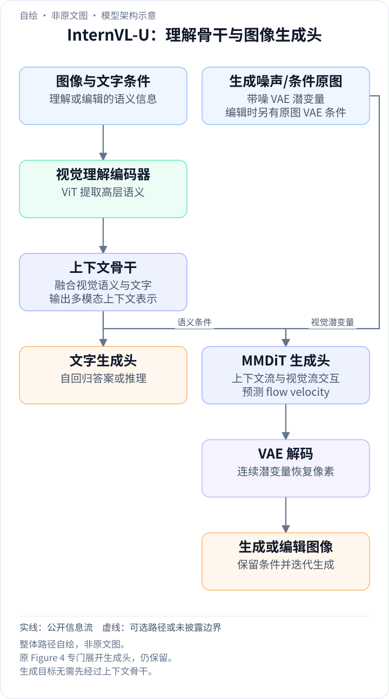
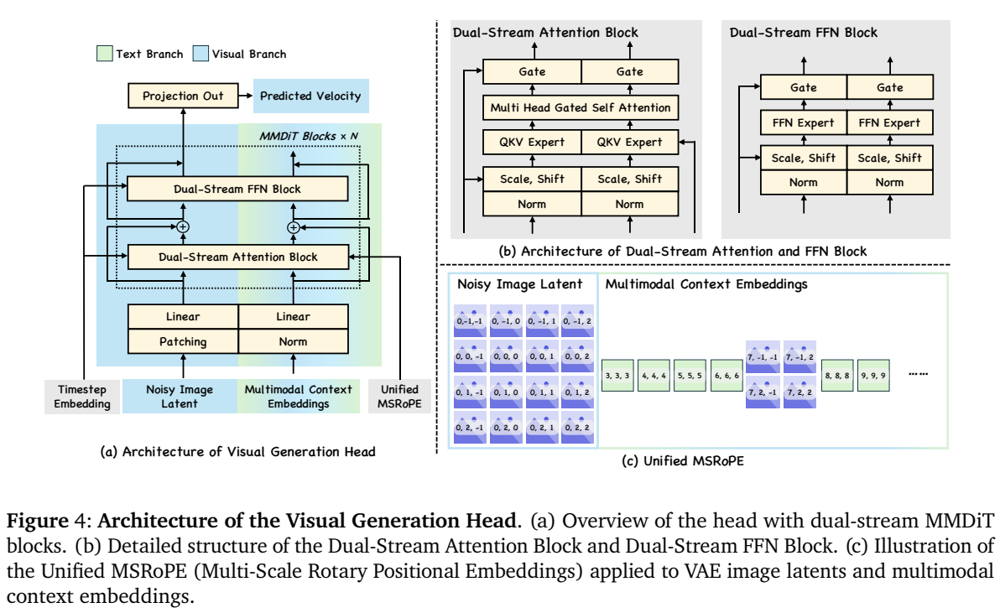
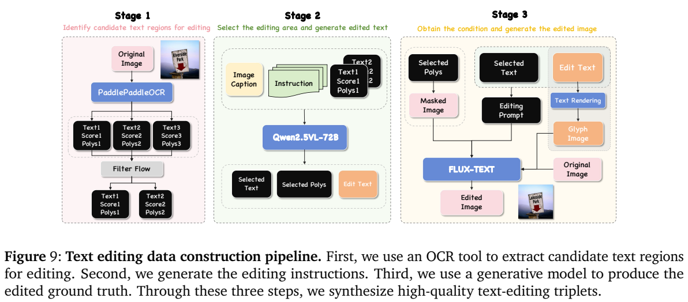
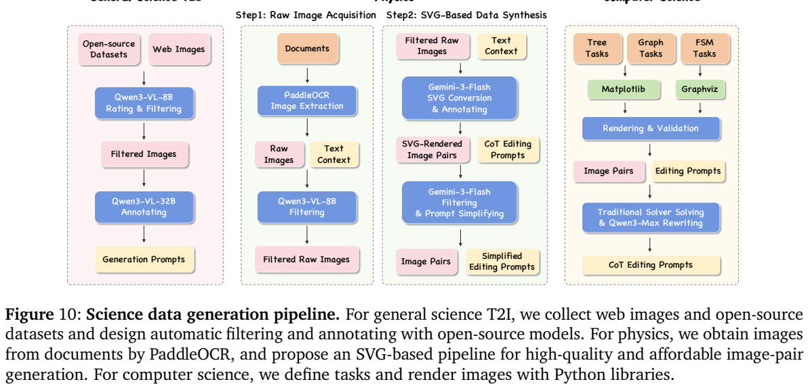
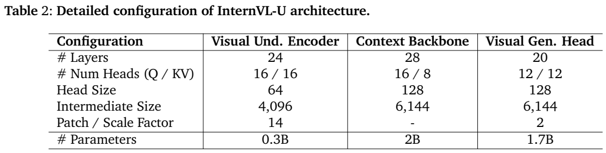
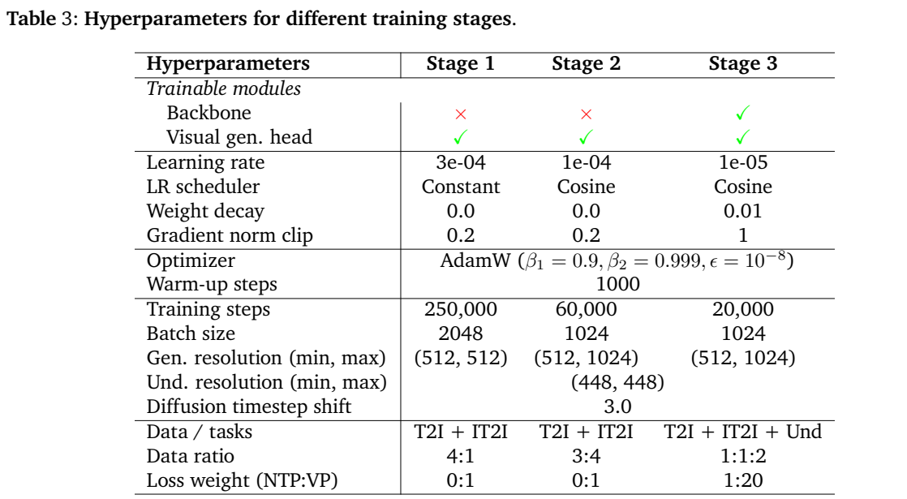
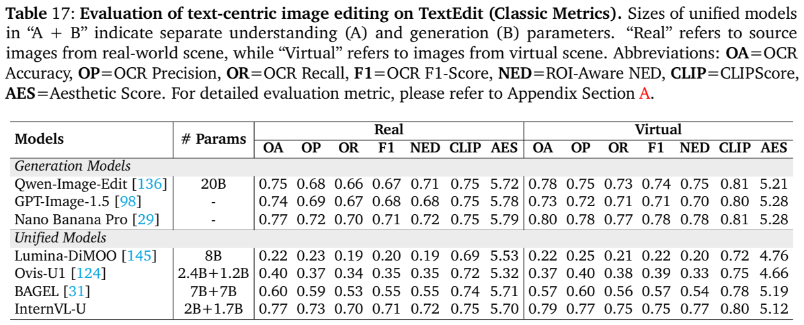
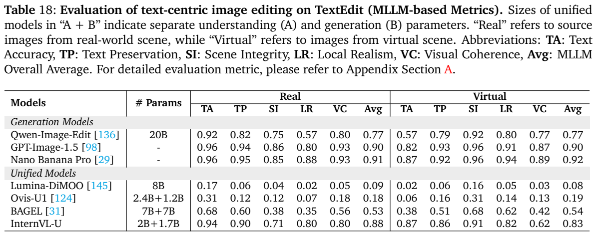

<!-- article-header:start -->
[项目首页](../../../README.md) › [模型系列](../../../reports/model-family-index.md) › [InternVL](../README.md)
<!-- article-header:end -->

# InternVL-U：共享语义上下文与双流图像生成的统一模型

<!-- article-toc:start -->

**本篇目录** · [论文定位](#paper-info) · [快速概览](#overview) · [整体架构](#architecture) · [核心原理](#principles) · [数据构建](#data) · [训练流程](#training) · [实验结果](#experiments)
<!-- article-toc:end -->

## 1. 论文信息与模型定位

| 项目 | 信息 |
|---|---|
| 原文 | *InternVL-U: Democratizing Unified Multimodal Models for Understanding, Reasoning, Generation and Editing* |
| 团队 | 上海人工智能实验室及香港中文大学、复旦、上海交大、清华等机构；Changyao Tian 等 |
| 固定版本 | [arXiv:2603.09877v1](https://arxiv.org/pdf/2603.09877v1)，2026-03-10 提交；报告首页标注 2026-03-11 |
| 模型 | 约 4B 总参数：0.3B 视觉理解编码器、2B 上下文骨干、1.7B 视觉生成头 |
| 官方资源 | [代码](https://github.com/OpenGVLab/InternVL-U)、[模型](https://huggingface.co/InternVL-U/InternVL-U)、[评测工具](https://github.com/open-compass/GenEditEvalKit)、[TextEdit](https://github.com/open-compass/TextEdit) |

InternVL-U 将图像理解、文字推理、文生图和指令编辑纳入同一框架。其出发点是利用 InternVL3.5-2B 已有的视觉语言知识，再让一个随机初始化的图像生成头学习执行这些语义条件。它属于混合自回归与连续图像生成的统一模型：文字逐 token 预测，图像通过潜空间流匹配生成。它没有把所有任务强行变成相同的离散 token 预测，也没有直接接入一个已经训练完成的大型图像生成器。[PDF 第 6–11 页](https://arxiv.org/pdf/2603.09877v1#page=6)

报告的主要价值还包括数据工程。作者将文字排版、科学图示、空间变换和表情包视为语义密度高的视觉任务，并用程序渲染、教师模型和推理轨迹补齐训练样本。这使介绍该模型时需要同时讨论“如何画得好”与“如何把抽象要求翻译成正确的图”。本文依据固定原文解释机制与结果，未运行模型或重做评测。

## 2. 快速概览

| 关键问题 | InternVL-U 的处理方式 |
|---|---|
| 理解与像素重建需要不同特征 | 输入理解用 ViT 语义表示，输出生成用 VAE 潜变量 |
| 怎样利用现有多模态模型 | 将骨干隐藏状态直接作为视觉生成头的统一条件 |
| 图像如何生成 | 双流 MMDiT 预测流匹配速度场，推理用 20 步 Flow-DPM-Solver |
| 如何维持编辑一致性 | 高分辨率阶段额外输入原图 VAE 潜变量，并共享三维位置编码 |
| 怎样处理抽象用户意图 | 学习文字推理，将知识和约束转换为具体生成或编辑步骤 |
| 如何控制训练代价 | 前两阶段冻结理解骨干，最后阶段联合微调 |

模型在 GenEval 得到 0.85，在 CVTG-2k 的平均单词准确率为 0.623；TextEdit 真实场景背景文字 F1 为 0.71，模型裁判综合分为 0.88。这些数字分别测量组合生成、画中文字和编辑后的文字保留，不能相互替代。增加 CoT 后，WISE 从 0.46 提升到 0.58；但普通理解仍存在代价，例如 MMMU 从初始化模型的 59.0 降到 54.7。[PDF 第 26–37 页](https://arxiv.org/pdf/2603.09877v1#page=26)

## 3. 整体架构

<!-- derived-architecture:start -->

*自绘模型架构示意（非原文图）。依据下述公开资料归纳；方框表示功能组件，不代表逐层实现。*

依据：[2603.09877v1; §3.1 / Figures 3–4](https://arxiv.org/pdf/2603.09877v1)。
<!-- derived-architecture:end -->

整体可分为理解输入、上下文建模和输出三个部分。输入图像由预训练 ViT 提取高层语义特征，文字经原有 tokenizer 编码，再在因果骨干中融合。文字生成头根据这些上下文自回归输出回答或推理；图像生成头接收骨干隐藏状态，在独立的连续潜空间中预测图像。生成目标本身无需经过上下文骨干，因此骨干主要负责语义与推理，MMDiT 负责空间细节。[PDF 第 8–10 页](https://arxiv.org/pdf/2603.09877v1#page=8)

**图怎么读。** Figure 4 左侧蓝色流为带噪图像潜变量，绿色流为多模态上下文。两者先分别投影，再反复进行双流注意力和 FFN 计算；最终只将视觉流投影成速度预测。右上图显示两条流拥有独立 QKV/输出投影和 FFN 参数，却在注意力处交互。这里的“Expert”指模态专用参数分支，原文并未将它定义为稀疏路由 MoE。右下图显示图像 token 使用时间、高、宽坐标，文字使用统一位置序列，条件图像也保留空间布局。

上下文特征和 VAE 潜变量的数值分布不同。作者在上下文分支投影前增加归一化，将其方差调整到单位尺度，以减轻大幅值与离群特征对新生成头的冲击。理解端使用 24 层、16 个注意力头的视觉编码器；骨干 28 层，Q/KV 头数 16/8；生成头 20 层、12/12 头，头维度 128。[PDF 第 10、25 页](https://arxiv.org/pdf/2603.09877v1#page=25)

“表示解耦”解决的是优化需求差异：识别物体需要语义抽象，重建图像还需要纹理和精确像素信息。它并不意味着编辑时只能获得抽象语义。第二阶段明确把条件原图的 VAE 潜变量送入生成头，给它额外的低层视觉参照，帮助保持颜色、布局和局部细节。

一次图像理解只需“ViT 语义特征与问题 → 上下文骨干 → 文字头”；文生图则用文字上下文条件驱动图像生成头迭代去噪，再由 VAE 解码。图像编辑还把条件原图的 VAE 潜变量送到生成头，与语义条件一同参与生成。因而现有 Figure 4 展开的是生成头内部双流交互，完整系统还包括上游理解骨干和下游像素解码，不能把图中的两条流直接等同于两个完整语言模型。原文 §3.1，PDF 第 8–10 页。

## 4. 核心创新与数学原理

**离散文字与连续图像共同训练。** 原文式 (2) 使用标准下一 token 目标：$`\mathcal L_{\mathrm{NTP}}=-\frac1T\sum_{i=1}^T\log p_\theta(x_i\mid x_{<i},c)`$，其中 $`c`$ 是图文上下文。该目标监督文字回答及推理过程，不能单独保证生成图像满足推理结论。图像分支还需要自己的监督。[PDF 第 11–12 页](https://arxiv.org/pdf/2603.09877v1#page=11)

设 $`z_0\sim\mathcal N(0,I)`$ 为噪声，$`z_1`$ 为真实图像的 VAE 潜变量，原文选择直线插值 $`z_t=(1-t)z_0+tz_1`$。沿此路径的目标速度是 $`z_1-z_0`$，因此式 (3) 为 $`\mathcal L_{\mathrm{FM}}=\mathbb E\Vert v_\theta(z_t,t,c)-(z_1-z_0)\Vert ^2`$。推理时从噪声出发，数值积分预测速度场，再由 VAE 解码为图像。预测的是速度，不能把这项损失直接写成噪声预测目标。

原文式 (4) 将两者组合为 $`\mathcal L_{\mathrm{Total}}=\alpha\mathcal L_{\mathrm{NTP}}+\beta\mathcal L_{\mathrm{FM}}`$。这是两个不同监督信号的权衡，不要求它们数值尺度相同。前两阶段只启用生成速度损失；联合阶段 NTP:VP 权重为 1:20，不能将此权重误读为任务抽样比例。

**门控双流注意力。** 原文式 (1) 对注意力输出施加逐元素门控：$`O'=O\odot\sigma(XW_g)`$。$`X`$ 是该分支输入，$`W_g`$ 为分支独立的可学习投影。sigmoid 将每个输出坐标的通行程度限制在 0 与 1 之间；其作用是提供输入相关的调节与额外非线性。作者将其用于缓解高分辨率长序列中的 attention sink，但本文不把它解读成全模型稳定性的数学证明。

**统一 MSRoPE 与分辨率插值。** 条件图像和生成潜变量都使用三维位置坐标，让跨流注意力能够对应空间位置。分辨率训练从 512px 扩展到 1024px 时，作者没有简单增大低分辨率训练中未见过的位置范围，而是在低分辨率阶段就覆盖最终坐标范围，使用更大的坐标步长。这一策略试图减少高分辨率外推产生的重复拼块伪影。[PDF 第 11 页](https://arxiv.org/pdf/2603.09877v1#page=11)

**推理作为执行前的语义转换。** 数据同时组织简短指令、展开的 reasoning 与图像目标。以“画中秋传统食物”为例，骨干先补充月饼的相关知识与外观，再给图像头具体条件；科学编辑则需要先求出结构变化。可以用“指令→计划→速度场→图像”概括这一机制，这是本文的解释，并非原文新提出的概率公式。CoT 的有效性由特定基准的有无推理对照支持，不能扩大成每种生成任务都必然提升。

## 5. 数据构建与处理

通用数据池整合 LAION、BLIP-3o、ShareGPT-4o-Image、Flux-Reason-6M 等生成数据，以及 InstructPix2Pix、AnyEdit、SEED-Data-Edit、OmniEdit 等编辑数据。作者先按美学、分辨率、安全与水印筛选，再通过检索和合成扩展长尾概念，最后使用感知哈希去除近重复。图像描述包括简洁描述、密集层级描述和人物细节描述，并进行中英翻译。编辑任务分为全局、对象、属性和组合修改，由任务路由器安排教师生成指令及目标图。[PDF 第 13–15 页](https://arxiv.org/pdf/2603.09877v1#page=13)

筛选编辑样本时，模型分别检查指令是否执行、原图语义结构是否保持、结果图质量是否合格。三项都超过任务对应阈值才保留。原文没有给出所有阈值及最终完整数据池的唯一总规模，不能用训练步数乘 batch size 反推去重后的样本数。

**图怎么读。** Figure 9 从左到右分别是 OCR 候选区提取、教师选择目标并写指令、编辑器结合字形与掩码生成目标图。Figure 10 下方三列对应一般科学生成、物理 SVG 编辑和计算机科学程序渲染。它们共同说明监督图像有可检查的构建过程，而非只收集自然照片配描述。

文字数据覆盖自然背景上的相关文字、纯色背景排版和已有图中的局部文字修改。前两类随机选择字体、颜色、遮罩及版式，自动调整字号和换行，再重新描述图像。文字编辑使用 PaddleOCR 提取文本、置信度与多边形，Qwen2.5-VL-72B 选择区域及改写内容，再由 FLUX-TEXT 等生成器编辑。这样可同时监督目标字符串和局部保留。[PDF 第 15–17 页](https://arxiv.org/pdf/2603.09877v1#page=15)

科学生成来源包括理解数据集、教材和竞赛图。低于 256p 的图被删除，感知哈希去重，并排除与评测基准相同的图。Qwen3-VL-8B 按图类型、学科、文字量、复杂度和知识密度进一步过滤，Qwen3-VL-32B 写描述。附录明确删除文字超过 200 字符的图，并按学科设定复杂度、知识密度范围，这属于该科学数据分支，不能说整个模型都不训练长文字。

物理编辑先从文档抽图，再让 Gemini-3-Flash 将原图转成 SVG、生成修改后的 SVG 和解释。渲染图对之后，还要过滤物理结构错误与标注错误，并把详细步骤压缩成更自然的简短指令。计算机科学数据使用 Matplotlib 或 Graphviz 画树、图、有限状态机，固定节点锚点以保持编辑前后位置；传统算法求解后记录步骤，再用教师改写。化学分支从 PubChem 获取 80 万原始条目，清理为 60 万实例，构建 60 万图文 QA 对。[PDF 第 18–19、60–61 页](https://arxiv.org/pdf/2603.09877v1#page=60)

空间数据分别用 GeoGebra/Matplotlib 构造旋转体、对称、平移和投影，用 ABC 与 OCC 渲染 CAD 多视图，用 Objaverse 构造物体旋转。旋转数据既有优先保证物体和背景融合的合成方式，也有先移除物体、再把其他角度物体贴回相同背景的方式。表情包分支先检测文字，生成详细模型描述与简短用户指令，再通过加字或去字构造图对。最后推理增强补充需要改变的区域、保留属性和知识约束，使骨干学会从抽象意图走向可执行描述。[PDF 第 19–24 页](https://arxiv.org/pdf/2603.09877v1#page=19)

## 6. 训练流程与目标

**表怎么读。** 上表将理解编码器、上下文骨干和生成头分别计数。下表的三列对应三个训练阶段；Backbone 的叉与勾表示冻结与解冻。Data ratio 是任务混合比例，Loss weight 是目标权重，两行含义不同；理解输入始终是 448px，生成分辨率逐步扩大。

| 配置 | 阶段 1：生成头预训练 | 阶段 2：继续预训练 | 阶段 3：统一监督微调 |
|---|---|---|---|
| 骨干 | 冻结 | 冻结 | 解冻 |
| 生成头 | 训练 | 训练 | 训练 |
| 学习率 | $`3\times10^{-4}`$，恒定 | $`10^{-4}`$，余弦 | $`10^{-5}`$，余弦 |
| 步数 / batch size | 250,000 / 2048 | 60,000 / 1024 | 20,000 / 1024 |
| 生成分辨率 | 512px | 512–1024px | 512–1024px |
| 任务比例 | T2I:IT2I=4:1 | T2I:IT2I=3:4 | T2I:IT2I:理解=1:1:2 |
| NTP:速度损失 | 0:1 | 0:1 | 1:20 |

第一阶段冻结已有 MLLM，只训练新生成头及投影器，同时提供文生图和图像编辑数据。这比只训练文本条件更早建立视觉条件对齐。第二阶段继续冻结骨干，采用更高美学标准筛选数据，支持 0.5–2.0 宽高比，并额外输入编辑原图的 VAE 潜变量。第三阶段原文描述为全模型解冻、端到端优化，混入理解和 CoT 样本以融合推理与图像执行能力。[PDF 第 12、25 页](https://arxiv.org/pdf/2603.09877v1#page=12)

三阶段均使用 AdamW，$`\beta_1=0.9,\beta_2=0.999,\epsilon=10^{-8}`$，warm-up 1000 步。前两阶段权重衰减为 0、梯度范数裁剪 0.2；第三阶段分别为 0.01 和 1。扩散 timestep shift 为 3.0。原文没有给出完整 GPU 集群、总训练时长与各数据来源占比。

训练还使用条件丢弃以支持 CFG。文生图以 10% 概率删除条件；编辑以 5% 概率同时删除图文条件，另有 5% 概率只删除文字、保留原图。推理用 20 步 Flow-DPM-Solver，全条件与仅文字条件的 guidance scale 分别为 3.5、1.5。这些数字属于本文评测设置，不能推断任意采样步数或 guidance 下结果相同。报告没有使用 RL、DPO 或奖励模型优化这一生成模型的训练描述。

## 7. 实验设置与主要结果

理解任务由 VLMEvalKit 评测，生成与编辑使用开源 GenEditEvalKit。除了总分，应关注原文哪些对比来自相同脚本、哪些结果为引用值，Table 4 的星号专门标识作者用其脚本计算的部分基线。报告以“理解参数+生成参数”呈现统一模型规模，因此 2B+1.7B 与约 4B 总量的表述口径不同，后者还包含视觉编码器。[PDF 第 25–26 页](https://arxiv.org/pdf/2603.09877v1#page=25)

| 评测 | InternVL-U | 对照与解释 |
|---|---:|---|
| MMMU | 54.7 | 原始 InternVL3.5-2B 为 59.0，BAGEL 为 55.3 |
| MathVerse | 45.6 | 原始骨干 53.4，说明推理理解未完全保持 |
| OCRBench | 83.9 | 原始骨干 83.6，文字识别基本维持 |
| GenEval | 0.85 | BAGEL 0.82，Qwen-Image 0.87 |
| DPG-Bench | 85.18 | BAGEL 85.07，差距较小 |
| CVTG-2k 单词准确率 | 0.623 | BAGEL 0.356，专业模型仍有更高结果 |
| LongText 英文 / 中文 | 0.738 / 0.860 | 两者分别报告，不能合并为单一总体分 |
| WISE | 0.46→0.58 | 无 CoT→有 CoT |
| GenExam relaxed score | 20.8→22.9 | 是宽松评分，不能解释成所有学科图都正确 |
| GEdit-Bench | 6.66→6.88 | CoT 提升；Qwen-Image-Edit 8.01 |
| ImgEdit | 3.67→3.82 | 有 CoT 仍低于 Ovis-U1 的 3.97 |
| RISEBench | 3.6→9.4 | 原文 Table 19 的 Overall；闭源基线仍明显更高 |

上述结果支持较小模型在文字和知识密集生成上有明显优势，也显示任务间存在取舍。尤其“保留理解能力”不应写成所有指标无下降：ChartQA 从 80.7 降到 76.6，LogicVista 从 47.7 降到 40.3。CoT 增益也有分项例外，不能用总分提升替代每个分项变化。[PDF 第 26–37 页](https://arxiv.org/pdf/2603.09877v1#page=26)

**表怎么读。** 两表都把真实场景与虚拟场景分开。Table 17 的 OA 是目标区新文字是否正确；OP、OR、F1 主要衡量背景文字是否保持，F1=0.71 不能写成目标文字编辑成功率。Table 18 的 TA、TP、SI、LR、VC 是模型裁判给出的文字准确、文字保留、场景完整、局部真实和视觉协调分。

TextEdit 完整集含 2148 个样本、18 个子类，覆盖海报、漫画、GUI、商品、招牌等场景，配人工筛选及人工编辑的目标图。另有 MiniSet-500，不能把其结果与完整集混用。OCR 相似度基于归一化 Levenshtein 距离；目标区仍残留旧文字时施加失败惩罚。裁判为 Gemini-3-Pro-Preview，五维原始 1–5 分归一化后按 0.4/0.3/0.1/0.1/0.1 加权；目标文字原始分低于 4 时，后四维不计入总分。这避免背景好看掩盖文字替换失败，但模型裁判仍不是无误的人类评审。[PDF 第 51–59 页](https://arxiv.org/pdf/2603.09877v1#page=51)

完整集上，InternVL-U 真实场景 OA=0.77、背景 F1=0.71、裁判综合分=0.88；虚拟场景分别为 0.79、0.75、0.83。真实场景的背景 F1 与 Nano Banana Pro 相当，但虚拟场景综合分低于其 0.92，说明优势集中在特定指标。原文缺少对所有架构和数据模块逐一隔离的系统消融、误差区间及训练成本比较，因此不能仅由参数量推断训练效率已经被严格量化证明。

<!-- article-footer:start -->
---

[← 上一篇：Omni-Diffusion](../../omni-diffusion/arxiv-2603.06577/README.md) · [按发表时间浏览](../../../reports/paper-reading-guide.md#year-2026) · [下一篇：MiMo-V2-Omni →](../../mimo/document-1ccf04ffaeaa/README.md)

[返回本篇目录](#article-toc) · [返回模型系列](../README.md)
<!-- article-footer:end -->
