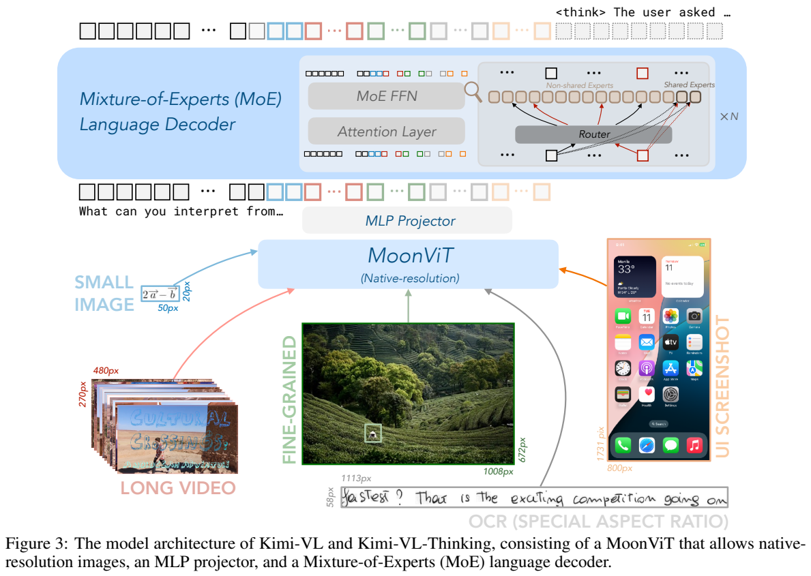
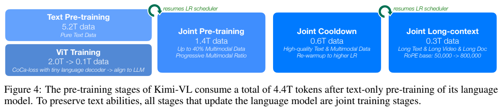
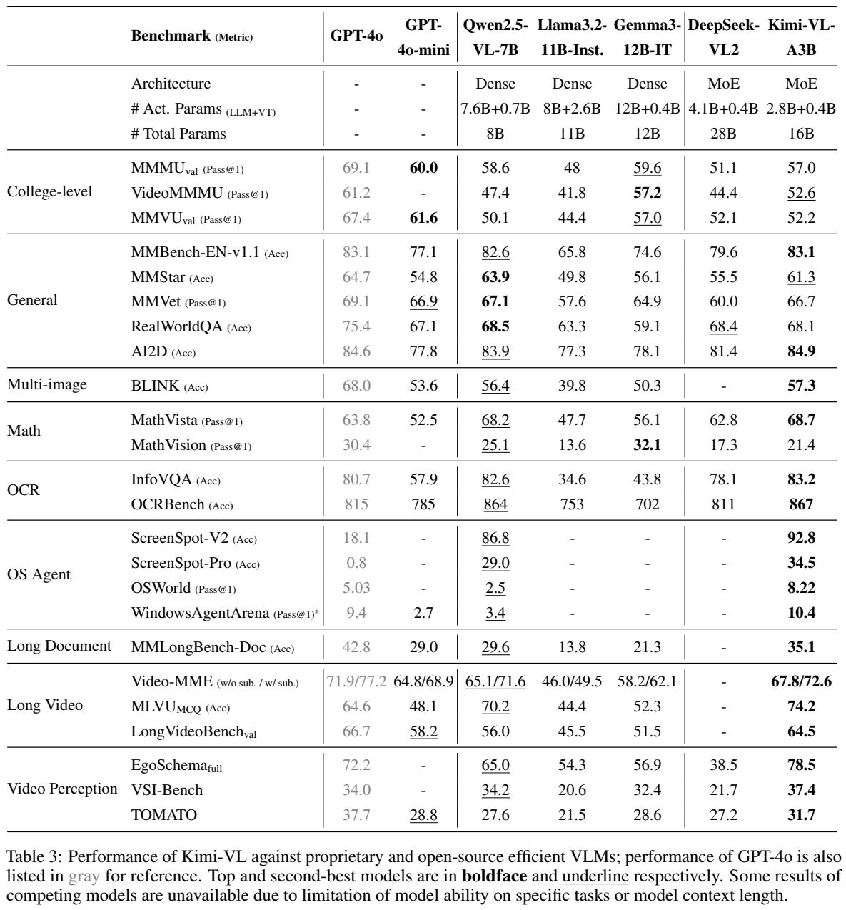
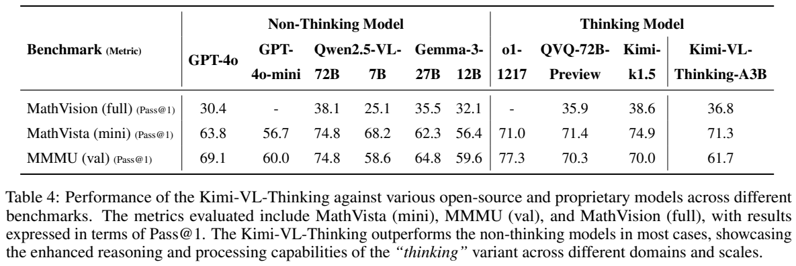
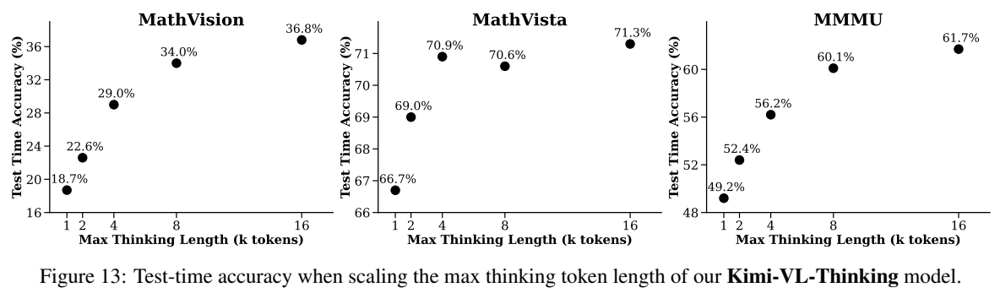

<!-- article-header:start -->
[项目首页](../../../README.md) › [模型系列](../../../reports/model-family-index.md) › [Kimi](../README.md)
<!-- article-header:end -->

# Kimi-VL：原生分辨率、长上下文与稀疏多模态推理

<!-- article-toc:start -->
<a id="article-toc"></a>

**本篇目录** · [论文定位](#paper-info) · [快速概览](#overview) · [整体架构](#architecture) · [核心原理](#principles) · [数据构建](#data) · [训练流程](#training) · [实验结果](#experiments)
<!-- article-toc:end -->

<a id="paper-info"></a>

## 1. 论文信息与模型定位

**报告**：[Kimi-VL Technical Report](https://arxiv.org/abs/2504.07491)，作者为 Moonshot AI 的 **Kimi Team**，本文依据 2025 年 4 月 10 日 [v1](https://arxiv.org/pdf/2504.07491v1)。介绍标准 **Kimi-VL-A3B** 与额外后训练的 **Kimi-VL-Thinking-A3B**，不混入之后的 Kimi-VL 更新版本。

模型由 400M MoonViT、投影层和 Moonlight MoE 语言模型组成，处理图像、多图、视频、文档与 GUI 截图，输出语言或代理动作文本。语言侧总约 **16B、激活 2.8B**，视觉侧另外约 **0.4B**；A3B 描述稀疏激活规模，不能理解为整个模型只需存储 3B 权重。Table 3 的总参数栏作16B量级报告，精确参数与部署显存不能由这里反推。

<a id="overview"></a>

## 2. 快速概览

| 方面 | 设计及限定 |
|---|---|
| 原生分辨率 | NaViT 式 patch packing，直接处理不同形状的图像序列 |
| 位置编码 | 保留插值绝对位置嵌入，并加入高、宽两轴 2D RoPE |
| 连接器 | 2×2 pixel shuffle 压缩后，两层 MLP 映射语言维度 |
| 稀疏语言模型 | Moonlight 中间检查点，初始已有 5.2T 纯文本训练 |
| 上下文 | 从8K逐步扩至32K、128K，混合长短输入回放 |
| 标准版 | 联合预训练及两轮不同长度的指令微调 |
| Thinking 版 | 再做长 CoT SFT、在线 RL，推理预算可调 |
| 主要证据 | OCR、长视频、GUI 定位与推理基准，单步/多步成功率差别很大 |

“原生分辨率”表示编码器接受可变 patch 网格，不等于所有图片无任何缩放限制；训练仍采用逐步放开分辨率的采样策略。本文没有完整公开固定最大像素、patch size、MoE 专家个数和 top-k 路由超参数，因此不凭其他模型配置补齐。

<a id="architecture"></a>

## 3. 整体架构



**读图：Figure 3，PDF 第 3 页。** 下方小图、长条文字、GUI、视频帧等经过同一 MoonViT，按不同长度产生视觉 token；中间 MLP 对齐；上方 MoE 的 router 为不同 token 选择非共享专家，并使用共享专家。Thinking 与标准版沿用这个骨架，差异主要来自后训练。

MoonViT 从 SigLIP-SO-400M 持续训练。图像划分为 patch 后展平成一维序列，多种图像长度可以打包在一个 batch，并使用 FlashAttention 的变长序列算子。它避免了传统方案的固定尺寸子图切分与拼接流程，但仍要把图像转为 patch 序列。

原 SigLIP 绝对位置嵌入通过插值保留已有知识，2D RoPE 沿高宽编码更精细的位置，两者结合适配高分辨率。随后 2×2 pixel shuffle 把四个空间位置重排到通道，将序列数约降为四分之一，再经两层 MLP 对齐。它是空间信息重排，不是丢掉四分之三特征的随机采样。

MoE 从 Moonlight 的 5.2T 纯文本、8K 上下文中间检查点继续训练，联合更新阶段混入文本与视觉。它不是先完成全部语言训练再只训练一个冻结语言模型外的视觉适配器。

| 模块 | 输入与输出 | 公开机制 |
|---|---|---|
| MoonViT | 变分辨率图像 → patch 表示 | SigLIP-SO-400M 持续训练；变长 packing，插值绝对位置加 2D RoPE |
| 空间重排 | 2×2 邻域 → 1 个高通道位置 | pixel shuffle 将位置数约降四分之一，保留邻域特征进入通道 |
| 两层 MLP | 重排视觉特征 → 语言嵌入 | 匹配 Moonlight hidden dimension，非额外查询采样网络 |
| Moonlight MoE | 视觉与文字序列 → 回答 | 16B 总参数、2.8B 激活；从 5.2T 文本中间检查点继续联合训练 |
| Thinking 后训练 | 图像问题 → 推理过程和答案 | 骨架共享；镜像下降类在线 RL 与标准版后训练分开 |


<a id="principles"></a>

## 4. 核心创新与数学原理

### 4.1 视觉塔的描述监督补充全局对齐

视觉塔采用 CoCa 式联合目标，原文明示：

```math
\mathcal L=\mathcal L_{siglip}+2\mathcal L_{caption}.
```

图文编码器计算 SigLIP 对比损失，轻量文本 decoder 根据图像特征做下一 token 预测。全局语义对齐与细节描述共同训练；后者目标还包含 OCR 文字和 grounding bounding boxes。报告没有展开 SigLIP 的具体逐对公式及全部负样本实现，不能替换成已确认的 CLIP batch-softmax 公式。

SigLIP 倾向建立整图与文字的匹配，caption decoder 则要逐 token 解释细节，两种目标给同一视觉塔提供不同粒度的梯度。OCR 和框文字进入生成目标，使局部内容也成为必须预测的信息；该轻量 decoder 属视觉预训练阶段，不等于最终回答时另有一个并行语言模型。[原文 §2.1、§2.3，PDF 第 4 页](https://arxiv.org/pdf/2504.07491v1#page=4)

### 4.2 变长位置表示与长短数据回放

长上下文训练将语言 RoPE 的 base 参数从 **50,000 调至800,000**，分两次四倍扩展。各阶段长数据 token 占25%，其余75%回放先前较短数据，平衡新增长度与短上下文能力。这个比例是长上下文阶段的长短数据组成，区别于联合预训练图中的“多模态逐步增至最多40%”，后者不是全流程固定比例。

视觉 2D RoPE 沿高宽编码，语言 RoPE base 扩展对应主干的序列位置，两者承担不同轴。patch packing 提高变分辨率批处理利用率，并不压缩单图 patch 数；真正减少送入语言模型位置的是后续 2×2 重排。因此原生分辨率、打包和长上下文扩展不能合并成一种无损压缩技术。[原文 §2.1、§2.3，PDF 第 3–5 页](https://arxiv.org/pdf/2504.07491v1#page=4)

### 4.3 逐轮参考更新约束推理策略

Thinking 版 RL 采用在线 policy mirror descent 的变体。以条件分布记号明确原式（1）的含义：

```math
\max_\theta\ \mathbb E_{(x,y^*)\sim D}
\left[\mathbb E_{(y,z)\sim\pi_\theta(\cdot\mid x)}r(x,y,y^*)
-\tau D_{KL}\big(\pi_\theta(\cdot\mid x)\Vert \pi_{\theta_i}(\cdot\mid x)\big)\right].
```

$`x`$ 是问题，$`y`$ 是答案，$`z`$ 是生成的推理过程；正确性奖励取0/1，KL 约束本轮策略相对当前参考策略的变化。下一轮参考更新为已优化的模型。奖励针对最终答案，不是给每个思考 token 人工逐步评分。另有长度惩罚防止冗长，以及按难度和样本成功率进行课程/优先采样；论文未给长度惩罚的完整公式和系数，也不是直接宣称采用 GRPO。

优化使用增强 Muon，加入 weight decay、调整参数更新尺度并实现 ZeRO-1 分布式版本。报告描述这些改动但未推导全部矩阵更新公式，本文不补写成未经核验的数学实现。

KL 的参考是本轮起点策略，下一轮再更新参考，所以约束限制每次优化的移动幅度，并非始终锚定一个不变的初始模型。正确性奖励监督最终答案，推理过程通过这些采样轨迹获得间接优化；没有逐步人工标签时，不能把每个中间论断都当成被单独验证过。[原文 §2.4，PDF 第 6 页](https://arxiv.org/pdf/2504.07491v1#page=6)


<a id="data"></a>

## 5. 数据构建与处理

预训练多模态数据包含 caption、图文交错、OCR、知识、视频、代理六类。中英文 caption 结合公开与内部来源，过滤重复和弱图文相关项，严格限制合成 caption 占比以减轻幻觉。交错数据来自教材、网页、教程等，并重排图文顺序，保留多图知识与长上下文结构。

OCR 覆盖多语言、密集布局、手写、多页文档，以及图表、几何、Mermaid、场景文字。增强包括旋转、畸变、颜色变化和噪声；转换时保留坐标及方向信息。知识管线使用版面解析与 OCR 处理教材、论文，也专门处理信息图中纯文字信息，避免只用单一 OCR 管线。

代理数据在批量虚拟机中通过启发式方法收集截图—动作，形成 dense grounding 与连续轨迹；桌面、移动端、网页有不同动作空间，还加入图标知识和人工多步轨迹配合合成 CoT。视频既包括细粒度短片也包括长视频，采用 dense caption 管线并限制合成比例。报告没有公开各类全部样本量、过滤阈值和精确混合权重。

SFT 非推理任务先人工构造种子数据、训练 seed model，再为多种提示采样多个回答，由标注员排序并修订最佳回答；可验证推理任务采用规则/模型验证的 rejection sampling 扩充。普通 SFT **文本 token 与图像 token 约1:1**，不是样本数各半。长 CoT 数据由带真值 QA 和 Kimi k1.5 多轨迹采样构建，奖励模型与规则过滤错误轨迹；没有披露全部推理数据规模。

<a id="training"></a>

## 6. 训练流程与目标



**读图：Figure 4，PDF 第 4 页。** 左上5.2T是已有语言模型训练，左下视觉塔2T及0.1T接入；右侧才是继续更新语言模型的联合训练。图中的累计4.4T包括视觉塔训练与纯文本/多模态联合训练，不能称4.4T都为新多模态语料。

| 阶段 | token 量 | 核心更新与数据 |
|---|---:|---|
| 视觉塔训练及接入 | 2T + 0.1T | 先 CoCa 目标与逐步增大分辨率，再只更新 MoonViT/MLP 对齐冻结 LLM |
| 联合预训练 | 1.4T | 文本与多模态共同更新，视觉比例从零逐步提高，延续 LR 调度 |
| 联合 cooldown | 0.6T | 高质量回放与少量合成/学术 QA，再 warmup 更高 LR |
| 长上下文激活 | 0.3T | 8K→32K→128K，文本/长视频/长文档，25%长数据加75%短回放 |

更新语言模型的三个联合阶段共 **2.3T**。cooldown QA 用于激活特定能力，比例保持较低；不把它直接等同于最后的对话微调。

标准版 SFT 更新视觉塔、MLP、语言模型，ChatML 格式，仅对答案和特殊 token 监督，system/user 内容遮蔽。先32K训练1 epoch，LR从 $`2\times10^{-5}`$ 降至 $`2\times10^{-6}`$；再128K训练1 epoch，re-warmup至 $`10^{-5}`$，末尾降至 $`10^{-6}`$，多样本 packing 提高效率。Thinking 再用小而高质量的长CoT进行轻量SFT，然后进行上节RL。未公开所有预训练LR、batch、RL步数等细节，不能补造。

工程侧结合 DP/EP/PP/CP 四维并行、ZeRO-1、选择性激活重算。作者报告优化后训练吞吐比7B稠密VLM高约60%，但未给完整同硬件复现表，因此它是该训练系统对比，不能当作所有部署环境下固定加速比例。

<a id="experiments"></a>

## 7. 实验设置与主要结果



**读图：Table 3，PDF 第 10 页。** 末列标准Kimi-VL；GPT-4o灰列为参考，其他高亮主要围绕高效模型比较。多个指标虽栏写Acc，附录明确 InfoVQA 为 **test ANLS**，OCRBench 为 **1000分制**；因此 867不是867%准确率。

| 项目 | Kimi-VL | Qwen2.5-VL-7B | GPT-4o |
|---|---:|---:|---:|
| MMMU val，Pass@1 | 57.0 | 58.6 | 69.1 |
| MMBench EN v1.1 | 83.1 | 82.6 | 83.1 |
| MathVista | 68.7 | 68.2 | 63.8 |
| MathVision | 21.4 | 25.1 | 30.4 |
| InfoVQA，ANLS尺度100 | 83.2 | 82.6 | 80.7 |
| OCRBench /1000 | 867 | 864 | 815 |
| BLINK，多图 | 57.3 | 56.4 | 68.0 |
| Video-MME，无/有字幕 | 67.8 / 72.6 | 65.1 / 71.6 | 71.9 / 77.2 |
| LongVideoBench val | 64.5 | 56.0 | 66.7 |
| MMLongBench-Doc | 35.1 | 29.6 | 42.8 |

标准版文字和长输入有竞争力，但MathVision、MMMU与多项GPT-4o参考结果仍有差距。报告未完整披露各模型统一的视频帧预算，本文不编造“相同帧数公平测试”。长文档正文写34.7而主表写35.1，采用原Table 3并保留口径差异。

GUI单步：ScreenSpot-V2 **92.8**（正文另写92.0）、ScreenSpot-Pro **34.5**；多步：OSWorld Pass@1 **8.22**，GPT-4o **5.03**、Qwen **2.5**；WindowsAgentArena **10.4**，GPT-4o **9.4**。后者GPT系列使用Omniparser且无UIA。单步定位高分不能推成多步桌面操作已可靠，实际多步任务大多数仍未完成。

128K needle-in-a-haystack 的 Table 2，在64K以下文本与视频均100%，**64K–128K区间文本87.0%、视频91.7%**。这既说明长上下文检索可用，也显示窗口长度不保证全位置无损；检索测试还不等于复杂长文档推理。





**读图：Table 4/Figure 13，PDF 第 17 页。** Thinking在MathVision full **36.8**、MathVista mini **71.3**、MMMU val **61.7**；相对标准版分别增 **15.4/2.6/4.7个百分点**。MathVision高于QVQ-72B **35.9**，但低于Qwen2.5-VL-72B **38.1**；MMMU仍低于GPT-4o **69.1**、o1 **77.3**。不能宣称激活3B全面超过大型模型。

把最大思考预算从1K增至16K，MathVision **18.7→36.8**，MMMU **49.2→61.7**；MathVista 4K **70.9**、8K **70.6**、16K **71.3**，收益饱和且不严格单调。图展示推理预算变化，不是证明RL和CoT SFT各自独立贡献的组件消融；本文也没有完整MoonViT/Muon/packing开关消融表。更长推理会增加实际生成开销，因此低激活参数与低任务成本不能画等号。

<!-- article-footer:start -->
---

[← 上一篇：Llama 4](../../llama/document-4003084812b3/README.md) · [按发表时间浏览](../../../reports/paper-reading-guide.md#year-2025) · [下一篇：GPT-4.1 →](../../gpt/document-32a268f7f1d8/README.md)

[返回本篇目录](#article-toc) · [返回模型系列](../README.md)
<!-- article-footer:end -->
