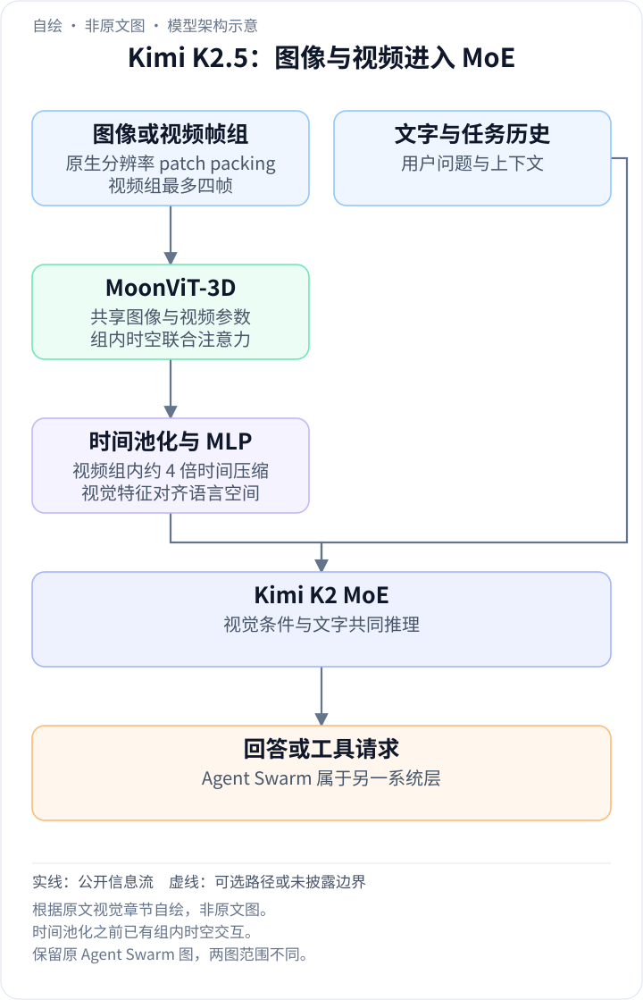
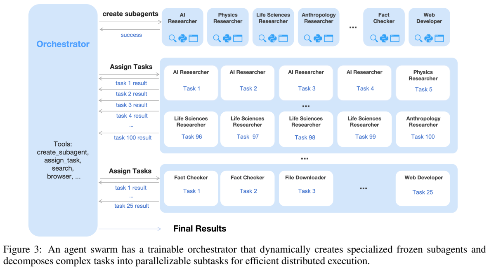
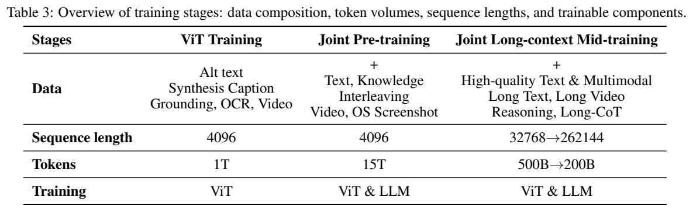
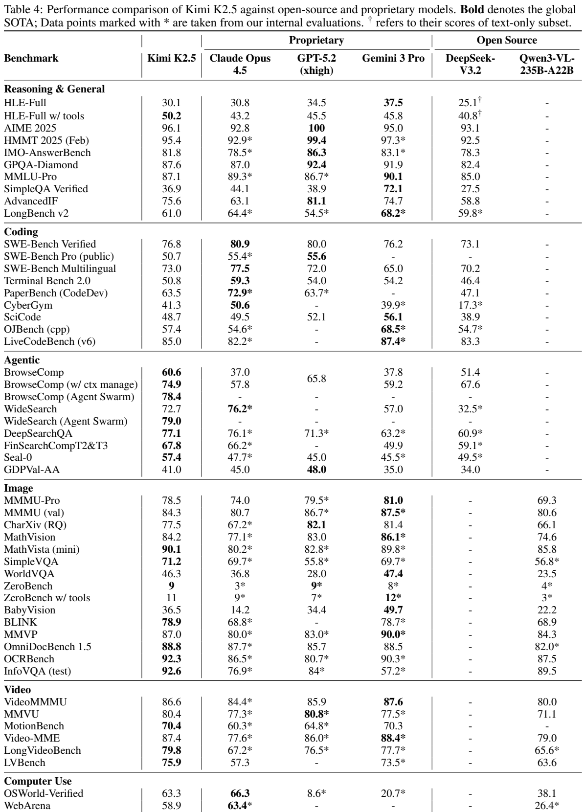
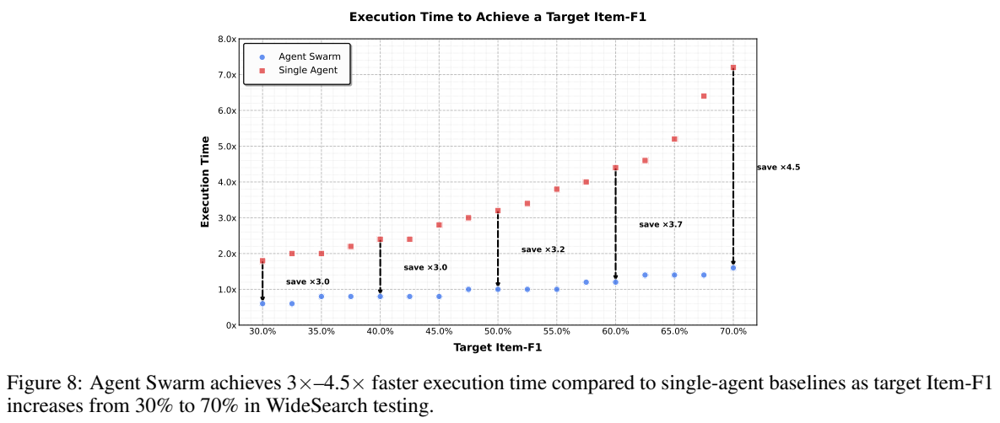

<!-- article-header:start -->
[项目首页](../../../README.md) › [模型系列](../../../reports/model-family-index.md) › [Kimi](../README.md)
<!-- article-header:end -->

# Kimi K2.5：视觉与文本联合训练，以及可学习的并行智能体编排

<!-- article-toc:start -->
<a id="article-toc"></a>

**本篇目录** · [论文定位](#paper-info) · [快速概览](#overview) · [整体架构](#architecture) · [核心原理](#principles) · [数据构建](#data) · [训练流程](#training) · [实验结果](#experiments)
<!-- article-toc:end -->

<a id="paper-info"></a>

## 1. 论文信息与模型定位

| 项目 | 内容 |
|---|---|
| 原文题名 | Kimi K2.5: Visual Agentic Intelligence；Technical Report of Kimi K2.5 |
| 作者与机构 | Kimi Team，Moonshot AI（月之暗面）；贡献者见原文附录 A |
| 来源版本 | [arXiv:2602.02276v1](https://arxiv.org/abs/2602.02276v1)，2026 年 2 月 2 日；30 页 |
| 官方权重 | [moonshotai/Kimi-K2.5](https://huggingface.co/moonshotai/Kimi-K2.5) |
| 基础模型 | Kimi K2 的约万亿参数 MoE 语言模型，加 MoonViT-3D 和 MLP 视觉投影器 |
| 定位 | 图像/视频理解、工具使用、代码与软件工程、GUI 操作；支持单智能体及 Agent Swarm 编排 |

报告给出 K2 语言骨干 1.04T 总参数、32B 激活参数，384 个专家、每 token 激活 8 个。它没有另行逐项核算加入视觉模块后 K2.5 的精确总参数，因而应将这些数解释为语言基础规模。Agent Swarm 是围绕模型和工具建立的多智能体运行及训练机制，不能只凭模型权重下载就默认获得完整并发环境。

<a id="overview"></a>

## 2. 快速概览

K2.5 围绕两条路线构建。第一条是让文本和视觉从联合预训练开始相互支持：采用适度视觉比例早期融合，之后只用文本 SFT 启动视觉推理和程序工具使用，再进行文本与视觉联合强化学习。所谓 zero-vision SFT 仅指这一 SFT 阶段没有视觉样本；前面的预训练和后面的 RL 都有大量视觉内容。

第二条是把复杂任务交给可学习的编排者：模型按需要创建不同角色子智能体、分配任务、收集结果，而不是固定执行每步工具调用。Parallel-Agent RL（PARL）只更新编排者，子智能体保持固定，减少最终奖励难以分摊到各参与者的困难。

图像和视频共享 MoonViT-3D；最多四个相邻帧形成一组，先做时空注意力，再以时间池化减少送入 LLM 的 token。报告的 MathVista mini 为 90.1、OCRBench 为 92.3、OSWorld-Verified 成功率为 63.3。搜索任务中 Swarm 的 WideSearch Item-F1 为 79.0，对应单智能体 72.7；完成同等目标 Item-F1 的时间最高可减少 4.5 倍，但不代表全部任务减少相同计算量。

<a id="architecture"></a>

## 3. 整体架构

<!-- derived-architecture:start -->


*自绘模型架构示意（非原文图）。依据下述公开资料归纳；方框表示功能组件，不代表逐层实现。*

依据：[2602.02276v1; MoonViT-3D / architecture section](https://arxiv.org/pdf/2602.02276v1)。
<!-- derived-architecture:end -->

多模态基础采用 MoonViT-3D → MLP → Kimi K2 MoE。视觉编码器从 SigLIP-SO-400M 初始化，继承 NaViT 的 patch packing：不同分辨率图片被拆为小 patch、展平为序列，在同一训练批次中打包。它不需要先统一为固定数量的方形子图；不过输入仍受到实际分辨率与上下文预算约束，原生分辨率不等于无限像素。

视频把最多四帧的 patch 联合打包为时空序列，用同一组注意力权重读取空间和时间关系。经过编码后，对同一空间位置的时间表示聚合，再送入 MLP，达到四帧组内约四倍时间压缩。这里包含池化之前的时空交互，不能写成“每帧完全独立编码后直接平均”。这一压缩增加固定上下文内可放入的视频帧数量，未保证每个短暂事件的信息都完整保留。



*原文 Figure 3，PDF 第 5 页，原文图表裁图。箭头区分创建与任务分派、返回结果；同一角色可以接收不同任务。PARL 训练设置与奖励见原文 §3。*

Agent Swarm 的可训练 orchestrator 使用 `create_subagent` 和 `assign_task` 等工具，子智能体来自固定中间策略检查点。训练时只优化编排者，子智能体轨迹不进入其优化目标，输出被当作环境观察。作者先用较小子智能体训练，再切换更大模型来兼顾效率。子智能体有独立工作上下文，只返回相关结果，不把全部工具日志塞回中心上下文。

运行环境以异步任务支持递归子任务、工具 sandbox 和多种 judge。附录 D 提到训练 Rollout Manager 可管理最多 100,000 个并发 agent task，这是训练框架的任务调度规模，不是一次用户任务必须创建十万个智能体的能力承诺。

<a id="principles"></a>

## 4. 核心创新与数学原理

**在固定总 token 预算下比较融合时间。** Table 1 对早期 0% 时刻引入视觉、10:90 视觉文本比例，中期 50% 时刻、20:80，以及后期 80% 时刻、50:50 进行对照。早期方案视觉知识 25.8、视觉推理 43.8、OCR 65.7；后期为 24.2、39.0、61.5。比例和引入时点同步改变，实验支持这套早期适度融合策略较好，却不能单独证明“10% 比例对任何模型都最优”。这些比例为消融设置，也不是完整生产数据配方的逐项披露。

**以结果奖励让程序能力迁移到视觉。** 文本 SFT 学会 IPython 操作后，图像处理可以通过代码完成：例如二值化、统计颜色、计算面积、寻找路径。后续视觉 RL 奖励定位、计数、OCR 和依赖图像的 STEM 答案，修正只依赖语言而忽略图片的失败。视觉 RL 前后，MMLU-Pro 84.7→86.4、GPQA-Diamond 84.3→86.4、LongBench v2 56.7→58.9；这是中间阶段迁移实验，不能与最终检查点成绩混用，也不是对任意视觉 RL 的普遍保证。

**PARL 同时约束有用并行与最终任务质量。** 原文第 3 节定义：


```math
r_{PARL}(x,y)=\lambda_1r_{parallel}+\lambda_2r_{finish}+r_{perf}(x,y).
```


创建子智能体的奖励鼓励探索并行，完成率奖励抑制大量创建但不实际执行的“假并行”，最终表现奖励约束任务质量。两项辅助权重在训练中逐渐衰减到零，使最终策略回到主要任务目标。报告没有给出这两个权重的具体初值和完整退火曲线。

并发开销用关键路径思想计数：


```math
\mathrm{CriticalSteps}=\sum_{t=1}^T
\left(S_{main}^{(t)}+\max_i S_{sub,i}^{(t)}\right).
```


每个阶段的并发部分由最长子任务决定，随后阶段依次累加。原文用步数代理时延；工具耗时、通信等待、模型服务吞吐并不完全相同，不能将该式当作精确秒数模型。缩短最慢分支可降低关键步数，但总调用数或总生成 token 可能增加，因此降低墙钟时间与降低总计算成本需要分别检验。

**Toggle 交替学习节省 token 与利用更长推理。** 固定预算训练可能让模型无法利用更多计算，作者每隔 $`m`$ 次迭代切换预算受限与普通扩展阶段。预算基于正确回答长度的百分位，原文 Eq. (2) 的意图可写为：


```math
budget(x)=\mathrm{Percentile}_\rho\{,\vert y_i\vert :r(x,y_i)=1\,\}.
```


预算在训练开始时估计，之后固定；受限阶段仅在该题平均正确率超过阈值时惩罚超预算回答，以免早期为省 token 放弃难题。这里整理了原文集合中不统一的下标，没有补充未披露的 $`m,\rho`$ 或准确率阈值。Figure 5 的 25%–30% 输出减少实验是在 **K2 Thinking** 上验证 Toggle，不能声称该图直接测得 K2.5 所有任务同样降幅。

<a id="data"></a>

## 5. 数据构建与处理

文本语料覆盖网页、代码、数学和知识，延续 K2 的清洗方法，并提高代码权重。新增内容强调仓库级多文件代码，issues、review、commit 历史，以及从 PDF/网页抽取的代码文档，让模型看到真实维护和架构理解场景。

视觉语料包含 caption、图文交错、OCR、知识、感知、视频、agent 七类。描述来自 alt text 和合成图注，作者限制合成图注用量以缓解幻觉，但未公布具体上限。交错图文来自书籍、网页、教程；OCR 包括多语言、密集布局、多页文档；知识部分以布局解析器处理学术资料。数学科学原始材料通过检索和网页采集获得，再用上下文学习改写为 K-12 到大学的结构化问题。

图像与代码对覆盖 HTML、React、SVG 等，通过渲染截图对齐程序结构与视觉布局。GUI 数据来自桌面、手机和网页的截图、动作轨迹及人工示范；长短视频提供时空学习，定位和轮廓分割增强细粒度感知。该段属于预训练/多模态数据构建，与“文本 SFT”不矛盾。

作者说明过滤、去重和质量检查，但没有公开每类条数、来源权重、所有阈值或训练集与所有基准的完整去污染审计。SFT 候选回答由 K2、K2 Thinking 和内部专家生成，结合人工标注、提示设计、多阶段验证。PARL 的任务包含宽搜索、深搜索、长文档分析和批量文件获取，合成提示本身不直接要求并行，让模型从任务分布和反馈中学会分解。



*原文 Table 3，PDF 第 7 页，原文图表裁图。保留各阶段 token 量、序列长度和更新模块；图像视频编码与短暂投影器对齐分别见原文 §4.2、§4.3。*

<a id="training"></a>

## 6. 训练流程与目标

| 阶段 | 原文公开内容 |
|---|---|
| 视觉编码器继续训练 | 与 Moonlight-16B-A3B 对齐，约 1T token、序列 4096；更新 MoonViT-3D，使用视觉条件 caption 交叉熵；明确没有此阶段的对比损失 |
| 短暂接口对齐 | 只更新 MLP，将视觉编码器接入 1T 语言骨干 |
| 联合预训练 | 从接近末期的 K2 检查点继续约 15T 视觉文本 token，序列 4096；视觉和语言共同更新 |
| 长上下文与 mid-training | Table 3 为 500B→200B token，长度 32768→262144；使用 YaRN 插值扩展，加入高质量长文本、长视频、推理与长 CoT |
| zero-vision SFT | 纯文本指令和工具轨迹启动视觉 agent 行为；本报告没有完整给出样本量和所有模块冻结策略 |
| 联合 RL 与 PARL | 文本视觉按知识、推理、代码和 agent 能力组织；PARL 固定子智能体，只更新编排者 |

正文概述“约 15T”与表中另列视觉 1T、联合 15T、长上下文 500B→200B 的近似口径不完全一致，应分别引用阶段量，而不是声称总计精确为 15T 或所有数据只看一遍。语言基础 K2 自身先前训练的 15T 文本也不能跟 K2.5 继续训练的 15T 混为一阶段。

视觉 caption 的标准目标可以解释为 $`\mathcal L_{caption}=-\sum_t\log p(y_t\mid y_{\lt t},I)`$，这是交叉熵机制说明，未冒充原文的新编号公式。RL 的 Eq. (1) 结合组内平均奖励作为基线、token 级策略比率裁剪和对数比率平方约束；文字解释其裁剪是按 off-policy 偏差屏蔽梯度，与按优势符号工作的 PPO clipped surrogate 不同。v1 对 Clip 的 ratio/log-ratio 表述与目标正负方向没有完全展开一致的定义，本介绍不据它编写一个确定可运行的 RL 算法。

视觉奖励按任务设计：框定位使用 IoU 软匹配 F1，点定位使用最优匹配下高斯距离权重，多边形分割栅格化后计算 mask IoU，OCR 用归一化编辑距离，计数用绝对误差。开放式任务使用生成式奖励模型和不同 rubric，代码与可验证推理使用规则结果奖励。报告缺少所有奖励权重、学习率、batch、迭代轮数和 clipping 阈值，无法仅靠报告完整复现。

训练在 H800 集群上，节点间 8×400Gbps RoCE；结合 16 路流水线、16 路专家并行和 ZeRO-1。Decoupled Encoder Process 先把视觉前向均衡到各 GPU，只保留输出，完成主骨干前反向后再重算视觉前向并做视觉反向。它换取负载均衡和激活内存节省，仍有重算成本；作者给出相对纯文本训练约 90% 效率，未公开全套计时统计和总训练 GPU 数。

<a id="experiments"></a>

## 7. 实验设置与主要结果

默认温度 1.0、top-p 0.95、上下文 256K，但附录 E 为各任务给出重要例外。视觉和视频最多输出 64K，三次运行平均；AIME/HMMT Feb 为 Avg@64，GPQA 为 Avg@8。SWE 和 Terminal Bench 使用非 Thinking 设置，代码结果 Avg@5。短视频采样 128 帧、最大空间分辨率 896，长视频采样 2048 帧、分辨率 448；Video-MME 使用字幕。GUI 最大 100 步，OSWorld 温度 0、WebArena 0.1，且只测一次。



*原文 Table 4，PDF 第 12 页，原文图表裁图。保留所有分区、模型列和脚注。星号为作者内部评测；HLE 的文本子集与全量集另有脚注，不能直接混比。*

| 任务与设置 | K2.5 | 对照或解释 |
|---|---:|---|
| HLE-Full 无工具 / 有工具 | 30.1 / 50.2 | 工具改变实际解题系统；DeepSeek 对应结果是文本子集 |
| MMMU-Pro / MMMU val | 78.5 / 84.3 | Gemini 3 Pro 为 81.0 / 87.5 |
| MathVision / MathVista mini | 84.2 / 90.1 | MathVista 高于表中对照，MathVision 低于 Gemini 86.1 |
| OCRBench / OmniDocBench 1.5 | 92.3 / 88.8 | OCRBench 百分化；OmniDoc 指标为 (1−归一化编辑距离)×100 |
| InfoVQA test | 92.6 | 文档信息图理解 |
| Video-MME，带字幕 / LVBench | 87.4 / 75.9 | 2048 帧输入；不与稀疏无字幕结果默认同条件比较 |
| SWE-Bench Verified | 76.8 | Claude Opus 4.5 为 80.9，GPT-5.2 为 80.0 |
| OSWorld-Verified / WebArena | 63.3 / 58.9 | GUI 在线任务成功率，Claude 为 66.3 / 63.4 |
| ZeroBench 无工具 / 有工具 | 9 / 11 | 依然只有较低成功率，工具并未解决全部视觉难题 |

作者说明 GPT-5.2-xhigh 在视觉复测约 10% 请求重试三次仍无输出，这些计为错误。因此部分对照受 API 可靠性影响，不能把所有分差解释为纯模型推理能力。LongBench 对照实际采用 GPT-5.2-high 以满足选项输出格式，不能机械沿用表头 xhigh；GUI 的 Claude 也限定只用 computer-use 工具，与系统卡条件不同。

Swarm 在 BrowseComp 为 78.4，单智能体无上下文管理为 60.6、有 discard-all 管理为 74.9；因此 +17.8 个百分点是相对无管理基线，而相对管理版本只有 3.5。WideSearch 由 72.7→79.0 Item-F1，内部 Swarm Bench 由 41.6→58.3；内部测试特意包含并行友好的大规模任务，外部可复核性弱于公开基准。正文早处写单智能体 72.8，正式 Tables 4、6 为 72.7，本介绍以表格为准。



*原文 Figure 8，PDF 第 15 页，原文图表裁图。横轴目标 Item-F1，纵轴归一化执行时间，图注为 WideSearch；并非单 token 推理速度或总 FLOPs。*

WideSearch 达到目标 Item-F1 30%–70% 时，Swarm 比顺序单智能体快约 3–4.5 倍。附录另设预算：BrowseComp 中心 15 步、每个子智能体 100 步；WideSearch 两者均 100；内部测试中心 100、子智能体 50。并行模式改变总可用工作量，报告没有证明总 GPU 或 token 花费等量。

Figure 11 的 24 小时、32 段视频分析依靠多个视觉子智能体分段处理并汇总 HTML；它是系统案例，不能说明一次 256K 前向直接完整读入 24 小时原视频。报告将联合训练、工具执行与并行编排结合得较完整，但对开放式搜索、长视频事实完整性及总成本仍缺少全面误差分析。本仓库未运行模型或 agent 环境，以上均为原文成绩和设置。

<!-- article-footer:start -->
---

[← 上一篇：DeepSeek-OCR 2](../../deepseek/document-536ef2604f4a/README.md) · [按发表时间浏览](../../../reports/paper-reading-guide.md#year-2026) · [下一篇：MiniCPM-o 4.5 →](../../minicpm/document-9be303a31d11/README.md)

[返回本篇目录](#article-toc) · [返回模型系列](../README.md)
<!-- article-footer:end -->
