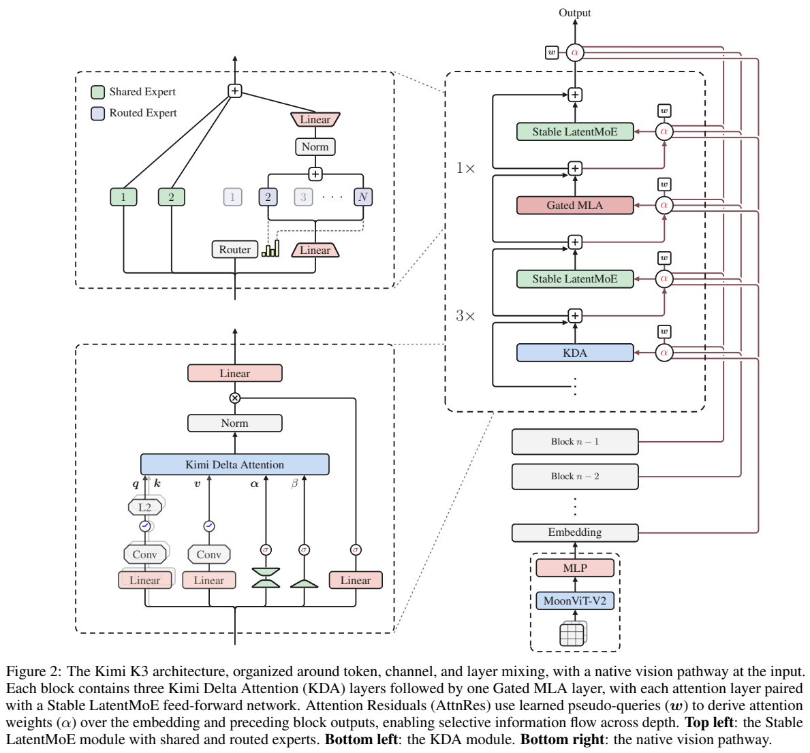
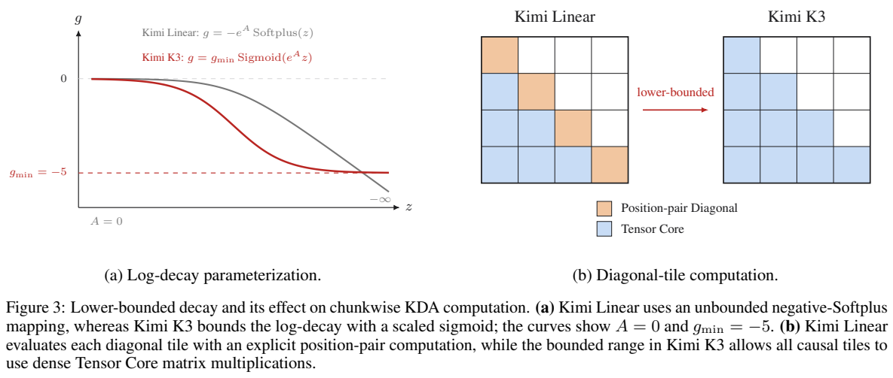
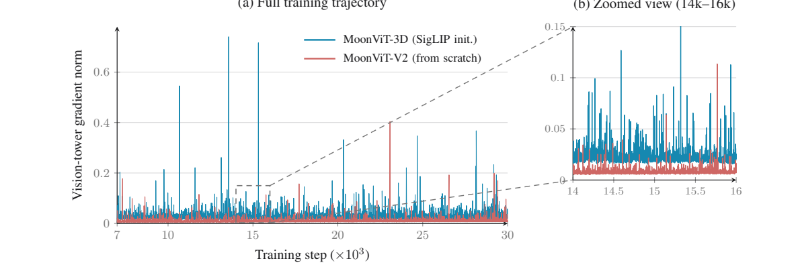
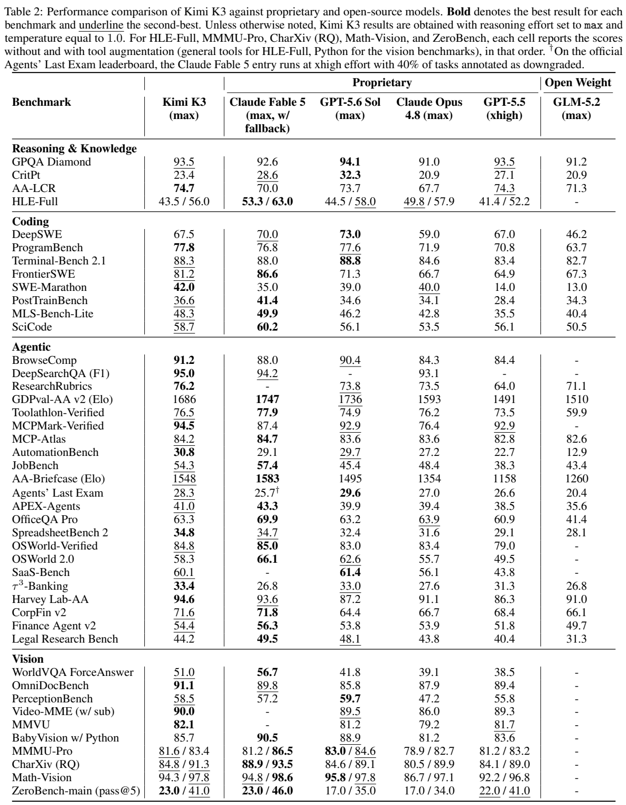

<!-- article-header:start -->
[项目首页](../../../README.md) › [模型系列](../../../reports/model-family-index.md) › [Kimi](../README.md)
<!-- article-header:end -->

# Kimi K3：混合递归注意力、原生视觉与百万上下文 agent 训练

<!-- article-toc:start -->
<a id="article-toc"></a>

**本篇目录** · [论文定位](#paper-info) · [快速概览](#overview) · [整体架构](#architecture) · [核心原理](#principles) · [数据构建](#data) · [训练流程](#training) · [实验结果](#experiments)
<!-- article-toc:end -->

<a id="paper-info"></a>

## 1. 论文信息与模型定位

原文为 Kimi Team 的 **Kimi K3: Open Frontier Intelligence**。本文使用 [MoonshotAI/Kimi-K3 官方仓库技术报告](https://github.com/MoonshotAI/Kimi-K3/blob/main/k3_tech_report.pdf)，固定为 2026 年 10 月 8 日缓存的 47 页 PDF，原文件 SHA-256 与截图来源见本目录记录。报告的主要排行榜比较集中在 2026 年 7 月相应日期，并不代表这些榜单的当前排序。

Kimi K3 是原生视觉 MoE 模型，文本、图像和视频进入共享主干，支持最多百万 token 上下文。摘要用四舍五入的 **2.8T 总参数、104B 激活参数**，Table 1 则给出 **2.78T、104.2B**。目标覆盖长程代码、知识推理、视觉理解及工具任务；视觉输出案例主要通过写代码、渲染和检查结果完成，不等于报告公开了原生图像生成解码器。[PDF 第 1–3、11 页](https://raw.githubusercontent.com/MoonshotAI/Kimi-K3/main/k3_tech_report.pdf#page=1)。

报告值得研究的地方是把序列、深度、专家宽度和视觉训练一起设计，并将长上下文扩展到持续的环境交互。它同时给出稳定性和系统细节，也承认研究级推理与部分 agent 行为落后于最强闭源对照。

<a id="overview"></a>

## 2. 快速概览

| 部件 | 实际公开配置 |
| --- | --- |
| 主干 | 93 层，隐藏维度 7168，96 个注意力头 |
| 注意力 | 69 个 KDA、24 个 Gated MLA，常规 3:1 交错，末层保证全局注意力 |
| MoE | 896 路由专家中选 16 个，2 个全宽共享专家；路由潜空间维度 3584 |
| 残差 | Block Attention Residuals，8 个计算块加 Embedding 源 |
| 视觉 | MoonViT-V2，401M 参数、27 层、patch 14、12 个头 |
| 输入规模 | 图像最高 3584×3584；空间 2×2 下采样使视觉 token 减至四分之一 |
| 长度课程 | 预训练 8K → 64K，cooldown 256K → 1M |
| 后训练 | SFT → 三领域×三预算的九教师 RL → 多教师 on-policy 蒸馏 |

作者通过 OOD 验证集上的拟合 scaling 曲线，报告相对 Kimi K2 约 **2.5 倍 scaling efficiency**。这是架构、数据和训练配方的联合收益，不是同一个模型推理速度提高 2.5 倍，也不能全部归因于一个注意力模块。[PDF 第 10–12 页](https://raw.githubusercontent.com/MoonshotAI/Kimi-K3/main/k3_tech_report.pdf#page=10)。

<a id="architecture"></a>

## 3. 整体架构



**如何读图：** 右下图像经 MoonViT-V2 和 MLP 投影，进入与文本共享的 Embedding 空间；右侧主干每组三个 KDA 配一个 Gated MLA，二者后接 Stable LatentMoE。红色跨层连线是 AttnRes 对更早表示的选择，不是跨模态 cross-attention。左上专家分支中，两个共享专家保留全宽，路由分支先降维、聚合后归一化并升维。

KDA 使用固定大小递归状态处理历史，全局 MLA 则保留逐 token 的压缩潜变量缓存。它们互补：递归路径降低长序列成本，周期性 MLA 提供全局内容交互。因此整个混合模型仍有随序列增长的 MLA KV 缓存，不能把全模型空间复杂度说成固定常数。主干的 MLA 使用 NoPE，位置信息主要通过 KDA 的递归、衰减与局部卷积隐式体现；这不代表序列顺序被删除。[PDF 第 4–6 页](https://raw.githubusercontent.com/MoonshotAI/Kimi-K3/main/k3_tech_report.pdf#page=4)。

视觉编码器从头训练，采用 RMSNorm、移除线性及注意力投影 bias。图像和视频共享参数，注意力分成帧内空间与帧间时间处理，另有时间池化压缩视频 token。视觉特征先做 2×2 下采样，再经轻量 MLP 进入语言主干。报告没有单列冻结语言模型的视觉对齐阶段，而是从训练开始联合优化语言与视觉。[PDF 第 9–12 页](https://raw.githubusercontent.com/MoonshotAI/Kimi-K3/main/k3_tech_report.pdf#page=9)。

| 模块 | 输入与输出 | 公开机制 |
|---|---|---|
| MoonViT-V2 | 图像/视频 → 原生分辨率视觉表征 | 27 层约 0.4B，从头 NTP 训练；空间/时间注意力分解，参数共享 |
| 压缩与投影 | 时空视觉网格 → 语言嵌入 | 时间池化与 2×2 pixel shuffle，轻量 MLP 接入共享流 |
| 混合 token 注意力 | 序列 → KDA 状态与 MLA 全局读取 | 3 KDA 后 1 Gated MLA，末尾额外 MLA；NoPE 用于 MLA |
| AttnRes 深度读取 | 早期层/块输出 → 当前层输入 | 最多 12 层一块，共 8 块；选择表示而非跳过后续执行 |
| Stable LatentMoE | 隐藏状态 → 稀疏通道变换 | 896 路由专家取 16；半宽潜空间专家，加全宽共享路径 |
| 解码与工具反馈 | 同一图文上下文 → 代码、回答及后续观察 | 渲染结果可回填同一模型；不是外部视觉模型接力 |


<a id="principles"></a>

## 4. 核心创新与数学原理

### 4.1 KDA 的逐通道遗忘与 delta 写入

原文式（1）为


```math
S_t=(I-\beta_tk_tk_t^\top)\mathrm{Diag}(\alpha_t)S_{t-1}
 +\beta_tk_tv_t^\top,\qquad \tilde o_t=S_t^\top q_t.
```


$`S_t`$ 是 key×value 状态，$`\alpha_t`$ 是每个 key 通道的保留率，$`\beta_t`$ 控制写入强度。状态先衰减，再通过 delta 项减少当前 key 方向的旧关联，最后写入当前 value；它不同于仅把所有 $`kv^\top`$ 累加。query/key 经短卷积、Swish 与 L2 归一化，输出又经过归一化和输入相关的全秩门控。该递归可以按块转换为块内并行、块间传递状态的计算。[PDF 第 4–5 页](https://raw.githubusercontent.com/MoonshotAI/Kimi-K3/main/k3_tech_report.pdf#page=4)。

遗忘先作用于旧状态，再用当前 key 方向修正写入，因此保留率与写入强度是两个控制量。KDA 输出还经过输入相关的全秩 gate，这个输出门调节送往后续层的通道，并不替代状态中的遗忘门；二者分别控制记忆更新与本次读取结果。[原文 §2.1.1、Eq. (1)、(6)，PDF 第 4–5 页](https://raw.githubusercontent.com/MoonshotAI/Kimi-K3/main/k3_tech_report.pdf#page=4)

### 4.2 衰减下界与块并行数值范围

K3 将 log-decay 改为原文式（5）


```math
g_t^h=-5\,\mathrm{Sigmoid}(e^{A_h}z_t^h),\qquad
\alpha_t^h=e^{g_t^h}\in(e^{-5},1).
```


16-token 子块的累计 log-decay 大于 -80，倒数缩放小于 $`e^{80}`$，仍在 BF16 动态范围内，避免对角子块因无限小衰减而必须逐位置对计算。这是数值参数化与 kernel 的共同设计，不是简单将 token 注意力裁成固定窗口。



**如何读图：** 左侧灰线是此前无下界的负 Softplus，红线被限制在 -5 到 0；右侧橙色对角块原本走特殊 position-pair 路径，K3 可将因果对角和非对角块都变为蓝色的 Tensor Core 路径。改善的是块计算的数值范围与执行方式，没有保证每个实际输入都同样快。

给单步 log-decay 设置下界并未停止遗忘：随着块数增加，历史贡献仍能继续衰减。限制的是 16-token tile 内做等价缩放时的数值动态范围，从而允许对角块也使用矩阵计算。这是递归公式与硬件实现的配合，不能理解成只保留最近 16 个 token。[原文 §2.1.1、Eq. (5)，PDF 第 5 页](https://raw.githubusercontent.com/MoonshotAI/Kimi-K3/main/k3_tech_report.pdf#page=5)

### 4.3 AttnRes 在深度维选择已有表示

普通残差把历史不断加到一个状态，AttnRes 为层 $`l`$ 设置可学习伪 query $`w_l`$，以归一化后的早期表示作为 key：


```math
\alpha_{i\to l}=
\frac{\exp(w_l^\top\mathrm{RMSNorm}(k_i))}
{\sum_j\exp(w_l^\top\mathrm{RMSNorm}(k_j))},\qquad
h_l=\sum_i\alpha_{i\to l}v_i.
```


这来自原文式（8–9），注意力发生在**层表示之间**。完整形式需保存所有层输出；Block 形式把块内输出求和，仅跨块选择，使保存与通信由 $`O(Ld)`$ 降为 $`O(Nd)`$。K3 每块最多 12 层、共 8 个计算块，Embedding 也作为可选源；不是给每个 token 任意跳过执行后续层。[PDF 第 6 页](https://raw.githubusercontent.com/MoonshotAI/Kimi-K3/main/k3_tech_report.pdf#page=6)。

token 位置仍沿序列由 KDA/MLA 处理，AttnRes 则对同一位置来自不同深度的表示分配权重，两种注意力的轴不同。块内求和减少保存单层输出的费用，代价是跨块选择只能访问已聚合结果，无法再分别挑选那个块内每一层。[原文 §2.2、Eq. (8)–(9)，PDF 第 6 页](https://raw.githubusercontent.com/MoonshotAI/Kimi-K3/main/k3_tech_report.pdf#page=6)

### 4.4 潜空间专家与路由均衡各控制什么

路由专家在半宽潜空间运算，聚合后 RMSNorm 再升维，降低每次路由通信与权重流量。SiTU-GLU 对 SwiGLU 的 gate 与 up 两个线性因子使用 $`\beta\tanh(z/\beta)`$ 平滑限幅，仍保留 Sigmoid 门控；$`\beta_1=4,\beta_2=25`$，所以每个输出坐标绝对值不超过 100。这个上界针对激活函数输出，不是整个模型隐藏状态或最终 logits 上界。[PDF 第 7–8、43 页](https://raw.githubusercontent.com/MoonshotAI/Kimi-K3/main/k3_tech_report.pdf#page=7)。

Quantile Balancing 进一步用各专家分数相对 token top-(k+1) 门槛的分位数更新路由 bias，目标负载为 $`mk/n`$。bias 只影响选专家，不加入最终混合权重；当前批统计只在下一训练步生效，推理时 bias 冻结。大规模实现统计全局直方图，而非平均每张卡的分位数。它和 MoonEP 的运行时均衡不同：MoonEP 动态复制/迁移专家以均衡设备执行负载，并不要求当前路由数据已经严格均衡。[PDF 第 8–9、19–20、43–46 页](https://raw.githubusercontent.com/MoonshotAI/Kimi-K3/main/k3_tech_report.pdf#page=8)。

专家潜空间降维节省专家运算与通信，而 Quantile Balancing 调整选中频率，MoonEP 调整设备执行分布，三者作用对象不同。路由均匀不保证硬件负载均匀，因为专家所在设备和请求并发仍会变化；运行时复制专家也不意味着改变模型给 token 的混合权重。[原文 §2.3、§5，PDF 第 7–9、19–20 页](https://raw.githubusercontent.com/MoonshotAI/Kimi-K3/main/k3_tech_report.pdf#page=7)

### 4.5 多教师信号与原生视觉的训练连接

三领域、三预算产生九个完整教师；学生采样轨迹后，使用对应教师给出密集 token 奖励。原文式（15）核心为


```math
r_{opd}=\mathrm{clip}\left(
\mathrm{sg}\left[\log\frac{\pi_{teacher}^{(d,e)}(y_t\mid x,y_{\lt t})}
{\pi_\theta(y_t\mid e,x,y_{\lt t})}\right],-R_{\max},R_{\max}\right).
```


教师由领域 $`d`$ 与预算 $`e`$ 决定，sg 表示不通过奖励项反传。报告采用这个截断 token 信号接入 RL，而非宣称对全部词表精确计算 KL；更细的 top-k 蒸馏在其测试中没有明确收益。$`R_{\max}`$ 及教师采样配比未公布。[PDF 第 13–14 页](https://raw.githubusercontent.com/MoonshotAI/Kimi-K3/main/k3_tech_report.pdf#page=13)。

MoonViT-V2 从头训练并不等于整个语言主干也不使用已有能力。报告选择视觉塔初始化方式的依据是联合优化中的梯度稳定性，并在 Figure 6 与 SigLIP 初始化对照；27 层、约 0.4B 的塔通过 NTP 直接适配主干需求，视觉表征监督不再需要独立对比预训练作为前提。[原文 §2.4、Figure 6，PDF 第 9–10 页](https://raw.githubusercontent.com/MoonshotAI/Kimi-K3/main/k3_tech_report.pdf#page=9)


<a id="data"></a>

## 5. 数据构建与处理

文本资料包含网页、代码、数学、知识四类，使用规则、质量分类器及去重，并在小模型消融中确定领域采样率；具体采样值未公开。知识与数学还通过多风格、多视角改写、分块自回归生成和对原文的忠实性验证扩充，不能把所有合成资料简单视作无源自由生成。

视觉资料覆盖 caption、交错图文、OCR、感知、视频和视觉代码。坐标监督同时提供绝对坐标及 $`[0,1]`$ 归一化形式，兼顾精确定位与分辨率变化。程序化多模态资料把 SVG、3D、网页、游戏和 CAD 等代码与实际渲染图像配对，支持“修改代码—看结果”的学习。[PDF 第 10 页](https://raw.githubusercontent.com/MoonshotAI/Kimi-K3/main/k3_tech_report.pdf#page=10)。

长文和视频有专门清洗：精确/模糊去重、视频帧感知哈希、启发式和分类器质量过滤、结构验证，清除二进制块、截断文档、无效日志等。稀少的连贯长资料被上采样，同时通过重排和组合多模态文档/子任务，把解题证据散布到完整上下文；仅拼接到足够长度不足以形成长程依赖。

SFT 轨迹由此前 Kimi 的领域专长模型生成，经过多阶段验证及人工参与标注，统一为 XTML 模板。RL 环境包括知识图谱引导的公开资料检索与任务生成、带 Python 的视觉推理、kernel 优化、个人助理应用模拟、web 开发和自主执行。视觉 agent 可以裁图、放大、计算并读取新图像；自主执行由独立 verifier 检查最终状态，配公共反馈与隐藏测试，避免仅按 agent 自报“完成”评分。[PDF 第 12、15–17 页](https://raw.githubusercontent.com/MoonshotAI/Kimi-K3/main/k3_tech_report.pdf#page=12)。

个人助理环境模拟应用核心语义而不依赖真实外部 API，持续多天、多个事件交错。统一白盒环境还改变工具、system prompt、记忆、子 agent 与上下文管理的组合，减少过拟合单一 harness。原文没有披露预训练总 token、图像/视频总量、SFT 样本数和环境任务比例，因此不补写这些统计。

<a id="training"></a>

## 6. 训练流程与目标

语言与视觉从开始共同参与 next-token prediction，没有先冻结语言模型做后置视觉对齐。这里的 next-token 目标指共享序列建模监督，不代表 MoonViT 独立预测原始像素。主干另保留一层 MTP。预训练使用 Per-Head Muon，把 Q/K/V 动量矩阵按头分块正交化，避免不同头在整体矩阵中因尺度差异而互相主导；还采用 weight clipping、QB、余弦学习率、1% 线性 warmup、权重衰减 0.1。峰值学习率、全局 batch、训练步数与总算力未公布。[PDF 第 10–12 页](https://raw.githubusercontent.com/MoonshotAI/Kimi-K3/main/k3_tech_report.pdf#page=10)。



**如何读图：** 横轴为训练步，纵轴为视觉塔梯度范数，红线是从头训练的 MoonViT-V2，蓝线是 SigLIP 初始化基线；右图放大 14K–16K 区域。作者观察红线梯度更低、尖峰更少，同时视觉测试可匹配基线。它支持此配方下的稳定性选择，不证明所有规模与资料条件下对比预训练都没有价值。

长度先在预训练扩到 64K，再在 cooldown 经 256K 到 1M；主干 NoPE 不需 RoPE 重缩放，但仍通过长数据与课程学习适应目标长度。KDA 的并行训练交换“段的累计状态变换＋从零产生的状态”，再做前缀组合，不能仅把各段状态相加，否则会丢失 delta 递归对进入状态的依赖。

后训练先 SFT，再分别训练一般任务、一般 agent、代码 agent；每领域从 max 预算逐步收紧为 high、low。给问题初始预算 $`b_0(x)`$，超过 $`\tau b_0(x)`$ 的轨迹奖励改为 -1；一般任务计 thinking token，agent 计所有累计输出及工具参数。$`\tau`$ 按领域人工参与调节，数值未公开。非易验证任务使用 agent GRM，必须读取产物、形成 rubric、逐候选评分并记录 scorepad，同时限制过长输出以减少靠啰嗦获得奖励。[PDF 第 12–14 页](https://raw.githubusercontent.com/MoonshotAI/Kimi-K3/main/k3_tech_report.pdf#page=12)。

partial rollout 在一定比例轨迹完成后暂停生成，未完长轨迹下一轮优先续跑；一问题所有候选完成后才进入对应更新。跨轮轨迹产生策略滞后，原文称采用逐 token 正则容忍这类 off-policy 状况，没有给出完整正则系数，不能直接把训练算法改称某个常见 GRPO 配方。沙箱与外部 KV 池保存真实环境和推理状态，防止暂停后从头执行带副作用操作。

SFT 起即采用 QAT：路由专家权重 MXFP4、相关激活 MXFP8，而共享专家、注意力、潜空间投影和 router 等维持更高精度，rollout 与训练量化一致。草稿模型阶段则冻结目标模型，将 MTP 微调为 EAGLE-3 式 draft，优化 $`-\log\sum_x\min(p(x),q(x))`$，直接提高无损 speculative sampling 接受率，不加额外 ground-truth CE。不能把此阶段的冻结条件误写成整个主模型后训练冻结。[PDF 第 14 页](https://raw.githubusercontent.com/MoonshotAI/Kimi-K3/main/k3_tech_report.pdf#page=14)。

系统报告“每个百万上下文 RL 实验在几百张 GPU 内”，并统计全部训练/评测累计创建 51,219,741 个沙箱；这些分别是实验部署规模和环境实例次数，均不是完整预训练 GPU 数或独立任务数。[PDF 第 21–22 页](https://raw.githubusercontent.com/MoonshotAI/Kimi-K3/main/k3_tech_report.pdf#page=21)。

<a id="experiments"></a>

## 7. 实验设置与主要结果

K3 主成绩使用 max effort、温度 1.0；单步推理/无工具视觉 top-p 0.95，agent top-p 1.0。大部分视觉结果平均三次运行，ZeroBench 按官方设置五次。WorldVQA 通过提示强制回答，Video-MME 的表内数值含字幕；因此必须保留输入、工具与聚合条件。[PDF 第 26–27 页](https://raw.githubusercontent.com/MoonshotAI/Kimi-K3/main/k3_tech_report.pdf#page=26)。



**如何读图：** 一行双分数先是无工具、后是有工具；HLE 用一般工具，视觉任务用 Python。粗体与下划线标出该表最佳及次佳，空白是未报告。部分 Fable 5 对照含 fallback，GPT-5.6 Sol 含潜在 cyberguards；工具框架也不全部相同，不能视作只替换模型权重的严格受控比较。

| 视觉测试 | 无工具 | Python 工具 | 解读 |
| --- | --- | --- | --- |
| MMMU-Pro | 81.6 | 83.4 | 学科图文推理，小幅受益 |
| CharXiv RQ | 84.8 | 91.3 | 科学图表中的裁图/计算提高表现 |
| Math-Vision | 94.3 | 97.8 | 视觉数学的工具增益 |
| ZeroBench-main | 23.0 | 41.0 | **pass@5**，不能当作单次准确率 |
| Video-MME | — | 90.0，含字幕 | 此行不是 Python/无 Python 配对 |

文档理解 OmniDocBench 为 91.1，MMVU 82.1；工具视觉仍非全部领先，BabyVision 85.7 低于 Fable 5 的 90.5，MMMU-Pro 有工具 83.4 低于其 86.5。一般推理 GPQA 93.5，而研究级 CritPt 23.4 和 HLE 无工具/有工具 43.5/56.0 仍有差距。

代码与 agent 方面，ProgramBench 77.8、Terminal-Bench 2.1 88.3、BrowseComp 91.2。Terminal-Bench 报告各框架最优值；SWE-Marathon 42.0 使用截至 7 月 9 日的 H20 校准分支，并非最终 v1.1 的原始全部配置。BrowseComp 在 300K token 触发压缩，完全使用 1M 上下文且不管理历史时为 90.4，故不能将 91.2 全部归因于窗口容量。

内部 Kimi Webdev Bench 的盲评为胜 58.6%、平 13.8%、负 27.6%，**31.0 是胜负差百分点**，不是胜率。Agent Behavior Bench 65.0、Agentic Vision Bench 78.3 等项目仍明显低于部分对照，表明视觉题高分不自动转化为长程任务中稳定关注关键视觉事实。[PDF 第 29–30 页](https://raw.githubusercontent.com/MoonshotAI/Kimi-K3/main/k3_tech_report.pdf#page=29)。

K3 将原生视觉与代码执行、验证和长期状态管理相连，给出较完整的训练系统思路；公开资料仍缺少完整数据配比与总训练成本，排行榜比较也受时间、框架和工具预算影响。本介绍没有运行模型或复现其报告结果。

<!-- article-footer:start -->
---

[← 上一篇：VideoChat3](../../videochat/arxiv-2607.14935/README.md) · [按发表时间浏览](../../../reports/paper-reading-guide.md#year-2026) · [下一篇：Qwen-MM-Plugins →](../../qwen/document-0aebb3826b29/README.md)

[返回本篇目录](#article-toc) · [返回模型系列](../README.md)
<!-- article-footer:end -->
