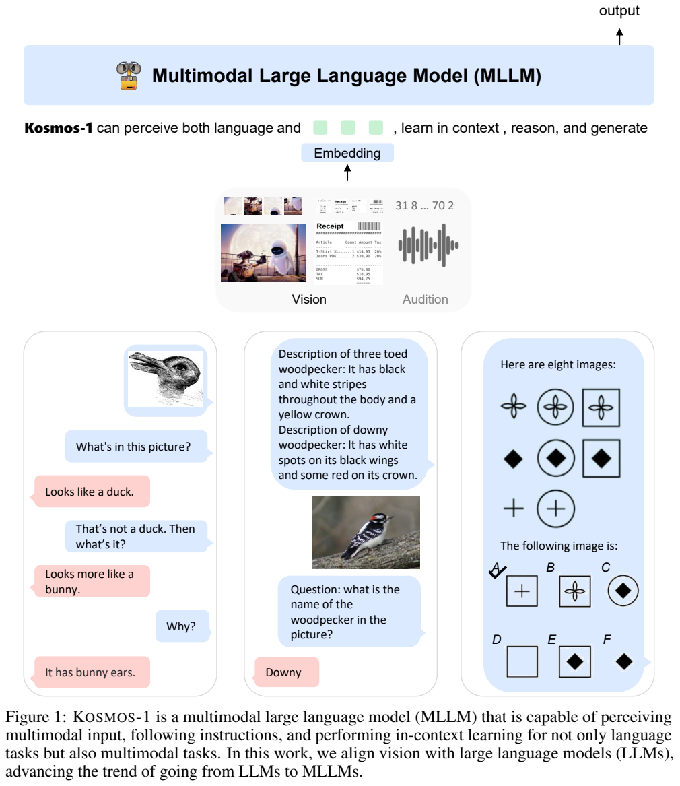
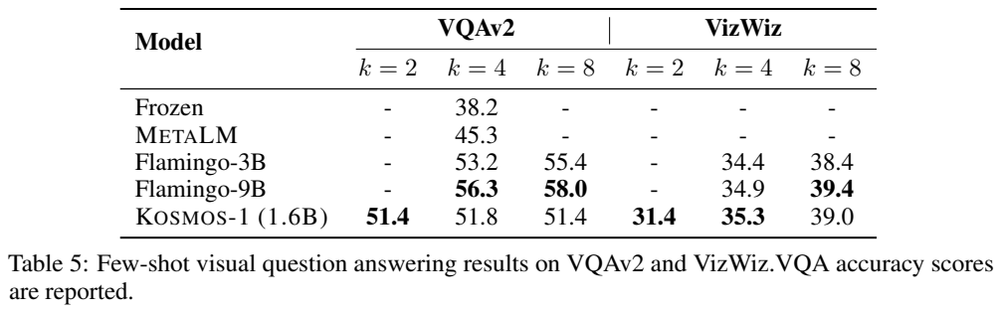
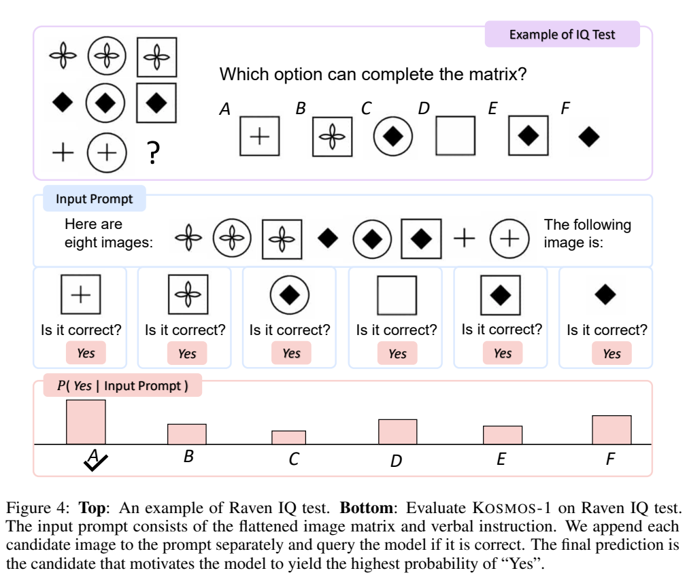
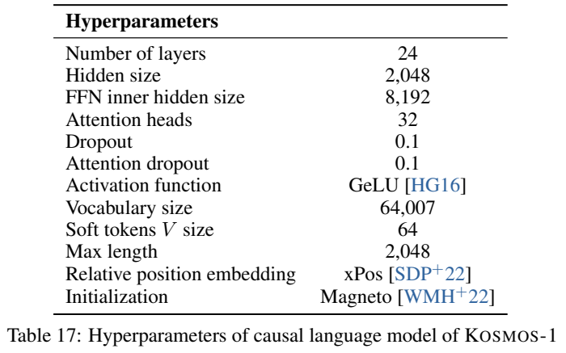
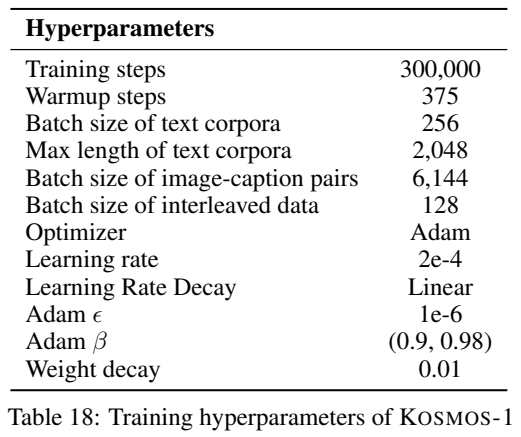
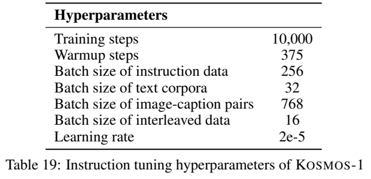
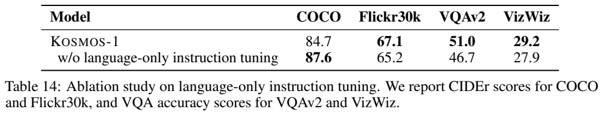
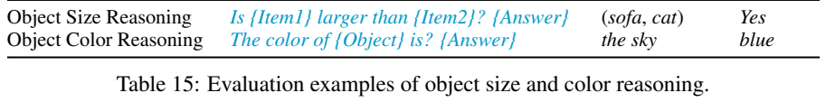
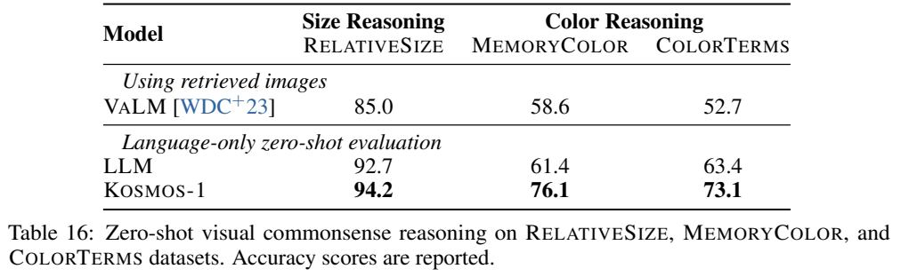

<!-- article-header:start -->
[项目首页](../../../README.md) › [模型系列](../../../reports/model-family-index.md) › [Kosmos](../README.md)
<!-- article-header:end -->

# Kosmos-1：把视觉感知接入通用语言接口

<!-- article-toc:start -->

**本篇目录** · [论文定位](#paper-info) · [快速概览](#overview) · [整体架构](#architecture) · [核心原理](#principles) · [数据构建](#data) · [训练流程](#training) · [实验结果](#experiments)
<!-- article-toc:end -->

## 1. 论文信息与模型定位

**Language Is Not All You Need: Aligning Perception with Language Models** 由 Shaohan Huang、Li Dong、Wenhui Wang 等 Microsoft 研究者提出。本文固定使用 2023-02-27 的 [arXiv:2302.14045v1](https://arxiv.org/pdf/2302.14045v1)，项目位于 [Microsoft UniLM](https://github.com/microsoft/unilm)。模型名为 **Kosmos-1**，因果语言主干约 1.3B，加入视觉模块后总参数约 1.6B。

论文把语言模型当作通用任务接口：图像先变成向量插入序列，模型用文字完成描述、问答、分类和对话。语言主干从头训练，视觉编码器则采用预训练 CLIP 初始化，“从头训练 Kosmos-1”不能扩展成所有模块均随机初始化。首版实际实现和实验以**图像与文字**为主；图中的听觉及文中通用模态愿景不意味着已经训练音频理解或语音生成，结论将语音列为未来方向。[PDF 第 1、5–7、18 页](https://arxiv.org/pdf/2302.14045v1#page=5)

## 2. 快速概览

Figure 1 位于 PDF 第 1 页。中间的 embedding 层将感知输入接入语言模型，下方展示视觉对话、依据文字类别描述分类和图形规律补全。该图是总体概念与例子，没有给出音频模块训练配方；灰色 Audition 应与论文实际视觉实验分开。示例展示模型可能完成的交互，不是对任意输入的正确性保证。

本篇重点有三项：同时使用纯文本、图文对和交错网页预训练；仅用**语言指令数据**继续训练，研究指令遵循能否迁移到视觉；在无下游梯度更新的条件下评价零样本、少样本与两阶段描述提示。其规模较小，结果可以说明早期通用接口的可行性，但不能等同于后来的高分辨率文档模型或视觉推理模型。

| 配置 | 原文披露 |
|---|---|
| 主干 | 24 层、hidden 2048、FFN 8192、32 attention heads |
| 视觉 | CLIP ViT-L/14，224×224，除末层外固定 |
| 图像序列 | Resampler attentive pooling，64 个视觉 soft token |
| 位置/稳定性 | xPos、Magneto 初始化与额外 LayerNorm |
| 训练 | 300K 步，每 batch 约 1.2M token，约 360B token |
| 指令调优 | 10K 步，新增指令数据全为语言 |

## 3. 整体架构

输入序列用 `<s>`、`</s>` 定界，图像用 `<image>`、`</image>` 包围连续 embedding。纯文本只查 token embedding 表；图像经 CLIP 提取 1024 维视觉特征，再由 Resampler 用注意力池化减到固定长度，作为 64 个 soft token 与文字交错。这样同一 decoder 可读取多张图及其间的段落，而不是要求先用 OCR 或描述模型把全部视觉内容翻译成文字。

语言主干是带左到右因果遮罩的 Transformer，顶部 softmax 分类器生成词表 token。Magneto 为注意力与前馈子层加入额外 LayerNorm，采用专门初始化改善深层训练稳定性；xPos 用于位置编码及长度泛化。论文引用相关方法，但本篇未展开它们的完整推导或逐模块消融，因此不能直接声称某个初始化项造成特定下游增益。

主干 24 层，hidden=2048，FFN=8192，32 头，GeLU，词表 64007，最大训练长度 2048。注意力与常规 dropout 均为 0.1。视觉编码器除最后一层外固定，意味着视觉表示也并非完全不更新。模型只输出离散文字，不提供像素 decoder、边界框定位 head 或动作控制器。GUI 问答、图像数学等例子是文字回答，并不是自动执行系统操作。[PDF 第 5–7、23、25 页](https://arxiv.org/pdf/2302.14045v1#page=5)

## 4. 核心创新与数学原理

**以文字输出统一任务。** 不同任务可以表示成 $p_\theta(y\mid I,x)$，其中 $I$ 是可选图像，$x$ 是说明或示例。预训练使用 next-token prediction，仅**离散 token**进入损失；连续图像 embedding 是条件，不做视觉向量回归。用解释性形式写为

$$
\mathcal L=-\sum_{t\in\mathcal D}\log p_\theta(u_t\mid u_{<t}),
$$

$\mathcal D$ 表示离散 token 位置。原文没有编号给出该式或全部模态边界 token 的权重，它是对第 2.3 节最大对数似然的数学整理。与 Emu 之类同时回归视觉输出的路线不同，本篇的生成空间仍是文字。

**少样本学习发生在上下文。** 把图像、问题和答案示例放在前缀，再接待测输入，模型生成续写，无需更新参数。示例数量、选择方法和上下文容量都会影响成绩；本篇通常随机从任务训练集取示例，而不是用检索得到最佳相似样例。

**两步 multimodal CoT。** 先要求模型详细介绍图像，再将生成的描述与目标任务一起输入，形成 $I\rightarrow r\rightarrow y$ 的测试时路径。它把感知结果显式转成文字，有助于后续语言判断，但错误描述也会传入答案。论文的“rationale”常是内容描述，并没有证明它是真实内部推理过程或完全可靠的感知中间状态。

**候选概率式图形推理。** Raven 任务不是让模型随意生成一个图像，而是把每个候选分别加入前缀，计算 $p_\theta(\text{Yes}\mid I_{1:n},I_j,q)$，选择最高者。候选的 yes 概率不是自动校准的正确率，不同候选下还可能有提示偏差。

PDF 第 10 页 Figure 4 上半是矩阵题，下半将矩阵展平，逐一接候选并问是否正确，最下面柱高对应 Yes 概率。图中每个候选下都写 Yes，意思是读取该 token 概率，不能误解为模型真的同时肯定所有候选。旁边 Table 5 也显示 VQAv2 2/4/8-shot 为 51.4/51.8/51.4，示例更多并不总提升。[PDF 第 6、10–13 页](https://arxiv.org/pdf/2302.14045v1#page=10)

## 5. 数据构建与处理

文本来自 The Pile 子集、Common Crawl 2020-50/2021-04、CC-Stories、RealNews 等。作者排除 GitHub、arXiv、Stack Exchange、PubMed Central 相关 split，做重复和近重复文档清理，并过滤下游任务内容。附录给出 OpenWebText2、Books3、维基、BookCorpus2、Gutenberg、NIH ExPorter 等来源的采样权重与 epochs；这些是不同语料的抽样口径，不可将原始来源容量全算成模型独立阅读过的 token。

图文对来自英文 LAION-2B、LAION-400M、COYO-700M、CC3M/CC12M。它们大量来自网页 alt-text，并非人工细致视觉标注；Conceptual Captions 中含 `<PERSON>` 等特殊替换标签的样本被删除。来源名称含 2B/700M 描述原数据集规模，论文未给出所有图像成功获取且去重后的统一样本总数。

交错数据从约 20 亿网页筛到 **7100 万**：保留英文、含图文交错的页面，删除小于 64×64 或纯色图像，以及垃圾、不连贯文本。启发规则处理表情、hashtag 与 URL 等。每文档最多 5 张图；只有一张图的文档随机丢弃一半，增加多图比例。该过程保留网页图文共现，但不保证每张图都与每句话严格对齐。

语言指令包括 Unnatural Instructions 核心 **68478** 条指令—输入—输出，以及 FLANv2 随机 **54K** 样本。新增指令全为语言，但调优时仍与原文本和多模态语料混合，不能说整段训练绝无图像。本文没有单独构造图文问答指令来取得相应迁移结果。[PDF 第 7、24 页](https://arxiv.org/pdf/2302.14045v1#page=7)

## 6. 训练流程与目标

PDF 第 23 页分为三张原表。Table 17 是模型配置，Table 18 是预训练，Table 19 是继续调优；最大长度、token batch 与各来源样本 batch 不应混为同一列。

预训练 300000 步，每 batch 约 1.2M token，分为纯文本 0.5M、图文对 0.5M、交错 0.2M，对应约 360B 处理 token。附录样本 batch 分别为文本 256、图文对 6144、交错 128，文字最大长度 2048。采用 full-sentence packing，使序列含从一个或多个文档连续取出的完整句子。学习率 375 步 warmup 到 2e-4，再线性降到零，beta=0.9/0.98、epsilon=1e-6、weight decay=.01。

正文称优化器 **AdamW**，Table 18 写 **Adam**，存在名称口径差异；本文保留这个事实，不推定代码中的确切 weight decay 实现。来源未披露 GPU 型号/数量、训练时长与全部并行配置，不能通过 token 数自行填写资源消耗。

语言指令调优继续 10000 步，375 warmup，学习率 2e-5；指令 batch 256、文本 32、图文对 768、交错 16。指令和输入部分不计入指令样本损失，只监督输出。报告没有另列此阶段完整冻结变化、各样本 loss 权重与更新细节，因此不能断言只训练某个 adapter。下游任务评测为零/少样本，无针对测试任务的梯度更新。[PDF 第 7、23 页](https://arxiv.org/pdf/2302.14045v1#page=23)

## 7. 实验设置与主要结果

图像描述在 COCO/Flickr30k Karpathy test 使用 224×224、beam 5；VQA 用 greedy decoding 和 VQAv2 答案归一化。零样本 COCO CIDEr **84.7**、Flickr30k **67.1**，VQAv2 **51.0**、VizWiz **29.2**。表中 Flamingo 零样本含两个移除图像的任务文字例子，而 Kosmos-1 没有例子，应保留提示差异。描述任务 4-shot COCO 101.7、8-shot 96.7，Flickr30k 75.3/68.0，再次说明超过一定上下文后未必获益。

Raven 自建测试仅 **50 题**、每题六候选。随机基线表中四舍五入为 17，Kosmos-1 为 **22%**，无语言指令调优为 **26%**，仅相当于约 11/13 题答对。它是探索性图形补全测验，不能转换成人类智商、也未给出统计显著性。描述引导的鸟类测试仅三组二分类、每类 20 张，文字描述后从 61.7 到 90.0；并非 CUB200 全类别分类达到 90%。[PDF 第 8–11、15 页](https://arxiv.org/pdf/2302.14045v1#page=9)

Rendered SST-2 accuracy **67.1**，两步 CoT 后 **72.9**；HatefulMemes **63.9** 是 ROC AUC。Table 7 图注概括为 accuracy，但正文明确后一任务 AUC，本文采用正文的正确指标区分。WebSRC 在图像**加提取文字**条件下 EM/F1 为 15.8/31.3，仅图像为 3.8/10.6；不能将最好的 WebSRC 结果当成完全 OCR/文字提取自由。ImageNet 自由生成类别名 Top-1 为 **4.0**，用 1000 类名约束解码为 **38.1**，输出规范影响很大。

PDF 第 17 页 Table 14：语言调优让 VQAv2 从 46.7 到 51.0、VizWiz 从 27.9 到 29.2、Flickr30k 从 65.2 到 67.1，却让 COCO 从 **87.6 降到 84.7**。Table 16 的视觉常识问答仅输入文字：RelativeSize 94.2 对纯语言 92.7，MemoryColor 76.1 对 61.4，ColorTerms 73.1 对 63.4。这支持多模态训练在所测对象属性上的迁移，但不表示每种语言能力更好：Table 13 八个文本任务平均，零样本 60.5 低于纯语言 61.1，4-shot 62.2 略高于 61.8。

论文的价值是以统一序列展示感知与语言结合、迁移和上下文任务指定的早期实证。局限包括低分辨率、有限上下文、较弱开放分类、少量 Raven/鸟类样本，以及提示和指标条件差异。本文核验原文与图表，没有运行模型或独立验证其污染过滤和泛化主张。[PDF 第 12–17 页](https://arxiv.org/pdf/2302.14045v1#page=12)

<!-- article-footer:start -->
---

[← 上一篇：BLIP-2](../../blip/arxiv-2301.12597/README.md) · [按发表时间浏览](../../../reports/paper-reading-guide.md#year-2023) · [下一篇：Prismer →](../../prismer/arxiv-2303.02506/README.md)

[返回本篇目录](#article-toc) · [返回模型系列](../README.md)
<!-- article-footer:end -->
