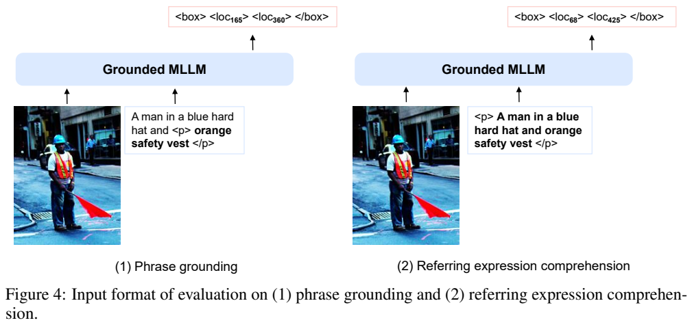
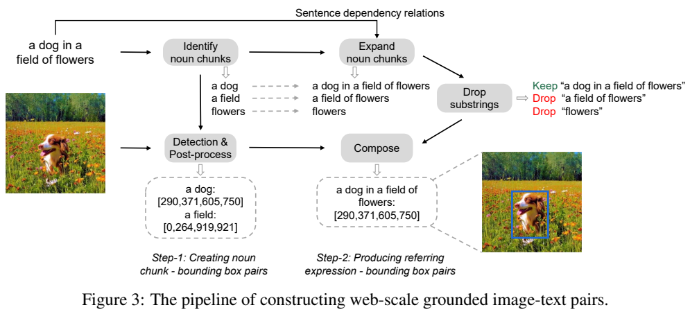
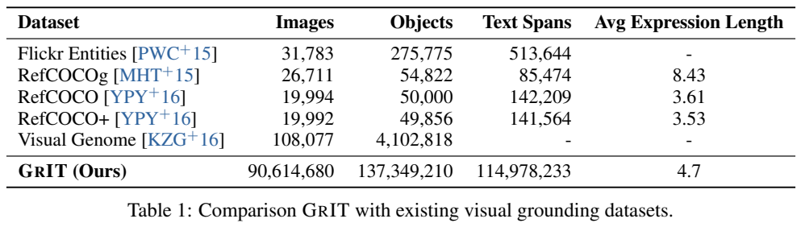
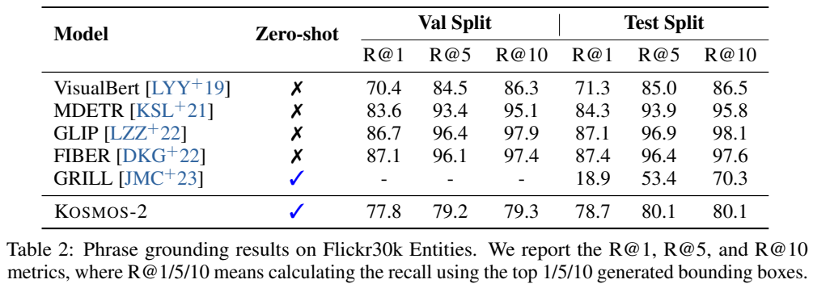
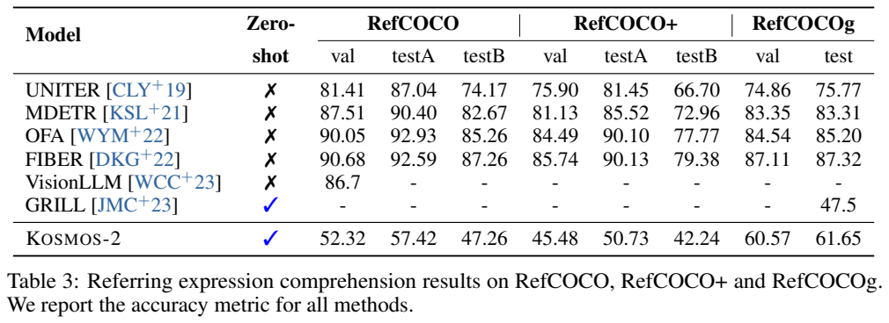
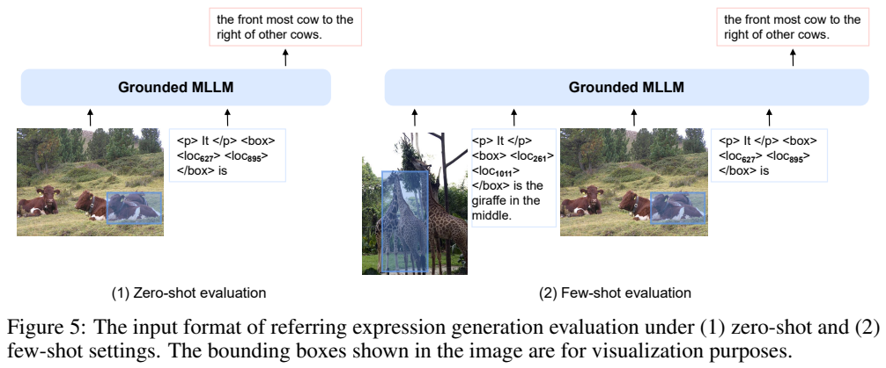
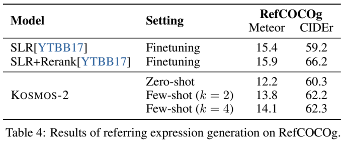

# KOSMOS-2：把文字指代表达连接到图像区域

## 1. 论文信息与模型定位

**KOSMOS-2: Grounding Multimodal Large Language Models to the World**，Zhiliang Peng、Wenhui Wang、Li Dong、Yaru Hao、Shaohan Huang、Shuming Ma、Furu Wei，Microsoft Research。[固定原文 arXiv 2306.14824v1](https://arxiv.org/abs/2306.14824v1)，2023-06-26；本文 PDF 页码按该版本。

模型从 KOSMOS-1 继续训练，新增 grounding 与 referring：既可把文字描述定位到图像中的框，也可输入框后询问该区域、生成指代表达。框以离散 token 表示，输出是文字与框描述，**不是图像生成或像素分割**。对具身智能的讨论属于研究愿景，论文没有机器人动作执行实验。

## 2. 快速概览

- 视觉编码器、resampler 和因果语言主干共享生成接口，约 **1.6B 可训练参数**。
- 224×224 输入图像、14×14 patch；resampler 输出 64 个图像嵌入。
- 将图像平面分为 **32×32** 网格，新增 1024 个位置 token，两个角点 token 表示一个框。
- GRIT 自动构建约 91M 图像、115M 文本片段、137M 框，供模型学习词语与区域关联。
- 约 25B token 继续训练后进行指令调优；定位、描述、常规 VQA 的评测条件分别报告，不用单一成绩概括全部能力。

## 3. 整体架构

视觉编码器为 24 层、隐藏维 1024、FFN 4096，resampler 将图像变成固定数量的连续嵌入。语言部分为 24 层 MAGNETO Transformer，隐藏维 2048、32 注意力头、FFN 8192（PDF 第 6 页）。文本和位置 token 经同一词嵌入表映射，与图像表示交错输入因果主干。

格式为 `
描述
<box>左上位置token 右下位置token</box>`，不同框可用 `<delim>` 分隔；`<grounding>` 提示本次需要把文字链接到视觉区域。所谓 Markdown “超链接”是接口类比，训练序列实际采用这些专用边界符。模型访问整张图和区域坐标，原文没有单独裁剪框区域再编码的专用分支。

**读图：Figure 4，PDF 第 7 页。** 左侧在原描述的上下文中标出“橙色安全背心”，输出背心框；右侧输入整段人物表达，输出人的框。两个任务的目标对象和语言上下文不同，不能把同一定位分数直接用于两种任务。

## 4. 核心创新与数学原理

Section 3.1 将连续图像位置量化为网格位置。对尺寸 $W\times H$，每个 bin 大小为 $W/P\times H/P$，$P=32$，一个 token 编码二维 bin，而非分别生成 x、y 两个数。解码使用 bin 的中心像素恢复角点，因此有限网格分辨率会产生量化误差；它无法精确表示任意连续边界。

训练仅对离散文本和位置 token 做下一 token 预测，图像连续嵌入作为上下文。可将原文目标解释为：

$$
\mathcal L=-\sum_{i\in\mathrm{Text}\cup\mathrm{Location}}\log p_\theta(z_i\mid z_{<i},I).
$$

这是对 Section 3.2 的自回归目标的数学表达，原文未另设 IoU 回归、框匹配或 mask 损失。坐标格式变成语言序列，使“描述到框”和“框到描述”共享生成机制；同时格式错误也成为实际失败，如只生成一个角点会被计错。

推理时无需附加检测器生成 proposals，但训练数据构建依赖 GLIP 类 grounding 模型。因此“模型推理不接检测器”与“无检测器监督”必须分开。空间 token 解决显式指代接口问题，也不自动消除文字幻觉或复杂关系理解错误。

## 5. 数据构建与处理

**读图：Figure 3、Table 1，PDF 第 4 页。** 图用“花田中的狗”展示先找名词短语，再扩展为较长表达；狗的框随扩展表达继承。表中的精确规模为 **90,614,680 图像、137,349,210 对象框、114,978,233 文本片段**，平均表达长度 4.7。各列不是同一计数，不能都称训练图片数。

GRIT 从 LAION-2B、COYO-700M 子集建立。spaCy 解析 caption 提取名词短语，去掉 time、love、freedom 等难以视觉化的抽象项；预训练定位器将词语与框关联，跨短语的非极大值抑制去掉高重叠框，保留置信度超过 **0.65** 的结果，没有框则丢弃图文对。

随后沿依存树递归扩展名词短语，但不扩展含并列连接的名词块，删除被更长表达包含的子串，并沿用原中心名词的框。这会得到更自然的指代表达，也继承解析、检测误差；删除子串可能减少某些子对象监督。原文没有报告人工复核比例或完整污染审计，故不能把所有框称为人类真值。

继续训练另用前代的纯文本、普通图文和交错图文。指令调优加入 LLaVA-Instruct、Unnatural Instructions、FLANv2，并从 GRIT 的表达框对转换出“描述生成框”和“给框描述对象”的双向模板。附录 Table 9 给出 `What is it?`、`Describe this object` 等模板，框作为 token 输入，不是把有色框画进原图作为必需输入。

## 6. 训练流程与目标

初始化使用 KOSMOS-1 权重，新增位置词嵌入随机初始化；继续训练和指令调优**更新所有参数**。继续训练 60K 步，batch 约 419K token：文本 185K、普通与 grounded 图文 215K、交错数据 19K，总约 25B token。AdamW 的 $\beta=(0.9,0.98)$、weight decay 0.01、dropout 0.1；375 步预热至 $2\times10^{-4}$，之后线性衰减为零。256 张 V100，约一天，属于作者报告的继续训练成本，不是从零建立前代的累计成本。

附录 Table 7 图文两个子类各 batch 1117；文本和交错按数据例数为 93/47，不能与上面的 token 数混为同一单位。指令调优 Table 8 为 10K 步、375 预热、学习率 $10^{-5}$，语言指令 batch 117、视觉语言 351、grounded 图文及指令 1404、普通文本 30、交错 15。原文没有充分说明指令阶段的总硬件时长等其余配置。

## 7. 实验设置与主要结果

定位把 token 解码为框，**IoU>0.5** 才判对，格式错误计负例。Flickr30k Entities 短语定位使用前文上下文减少歧义，以 ANY-BOX 协议报告前 1/5/10 框召回；RefCOCO 系列用单独的整段表达，只计第一个框的准确率。零样本指未在相应目标基准做专门微调，不是模型没有学习过 grounding。

**读图：Tables 2、3，PDF 第 8 页。** 上表区分 val/test 和召回，下表区分 RefCOCO、RefCOCO+、RefCOCOg 的多个划分及是否专门微调。不能仅选最高的一列作所有定位任务成绩。

| 指标 | KOSMOS-2 | 对照与条件 |
|---|---:|---|
| Flickr30k test R@1/5/10 | 78.7/80.1/80.1 | 零样本 GRILL 18.9/53.4/70.3；专门微调 GLIP 87.1/96.9/98.1 |
| RefCOCO val/testA/testB accuracy | 52.32/57.42/47.26 | 专门微调模型仍明显更高 |
| RefCOCO+ val/testA/testB accuracy | 45.48/50.73/42.24 | 短表达与训练长表达存在分布差异 |
| RefCOCOg val/test accuracy | 60.57/61.65 | GRILL test 47.5；专门微调 FIBER 87.32 |

R@5/10 接近 R@1 表示后续候选增加有限，不应只据此声称定位已充分覆盖所有对象。框越小，量化和视觉分辨率约束的影响也越值得关注。

**读图：Figure 5、Table 4，PDF 第 9 页。** 图中的有色框用于可视化，模型实际输入是坐标 token。RefCOCOg 用 224×224、greedy 解码，零样本 METEOR/CIDEr **12.2/60.3**，2-shot 为 13.8/62.2，4-shot 为 14.1/62.3。CIDEr 超过 SLR 59.2，但未超过 SLR+rerank 66.2，METEOR 也低于两个微调基线。

普通图文和纯语言表为公平比较报告**未指令调优**结果。Table 5 的 Flickr30k CIDEr 为 66.7，高于 KOSMOS-1 65.2；VQAv2 为 45.6，低于 46.7。Table 6 BoolQ 从 56.4 到 62.0，CB 从 44.6 降至 30.4，其余有升降。论文未给出完整逐组件消融或不同网格尺寸的受控实验。证据支持把定位作为可生成的基础接口，但不支持“新增空间能力后所有任务都增强”；原文选例中的多轮、细粒度识别也不是整体可靠性证明。本文未运行或复现模型。
