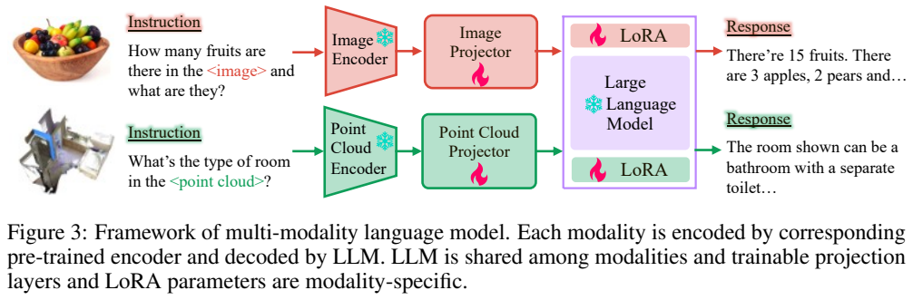
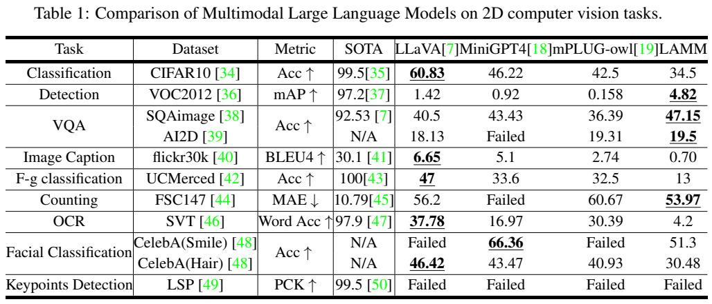
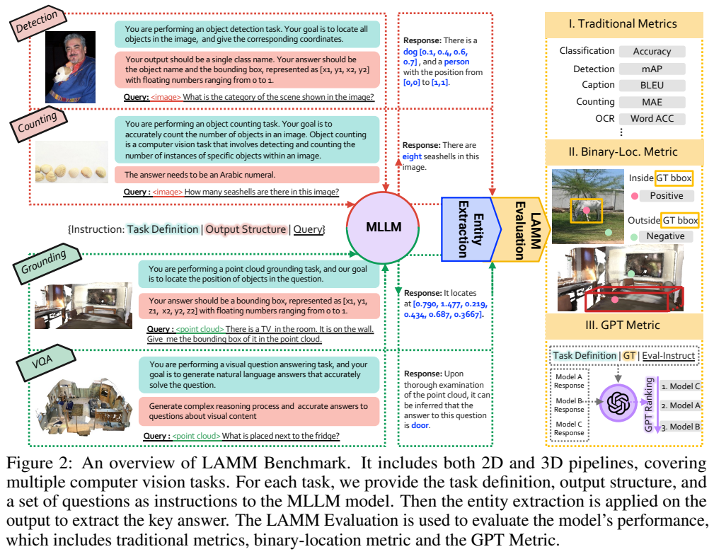
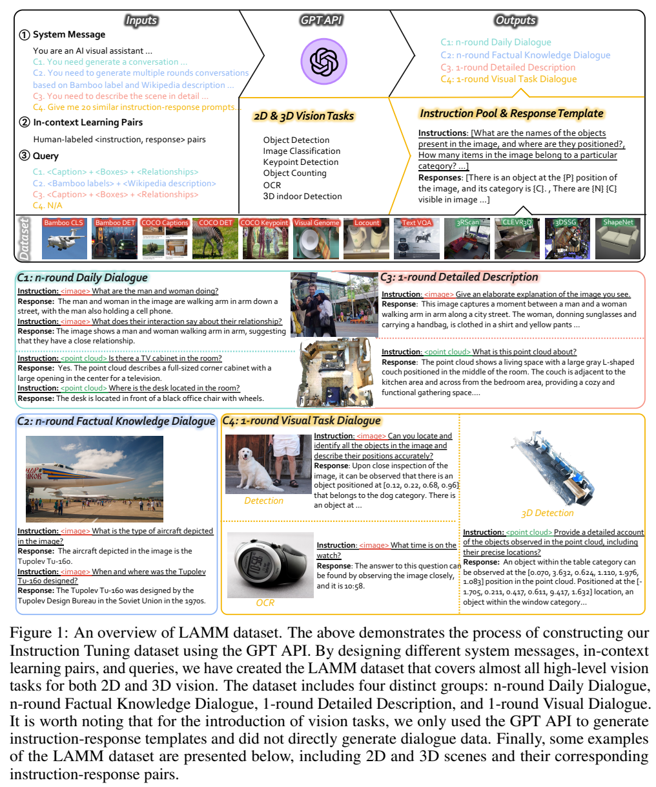
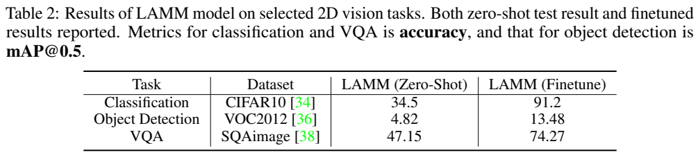
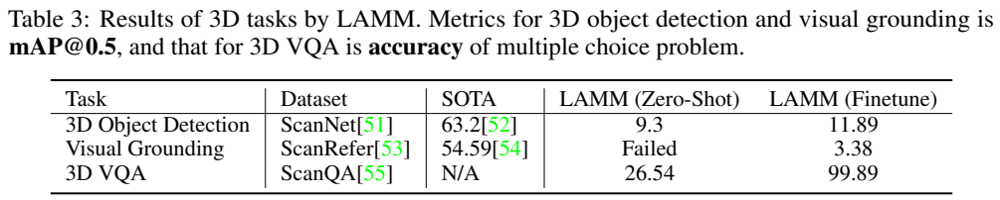
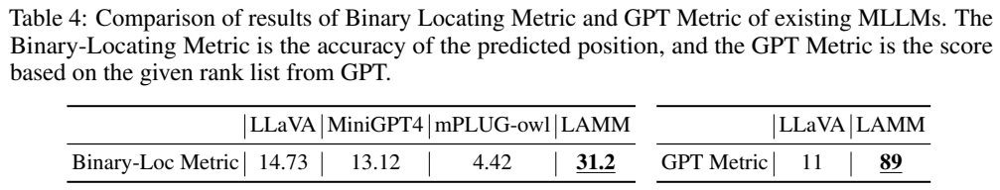

<!-- article-header:start -->
[项目首页](../../../README.md) › [模型系列](../../../reports/model-family-index.md) › [LAMM](../README.md)
<!-- article-header:end -->

# LAMM：把图像、点云与传统视觉任务接入指令语言模型

<!-- article-toc:start -->
<a id="article-toc"></a>

**本篇目录** · [论文定位](#paper-info) · [快速概览](#overview) · [整体架构](#architecture) · [核心原理](#principles) · [数据构建](#data) · [训练流程](#training) · [实验结果](#experiments)
<!-- article-toc:end -->

<a id="paper-info"></a>

## 1. 论文信息与模型定位

| 项目 | 内容 |
|---|---|
| 题名 | LAMM: Language-Assisted Multi-Modal Instruction-Tuning Dataset, Framework, and Benchmark |
| 作者 / 机构 | Zhenfei Yin、Jiong Wang、Jianjian Cao、Zhelun Shi 等；上海人工智能实验室、北京航空航天大学、香港中文大学（深圳）、复旦大学等 |
| 采用版本 | arXiv:2306.06687v1，2023 年 6 月；12 页，技术正文第 1–9 页 |
| 原文 | [固定版本 PDF](https://arxiv.org/pdf/2306.06687v1) |
| 模型 | Vicuna-13B 语言骨干；图像与点云各自配置编码、投影及 LoRA 参数，全文没有给出整套系统精确参数总量 |
| 输入 / 输出 | 图像或三维点云加文字指令 → 自然语言回答，也可用文字表示类别、数量、框坐标 |
| 贡献与开放定位 | 同时提出 LAMM-Dataset、LAMM-Framework 和 LAMM-Benchmark；论文声明公开数据、基线、代码和评测框架 |

LAMM 是早期多模态指令调优的基础设施论文。它希望语言模型既能解释一张图或一个房间点云，又能以可解析的文字完成检测、计数、OCR 等传统任务。它没有另行预训练一个通用基础语言模型，也没有展示图像或点云生成能力。理解这篇论文，需把数据构建方法、可扩展基线和评测结果分开看；“能回答问题”并不自动意味着“能准确输出几何位置”。

<a id="overview"></a>

## 2. 快速概览

已有视觉聊天模型的案例展示难以回答一个实际问题：流畅的描述是否对应可靠的视觉理解？LAMM 一方面扩展训练数据，另一方面要求模型接受明确的任务定义和输出格式，再把回答转换为传统指标可以评测的结果。

其数据包含 186,098 条图像指令响应对和 10,262 条点云指令响应对。日常对话、事实知识对话和详细描述由 GPT-4 根据文字标注合成；检测、OCR 等任务则使用 GPT-4 生成的语言模板，填入原有真实标注。基线共享 Vicuna-13B 的语言参数，但图像和点云拥有独立的投影与低秩适配参数。评测覆盖 2D 的 9 类任务、11 个数据集以及 3D 的 3 类任务、3 个数据集。

实验的价值在于同时暴露能力和局限。LAMM 在 ScienceQA 图像子集零样本准确率为 47.15%，超过同表 LLaVA 的 40.5%；VOC2012 检测 mAP 为 4.82，虽领先同表视觉聊天基线，但距离专用检测模型很远。OCR 准确率仅 4.2%，人体关键点检测失败。任务微调能改善若干结果，点云问答的近满分则发生在作者改造的选择题设置，并伴随作者明确提出的过拟合疑虑。[原文 Sections 3–5、Tables 1–3](https://arxiv.org/pdf/2306.06687v1)

<a id="architecture"></a>

## 3. 整体架构





> 来源：原文 Figure 3、Table 1，2306.06687v1，PDF 第 6 页。分别展示模型框架与零样本结果，保留各自图注或表头。

**读图**：上方红色分支处理图像，下方绿色分支处理点云；雪花表示冻结，火焰表示更新。两个分支经各自投影器接入共同的语言模型，同时激活对应模态的 LoRA。输入文字直接用 SentencePiece 编码，视觉 token 与文字 token 拼接，语言模型逐 token 输出回答。

| 组件 | 论文实际设置 | 作用 |
|---|---|---|
| 图像编码器 | 冻结的 CLIP ViT-L/14；输入缩放为 224×224，256 个图像 patch | 提供预训练视觉特征 |
| 点云编码器 | 按 FrozenCLIP 设计，由 PointNet++ 将点云变为 256 个 token，再经 CLIP 预训练的 ViT-L/14 编码 | 用点云局部表示连接已有 Transformer 编码能力 |
| 投影器 | 图像、点云分别设置可训练投影层 | 将特征映射到语言 token 的维度 |
| 语言模型 | 共享的 Vicuna-13B 基础参数；不同模态使用独立 LoRA | 利用共同语言知识解释不同视觉输入 |
| 输出 | 自回归文字 | 自然语言回答或结构化标签、数字、坐标 |

点云路径不是把点云渲染成若干二维照片再输入 CLIP：本文明确写的是 PointNet++ token 化后接 ViT。独立 LoRA 也意味着不同模态可以分别适配；论文没有证明把独立适配器直接相加会得到同时联合理解图像与点云的能力。架构的“扩展性”主要指增加编码器、投影器和适配参数的工程方式，而非已经验证任意新模态都能无损加入。

<a id="principles"></a>

## 4. 核心创新与数学原理

**将模态差异限制在小规模可训练分支。** 投影器解决视觉特征与文字嵌入的维度差异，LoRA 则改变语言注意力对新特征的解释方式。以下是标准 LoRA 的解读公式，原文只说明采用该方法与 rank=32，没有列出这条编号公式：


```math
W_m=W_0+sB_mA_m,\qquad
A_m\in\mathbb R^{32\times d_{in}},\quad
B_m\in\mathbb R^{d_{out}\times32}.
```


其中 $`m`$ 是图像或点云，$`W_0`$ 为共享且冻结的原权重，$`s`$ 是缩放因子；本文没有披露缩放参数。低秩更新的参数量为 $`32(d_{in}+d_{out})`$，这是矩阵尺寸推导，不是论文报告的整套参数量。论文把 LoRA 加入自注意力的所有投影层，没有声称对所有前馈层也使用 LoRA。[Section 5.1](https://arxiv.org/pdf/2306.06687v1)

**把传统视觉任务翻译成可监督的语言输出。** 与只生成开放式图像描述不同，检测可以被表达成“类别 + 坐标”，计数要求明确整数，OCR 要求可匹配的词。任务含义、输出结构、实际问题共同构成推理指令。随后使用 NLTK 和正则抽取回答实体。这一步会把语言格式错误也计入系统能力：模型可能大致理解场景，却因没有给出可解析数字而无法通过评测。



> 来源：原文 Figure 2，PDF 第 5 页；保留所引用的图表区域。图中 3D 输出示例与提示的归一化范围存在不一致，不能据此补写统一的点云坐标预处理。

**读图**：左侧四组任务指令送入 MLLM，中间抽取实体，右侧三类评测分别检查任务数值、粗略位置和回答相关性。Binary-Loc 只要求输出一个近似位置点，落在真实框内即成功。其二维定义可用以下解读公式表示：


```math
\mathrm{BinLoc}=\frac1N\sum_i
\mathbf1[x_i^{min}\le\hat x_i\le x_i^{max}
\land y_i^{min}\le\hat y_i\le y_i^{max}].
```


它不会衡量预测框的边界、面积或重叠程度。标准框 IoU 为交集面积除以并集面积，mAP 再结合置信度、类别及匹配阈值；这些与“点落入框内”是不同要求。因此 Binary-Loc 高于检测 mAP 并不矛盾。GPT Metric 则让 GPT 根据任务及真实答案排序多个模型响应，评价开放式表达；本文没有给出完整的排名到分数换算公式，不应把其 89 分写成 89% 的客观答题准确率。[Section 4、Table 4](https://arxiv.org/pdf/2306.06687v1)

<a id="data"></a>

## 5. 数据构建与处理



> 来源：原文 Figure 1，PDF 第 4 页；裁图展示各数据来源与四类示例。

**读图**：上部将 system message、人工少样本示例和查询输入 GPT API。前三类数据通过文字标注提供视觉背景，第四类只生成模板池，再插入实际监督标签。下部例子展示日常描述、知识拓展、长描述以及检测/OCR 等任务的区别。

| 类型 | 构建依据 | 监督内容与注意点 |
|---|---|---|
| C1 多轮日常对话 | caption、框、实体关系及人工示例 | 场景相关问答；GPT-4 看到的是文字描述而非原始像素 |
| C2 多轮事实知识对话 | Bamboo 类别标签、Wikipedia 描述 | 将可见物体与外部知识连接；设计年代等知识不能直接从图像观察得到 |
| C3 单轮详细描述 | caption、框、关系 | 生成较丰富的场景说明，仍受原始标注覆盖程度约束 |
| C4 单轮视觉任务 | GPT-4 生成每种任务的约 20 种语言模板，再填真实标签 | 检测、分类、关键点、计数、OCR、3D 室内检测；坐标与标签并非让 GPT-4 自行猜测 |

图像数据来源包括 Bamboo 分类/检测、COCO caption/检测/关键点、Visual Genome、LOCount、TextVQA，共 8 种；点云来源包括 3RScan、CLEVR3D、3DSSG、ShapeNet，共 4 种。最终数量是指令响应对，不能理解为相同数量的独立图像或场景。正文没有逐项给出各来源样本分配、全面去重规则、人工复核比例或过滤阈值；也没有证明外部知识对话中所有生成知识均正确。本文的主要控制方式是给 GPT-4 结构化标注和少样本示范，并在需要准确数值的任务中保留真实监督。[Section 3](https://arxiv.org/pdf/2306.06687v1)

<a id="training"></a>

## 6. 训练流程与目标

| 阶段 | 训练内容 | 更新 / 冻结 | 已披露设置 |
|---|---|---|---|
| 基线指令调优 | 视觉输入、任务或对话指令 → 回答 | 编码器和 Vicuna 原始权重冻结；更新对应投影器与 LoRA | 一阶段端到端；Vicuna-13B；LoRA rank=32；4 张 A100 |
| 任务适配实验 | CIFAR10、VOC2012、ScienceQA 及 3D 检测/定位/问答任务的额外微调 | 本节未另行完整列出任务微调的参数更新与优化配置 | 对比同一基线零样本及微调结果 |

“一阶段端到端”指可训练投影层和适配器在同一训练流程中优化，不能据此说冻结的编码器与全部语言权重一起更新。对于回答生成，可用标准自回归监督形式理解其训练任务：


```math
\mathcal L_{ans}=-\sum_{t\in\mathcal A}
\log p_\theta(y_t\mid V,Q,y_{\lt t}).
```


这是帮助理解文字输出监督的标准定义，不是原文编号公式；$`V,Q`$ 是视觉输入和指令，$`\mathcal A`$ 表示回答 token。原文没有完整说明实际 loss masking、优化器、学习率、batch、epoch、序列长度、精度、LoRA alpha 或耗时，不能把其他 Vicuna/LoRA 项目的默认配置迁移成 LAMM 的训练事实。更没有 RLHF、DPO 或图像生成训练阶段。[Section 5.1](https://arxiv.org/pdf/2306.06687v1)

<a id="experiments"></a>

## 7. 实验设置与主要结果

LAMM-Benchmark-2D 使用 62,439 个样本，3D 使用 12,788 个样本。任务指令同时提供任务定义和输出格式，并从自然语言中抽取类别、框、计数等结果。零样本指的是这些测试数据与模型训练数据没有交集；基线在其他训练数据中已接受检测等任务模板，并非从未见过这些任务。Table 1 的 SOTA 列是各任务的专用模型，训练条件与通用 MLLM 零样本列不一致。

| 任务 / 数据 | 指标 | LAMM 零样本 | 同表参考结果 | 解读 |
|---|---|---:|---:|---|
| CIFAR10 分类 | Acc↑ | 34.5 | LLaVA 60.83 | 通用分类并未领先 |
| VOC2012 检测 | mAP↑ | 4.82 | LLaVA 1.42；专用模型 97.2 | 同表聊天模型中较好，但几何精度仍低 |
| ScienceQA image-only | Acc↑ | 47.15 | LLaVA 40.5 | +6.65 个百分点；SOTA 92.53 使用任务训练及 GPT-4 答案组件 |
| AI2D | Acc↑ | 19.5 | mPLUG-owl 19.31 | 提升很小，没有置信区间 |
| FSC147 计数 | MAE↓ | 53.97 | LLaVA 56.2；专用模型 10.79 | 错误量仍很大 |
| SVT OCR | Word Acc↑ | 4.2 | LLaVA 37.78 | 明显短板 |
| Flickr30k caption | BLEU4↑ | 0.70 | LLaVA 6.65 | 长回答与参考短句的 n-gram 指标可能错配，但不能据此证明描述更准确 |
| UCMerced 细粒度场景分类 | Acc↑ | 13 | LLaVA 47 | 在领域变化下退步明显 |

以上据原文 Table 1 整理。所有模型在 LSP 人体关键点检测上均报告 Failed；CelebA 头发分类 LAMM 为 30.48，低于 LLaVA 的 46.42。这些结果限制了“覆盖传统视觉任务”可以支持的能力结论。







> 来源：原文 Tables 2–4，PDF 第 7 页；所有表头、指标说明、结果行与下方解释完整保留。

**读表**：Table 2 比较零样本与进一步任务微调，CIFAR10 为 34.5→91.2，VOC2012 的 mAP@0.5 为 4.82→13.48，ScienceQA 为 47.15→74.27。提高分别为 56.7、8.66、27.12 个百分点，并没有使检测接近专用模型。

Table 3 中 ScanNet 检测 mAP@0.5 为 9.3→11.89，ScanRefer 定位为 Failed→3.38，专用参考分别为 63.2 与 54.59。ScanQA 为 26.54→99.89，但作者已将原任务重新组织为多项选择，且提醒训练/测试差距小、数据规模有限，可能发生过拟合。因此这不是原始开放式 ScanQA 准确率，也不能与其官方榜单直接并列。

Table 4 的粗定位准确率为 LAMM 31.2、LLaVA 14.73；GPT 排名分为 89 对 11。这能说明在此协议下模型更容易给出正确区域点和受评审偏好的回答，不能消除 Table 1 中精确检测、OCR、细粒度分类的缺陷。Figure 5 进一步显示推理提示方式、计数目标数量和训练数据组合影响结果；加入事实知识和视觉任务数据对 ScienceQA 有帮助，但作者没有给出足以证明所有能力提升都由单个数据因素造成的全面控制实验。

本文最稳妥的结论是：语言化监督使共享语言骨干能适配图像与点云，并提供统一评测接口；传统视觉指标揭示了精确定位与细节识别的明显差距。以上均为论文报告结果，本介绍未运行模型或复现实验。

<!-- article-footer:start -->
---

[← 上一篇：Video-ChatGPT](../../video-chatgpt/arxiv-2306.05424/README.md) · [按发表时间浏览](../../../reports/paper-reading-guide.md#year-2023) · [下一篇：Macaw-LLM →](../../macaw-llm/arxiv-2306.09093/README.md)

[返回本篇目录](#article-toc) · [返回模型系列](../README.md)
<!-- article-footer:end -->
