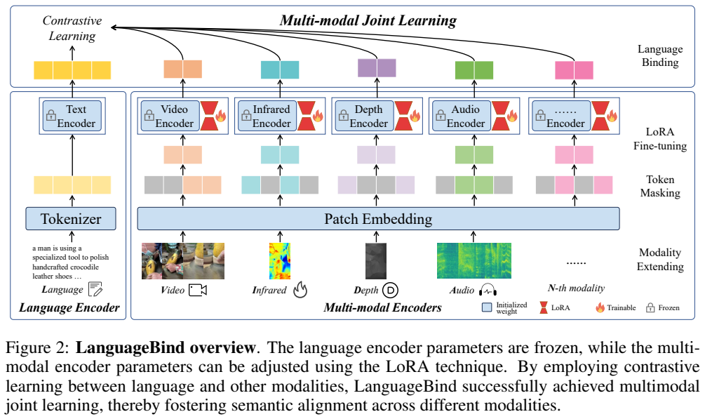
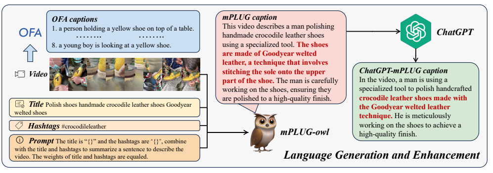
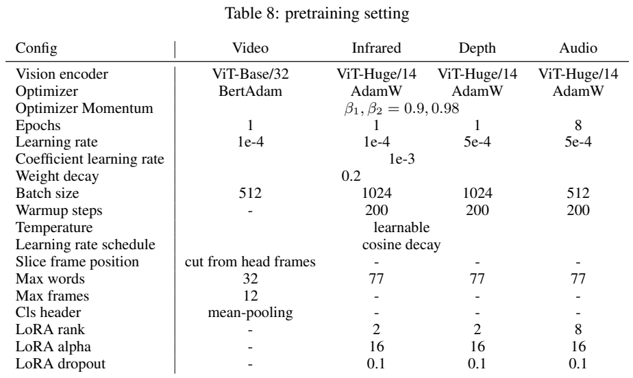
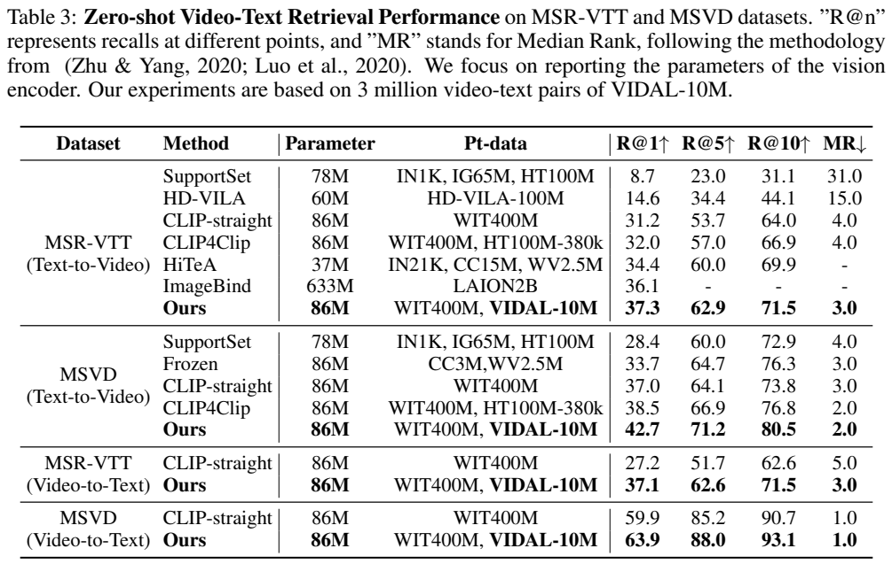
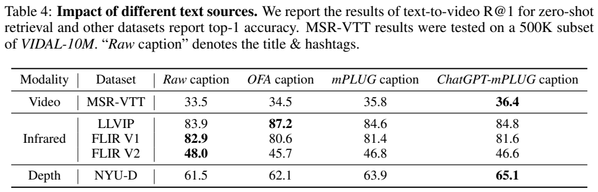

<!-- article-header:start -->
[项目首页](../../../README.md) › [模型系列](../../../reports/model-family-index.md) › [LanguageBind](../README.md)
<!-- article-header:end -->

# LanguageBind：以固定语言空间连接视频、音频、深度与红外

<!-- article-toc:start -->
<a id="article-toc"></a>

**本篇目录** · [论文定位](#paper-info) · [快速概览](#overview) · [整体架构](#architecture) · [核心原理](#principles) · [数据构建](#data) · [训练流程](#training) · [实验结果](#experiments)
<!-- article-toc:end -->

<a id="paper-info"></a>

## 1. 论文信息与模型定位

**论文：** *LanguageBind: Extending Video-Language Pretraining to N-Modality by Language-based Semantic Alignment*。作者包括 Bin Zhu、Bin Lin、Munan Ning、Yang Yan、JiaXi Cui 等，机构包括北京大学、腾讯、国立新加坡大学和鹏城实验室。本篇依据 [arXiv 2310.01852v1](https://arxiv.org/abs/2310.01852v1)，2023 年 10 月 3 日提交，共 18 页；页眉中的 ICLR 2024 under review 是该版本状态。官方仓库为 [PKU-YuanGroup/LanguageBind](https://github.com/PKU-YuanGroup/LanguageBind)。

LanguageBind 是多模态编码器与对齐预训练方案，输出可比较的特征，用于检索和零样本分类。它没有自回归语言解码器，也没有在本文训练聊天式大模型。收录它的意义在于多模态基础表示：后续系统可以利用这些编码器，但本文成绩不能等同于多模态问答或生成能力。

作者选择语言作为各模态的共同语义锚点。与先将其他模态对齐到图像、再间接利用图文空间的方案相比，它训练每个模态直接靠近对应文本，并冻结语言编码器以保持共同参照。[原文 §1、§3，PDF 第 1–5 页](https://arxiv.org/pdf/2310.01852v1#page=1)

<a id="overview"></a>

## 2. 快速概览

| 项目 | 原文内容 |
|---|---|
| 已实验模态 | 视频、红外、深度、音频和语言；“N 模态”是扩展方法，并非已验证任意传感器 |
| 输出 | 共享语义空间中的归一化特征，计算相似度做检索或分类 |
| 对齐方式 | 固定语言编码器；各模态与文本做双向对比学习 |
| 效率手段 | 非视频模态使用 LoRA 和 patch masking；视频实验沿用 CLIP4Clip |
| 数据 | VIDAL-10M：3M 视频文本、3M 红外文本、3M 深度文本、1M 音频文本配对 |
| 关键边界 | 深度/红外训练数据由生成模型构造；不是全部来自对应真实传感器 |

一个类别只需写成文本提示，即可与传感器输入的特征计算相似度。例如音频使用 “a sound of …”，深度使用 “a depth photo of …”。这是基于文本类别原型的判别过程，不是在自由生成说明文字。

<a id="architecture"></a>

## 3. 整体架构



**原图：Figure 2，PDF 第 4 页。** 从底部向上看，各模态先被转为可输入视觉 Transformer 的 patch 序列，灰块表示遮蔽的 token；中部锁形标记代表固定初始化参数，红色模块是 LoRA；顶端连线表示各模态直接与文字做对比学习。图是统一方法示意，具体视频实验不应机械套用右侧全部 LoRA 设置。

视频分支使用 CLIP4Clip 框架，视觉编码器从 ViT-B/32 初始化，通过帧特征的 mean pooling 得到视频表示。红外、深度是单通道输入，重复为三个通道以适配视觉编码器；音频变成 128 mel-bin 频谱，同样构造成三通道输入。

音频处理以 10 秒为单位：不足 10 秒先重复、再补零；例如 4 秒音频重复两次，再补 2 秒。超过 10 秒时，从前、中、后三段各随机取一个 10 秒片段并堆叠。这个处理保留部分长音频信息，不代表模型完整读取任意时长录音。

语言侧为 OpenCLIP 初始化的 12 层、768 维 Transformer，使用 BPE tokenizer。正文描述非视频编码器为 24 层、1024 维、patch 14、OpenCLIP-large 初始化；附录 Table 8 却将这些分支写为 “ViT-Huge/14”，且主表报告 305M 参数。本文保留这一命名不一致，不据此补造另一套隐藏维度或检查点。[原文 §3.1–3.2、Table 8，PDF 第 4–5、17 页](https://arxiv.org/pdf/2310.01852v1#page=4)

LanguageBind 的基础出口是归一化语义表示，不是直接生成回答的 LLM。推理时，待识别的图像、视频、音频或深度等信号进入对应编码器，候选类别描述或检索文本进入语言编码器；两侧表示的相似度用于零样本分类或检索排序。模态编码器不必先把输入转成一段文字再比较，多个模态也不是先全部拼入一个聊天 decoder。若后续系统接入语言生成模型，还需要另一个连接与训练环节，不能把下游 Video-LLaVA 的架构归为本篇原生组件。[原文 §3.1–3.2，PDF 第 4–5 页](https://arxiv.org/pdf/2310.01852v1#page=5)


<a id="principles"></a>

## 4. 核心创新与数学原理

**直接以语言绑定各模态。** 令一个 batch 有 $`K`$ 个正确配对样本，模态编码特征为 $`x_i`$，文本特征为 $`y_i`$，二者归一化，温度为 $`\tau`$。原文式 (3) 的一个方向是：


```math
\mathcal L_{M\to T}=-\frac1K\sum_{i=1}^{K}
\log\frac{\exp(x_i^\top y_i/\tau)}{\sum_{j=1}^{K}\exp(x_i^\top y_j/\tau)}.
```


另一个方向交换模态与文字，以文本查询正确模态样本。分子提高真配对的相似度，分母将 batch 中其他文本作为负例。对视频、深度、红外、音频分别应用同类目标，便可把它们拉向固定语言空间。原文没有给所有模态任务的精确加权总和，本文不另造权重。

冻结语言编码器使新增模态不必同时改变公共参照，这是可扩展性的来源。但共享锚点只提供语义对齐机制，不自动保证模态间任意细粒度匹配、时间同步或传感器数值校准；这些都不由对比损失直接监督。

**遮蔽 patch 降低训练计算量。** 原文式 (1) 只向编码器送入可见 patch：$`x=\{m'_i+P_i\}_{i\in M_e}`$，其中 $`P_i`$ 为位置嵌入。深度实验最佳遮蔽比例为 0.5。若 token 数减半，自注意力的二次项约降至四分之一，这是对计算结构的解释；整次训练还有线性层、读取数据等开销，不能将其等同于已实测四倍端到端加速。它也没有增加 MAE 式像素重建目标。

**低秩调整预训练编码器。** 原文式 (2) 写为 $`h(x)=W_0x+BAx`$，保留 $`W_0`$ 并训练低秩矩阵，$`B\in\mathbb R^{d\times r}`$、$`A\in\mathbb R^{r\times k}`$。正文对 $`r`$ 的一句描述与“低秩”的通常定义不吻合，实际附录给出深度/红外 rank 2、音频 rank 8，应以具体实验配置为准。小规模更新与固定语言空间结合，减少了需要学习的参数，但论文参数列主要表示编码器规模，不是 LoRA 可训练参数量。[原文式 (1)–(3)、Table 5，PDF 第 4–5、9 页](https://arxiv.org/pdf/2310.01852v1#page=4)

<a id="data"></a>

## 5. 数据构建与处理



**原图：Figure 4，PDF 第 6 页。** 左边是视频、原始标题和 hashtags，OFA 为关键帧生成局部描述；中间的 mPLUG-owl 结合视频与标题/标签产生整体描述；右侧 ChatGPT 改写增强。红字是示例中的细节，不是人工核验后保证正确的事实。图下方解释各类文字监督补充空间与事件语义。

数据搜集先从视觉任务数据集的类别、标题和描述中抽取搜索词，用 NLTK 标注词性并统计名词、动词频率，形成约 100,000 项的平衡搜索词库。视频来自短视频平台，音频来自 Freesound 等来源。视频过滤标题过短且无标签的样本，移除 “youtube”“fyp”“shorts” 等无关词，并限制时长不超过 20 秒，希望保留较完整的单个事件。音频依据搜索相关性、评分、下载数、评论、标签、时长进行过滤；论文没有给每项精确阈值。

文字有四种主要监督视角：原始标题/标签、OFA 关键帧描述、mPLUG-owl 视频描述、ChatGPT 增强描述。它们不是质量严格递增的四层标注。原文 Table 4 表明红外分类有时原始文字更好，模型生成描述可能引入无关或错误细节。

红外由 **sRGB-TIR** 将关键帧转换，深度由 **GLPN** 预测。这是生成的配对数据，不能称为在同一现场同时采集的热成像和深度真值。VIDAL-10M 的 10M 是四类配对样本的总数，视频、深度、红外会共享来源，音频另有搜集流程；不是 10M 组各含五种实测模态的独立记录。

附录统计视频 1–7 秒占 15%，8–14 秒占 44%，15–20 秒占 41%；整体覆盖 15 类短视频主题。构建搜索词时使用了 MSR-VTT 等数据集的文本，这与预训练直接使用测试视频不同，但论文没有给出严格的跨来源重复审计，不宜进一步保证所有检索测试样本完全无关联。v1 承诺发表后发布数据，附录列出 CC BY-NC-SA 4.0 及附加非商业条款；这是原文的数据说明。[原文 §4、附录 A/D，PDF 第 5–7、14–18 页](https://arxiv.org/pdf/2310.01852v1#page=5)

<a id="training"></a>

## 6. 训练流程与目标



**原表：Table 8，PDF 第 17 页。** 列是四种训练分支，横跨各列的参数是表内共享设置；破折号不应自行解释成某个未经披露的数值。音频为 8 epoch、较高 LoRA rank，视频不沿用红外/深度的全部设置。

| 分支 | epoch / batch | 学习率 | 优化器 | LoRA |
|---|---|---|---|---|
| 视频 | 1 / 512 | $`10^{-4}`$ | BertAdam | 表中未配置 |
| 红外 | 1 / 1024 | $`10^{-4}`$ | AdamW | rank 2 |
| 深度 | 1 / 1024 | $`5\times10^{-4}`$ | AdamW | rank 2 |
| 音频 | 8 / 512 | $`5\times10^{-4}`$ | AdamW | rank 8 |

表还给出动量 $`(0.9,0.98)`$、weight decay 0.2、cosine 学习率与可学习温度；深度、红外、音频 warm-up 200 steps、LoRA alpha 16、dropout 0.1。视频最多 12 帧、文本最多 32 tokens，其他分支文本最多 77 tokens。深度训练随机选一帧，短边缩放到 256 再中心裁为 224×224。语言编码器固定，非视频编码器采用 LoRA；视频按 CLIP4Clip 默认框架运行，不能将总体示意图当成其全部参数冻结证明。

NYU-D 消融选定 batch 1024、rank 2、mask 0.5，温度从 0.07 初始化后学习。1/3/5 epoch 分别为 65.1/65.4/64.5，作者为成本选 1 epoch。更大 batch 或 rank 并非自动更好：batch 2048 得 64.5，rank 4 得 64.4。音频谱与自然图像差异较大，因此使用更多 epoch 和更高 rank。报告未披露 GPU 数量、完整训练时长、计算精度或所有分支确切优化步数，本文不补齐这些数字。[原文 §6.3、附录 B，PDF 第 9、17–18 页](https://arxiv.org/pdf/2310.01852v1#page=17)

<a id="experiments"></a>

## 7. 实验设置与主要结果





**原表：Table 3、Table 4，PDF 第 8 页。** 上表 R@1/5/10 越高越好，MR 是正确结果排名中位数，越低越好；参数列特别说明只比较视觉编码器规模。下表横向比较不同文本来源，粗体的分布说明不存在所有任务通用的最佳描述器。

视频检索在 MSR-VTT 的 1K-A 测试集、MSVD 的 670 个测试视频上运行，预训练使用 VIDAL 中 **3M 视频文本配对**。MSR-VTT 文本到视频 R@1/5/10 为 **37.3/62.9/71.5**，MR 3；MSVD 为 **42.7/71.2/80.5**，MR 2。MSR-VTT 的 ImageBind R@1 是 36.1，差距为 **1.2 个百分点**；LanguageBind 视频编码器 86M 对 ImageBind 的 633M，约 13.6%，不是整个五模态系统总参数减少到 15%。

原文 prose 称较 CLIP4Clip 在 MSR-VTT 提升 5.0%，但 Table 3 的 37.3 与 32.0 相差 **5.3 个百分点**，本文按表列数字解释；MSVD 的 42.7 对 38.5 是 4.2 个百分点。视频到文本 R@1 为 MSR-VTT 37.1、MSVD 63.9。这些是候选库检索成绩，并非视频问答正确率。

| 零样本分类数据集 | LanguageBind top-1 | ImageBind top-1 | 测试含义 |
|---|---:|---:|---|
| LLVIP | 87.2 | 63.4 | 从边框提取的人/背景二分类 |
| FLIR V1 | 82.9 | 未报告 | 提取对象框后的 4 类分类 |
| FLIR V2 | 48.0 | 未报告 | 提取对象框后的 12 类分类 |
| NYU-D | 65.1 | 54.0 | 深度输入的 10 类场景分类，654 测试样本 |
| ESC-50 | 69.6 | 66.9 | 声音类别分类 |

LLVIP 的 23.8、NYU-D 的 11.1 和 ESC-50 的 2.7 都是准确率百分点差。LLVIP 不是整幅热成像的人体检测 mAP，NYU-D 也不是米制深度预测误差；训练的生成深度最终测试在真实深度场景分类上，是语义迁移证据，不能据此推断深度估计精度。[原文 Table 2、附录 C，PDF 第 7、18 页](https://arxiv.org/pdf/2310.01852v1#page=7)

文字消融使用 500K 视频配对子集：MSR-VTT 从原始文字 33.5 提升到增强文字 36.4；NYU-D 从 61.5 到 65.1。但 LLVIP 最佳是 OFA 87.2，FLIR V1/V2 最佳是原始文字 82.9/48.0，增强文字仅 81.6/46.6。主结果因此包含按任务选择监督视角的设置，不能描述成一次固定文本方案同时达到全表最优。本文证据支持语言作为语义锚点及生成配对数据的实用性，尚未验证生成式对话、真实传感器精确校准或任意新增模态的通用性能。

<!-- article-footer:start -->
---

[← 上一篇：AnyMAL](../../anymal/arxiv-2309.16058/README.md) · [按发表时间浏览](../../../reports/paper-reading-guide.md#year-2023) · [下一篇：LLaVA-1.5 →](../../llava/arxiv-2310.03744/README.md)

[返回本篇目录](#article-toc) · [返回模型系列](../README.md)
<!-- article-footer:end -->
