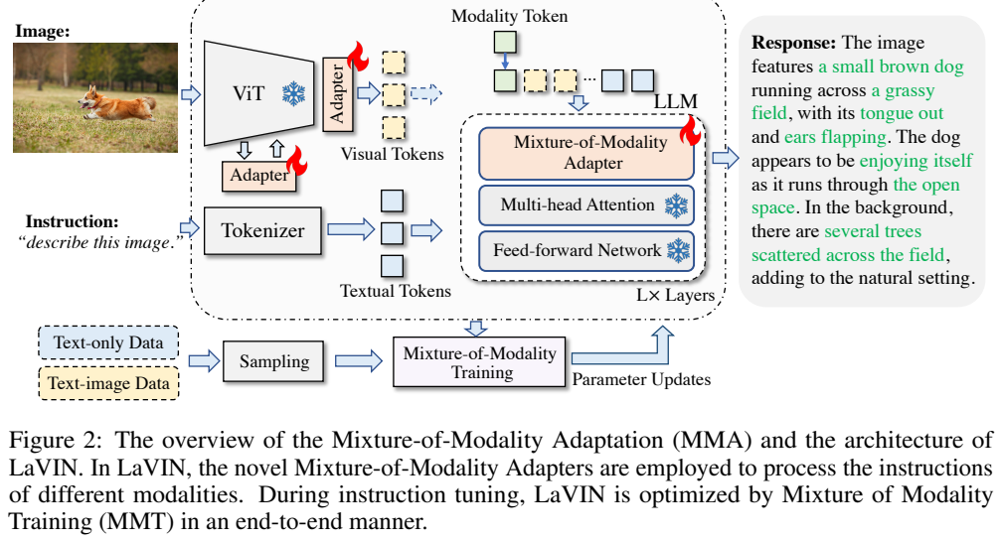
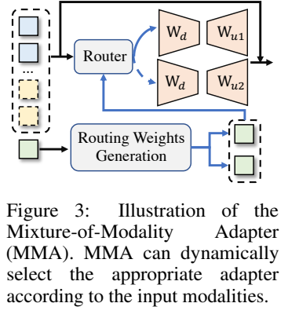
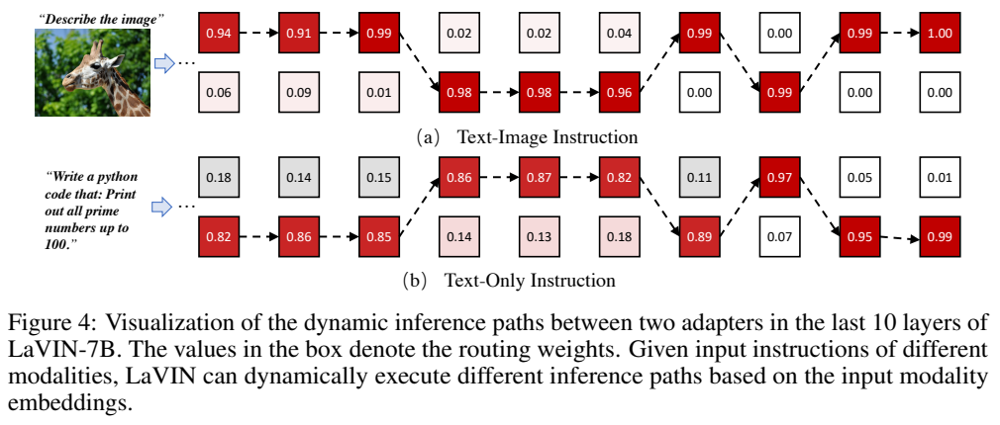
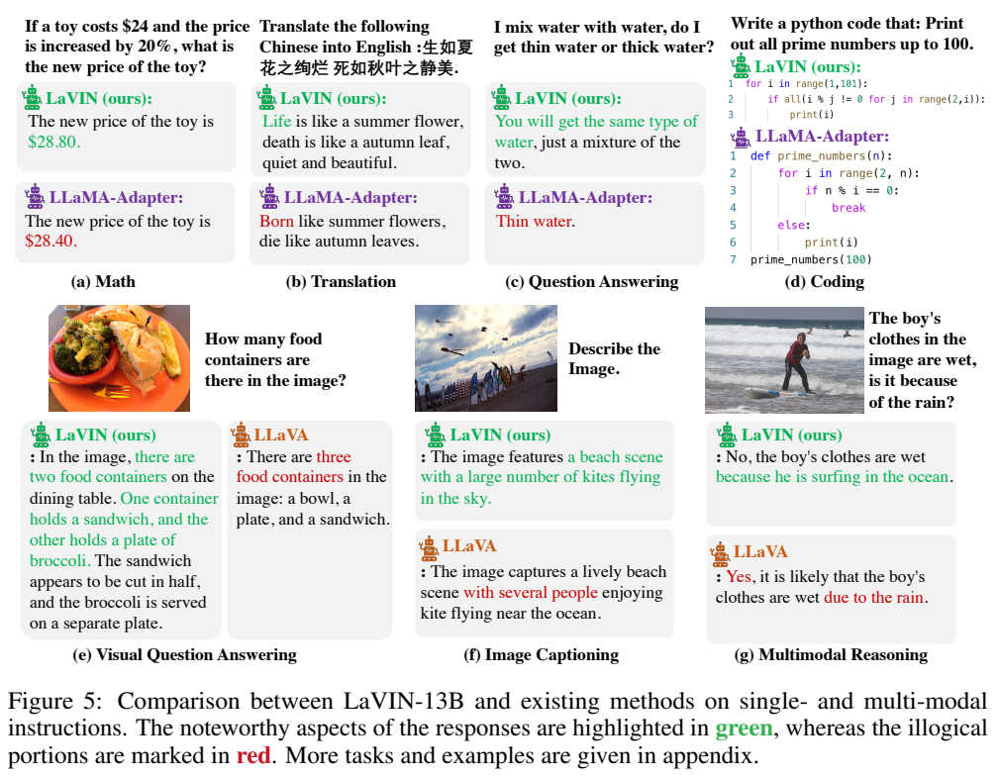
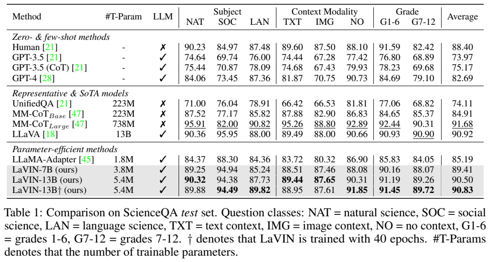
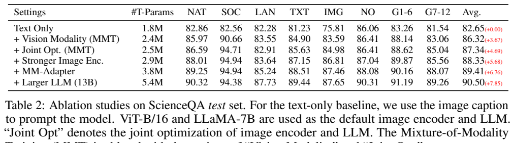
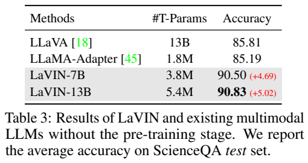
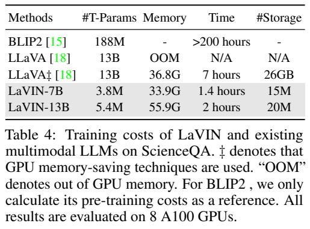

<!-- article-header:start -->
[项目首页](../../../README.md) › [模型系列](../../../reports/model-family-index.md) › [LaVIN](../README.md)
<!-- article-header:end -->

# LaVIN：按输入模态路由的低成本视觉语言适配

<!-- article-toc:start -->
<a id="article-toc"></a>

**本篇目录** · [论文定位](#paper-info) · [快速概览](#overview) · [整体架构](#architecture) · [核心原理](#principles) · [数据构建](#data) · [训练流程](#training) · [实验结果](#experiments)
<!-- article-toc:end -->

<a id="paper-info"></a>

## 1. 论文信息与模型定位

**论文**：[Cheap and Quick: Efficient Vision-Language Instruction Tuning for Large Language Models](https://arxiv.org/abs/2305.15023)，依据 2023 年 5 月 24 日 [v1](https://arxiv.org/pdf/2305.15023v1)。作者 Gen Luo、Yiyi Zhou、Tianhe Ren、Shengxin Chen、Xiaoshuai Sun、Rongrong Ji，来自厦门大学相关实验室与人工智能研究院。

工作提出 **Mixture-of-Modality Adaptation，MMA**，将 CLIP ViT 与 LLaMA 连接成 LaVIN。目标是在不进行额外大规模图文对齐预训练的情况下，用少量适配参数同时支持纯文本与图文指令。定量证据集中于 ScienceQA，聊天主要通过案例说明，不能据此认定已经验证通用聊天、OCR 或复杂推理的全面领先。

<a id="overview"></a>

## 2. 快速概览

| 项目 | 方案 |
|---|---|
| 视觉基座 | 预训练 CLIP ViT-L/14，主体冻结 |
| 语言基座 | LLaMA-7B / 13B，主体冻结 |
| 视觉表示 | 每第四层提取 CLS，总共六个全局特征 token |
| 视觉连接器 | 小瓶颈适配层，默认隐藏维度128 |
| 模态适配器 | 两个共享降维投影的 RepAdapter，按模态 token 加权 |
| 可训练规模 | 7B版3.8M，13B版5.4M；不是总模型参数 |
| 训练方式 | 单次端到端混合纯文本和图文指令，仅更新接入适配参数 |
| 主要限制 | 全局表示无法可靠识别极细文字；仍会错误和虚构回答 |

“无需大规模图文预训练”针对新增的适配过程；CLIP 和 LLaMA 本身早已预训练。报告的1.4小时来自8张A100的ScienceQA设置，不是单卡耗时，也不是从头训练全部模型的费用。

<a id="architecture"></a>

## 3. 整体架构





**读图：Figure 2/Figure 3，PDF 第4页。** 左边 ViT 的主体与右边语言注意力/FFN 均标冻结，火焰集中在新增适配器。下方两类指令共同采样，上方绿色模态 token 提示当前是纯文本还是图文。Figure 3 中两个分支共享降维矩阵，各有升维映射，降低额外参数数目。

图像端在注意力模块前加入适配器，并从ViT每四层取CLS。六个不同深度的全局token可提供不同抽象层次，但不是六个独立空间区域的patch；因此不能宣称该方法保留了完整文字位置。

视觉连接器把这些特征映射到语言维度，正文称采用SwiGLU非线性和128维瓶颈。图文输入拼成 $`[t_m,X',Y]`$，纯文本输入为 $`[t_m,Y]`$，其中 $`X'`$ 是视觉token、$`Y`$是词嵌入。语言模型逐token生成回答。冻结主体仍参与前向/反向计算，“端到端联合优化”指视觉和语言两端的**适配器共同学习**，并不意味着所有基座权重解冻。

<a id="principles"></a>

## 4. 核心创新与数学原理

令模态one-hot向量 $`m\in\mathbb R^2`$，可学习模态嵌入 $`E_m\in\mathbb R^{2\times c}`$，原式（1）定义 $`t_m=mE_m`$。输入特征 $`Z`$ 经双适配器后，原式（2）（3）为：

```math
Z'=Z+s\big(\hat w_0f_{a1}(Z)+\hat w_1f_{a2}(Z)\big),\qquad
\hat w=\mathrm{softmax}\left(\frac{t_mW_m+b_m}{\tau}\right).
```

$`s`$ 是适配输出缩放，$`\tau`$ 是路由温度；$`W_m\in\mathbb R^{c\times2}`$、$`b_m\in\mathbb R^2`$。两个候选RepAdapter共享降维层。残差保留已有表示，路由允许纯文本与图文采取不同适配组合。

这是**由输入模态类别驱动的软加权**。公式并非逐token按语义负载选择海量专家，也没有声明 top-k 硬路由或负载均衡损失。模态token的种类由输入格式给出，不能把路由解释成模型先自动判断图片是否存在。学习到的权重可接近0或1，但数学表达仍为两分支加权和。





**读图：Figure 4，PDF 第8页。** 展示7B模型最后10层纯文本/图文的路由权重，红色突出占优分支，路径随层与模态变化。它说明两类输入的适配倾向不同，不是两套完全独立的语言模型。Figure 5 展示案例，不能用少数展示替代整体准确率。

混合模态训练采用下一token预测，目标覆盖两类回答。原式（4）写最小化，而原式（5）却直接写正的 log probability 之和，缺少负号；两处符号不一致。按标准最大似然含义，可解释为**最大化两类回答的log likelihood，或最小化其负值**，本文不照抄成“最小化正log概率”。同页式（6）的投影矩阵下标/维度也有排版不一致，本文按降维—非线性—升维的连接器作用描述，不把不自洽维度作为可执行实现。

<a id="data"></a>

## 5. 数据构建与处理

ScienceQA 含纯文本和图文题，覆盖3类学科、26主题、127类别、379技能；train/val/test 为 **12,726/4,241/4,241**。模型在训练集监督微调、测试集报告平均准确率，另按自然科学、社会科学、语言、上下文类型和年级划分。

聊天训练采用 **Alpaca-52K** 纯文本指令及 **LLaVA-158K** 图文指令：前者由GPT-3.5生成，后者答案由GPT-4生成。引言另称152K图文对，实施数据节标题与描述为158K，本文沿实施节并注明差异，不能将其当作额外完整披露的筛选结果。

训练mini-batch随机混合纯文本与图文样本。报告没有明确固定混合比例、详细图像增强、过滤阈值或完整去重操作，本文不补写。ScienceQA 的“Text Only”消融**仍用图像caption作提示**，它移除了视觉编码器，却并非完全剥离图像语义信息的盲文本基线。

<a id="training"></a>

## 6. 训练流程与目标

MMA 不再添加一个先在海量图文对训练的独立对齐阶段，直接冻结已有视觉与语言主体，只训练适配器、模态相关接入参数和视觉连接器。MM-Adapter瓶颈维度 **8**，visual neck维度 **128**，路由温度7B为 **10**、13B为 **5**。

ScienceQA 使用 AdamW，batch **32**、学习率 **$`9\times10^{-3}`$**、weight decay **0.02**，余弦衰减，默认 **20 epoch**；主表另列13B的 **40 epoch** 版本。聊天实验其他超参相同，降至 **15 epoch**。报告没有完整给出warmup、缩放$`s`$、所有参数组和loss masking细节，不能据其他代码经验补齐。

解码为 top-p sampling，温度 **0.1**、top-p **0.75**。生成过程并不是额外搜索树或训练时强化学习。只保存少量新增参数降低checkpoint开销，但部署仍需原CLIP和LLaMA全部基座，不应把适配器文件体积当作完整模型体积。

<a id="experiments"></a>

## 7. 实验设置与主要结果



**读图：Table 1，PDF 第6页。** #T-Param是可训练参数；Average为完整测试集平均。IMG是有图像上下文子集，不能只引用Average作为纯图像题准确率。GPT系列放在零/少样本组，LaVIN则为监督训练，比较条件不同。

| 模型 | 可训练参数 | Average | IMG | G7–12 |
|---|---:|---:|---:|---:|
| LLaMA-Adapter | 1.8M | 85.19 | 80.32 | 84.05 |
| LaVIN-7B，20 epoch | 3.8M | **89.41** | 87.46 | 88.07 |
| LaVIN-13B，20 epoch | 5.4M | **90.50** | 87.65 | 89.26 |
| LaVIN-13B，40 epoch | 5.4M | **90.83** | 87.61 | 89.72 |
| LLaVA | 13B | 90.92 | 88.00 | 90.90 |
| MM-CoT Large | 738M | 91.68 | 88.80 | 90.31 |

主结果接近LLaVA且训练参数大幅减少，但Average仍低于LLaVA/MM-CoT Large；更长训练也没有提升所有子集。不能概括成全面领先。







**读图：Table 2–4，PDF 第7页。** 左侧是逐步添加能力的累积消融；右侧分别是不进行额外VL预训练的比较和8张A100训练成本。它们不是同一组所有控制变量完全相同的测量。

Table 2 的Average：文本基线 **82.65** → 加视觉 **86.32** → 联合适配 **87.34** → 更强ViT **88.33** → MM-Adapter **89.41** → 13B语言基座 **90.50**。对应单步增益 **3.67/1.02/0.99/1.08/1.09个百分点**；表中括号是相对起点的累积增益，不能都当新增模块贡献。路由额外约0.9M参数得到1.08个百分点收益。

Table 3 列7B **90.50**、13B **90.83**，与主表及默认20epoch设置对7B的89.41不一致，也没有完整解释其额外配置。本文不以90.50替换7B主表值；引用“无预训练比较”时应保留该来源差异。

Table 4：LaVIN-7B显存 **33.9G**、时间 **1.4小时**、新增checkpoint标为 **15M**；13B为 **55.9G/2小时/20M**；加省显存技术的LLaVA为 **36.8G/7小时/26GB**。时间相对减少约80%和71.4%，但13B显存反而高于该LLaVA配置，7B只约降7.9%。原文“超过40%显存节省”不能从这张比较表推广。BLIP-2的 **>200小时**只统计预训练作参考，任务和阶段不同，不是同等ScienceQA微调耗时。

聊天没有完整的大规模平均分表，Figure 6是若干GPT-4评分案例。Figure 5(d) LaVIN生成的素数代码从1循环，空集合上的all会为真，因此**会错误打印1**；这说明原图声称“准确代码”不能直接当成静态核验通过。原文还承认幻觉与极细视觉文字识别困难。更稳妥的结论是：MMA在ScienceQA展示了较好的性能—适配开销权衡，通用聊天与视觉细节能力仍需要系统评估。

<!-- article-footer:start -->
---

[← 上一篇：DetGPT](../../detgpt/arxiv-2305.14167/README.md) · [按发表时间浏览](../../../reports/paper-reading-guide.md#year-2023) · [下一篇：PandaGPT →](../../pandagpt/arxiv-2305.16355/README.md)

[返回本篇目录](#article-toc) · [返回模型系列](../README.md)
<!-- article-footer:end -->
