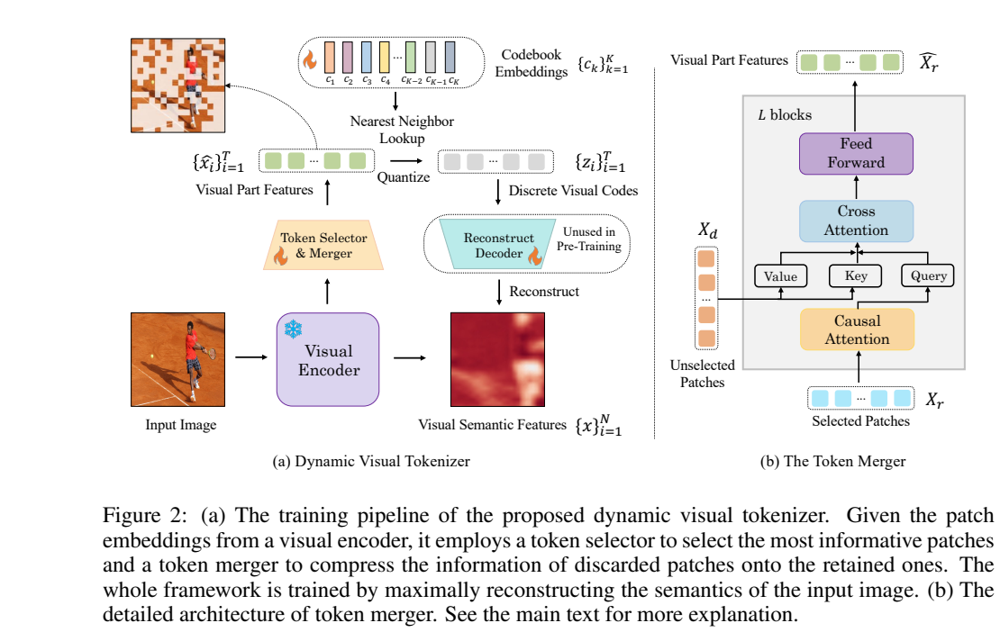
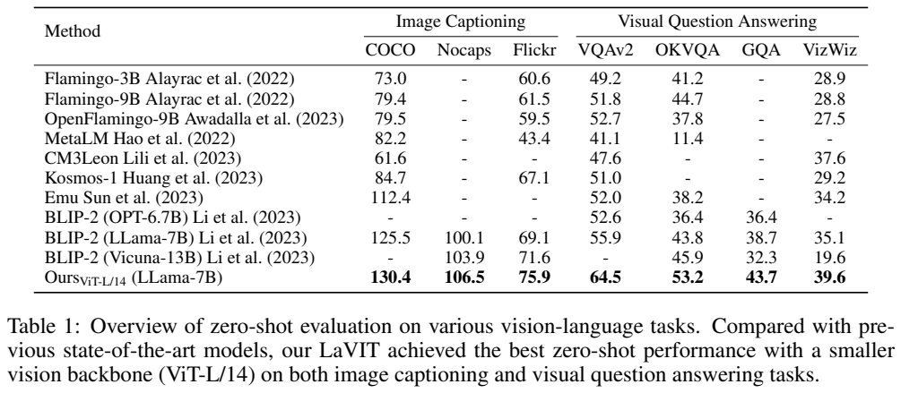
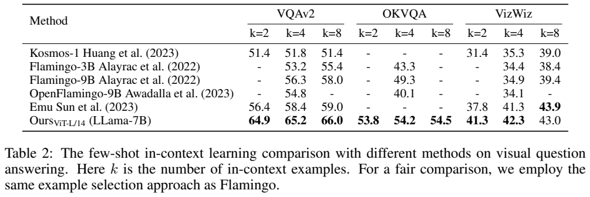
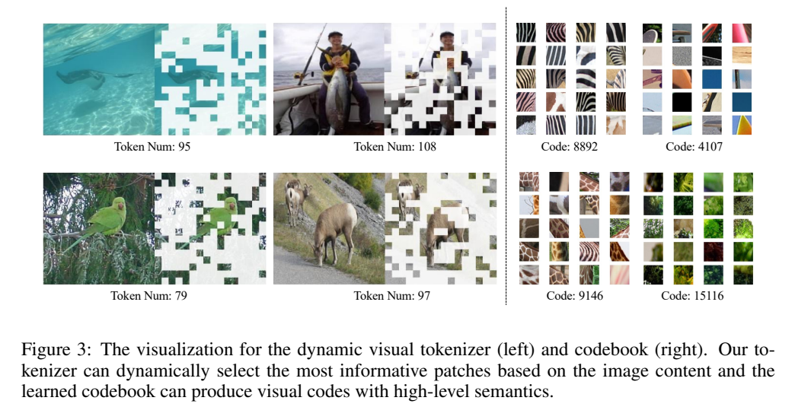
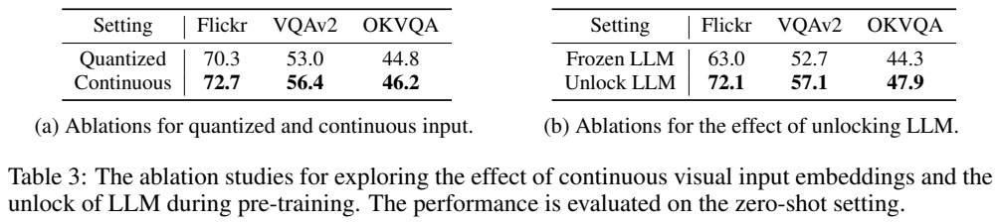

<!-- article-header:start -->
[项目首页](../../../README.md) › [模型系列](../../../reports/model-family-index.md) › [LaVIT](../README.md)
<!-- article-header:end -->

# LaVIT：动态视觉 token 与统一图文下一 token 预测

<!-- article-toc:start -->

**本篇目录** · [论文定位](#paper-info) · [快速概览](#overview) · [整体架构](#architecture) · [核心原理](#principles) · [数据构建](#data) · [训练流程](#training) · [实验结果](#experiments)
<!-- article-toc:end -->

## 1. 论文信息与模型定位

| 项目 | 内容 |
|---|---|
| 题名 | Unified Language-Vision Pretraining with Dynamic Discrete Visual Tokenization；目录题名为 Unified Language-Vision Pretraining in LLM with Dynamic Discrete Visual Tokenization |
| 作者 / 机构 | Yang Jin、Kun Xu 等；北京大学、快手；通讯作者 Yadong Mu |
| 采用版本 | arXiv:2309.04669v1，2023-09-09；13 页，技术正文到第 10 页 |
| 原文 / 官方代码 | [固定版本 PDF](https://arxiv.org/pdf/2309.04669v1) · [LaVIT](https://github.com/jy0205/LaVIT) |
| 模型规模 | 原始 LLaMA-7B 为语言骨干，CLIP ViT-L/14 为视觉骨干；第二阶段约 7.3B 可训练参数，不是全文精确总参数 |
| 输入 / 输出 | 图像、文字和交错图文上下文 → 文字描述与问答；支持少样本上下文示例 |
| 定位 | 视觉语言基础预训练，重点验证理解；本版本结论把文本条件图像生成及指令跟随增强列为未来工作 |

本文提出把视觉 token 也纳入自回归预测，而不是只让图像充当文字生成的条件。其“离散”主要体现在视觉目标是有限代码本里的类别：语言模型输入仍使用连续视觉特征，以避免量化损失细节。阅读后续 LaVIT 版本或仓库能力时，不能把新增图像生成实验追溯成本篇 v1 已证实的结论。

## 2. 快速概览

固定长度视觉特征可能把大量相似背景重复送入语言模型。LaVIT 首先学会选取具有信息的 patch，再让保留 token 聚合未保留 patch 的内容，形成随图像变化的短序列。随后为这些语义特征分配视觉代码，使语言模型可以像预测单词类别一样预测视觉代码类别。

模型训练分两步。先训练动态 tokenizer，用较少 token 重建冻结视觉骨干的特征；再把图文对和纯英文文本混合，解冻 LLaMA 与 token merger，以共享预测头学习图文序列。视觉目标是量化代码，视觉输入是 merger 输出的连续向量，二者职责不同。多组图文对被打包到一条序列，使模型接触交错图文，也为少样本问答提供形式基础。

在 93M 图像的图文数据配置下，LaVIT 报告 COCO CIDEr 130.4、VQAv2 64.5、OKVQA 53.2；8 个检索示例的 VQAv2 为 66.0。子集消融显示，连续输入优于代码本向量输入，解冻语言模型也优于冻结。这里的证据主要涉及图像描述与问答，没有包含通用视觉助手评测、精细定位、长视频或已完成的图像生成系统。[Sections 3–4](https://arxiv.org/pdf/2309.04669v1)

## 3. 整体架构

> 来源：原文 Figure 2，2309.04669v1，PDF 第 4 页；裁图保留模块标记；选择器公式见同页原文与本节解读。

**读图**：左侧图像经冻结视觉编码器产生 patch 特征，selector 选择部分位置，merger 将其余位置的信息汇入保留位置。近邻量化得到代码本索引，重建 decoder 检查语义是否保存。右侧是 merger 内部：保留 token 先做因果注意力，再作为 query 对未保留特征做 cross-attention，之后经过前馈层。重建 decoder 只用于 tokenizer 阶段，图中明确标记不用于后续语言预训练。

| 环节 | 实际配置 / 信息流 |
|---|---|
| 输入与编码 | 224×224，patch14；CLIP ViT-L/14 冻结，产生 16×16=256 个 patch 特征 |
| Selector | 多层 MLP 对每个 patch 给出保留/不保留分布，Gumbel-Softmax 松弛训练 |
| Merger | 12 个因果 self-attention、cross-attention、FFN 组成的 block；输出长度 T 可变 |
| 量化与重建 | 16,384 个代码本条目；3 层 Transformer 重建原始视觉语义特征 |
| 接入 LLM | merger 的连续特征经线性层变为文字嵌入维度，以 [IMG] 和 [/IMG] 划定视觉段 |
| 自回归模型 | 原始 LLaMA-7B；图像代码和文字 token 共享预测头，分别在相应位置接受类别监督 |

减少的是送入 LLM 的 token 数，原始 256 个 patch 仍经过 ViT，merger 也仍需访问未保留特征。因此不能把它表述为整个视觉计算都按保留比例减少。因果 self-attention 则使 merger 输出的先后位置与自回归建模一致，并不是生成像素时的逐 patch 图像 decoder。

## 4. 核心创新与数学原理

**动态选择与信息合并。** 原文 Equation (1) 对每个 patch 的两种选择使用 Gumbel-Softmax：

$$
\hat\pi_{i,j}=\frac{\exp((\log\pi_{i,j}+G_{i,j})/\tau)}
{\sum_{r=1}^{2}\exp((\log\pi_{i,r}+G_{i,r})/\tau)}.
$$

$`\pi`$ 为选择分布，$`G`$ 为 Gumbel 噪声，$`\tau`$ 控制平滑程度；最终得到二值掩码 $`M`$。它允许学习“哪里值得保留”，而不是对所有图片固定留下同样的位置。原文没有披露温度数值、推理决策阈值和全部离散采样实现。

设保留 T 个 patch 的特征为 $`X_r`$，未保留为 $`X_d`$。保留特征作 query，从被丢弃位置取信息。标准注意力复杂度的解读是：保留位置的 self-attention 约为 $`O(T^2D)`$，merger 的 cross-attention 约为 $`O(T(N-T)D)`$，另有前馈计算；LLM 的视觉段较短可以减轻其序列开销，但这不是整个模型的线性复杂度保证。

> 数学依据：[原文 Equations (2)–(5)、Sections 3.1–3.2，PDF 第 5 页](https://arxiv.org/pdf/2309.04669v1#page=5)。

Equation (2) 用将注意力 logits 与 $`1-M`$ 相乘的写法表示仅访问未保留位置。这里有一个数学简写问题：softmax 前乘零会令该位置获得 $`e^0`$ 而非零概率。若严格实现“排除保留位置”，通常应只对 $`X_d`$ 做注意力，或给禁止位置加负无穷掩码。以下是与正文语义一致的**解释性改写**，不是宣称原文或官方代码已采用该写法：

$$
\Delta X_r=\mathrm{softmax}(Q_rK_d^\top/\sqrt D)V_d.
$$

**语义量化而非像素重建。** Equation (3) 按距离选取代码：

$$
z_i=\arg\min_j\Vert l_2(\hat x_i)-l_2(c_j)\Vert .
$$

$`\hat x_i`$ 为合并后的特征，$`c_j`$ 为代码本向量。原文将 $`l_2`$ 称为 L2 norm，按常见向量量化可理解为比较 L2 处理后的向量；仅凭这句记号不能恢复完整归一化或代码本更新实现。其重建目标 Equation (4) 为：

$$
\mathcal L_{tokenizer}=\frac1N\sum_i(1-\cos(x_i,x_i^{rec}))
+\lambda\left(\rho-\frac1N\sum_iM_i\right)^2.
$$

第一项要求压缩特征仍能恢复原 ViT 特征的方向，第二项约束平均保留比例，$`\rho=1/3`$、$`\lambda=2`$。该比例是训练目标，不是每张图都恰好保留 85 或 86 个 token 的硬限制。重建的是语义特征而非 RGB 像素，也没有在此列出对抗式像素重建损失或承诺视觉细节无损。

**连续输入与离散预测目标解耦。** 离散代码让视觉监督变成分类问题，共享图文下一 token 目标；连续输入则把 merger 的细节保留给语言模型。原文 Equation (5) 写作 $`p(y)=\sum_{y\in D}\sum_i\log P_\theta(y_i\mid y_{<i})`$，右侧实际是数据集对数似然，不是单序列概率。第 6 节使用“最大化对数似然 / 最小化负对数似然”的等价解释，避免沿用左侧的概率记号混淆。

## 5. 数据构建与处理

| 用途 | 公开来源与数量 | 处理方式 |
|---|---|---|
| 图文预训练 | Conceptual Captions 3M、12M，SBU，COCO，LAION-115M；最终合计 93M 图像 | 使用图像与 caption 对，多个图文对打包为交错序列 |
| 纯文本保持 | RedPajama 的英文语料 | 与图文样本混合；不同文本来源按原 LLaMA 的分布抽样 |
| Tokenizer 图像输入 | 第 3.3 节描述共同图像预处理，但未另列独立 tokenizer 训练数据规模 | 224×224，随机 crop 和水平翻转 |
| 少样本推理支持 | 对应任务训练集合中的示例 | RICES 检索选择，并按图文示例交错组织 |

93M 是论文给出的最终图像口径，不能直接把数据集名称中的 3M、12M、115M 相加成另一总量，也没有披露精确清洗后分来源数量。正文希望通过采用与 BLIP-2 等工作相同的图文来源控制数据优势，但各模型的语言预训练、视觉骨干及纯文本混合仍不同，不能据此断言所有比较严格等算力、等数据。

全文没有给出完整去重、测试污染检查、caption 清洗阈值、纯文本与图文比例、每条序列最大长度或总独立文本 token 数。模型不依赖本文新合成的视觉对话 SFT 数据；其主训练是图文基础预训练，而非这里另有一个已披露的大规模聊天调优阶段。[Section 3.3](https://arxiv.org/pdf/2309.04669v1)

## 6. 训练流程与目标

| 阶段 | 更新 / 冻结 | 目标与已披露设置 |
|---|---|---|
| Tokenizer 训练 | ViT 冻结；学习 selector、merger、代码本和重建模块 | Equation (4)；merger 12 层，decoder 3 层；batch 2048；AdamW；LR warmup 到 1e-4 后 cosine decay；rho=1/3、lambda=2 |
| 统一图文预训练 | Selector 冻结；merger 与 LLaMA 联合更新；重建 decoder 不参与 | 图文 token 下一 token 分类；约 7.3B 可训练参数；AdamW beta=(0.9,0.95)、weight decay=0.1；12K steps、每 batch 4M tokens；前 2K steps warmup 到 1e-4 后 cosine decay |

视觉编码器延续冻结设计；原文说第二阶段 tokenizer 中只有 merger 参与联合训练，没有报告 selector 再学习，也没有报告此阶段更新重建 decoder。线性映射的训练包含在接入连续特征的路径中，但全文没有逐项列出其参数数目。Tokenizer 总步数、代码本更新算法、硬件总量与训练耗时未披露。

用明确的优化方向重写 Equation (5)，统一自回归损失为：

$$
\mathcal L_{LM}=-\sum_{y\in\mathcal D}\sum_{i=1}^{S}
\log P_\theta(y_i\mid y_{<i}).
$$

文字位置的标签来自文本词表，视觉位置来自量化代码本。关键改动是图像段也被预测监督，不只是回答文本被监督。12K×4M 约为 48B **处理 token 次数**的算术估计；不是论文披露的独立训练语料规模，重复、打包与混合比例均会影响其含义。本文没有给出后续指令 SFT、偏好优化或图像像素 decoder 训练配方。

## 7. 实验设置与主要结果

> 来源：原文 Tables 1–2，PDF 第 7 页；所有模型行、任务列、k 值、表注完整可见。

**读表**：Table 1 的前三列为 caption CIDEr，后四列为问答准确率，不能将它们当同一种百分比。问答提示采用 Question/Answer 形式，生成用 beam search，length penalty=0 以鼓励与短标注一致的回答；beam 宽度未披露。Table 2 的 k 是推理时提供的检索示例数，不是训练样本数或再微调步数。

| 基准 | 指标↑ | LaVIT | 同表 BLIP-2 LLaMA-7B | 差值 |
|---|---|---:|---:|---:|
| COCO | CIDEr | 130.4 | 125.5 | +4.9 分 |
| NoCaps | CIDEr | 106.5 | 100.1 | +6.4 分 |
| Flickr30k | CIDEr | 75.9 | 69.1 | +6.8 分 |
| VQAv2 | Acc | 64.5 | 55.9 | +8.6 个百分点 |
| OKVQA | Acc | 53.2 | 43.8 | +9.4 个百分点 |
| GQA | Acc | 43.7 | 38.7 | +5.0 个百分点 |
| VizWiz | Acc | 39.6 | 35.1 | +4.5 个百分点 |

LaVIT 在 Table 1 的已报告数值中领先，但跨模型整体差异不能单独归因于离散监督。少样本 k=2/4/8 时，VQAv2 为 64.9/65.2/66.0，OKVQA 为 53.8/54.2/54.5，VizWiz 为 41.3/42.3/43.0。虽然同一模型随示例数增加改善，8-shot VizWiz 的 Emu 为 43.9，仍高于 LaVIT 的 43.0；不能把“全部 few-shot 任务领先”写成结果。

> 来源：原文 Figure 3、Table 3，PDF 第 8 页；原图 token 数、代码编号、所有消融行完整保留。

**读图**：左侧示例保留 95、108、79、97 个位置，说明实际数量并非固定；右侧同代码的 patch 展示相似纹理或局部对象，但有限案例不保证所有代码均有单一可命名语义。Table 3 在部分预训练数据上比较设计：连续输入相对量化输入的 Flickr 为 72.7 对 70.3，VQAv2 56.4 对 53.0，OKVQA 46.2 对 44.8；解冻相对冻结 LLM 为 72.1 对 63.0、57.1 对 52.7、47.9 对 44.3。

这两组消融支持实际采用的“连续输入、离散目标”及解冻语言模型，但不是同一张表中可直接连乘或累加的提升。它们也没有给出动态 selector 对固定 token 长度的完整量化消融、端到端吞吐或等预算曲线。该版本最充分的证据是 caption/VQA 与少样本图文理解；文本条件图像生成仍是结论中的未来方向。以上结果来自原文，本介绍未运行或复现模型。

<!-- article-footer:start -->
---

[← 上一篇：ImageBind-LLM](../../imagebind-llm/arxiv-2309.03905/README.md) · [按发表时间浏览](../../../reports/paper-reading-guide.md#year-2023) · [下一篇：NExT-GPT →](../../next-gpt/arxiv-2309.05519/README.md)

[返回本篇目录](#article-toc) · [返回模型系列](../README.md)
<!-- article-footer:end -->
