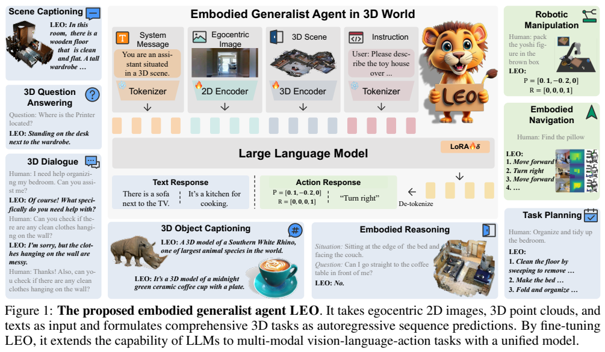
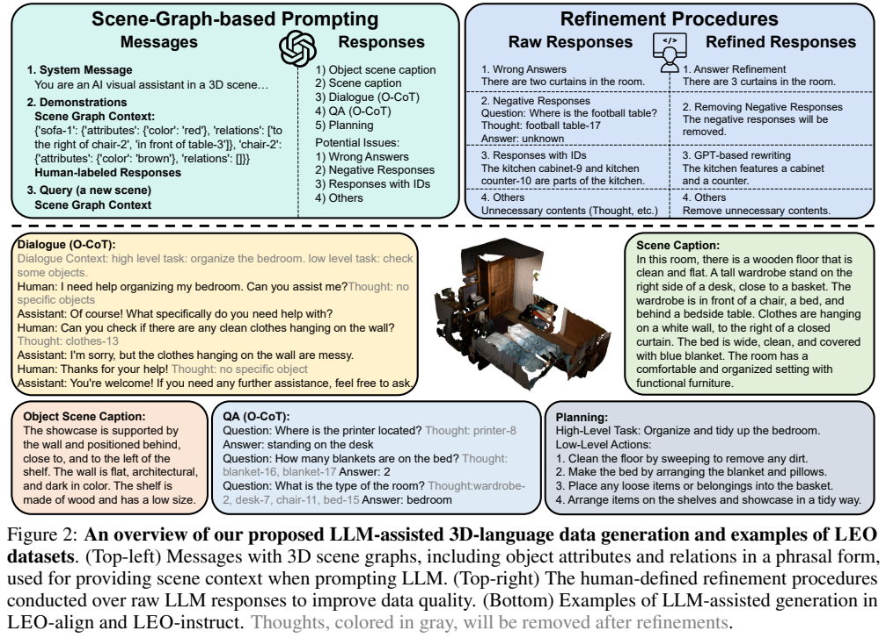
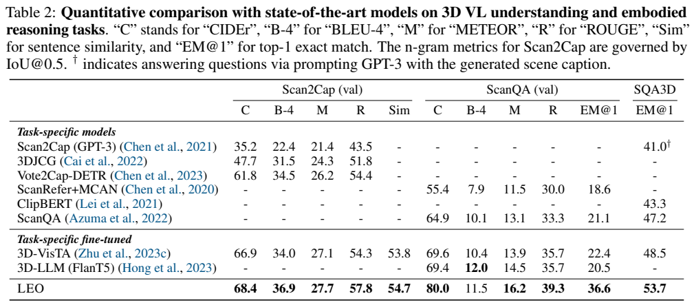
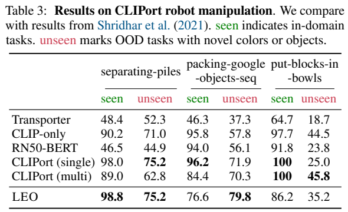
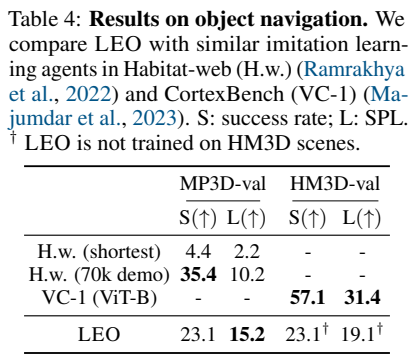
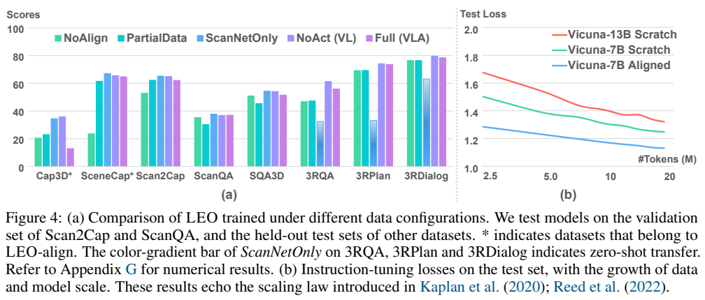

<!-- article-header:start -->
[项目首页](../../../README.md) › [模型系列](../../../reports/model-family-index.md) › [LEO](../README.md)
<!-- article-header:end -->

# LEO：以对象为中心连接三维理解、语言与具身动作

<!-- article-toc:start -->
<a id="article-toc"></a>

**本篇目录** · [论文定位](#paper-info) · [快速概览](#overview) · [整体架构](#architecture) · [核心原理](#principles) · [数据构建](#data) · [训练流程](#training) · [实验结果](#experiments)
<!-- article-toc:end -->

<a id="paper-info"></a>

## 1. 论文信息与模型定位

[An Embodied Generalist Agent in 3D World](https://arxiv.org/abs/2311.12871) 由 Jiangyong Huang、Silong Yong、Xiaojian Ma、Xiongkun Linghu 等提出，主要机构为 BIGAI，并包括北京大学、卡内基梅隆大学与清华大学。本文固定依据 **2311.12871v1，2023 年 11 月 18 日**。模型名称 **LEO**，以 Vicuna-7B 为基础，是把三维场景理解与具身动作任务共同表述为序列预测的通用智能体。[PDF 第 1–4 页](https://arxiv.org/pdf/2311.12871v1#page=1)

输入包括对象点云、可选第一视角图片及语言指令，输出可以是描述、问答、对话、文本计划，也可以是导航或桌面操作的动作码。这里“通用”指一个共享模型覆盖报告所列任务，不意味着已经在任意真实场景、任意机器人上获得可靠执行能力。动作实验主要位于 Habitat 导航与 CLIPort 桌面操作环境。

<a id="overview"></a>

## 2. 快速概览

| 关键设计 | 具体含义 |
|---|---|
| 对象中心三维表示 | 每个对象的点云形成一个 token，用空间 Transformer 加入对象之间的几何关系。 |
| 第一视角补充 | OpenCLIP ConvNeXt 编码当前图像，补充智能体实际看到的局部内容。 |
| 自身对象 token | 将智能体位置、朝向作为特殊对象放入三维关系网络，支持“我的左侧”等问题。 |
| 统一动作词汇 | 导航用 4 个动作 token；CLIPort 使用 516 个分量离散码，映射到语言词表低频 token。 |
| 两阶段学习 | 先做三维视觉语言对齐，再混合语言理解和动作指令微调。 |
| 参数效率 | 约 7B 总参数，约 142M 可训练；语言主干和 PointNet++ 冻结，使用 LoRA 适配。 |
| 数据生成 | 用三维场景图提示 ChatGPT，列出涉及对象的 O-CoT，再按场景图纠错与过滤。 |

LEO 的优势在于三维对象结构与语言模型之间的接口简单：不用把全部点送进语言模型，也不为每项任务设计单独输出头。不过它依赖对象提案和几何信息，智能体的可访问三维场景条件应与仅用相机的策略区别理解。[PDF 第 2–4、25–27 页](https://arxiv.org/pdf/2311.12871v1#page=2)

<a id="architecture"></a>

## 3. 整体架构



**Figure 1 的读法。** 中央将系统提示、第一视角图片、三维场景和任务指令编码为连续序列，由 LLM 生成文本或特殊动作 token。旁边的描述、问答、对话、计划与操作展示不同任务共用同一框架。火焰与雪花区分可训练和冻结模块：语言主干由 LoRA 适配，不是完整更新全部 7B 参数。

二维路径采用在 LAION2B 上预训练的 OpenCLIP ConvNeXt-base。三维路径先获取对象提案，理解评测采用 Mask3D；每个对象采样 1,024 个点，交给在 ScanNet 对象分类上预训练的 PointNet++。对象表示再进入 **三层、八头 Spatial Transformer**，MLP 适配器匹配语言嵌入维度。附录还用 CLIP 文本编码器提取全局指令特征，与图片和对象特征逐元素相乘，让视觉表示受当前指令调制。[PDF 第 3、25–27 页](https://arxiv.org/pdf/2311.12871v1#page=25)

三维表示不能只包含物体类别。模型需要知道两个对象间的距离和方向，也需要知道智能体位于哪里。embodiment token 是一个可学习的特殊“自身对象”，与普通对象共同参与空间注意力；导航使用 GPS 与 compass 所提供的位置、朝向，旋转以 Fourier 特征再线性映射。描述指定对象时，则把自身位置设为被指对象盒内选取的位置。这样“左边的椅子”不再只是无参照的语言关系。

语言词表为 SentencePiece 的约 32K 子词。动作使用其中低频 token：导航有前进、右转、左转、停止；CLIPort 分别用 320 个 x 位置码、160 个 y 位置码、36 个 z 轴旋转码。**516 是分量码的数量之和，不是只有 516 种完整姿态，也不是任意七自由度机械臂控制接口。** 输出这些码后，系统映射回任务规定的动作命令。[PDF 第 21–22、27 页](https://arxiv.org/pdf/2311.12871v1#page=22)

| 模块 | 输入与输出 | 公开机制 |
|---|---|---|
| 二维视觉路径 | 第一视角图像 → 图像 token | OpenCLIP ConvNeXt 编码，MLP 匹配语言维度；训练可更新二维编码器 |
| 对象点云路径 | Mask3D 对象提案 → PointNet++ 特征 | 逐对象采 1024 点，预训练点云编码器冻结；提案质量影响后续场景输入 |
| Spatial Transformer | 对象和 embodiment 表示 → 关系增强对象 token | 三层八头，内容注意力与相对距离/方向空间门控融合 |
| Vicuna-7B 与 LoRA | 系统、二维/三维输入与指令 → 文本/动作码 | 冻结语言主权重，LoRA 及空间/二维组件适配，约 142M 参数更新 |
| 动作映射接口 | 低频 SentencePiece token → 导航或离散姿态 | 按任务预定义动作空间还原命令，非任意连续机器人控制头 |


<a id="principles"></a>

## 4. 核心创新与数学原理

### 4.1 对象中心表示需要关系和自身参照

单独对象特征主要描述“是什么”，空间网络把对象之间及对象与自身的关系加入后，语言端才有条件理解相对方位。输入对象来自提案，若提案漏掉目标，后续空间注意力也无法凭关系恢复缺失点云。embodiment token 提供任务参照，而不是凭空增加一个真实可操作物体。[原文 §2.1–2.2，PDF 第 3 页；附录 D.2](https://arxiv.org/pdf/2311.12871v1#page=3)

三维空间注意力的目标是让对象间几何关系影响信息聚合。设对象中心为 $`c_i,c_j`$，附录定义五维关系：

```math
f_{ij}=[\Vert c_i-c_j\Vert _2,\sin\theta_h,\cos\theta_h,
\sin\theta_v,\cos\theta_v].
```

距离与水平、垂直方向既描述接近程度，也描述相对方位。对象特征 $`o_i`$ 产生 $`g_i=W_S^\top o_i`$，空间项为 $`\omega^s_{ij}=g_i^\top f_{ij}`$。按附录原写法，内容注意力项 $`\omega^o`$ 与空间门控共同归一化：
```math
\omega_{ij}=\frac{\sigma(\omega^s_{ij})\exp(\omega^o_{ij})}
{\sum_l\sigma(\omega^s_{il})\exp(\omega^o_{il})}.
```

其中 $`\sigma`$ 是 sigmoid。语义上相关却空间上不合理的对象，可以获得不同的信息权重。原文先用 softmax 表示 $`\omega^o`$，随后在融合式中又写指数；本篇沿用其附录表达，不擅自把它重写为某个实现级“标准 logits 加位置偏置”公式。空间网络最终提供的是关系增强后的对象表示，不是一个显式碰撞检测器。[PDF 第 25–27 页](https://arxiv.org/pdf/2311.12871v1#page=26)

### 4.2 动作离散化让行为进入响应序列

把连续控制分量离散成任务规定的码，再映射到低频文字 token，主干便可用同一响应预测接口学习文字和动作。代价是控制分辨率受离散网格限制，而且不同环境动作定义不同；模型输出必须经任务映射才能执行。监督动作示范和自然语言计划共享格式，不意味着两者具有相同的环境成功率。[原文 §2.1–2.3，PDF 第 3–4 页](https://arxiv.org/pdf/2311.12871v1#page=4)

第二个统一点是学习目标。令 $`s_{\mathrm{prefix}}`$ 为系统消息、视觉输入与指令，$`s_{\mathrm{res}}`$ 为回答或动作序列，原文 Eq. (2) 的核心为：

```math
\mathcal L=-\sum_{b,t}\log p_\theta
(s_{\mathrm{res}}^{(b,t)}\mid s_{\mathrm{res}}^{(b,\lt t)},s_{\mathrm{prefix}}^{(b)}).
```

模型对响应 token 进行前缀语言建模。对话与动作因此使用同一交叉熵学习机制；动作示范是监督标签，报告没有对 LEO 做强化学习或流匹配训练。LoRA 则用低秩增量适配冻结主干：可解释为 $`W'=W+BA`$，原权重不更新，较小的 $`A,B`$ 负责模态与任务变化。报告设 rank 和 $`\alpha`$ 都为 16、dropout 为 0，应用到注意力投影与 MLP 投影。[PDF 第 4、27 页](https://arxiv.org/pdf/2311.12871v1#page=4)

### 4.3 教师对象核查与部署响应目标分离

对象标签及 ID 使教师在回答前显式关联场景实例，便于发现计数或引用错误；清洗移除 thought 后，学生目标仍是最终回答。这种数据构造可改善监督依据，却不是让 LEO 在推理时执行同一教师检查程序。模型的空间表示、教师数据质量和环境动作执行仍是不同误差来源。[原文 §3.3；原有 O-CoT 流程与附录示例](https://arxiv.org/pdf/2311.12871v1#page=5)

数据侧的 O-CoT 要求生成模型先列出有关对象标签与 ID，再作答。例如计数问题先列出各个 blanket 实例，减少凭语言习惯直接猜数字。**这些 thought 在清洗后移除**，因此它主要提高教师生成数据的可核验性，不是要求 LEO 部署时输出显式长思维链。[PDF 第 5–6、18–20 页](https://arxiv.org/pdf/2311.12871v1#page=5)

<a id="data"></a>

## 5. 数据构建与处理



**Figure 2 的读法。** 上方左侧把物体属性和关系作为结构化上下文交给 ChatGPT，上方右侧处理计数错误、未知回答与对象 ID 泄露；下方展示描述、问答、对话和计划。灰色 thought 是数据生成中的中间信息，最终训练响应中删除。图中计划只是语言步骤示例，不能据此认定全部步骤已经被机器人实际执行验证。

| 数据阶段 | 类别与规模，取原 Table 1 |
|---|---|
| LEO-align | Objaverse / Cap3D 对象描述约 660K；ScanNet+3RScan 对象指代表达约 354K；3RScan 场景描述约 20K。 |
| LEO-instruct 语言任务 | 三维描述约 37K；三维 QA 约 83K；对话约 11K；任务计划约 14K。 |
| LEO-instruct 动作任务 | MP3D 导航约 60K episode；三个 CLIPort 操作任务各 100K 示范，共约 300K。 |

样本单位有所区别，不能把一段导航 episode 与一道短 QA 的 token 成本视作一样。Table 1 还区分“响应 token”和“前缀加响应 token”，避免将全部输入序列都写成监督输出预算。[PDF 第 4–6 页](https://arxiv.org/pdf/2311.12871v1#page=4)

场景图来自 3DSSG，包含对象属性与自然语言关系，比仅提供中心坐标更方便教师生成物理空间描述。为了避免总盯着场景最显眼的对象，作者按场景节点数量设置不同子图保留率，并变化提示种子。原始回答按计数、存在、不存在、信息不足及带 ID 分类；附录使用正则匹配检测和修订多数规则性错误，ID 由 ChatGPT 重写，多次仍含 ID 的问答删除，信息不足的 negative response 也删除。[PDF 第 19–21 页](https://arxiv.org/pdf/2311.12871v1#page=19)

这种清洗与普通“随机合成问答”有明显区别：输出可以回到已知场景图核验。不过场景图本身的缺失和误差仍会传播，删除信息不足样本也不能训练出全面可靠的拒答行为。O-CoT 对象计数消融的平均正确率从 0.5741 到 0.7802，仍非完全正确，所以后续修订必要；这个数字属于教师数据生成，不是 LEO 的计数测试分数。[PDF 第 19–20 页](https://arxiv.org/pdf/2311.12871v1#page=19)

导航示范采用 MP3D 训练划分的 57 个场景，生成较少探索噪声的最短路径。模型每步看到当前二维和三维输入、指令与过去 **4 个动作**，预测下一个动作；没有递归状态记录完整观察历史。这一条件帮助解释最短路径训练与人类探索轨迹训练的差别。[PDF 第 30 页](https://arxiv.org/pdf/2311.12871v1#page=30)

<a id="training"></a>

## 6. 训练流程与目标

第一阶段 LEO-align 用对象与场景描述建立三维视觉语言接口；第二阶段 LEO-instruct 加入 QA、对话、计划、导航及操作。两阶段共用模型和响应交叉熵，不为动作独立增加一套策略网络。冻结 PointNet++ 与预训练 LLM，训练二维编码器、Spatial Transformer 与 LoRA 等可训练接口，总可训练参数约 142M。[PDF 第 4 页](https://arxiv.org/pdf/2311.12871v1#page=4)

| 附录超参数 | 对齐 | 指令微调 |
|---|---:|---:|
| 优化器 | AdamW | AdamW |
| 学习率 | $`3\times10^{-4}`$ | $`3\times10^{-5}`$ |
| 权重衰减 / betas | 0.05 / (0.9, 0.999) | 同左 |
| GPU 与并行 | 4 张 A100，DDP | 同左 |
| 每 GPU batch / 梯度累积 | 4 / 5，总 batch 80 | 同左 |
| 预热 / epoch | 400 步 / 10 | 同左 |
| 精度 / 梯度范数 | bfloat16 / 5.0 | 同左 |

推理采用 5 beams，最大输出 256 token；附录还把最大上下文设为 256，过长从左侧截断，保留最右侧部分。重复惩罚 3.0、长度惩罚 1、温度 1、top-p 0.9。此处是报告实际设置，不应按后来长上下文模型的默认值替换，也不能因 beam search 同时写了 top-p 就自行认定其运行某种采样实现。动作码最后还原成任务命令。[PDF 第 27–28 页](https://arxiv.org/pdf/2311.12871v1#page=27)

<a id="experiments"></a>

## 7. 实验设置与主要结果







**结果页的读法。** 上表包含描述的 n-gram 指标、语义相似度与 QA 的 EM，不能相互当作统一成功率；Scan2Cap 指标还受 IoU@0.5 定位条件约束。左下操作表的 seen/unseen 指颜色或对象分布差异，右下导航把任务成功率 S 与路径效率 SPL 分开。HM3D 上的 † 表示没有使用该数据集场景训练。

LEO 在主表 Scan2Cap 的 CIDEr 为 68.4，对照 3D-VisTA 为 66.9；ScanQA CIDEr 为 80.0、EM@1 为 36.6；SQA3D EM@1 为 53.7。**QA 使用修订后的 exact match**：去掉空格后，如果预测是标签的子串、或标签是预测的子串，也判为匹配。这缓解“left”与“left side of towel”等表达差异，但也更宽松，不能将其分数与严格完全匹配的评测无条件等同。附录明确讨论了这个评价限制。[PDF 第 7、28–29 页](https://arxiv.org/pdf/2311.12871v1#page=29)

CLIPort 中 separating-piles 的 seen/unseen 平均奖励为 98.8/75.2，packing-google-objects-seq 为 76.6/79.8，put-blocks-in-bowls 为 86.2/35.2。模型在部分未见对象任务较强，却在已见 packing 及 bowls 上低于专用 CLIPort。导航 MP3D 成功率 23.1、SPL 15.2，人类示范 Habitat-web 成功率更高至 35.4，但 SPL 为 10.2；HM3D 为 23.1/19.1，低于 VC-1 的 57.1/31.4。共享框架证明可行，尚不能写成全面替代任务专用策略。



**Figure 4 的读法。** 左图逐任务对比不对齐、少量数据、仅 ScanNet、去动作与全任务模型；星号标记对齐阶段任务，不能把所有柱子都当独立新测试。右图横轴是训练 token 量，纵轴是测试损失，随数据增加整体下降。13B 未对齐曲线反而高于 7B 未对齐，说明本实验没有证明仅放大主干就能改善三维能力。

消融使用真实对象提案，以隔离分割误差；主理解比较使用 Mask3D，因此协议和数值不能直接拼成一张无条件总榜。加入跨领域语言任务有收益，但动作混合也会使某些理解分数下降；附录 NoAct 与 Full 的 SQA3D 分别 54.1、51.5，体现领域竞争。未见导航目标的成功率仅 11.1，使用较多探索的人类轨迹训练后 MP3D seen 为 7.1，作者将其与缺乏递归记忆联系。对话和计划主要是 held-out 示例及内部指标，没有统一公开外部榜单或完整计划执行成功率。LEO 更适合作为三维语言动作统一接口的早期证据，而不是现实通用具身能力已解决的结论。[PDF 第 9、29–30 页](https://arxiv.org/pdf/2311.12871v1#page=9)

<!-- article-footer:start -->
---

[← 上一篇：Video-LLaVA](../../video-llava/arxiv-2311.10122/README.md) · [按发表时间浏览](../../../reports/paper-reading-guide.md#year-2023) · [下一篇：LION →](../../lion/arxiv-2311.11860/README.md)

[返回本篇目录](#article-toc) · [返回模型系列](../README.md)
<!-- article-footer:end -->
