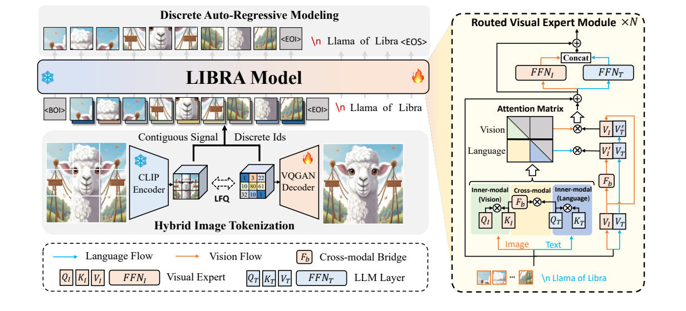
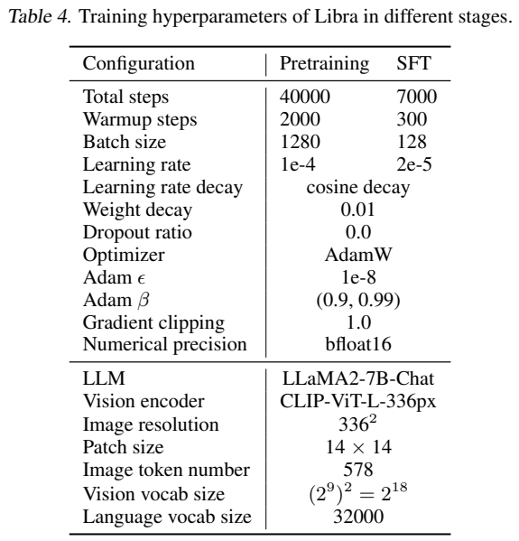
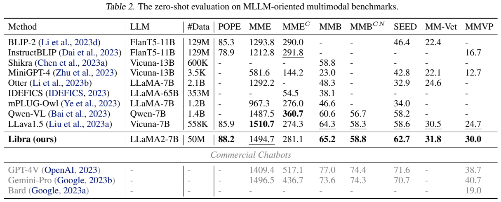
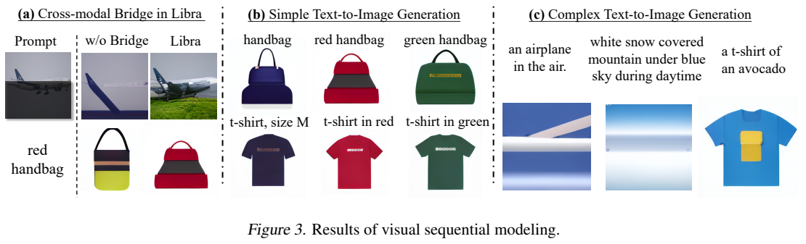
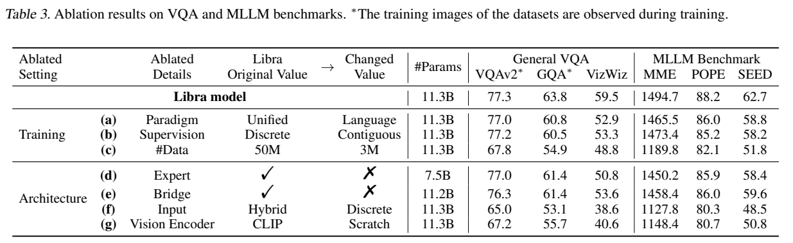
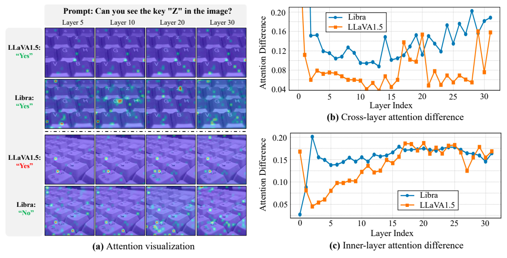

<!-- article-header:start -->
[项目首页](../../../README.md) › [模型系列](../../../reports/model-family-index.md) › [Libra](../README.md)
<!-- article-header:end -->

# Libra：在语言模型上构建解耦的视觉系统

<!-- article-toc:start -->
<a id="article-toc"></a>

**本篇目录** · [论文定位](#paper-info) · [快速概览](#overview) · [整体架构](#architecture) · [核心原理](#principles) · [数据构建](#data) · [训练流程](#training) · [实验结果](#experiments)
<!-- article-toc:end -->

<a id="paper-info"></a>

## 1. 论文信息与模型定位

**Libra: Building Decoupled Vision System on Large Language Models** 由 Yifan Xu、Xiaoshan Yang、Yaguang Song、Changsheng Xu 提出，作者来自中科院自动化所等机构。本介绍依据 [arXiv 2405.10140v1](https://arxiv.org/pdf/2405.10140v1)（2024-05-16，18 页；论文标注 ICML 2024）。[官方代码](https://github.com/YifanXu74/Libra)提供项目实现。它是探索视觉系统设计的研究原型，以 LLaMA2-7B-Chat 为语言基础，总参数 11.3B，其中视觉专家 4B、CLIP 编码器约 0.3B（§4.1，PDF 第6页）。因此“7B语言底座”不能等同于整个模型只有7B，也不是仅训练几百万参数的适配器方案。

论文关注一个具体矛盾：当所有视觉学习都服务于冻结语言模型的回答需求时，视觉特征容易失去独立建模能力。Libra 为视觉与语言提供分别处理的参数，并为两者交流单独设置桥接，再通过图像 token 预测给视觉系统额外监督。它主要面向单图理解，图像生成只是验证视觉分布学习的实验。

<a id="overview"></a>

## 2. 快速概览

| 项目 | 原文披露 |
|---|---|
| 视觉输入 | 冻结 CLIP-ViT-L-336px；14×14 patch；图像序列578 token |
| 混合表征 | 连续 CLIP 特征与离散视觉词嵌入按通道拼接 |
| 解耦结构 | 每个语言层附加视觉 Q/K/V、FFN；跨模态 K/V 用独立低秩桥接 |
| 预训练 | 50M 图文对；图像和文本均做离散自回归预测；冻结语言底座 |
| 指令微调 | 665K LLaVA 指令数据，答案部分计损失；解冻语言模型 |
| 主要证据 | VizWiz 59.5，POPE F1 88.2，MMVP 30.0；有逐项组件消融 |

核心不是简单多加一个专家，而是让“图像自己怎样组织”与“语言怎样读图”使用不同变换。代价是额外4B参数和大量图文预训练；论文也承认新注意力形式当时缺少 FlashAttention 等加速框架的直接支持（附录D.2）。

<a id="architecture"></a>

## 3. 整体架构



**读图：** 左下方先由 CLIP 产生连续特征，再由 LFQ 量化器得到离散编号，编号查独立视觉词嵌入表。连续与离散向量合并成为同一位置的图像输入，并非把序列长度翻倍。右侧每层中橙色路径处理视觉、蓝色路径处理语言；对角注意力块对应模态内部，非对角块的 K/V 才经过桥接。图上雪花与火焰表示预训练冻结与训练组件。

视觉专家的 Q/K/V 与 FFN 独立于原始语言层，按 token 所属模态路由，不是根据语义竞争 top-k 专家的 MoE。视觉投影分解为内维度 D/4 的两个矩阵以减少新增参数；桥接另采用秩8。输入用图像起止标记包围视觉序列，再用换行分隔文本。图像 tokenizer 的视觉词表概念上是 $`2^{18}`$，实际拆成两个各 $`2^9`$ 的码本并使用两个预测头，合计约4M预测头参数，避免直接建立巨大分类头（附录A.1）。

图像 tokenizer 可以通过 VQGAN 解码器把离散序列重建为图像。但理解模式仍保留连续 CLIP 特征；生成时把连续分量置零，依赖离散 token 与解码器。这两个模式的输入条件不同。

<a id="principles"></a>

## 4. 核心创新与数学原理

第一，跨模态桥接只改变交流所用的键和值。以视觉到文本为例，原文式(3)与(5)可以写成：

```math
K'_I=K_I+X_I W_I^{K'},\qquad V'_I=V_I+X_I W_I^{V'}.
```

文本查询使用 $`Q_TK_I'^\top`$ 和 $`V'_I`$ 读取视觉信息；视觉内部使用原始 $`Q_IK_I^\top`$ 与 $`V_I`$。桥接 $`W=AB`$ 的中间维度为8，使更新是受限残差，而不是任意重写原始视觉特征。语言内部也保持自己的 Q/K/V。所有注意力依然受因果 mask 约束：预训练图像在文本之前，因此图像查询未来文本的方向被屏蔽，不能把图示的四块注意力都理解成在预训练中双向生效。

第二，连续信息用于输入，离散编号用于预测。设 $`E_c=\Phi(I)`$，两个 LFQ 编号为 $`z_1,z_2`$，原文式(9)的组织是：

```math
E_d=\mathrm{concat}(E_1(z_1),E_2(z_2)),\qquad
X_I=\mathrm{concat}(E_c,E_d).
```

这里 concat 都沿通道执行。连续特征保护细节和已有 CLIP 知识；离散分类让模型学习下一图像位置的分布。LFQ 不要求传统可学习码本向量去模拟高语义 CLIP 特征，作者用重建案例说明这有助于减少失真，未给出覆盖全部图像分布的重建质量定量保证。

第三，统一自回归目标为 $`p(X)=\prod_\ell p(X_\ell\mid X_{\lt \ell})`$。预训练交叉熵同时作用于离散图像编号与文本，区别于只预测回答文字，也区别于连续下一位置 CLIP 特征回归。图像监督不能被描述成对原始像素做均方误差。

<a id="data"></a>

## 5. 数据构建与处理

图像 tokenizer 先使用 SA-1B 来源的10M图像训练（§3.2）。Libra 多模态预训练再从 COYO-700M 与 CC12M 随机取50M图文对，额外使用 COCO 训练集500K图文对规范描述输出；指令阶段采用 LLaVA 的665K监督数据（§3.3，PDF第5–6页）。这几种数字分别指 tokenizer、理解预训练、描述规范化和 SFT，不能相加后称为一个去重的数据集规模。

图像分辨率336×336，图文排成图像先、文本后的序列。视觉离散词表两个512项组合为262144种编号组合；语言词表32000。原文没有披露50M抽样两库的具体比例、完整去重阈值、全部质量过滤 recipe 或混合序列长度，不能据此推断。数据相关的任务重叠也会影响实验解读：表1的星号明确表示训练时见过该数据集的训练图像，并非全部结果都是从未接触相关图像的零样本泛化。

<a id="training"></a>

## 6. 训练流程与目标



**读表：** 左列预训练40K步、batch1280、学习率1e-4、warmup2000步；右列SFT7000步、batch128、学习率2e-5、warmup300步。两阶段采用AdamW、余弦衰减、weight decay0.01、β=(0.9,0.99)、epsilon1e-8、gradient clipping1.0和bfloat16。训练资源分别8400与380个A100-40G GPU小时，属于总设备时间，不是单次墙钟用时。

预训练冻结原语言模型，学习新增视觉专家及相关视觉建模组件；图像 tokenizer 的 CLIP 编码器按§3.2冻结。SFT原文称训练整个模型，并明确解冻LLM；不能套用“两个阶段一直冻结LLM”的通用适配器叙述。SFT组织系统提示、用户图像及问题、助手答案，只对答案计自回归损失，避免要求模型重新生成用户输入。

图像生成实验另取预训练数据中的10M文本—图像对继续训练，共7B token，取消连续输入分量（§4.3）。这一额外阶段不能算作主理解模型共同的训练配置，也不能把生成样例当作50M理解预训练后直接获得的成熟文生图能力。

<a id="experiments"></a>

## 7. 实验设置与主要结果

评测统一使用greedy search。表1用VQA score、GQA EM、ScienceQA图像子集准确率，以及NoCaps/Flickr/COCO CIDEr；表2的MME感知与认知分开计分，POPE报告F1，MMBench采用循环评测，SEED包含图像与视频题（附录B.1，PDF第16页）。主模型是11.3B，不同基线的训练数据、模型规模和任务微调并未严格统一。

| 指标 | Libra | 同表参考 | 含义 |
|---|---:|---:|---|
| VQAv2 test-dev | 77.3* | LLaVA1.5 80.0* | Libra并非所有任务更好 |
| GQA test-balanced | 63.8* | LLaVA1.5 63.3* | 小幅提升，训练图像可见 |
| VizWiz test-dev | 59.5 | Qwen-VL 38.9；LLaVA1.5 53.6 | 分别提高20.6和5.9个百分点 |
| NoCaps val CIDEr | 123.8 | BLIP-2 121.6 | 不同训练条件下的描述泛化参考 |
| POPE F1 | 88.2 | LLaVA1.5 85.9 | 对象存在问答提升 |
| MME感知 / 认知 | 1494.7 / 281.1 | LLaVA1.5 1510.7 / 274.3 | 感知更低，认知略高 |
| MMBench / 中文 | 65.2 / 58.8 | LLaVA1.5 64.3 / 58.3 | 均小幅提升 |
| SEED / MM-Vet / MMVP | 62.7 / 31.8 / 30.0 | LLaVA1.5 58.6 / 30.5 / 24.7 | 不同评价口径不能平均替代总成绩 |





**读图表：** 表2的Libra行与商用模型分隔；它的MMBench65.2低于GPT-4V77.0与Gemini-Pro73.6。Figure3左侧说明去掉桥接后生成和补全变差，中间展示基础颜色、形状概念，右侧复杂提示则出现失败。原文明确这不是追求生成SOTA，且没有用标准文生图大规模基准证明质量。





表3给出了真实组件证据：只监督文本时VizWiz从59.5降至52.9；用连续视觉预测替代离散监督为53.3；删除视觉专家为50.8，删除桥接为53.6；输入只保留离散分量为38.6。预训练数据缩到3M则VQAv2降至67.8、MME1189.8。因此结果支持数据规模、连续输入、离散监督与桥接共同起作用，不能把收益全部归给单一模块。

Figure4基于100个VQA样本显示Libra有更丰富的跨层注意力差异；这是一种表示分析，尚不足以单独证明“注意力多样性必然造成更强泛化”。Libra的研究价值在于提供可检验的解耦视觉设计，而不是证明它全面超过更大模型：主表中COCO CIDEr135.2仍低于BLIP-2的144.5，MME感知也未超过LLaVA1.5。长序列、生成复杂度及工程加速仍是原文指出的限制。

<!-- article-footer:start -->
---

[← 上一篇：Chameleon](../../chameleon/arxiv-2405.09818/README.md) · [按发表时间浏览](../../../reports/paper-reading-guide.md#year-2024) · [下一篇：ConvLLaVA →](../../convllava/arxiv-2405.15738/README.md)

[返回本篇目录](#article-toc) · [返回模型系列](../README.md)
<!-- article-footer:end -->
