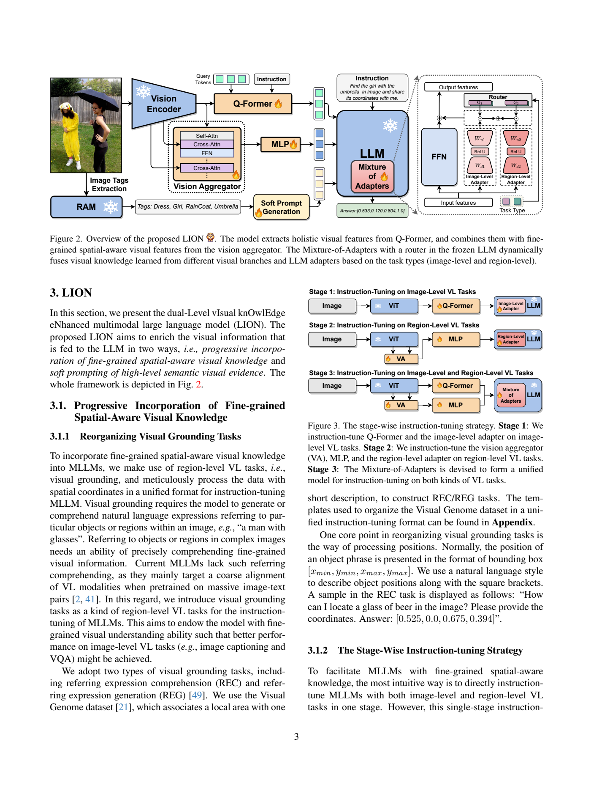
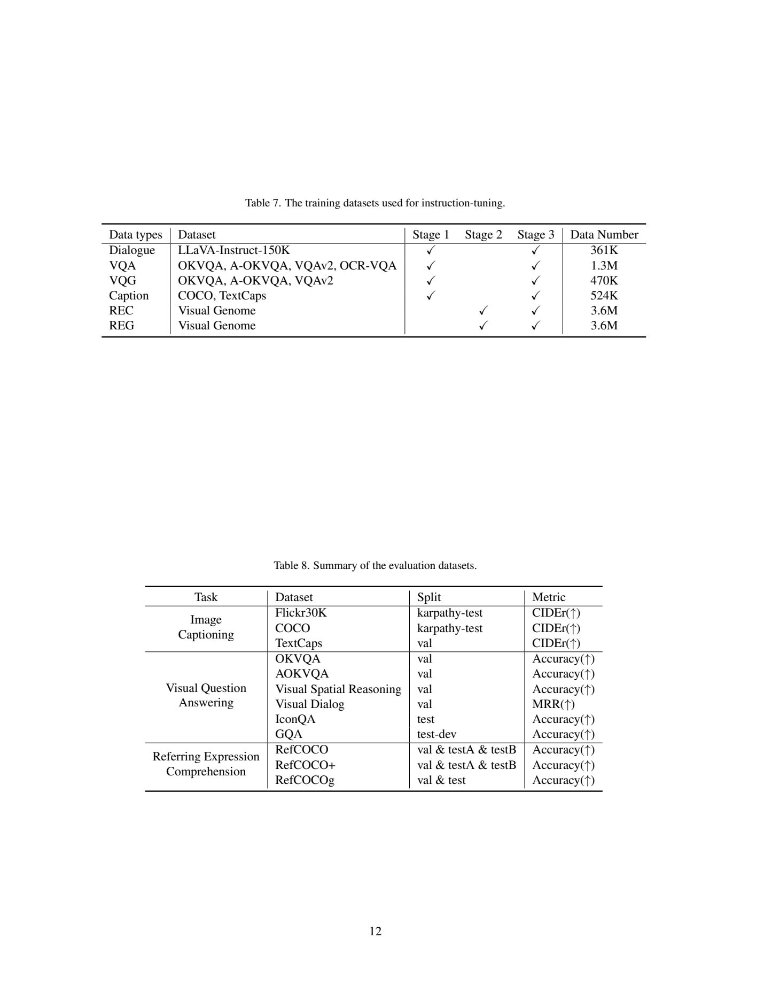
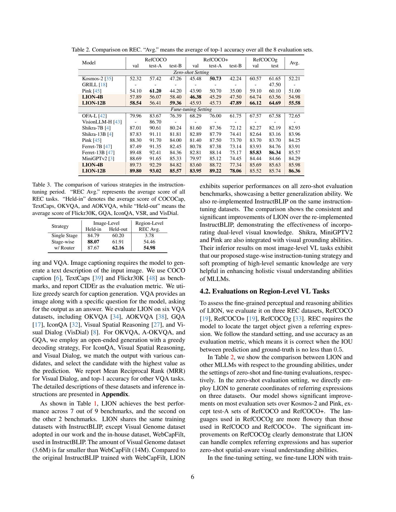
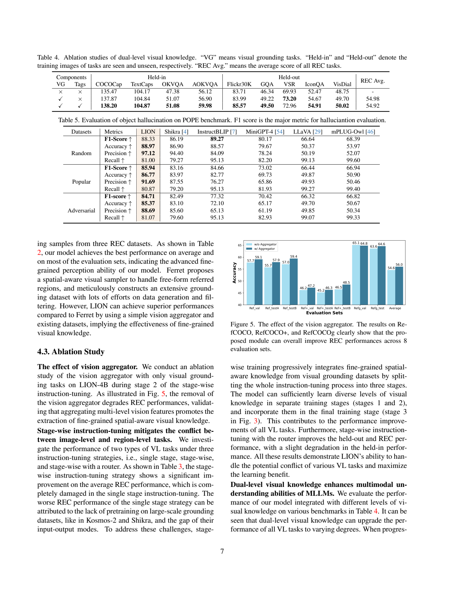

[返回模型家族](../README.md) · [返回仓库](../../../README.md)

# LION：用区域训练与图像标签补足双层视觉知识

## 1. 论文信息与模型定位

| 项目 | 内容 |
|---|---|
| 题名 | LION: Empowering Multimodal Large Language Model with Dual-Level Visual Knowledge |
| 作者 / 机构 | Gongwei Chen、Leyang Shen、Rui Shao、Xiang Deng、Liqiang Nie；哈尔滨工业大学（深圳） |
| 采用版本 | arXiv:2311.11860v1，2023-11-20；12 页，附录 A 给出架构、训练与数据细节 |
| 原文 / 官方仓库 | [固定版本 PDF](https://arxiv.org/pdf/2311.11860v1) · [JiuTian](https://github.com/rshaojimmy/JiuTian) |
| 模型规模 | LION-4B 使用 FlanT5-XL 3B，LION-12B 使用 FlanT5-XXL 11B，配合 EVA-CLIP ViT-G/14；4B/12B 为系统档位，未逐项报告精确总参数 |
| 输入 / 输出 | 图像与文字指令 → 描述、问答、区域坐标；区域表达任务也学习框到文字的方向 |
| 研究定位 | 以预训练视觉与语言组件为基础进行指令调优，增强整图理解、区域定位及抗对象幻觉能力 |

LION 的“双层”是细粒度空间知识和高层语义标签，不能理解为只有两层网络。其语言骨干是编码器—解码器式 FlanT5，而非 LLaMA。方法把整图任务和区域任务先分别学习再融合，另外调用冻结的 RAM 图像标签模型提供对象、场景、动作、属性提示。

## 2. 快速概览

整图图文预训练擅长表达整体场景，却未必让模型掌握某个对象的精确位置。直接混合区域坐标任务与描述问答任务，在作者的有限训练配置中又会造成明显冲突。LION 因此设置两条视觉接入路径和两套语言适配器，先分别训练，再用任务类型对应的路由向量融合它们。

原有 Q-Former 分支负责整图信息，新 vision aggregator 从视觉编码器的不同深度汇集局部和高级特征，经 MLP 接入语言模型。区域训练使用 Visual Genome 的框与短描述，组织为指代表达理解 REC 和表达生成 REG。第三阶段同时使用两类任务，冻结的大骨干继续保留原知识，任务相关的小模块负责适配。

另一条补充路径用 RAM 输出图像标签，并把一个可学习 soft prompt 放入“允许使用部分标签”的指令里，减少错误标签被无条件采纳的风险。这是条件提示与参数学习，不是已定义的逐标签置信度筛选算法。

LION-12B 报告 VSR 73.77、TextCaps CIDEr 108.76、RefCOCOg 零样本 val 66.12、MMBench test 73.4。消融显示分阶段训练明显改善 REC，标签对部分整图任务有效，但也有轻微退步；POPE 的 random F1 并非优于所有对比模型。[Sections 3–4](https://arxiv.org/pdf/2311.11860v1)

## 3. 整体架构

> 来源：原文 Figures 2–3，2311.11860v1，PDF 第 3 页；完整图注、模块和训练阶段均保留。

**读图**：冻结 ViT 的输出走两条路径。Q-Former 用 query 和指令抽取整体视觉信息；vision aggregator 整合不同深度的视觉特征，MLP 将其映射到语言空间，两条视觉输出与文本拼接。下方 RAM 独立产生标签，配合软提示成为额外文字条件。右侧每个前馈层保留原 FFN，增加整图与区域 adapter，并根据任务类型使用不同调制向量。

| 组件 | 实际设置 | 用途 |
|---|---|---|
| 视觉骨干 | EVA-CLIP ViT-G/14，去掉最后一层，冻结 | 同时提供整体特征和中间层特征 |
| Q-Former | 沿用 InstructBLIP 式指令条件视觉桥接 | 整图 caption/VQA 接入 |
| Vision aggregator | 两个带 cross-attention 的 BERT layer | 汇聚多层视觉信息，服务细粒度区域理解 |
| 区域 MLP | 两层，GeLU | 将 aggregator 输出变为语言隐空间向量 |
| FlanT5 与 adapters | 原语言骨干冻结，adapter 瓶颈维度 64 | 在 FFN 旁增加可训练任务分支 |
| RAM 与软提示 | 冻结现成标签器，学习提示向量 | 把对象、场景等离散语义证据加入条件 |

附录没有给出输入分辨率、各路径 token 数和完整张量尺寸，不能用其他 InstructBLIP 配置补成此文事实。RAM 标签只提供额外证据，输出正确与否仍需语言模型综合视觉输入判断，本文不保证标签无噪声。[Section 3、Appendix A](https://arxiv.org/pdf/2311.11860v1)

## 4. 核心创新与数学原理

**分开学习，再按任务融合。** 原文 Equations (1)–(2) 的 adapter 为：

\[
O=F(X)+H(X),\qquad H(X)=W_u\operatorname{ReLU}(W_dX).
\]

这里 \(F\) 是原前馈层，\(H\) 先降维到瓶颈 64，再升维。矩阵乘法方向按原文记法表示线性映射；它是具有非线性激活的瓶颈 adapter，不能直接当成 LoRA 的低秩线性权重更新。

第三阶段将两种 adapter 作为分支，Equation (3) 为：

\[
O_t=F(X)+\sum_{k=1}^{K}G_k^t\odot H_k(X),\qquad G_k^t\in\mathbb R^D.
\]

\(t\) 是整图或区域任务类型，\(G_k^t\) 对每个隐藏维度调制分支输出，并在 token 维广播。这是按任务定义的可训练向量，不是文本内容驱动的 top-k 稀疏 MoE router，也没有披露 softmax 归一化、路由负载均衡损失或只激活一个专家。两个阶段学到的适配器因此可以在第三阶段联合使用，同时降低坐标格式与自然语言格式的直接干扰。

**多层视觉聚合。** Equations (4)–(5) 写成：

\[
\bar V=B_2(B_1(V_i;V_j);V_k),\quad
B(X;Y)=\operatorname{FFN}(\operatorname{XAttn}(\operatorname{Attn}(X),Y)).
\]

特征取自视觉层索引 \(i=L-1,j=2L/3,k=L/3\)。先把前两组特征聚合，再结合第三组；高层语义与较低层细节共同提供区域定位依据。新模块并不显式裁剪框内像素，也没有给出自由形状区域采样器；其空间能力主要由坐标任务监督塑造，而不是区域特征提取本身已具备准确定位保证。

**带可学习提示的标签条件。** 标签被放入专门文字模板，模板中的 hint 被可学习向量替代。训练目标指导模型有选择地使用标签，机制没有单独的逐标签正确性监督或明示过滤概率。这降低无条件相信标签的风险，却不能保证消除标签幻觉。由于标签仍需 RAM 推理，论文所说避免额外“特征对齐”开销也不等同于完全零额外计算。[Section 3.2](https://arxiv.org/pdf/2311.11860v1)

## 5. 数据构建与处理

> 来源：原文 Tables 7–8，PDF 第 12 页；保留全部数据行、阶段勾选、划分与指标列。

**读表**：整图任务在阶段 1 和 3 使用，区域 REC/REG 在阶段 2 和 3 使用。表中数据数目是任务样本口径；REC 与 REG 可以来源于相同框描述，不能把两行相加当作独立图像数。

| 任务 | 来源 | Table 7 样本数 |
|---|---|---:|
| Dialogue | LLaVA-Instruct-150K | 361K |
| VQA | OKVQA、A-OKVQA、VQAv2、OCR-VQA | 1.3M |
| VQG | OKVQA、A-OKVQA、VQAv2 | 470K |
| Caption | COCO、TextCaps | 524K |
| REC | Visual Genome，表达 → 区域框 | 3.6M |
| REG | Visual Genome，区域框 → 表达 | 3.6M |

区域位置用方括号中的四个数表示 xmin、ymin、xmax、ymax；示例为 0–1 坐标。正文指向附录的任务模板，但本 v1 的实际附录主要列出架构、训练和数据表，没有完整提供逐条模板、坐标处理与无效框清洗实现。LLaVA-Instruct-150K 一行记为 361K，也未充分解释多轮展开计数，应保留原表口径而不改成 150K。

作者比较公开配置与带 WebCapFilt 的原 InstructBLIP，并另行复现不含私有数据的 InstructBLIP。Visual Genome 在正文以 3.6M 描述，而 Table 7 按 REC/REG 分别记数；WebCapFilt 为 14M，不能据这些行直接断言 LION 所有训练总样本更少或两个系统的预训练完全一致。数据全面去重、标签生成阈值、RAM 错标签人工复核及每类混合比例未披露。[Sections 3.1、4.1、Appendix A](https://arxiv.org/pdf/2311.11860v1)

## 6. 训练流程与目标

| 阶段 | 更新模块与目的 | batch / 训练长度 | 学习率 |
|---|---|---|---|
| 1 整图任务 | Q-Former、整图 adapter；学习描述与问答 | 64；10 epochs；30K steps | 1e-5 → 0 |
| 2 区域任务 | Vision aggregator、MLP、区域 adapter；学习坐标与指代表达 | 256；10 epochs；60K steps | 一般模块 5e-4 → 1e-6；aggregator 固定 1e-5 |
| 3 混合任务 | 两条视觉接入路径及 mixture-of-adapters/router 联合适配；ViT 和原语言权重保持冻结 | 64；10 epochs；60K steps | 1e-5 → 0 |

全阶段使用 AdamW，beta1=0.9、beta2=0.999、weight decay=0.05；每阶段前 1,000 steps 从 1e-8 线性 warmup。这里照录附录同时给出的 epoch 与 step 口径；按 Table 7 总量直接做 batch×step 运算不能复原全部数据轮次，正文没有交代采样权重和 epoch 计算方式，不应据此推算实际每个样本恰好出现十次。阶段 3 具体 soft prompt 开始学习的时点与所有模块 optimizer group 未完整说明。

所有阶段采用标准语言建模损失。对于 FlanT5，可用以下**标准解释公式**表示条件回答监督，原文没有给出编号损失式：

\[
\mathcal L=-\sum_t\log P_\theta(y_t\mid V,Q,\text{tags},y_{<t}).
\]

输入图像特征、指令及标签经编码条件影响解码器回答；区域框也作为文字 token 目标，并不是另设一个框回归头和 L1/IoU 损失。没有 RLHF、DPO、检测器训练或 RAM 联合训练阶段。序列长度、显存、GPU 数量、耗时与任务微调的完整优化配置未披露。[Section 3.1、Appendix A](https://arxiv.org/pdf/2311.11860v1)

## 7. 实验设置与主要结果

Caption 用 CIDEr，VisDial 用 MRR，其余图文问答用 top-1 accuracy。caption 和开放问答采用 greedy decoding；IconQA、VSR 和 VisDial 对候选答案评分选择。Table 8 给出 COCO/Flickr 的 Karpathy test，TextCaps/OKVQA/AOKVQA/VSR/VisDial 的 val，IconQA test、GQA test-dev。训练涉及的任务与 held-out 任务应区分，表中多个指标平均值也不能视作统一的准确率。

| 基准 | LION-12B | 公开配置 InstructBLIP T5XXL | 变化 |
|---|---:|---:|---|
| COCO CIDEr | 139.25 | 138.63 | +0.62 分 |
| TextCaps CIDEr | 108.76 | 105.44 | +3.32 分，非 3.32 个准确率百分点 |
| OKVQA Acc | 57.33 | 53.02 | +4.31 个百分点；同表 Pink 59.50 更高 |
| AOKVQA Acc | 60.87 | 59.38 | +1.49 个百分点 |
| GQA Acc | 51.56 | 47.74 | +3.82 个百分点；同表 MiniGPTV2 60.30 更高 |
| VSR Acc | 73.77 | 68.46 | +5.31 个百分点 |
| VisDial MRR | 50.42 | 50.41 | +0.01 分，改善有限 |

据原文 Table 1 整理。带星号结果为作者用公开 checkpoint 重测，原评测配置不完整，只供参考；dagger 表示使用非公开内部数据。不能省略这些脚注后把差值写成等条件优势。Table 6 报告 MMBench test 73.4，超过同表 mPLUG-Owl2 的 66.0，但比较模型的语言与视觉骨干不同。

> 来源：原文 Tables 2–3，PDF 第 6 页；完整零样本、额外任务微调分组及八个划分保留。

**读表**：REC 成功标准是预测框与真实框 IoU≥0.5。LION-12B 零样本八划分均值 55.58，对比 Kosmos-2 52.21；RefCOCOg val 66.12 对 60.57，test 64.69 对 61.65。但 RefCOCO test-A 的 56.41 低于 Kosmos-2 的 57.42，RefCOCO+ test-A 的 45.73 低于 50.73。进一步用 REC 训练集微调后均值为 86.36，高于 Ferret-13B 的 85.57，但 RefCOCOg val/test 85.52/85.74 仍低于 Ferret 的 85.83/86.34。

Table 3 的单阶段 REC 平均只有 3.78，分阶段为 54.46，加 router 为 54.98。这支持先学习区域任务的作用；router 同时把 held-out 均值从 61.91 提到 62.16，却把 held-in 从 88.07 降到 87.67，没有全面单调提升。

> 来源：原文 Tables 4–5、Figure 5，PDF 第 7 页；全表与柱状图图例、坐标、数值、图注完整可见。

**读图与表**：Table 4 在 4B 配置中，先加区域训练再加标签，AOKVQA 从 56.12→56.90→59.98，Flickr 从 83.71→83.99→85.57。标签使 VSR 73.20→72.96、REC 54.98→54.92 略降；后者与 Table 2 的 4B REC 均值 54.98 口径有差异，应按对应表保留数值。Figure 5 的 aggregator 总平均 54.6→56.0，但 RefCOCOg val 65.1→64.8，并非所有划分都改善。

POPE 检查对象是否存在，LION 在 random/popular/adversarial 的 F1 为 88.33/85.94/84.71。InstructBLIP random F1 89.27 仍更高；LION popular/adversarial 更高，但 recall 约 81%，低于 InstructBLIP 的 95.13%，体现更保守回答带来的精确率与召回权衡。因此结论应是特定协议下部分对象幻觉指标改善，不是所有幻觉被消除，也不能用 MMBench 总分直接证明事实可靠性。以上均为原文报告，本介绍未运行模型。
