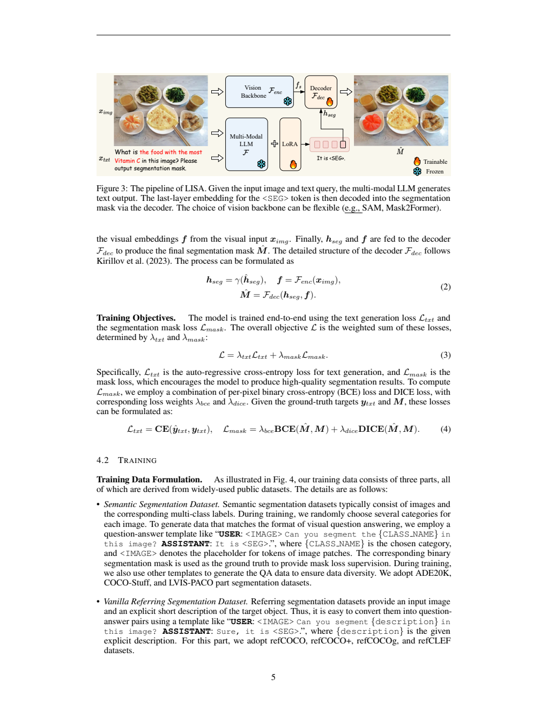
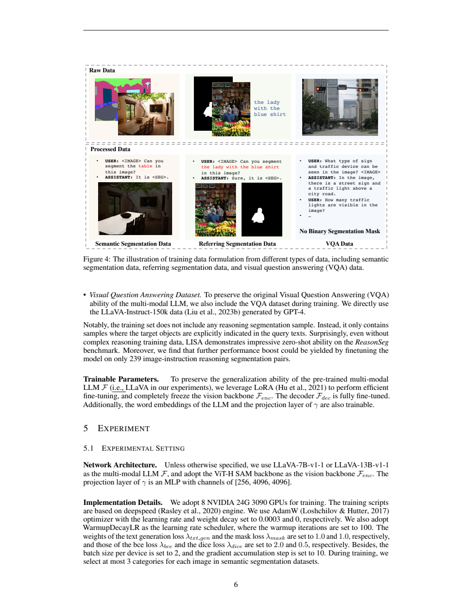
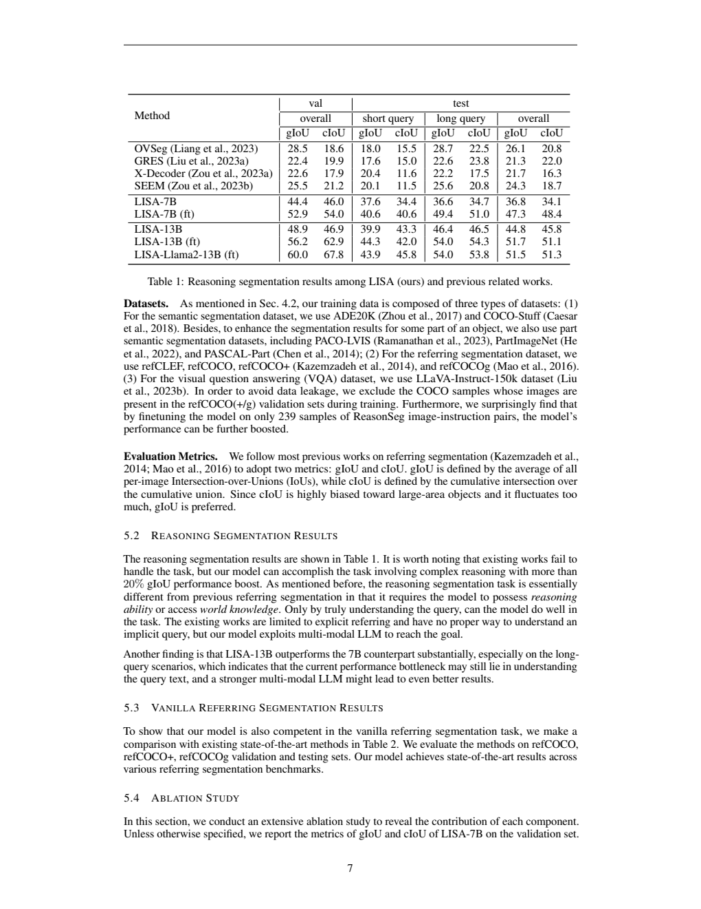
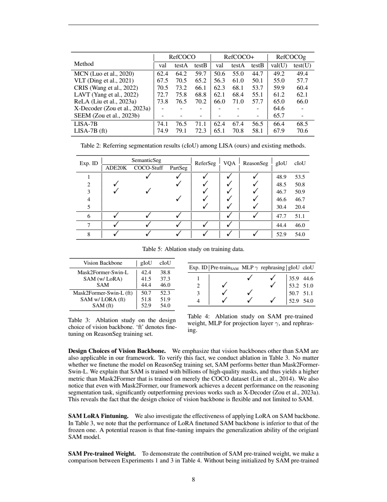

[返回 LISA 家族](../README.md) · [返回项目](../../../README.md)

# LISA：用分割token把语言推理连接到像素掩码

> 固定版本为 [arXiv:2308.00692v1](https://arxiv.org/abs/2308.00692v1)。图表来自原 PDF 页面；原文公式保留编号对应，补充解释不冒充新增实验。

## 1. 论文信息与模型定位

| 项目 | 内容 |
|---|---|
| 原题 | LISA: Reasoning Segmentation via Large Language Model |
| 机构 | 香港中文大学、思谋、微软亚洲研究院 |
| 首次提交 | 2023-08-01，本文使用 v1 |
| 研究目标 | 从隐含用户意图推理目标并输出二值掩码 |
| 多模态基础 | LLaVA-7B-v1-1 或 LLaVA-13B-v1-1 |
| 分割基础 | 默认 ViT-H SAM 图像骨干与掩码 decoder |
| 关键接口 | 新词表 token `<SEG>`，其最后层表示作为分割条件 |
| 资源 | [固定 PDF](https://arxiv.org/pdf/2308.00692v1) · [官方代码与模型](https://github.com/dvlab-research/LISA) |

LISA 同时继承多模态语言模型的文字生成与像素输出能力。它是分割助手，不是单纯把框坐标写成文本的定位模型，也不是独立的机器人控制器。任务中的“推理”指查询可能不直接说出对象名称，例如要求找到“用于调整电视频道的东西”；模型需结合视觉和常识确定遥控器，再分出其像素区域。[原文 §1、§3](https://arxiv.org/pdf/2308.00692v1#page=2)

## 2. 快速概览

常规指代分割给“穿蓝色衣服的人”这样的显式描述；LISA 提出的 reasoning segmentation 接收“能让幼儿安全玩耍的区域”之类隐式问题。困难分为两步：理解用户意图，确定画面中的目标；把该目标表达为精细掩码。仅有强分割器不一定能理解常识查询，仅有语言模型也不天然会输出逐像素结构。

LISA 将这两类能力通过 `<SEG>` 连接。语言模型输出回答时生成该 token，隐藏状态压缩了当前图像、问题和回答上下文，经 MLP 变为掩码 decoder 的条件。分割图像骨干同时提取细粒度特征，decoder 把语义条件与空间特征结合，输出掩码。这种 embedding-as-mask 不需要把轮廓多边形变成很长的文字序列。

论文使用常规语义分割、显式指代分割和 VQA 数据训练，已经能在新建 ReasonSeg 基准上做未见过任务形式的迁移；再加入仅 239 条推理分割训练例，性能进一步提升。因此要把不含 ReasonSeg 训练的 LISA 与标为 `(ft)` 的版本分开读：后者已经接触推理任务，不再属于同样的零样本条件。

效果也有边界。该方法通过既有语言、视觉与分割预训练能力产生掩码，并未证明所有自然语言问题都存在唯一目标或所有回答理由正确。ReasonSeg 只有 1,218 对样本，报告显示验证集和测试集分数差异，评测结论须保留切分和任务范围。[原文 §3–5](https://arxiv.org/pdf/2308.00692v1#page=7)

## 3. 整体架构

*来源：原文 Figure 3 和公式 (2)–(4)，PDF 第 5 页；[原页](https://arxiv.org/pdf/2308.00692v1#page=5)。火焰为训练组件，雪花为冻结组件。*

Figure 3 中图像有两条路径。上方 Vision Backbone 提取适合掩码解码的图像特征；下方 Multimodal LLM 同时读图和问题，输出文字，其中 `<SEG>` 位置的最后层 embedding 经投影进入上方 decoder。右侧红色区域是预测像素掩码。不能把上方分割骨干与下方 LLaVA 内部的视觉编码合并成同一个模块，也不能把 LoRA 理解为冻结模型完全不变——它仍通过附加参数改变输出。

原文公式 (1)、(2) 将过程写为：

$$\widehat y_{\mathrm{txt}}=F(x_{\mathrm{img}},x_{\mathrm{txt}}),$$
$$h_{\mathrm{seg}}=\gamma(\widehat h_{\mathrm{seg}}),\qquad f=F_{\mathrm{enc}}(x_{\mathrm{img}}),\qquad \widehat M=F_{\mathrm{dec}}(h_{\mathrm{seg}},f).$$

$F$ 是多模态语言模型，$\widehat h_{\mathrm{seg}}$ 是生成 `<SEG>` 时的隐藏表示，$\gamma$ 是投影 MLP，$f$ 是像素解码所用图像特征，$F_{\mathrm{dec}}$ 是分割 decoder，$\widehat M$ 是预测二值掩码。文字输出是离散 token，但隐藏表示是连续特征，这个连续桥梁使分割监督能够训练相关语言适配与投影模块。

默认模型用 SAM ViT-H 骨干，掩码 decoder 遵循 SAM 结构。报告指出可以替换 Mask2Former 等骨干，并给出实际对照，因此框架的语义条件接口不依赖唯一一种视觉 backbone。这里的“可替换”并不意味着任意分割器不用重新适配就具有同等结果。[原文 §4.1、§5.1、Table 3](https://arxiv.org/pdf/2308.00692v1#page=8)

## 4. 核心创新与数学原理

第一项创新是**以隐藏表示承载掩码语义**。对自然语言模型，输出一张高分辨率像素图通常需要大量符号；用一个 `<SEG>` 位置的 embedding，语言端只需指出何时要分割，空间细节由已有视觉特征和掩码 decoder 决定。它不是“一枚 token 无损存储整张掩码”，而是“一个语义条件与图像特征共同确定掩码”，因此图像骨干依然重要。

第二项是**文本与像素联合监督**。原文公式 (3)、(4) 明确为：

$$\mathcal L=\lambda_{\mathrm{txt}}\mathcal L_{\mathrm{txt}}+\lambda_{\mathrm{mask}}\mathcal L_{\mathrm{mask}},$$
$$\mathcal L_{\mathrm{txt}}=\operatorname{CE}(\widehat y_{\mathrm{txt}},y_{\mathrm{txt}}),\quad
\mathcal L_{\mathrm{mask}}=\lambda_{\mathrm{bce}}\operatorname{BCE}(\widehat M,M)+\lambda_{\mathrm{dice}}\operatorname{DICE}(\widehat M,M).$$

文字交叉熵教模型何时输出 `<SEG>`，以及怎样回答用户；BCE 监督各像素前景/背景判断，DICE 关注预测区域与真实区域的重叠。它们作用互补：背景面积很大时，单纯逐像素正确可能不足以保证小目标被分完整。常见 soft Dice 的阅读辅助式是：

$$\operatorname{DiceLoss}=1-\frac{2\sum_p\widehat M_p M_p+\epsilon}{\sum_p\widehat M_p+\sum_pM_p+\epsilon}.$$

$p$ 为像素，$\epsilon$ 防止分母为零。原文没有在编号式中展开 Dice 的平滑实现，这里只是解释重叠损失含义，不能从上式推断官方所有阈值、归约和数值稳定实现。

第三项是**推理能力与显式分割监督的组合迁移**。训练题“分出桌子”给精确掩码，已有多模态语言模型提供常识和复杂指令理解；推理查询将两者组合成新的任务形式。论文把不使用 ReasonSeg 训练例的结果称为零样本推理分割，但模型并非完全没接受分割训练。它已经大量学习如何输出掩码，仅对隐式问题这一特定监督形式没有直接训练。

LoRA 在大部分语言权重保持固定的基础上加入低秩增量，可用标准解释 $W'=W+BA$。$A,B$ 可训练，秩小于完整矩阵维度，减少更新参数。论文没有在正文指定完整的秩、缩放系数和所有注入层，本文不擅自给出。它的主要价值是在既有 LLaVA 能力上添加分割，而不将语言模型全部从头重训。[原文 §4.2、第 6 页](https://arxiv.org/pdf/2308.00692v1#page=6)

## 5. 数据构建与处理

*来源：原文 Figure 4，PDF 第 6 页；[原页](https://arxiv.org/pdf/2308.00692v1#page=6)。左、中两列有二值掩码，右列 VQA 没有 mask，这决定其监督目标不同。*

语义分割资料的多类像素标签可以按选定类别提取二值掩码，并生成“分出图中的某类对象”的指令；每张图训练时最多选三类。来源包括 ADE20K、COCO-Stuff，以及 PACO-LVIS、PartImageNet、PASCAL-Part 等部件分割，后者使模型接触物体局部而不只是完整实例。

指代分割使用 refCOCO、refCOCO+、refCOCOg、refCLEF，以原来的描述生成问答模板，目标掩码提供像素损失。VQA 使用 GPT-4 合成的 LLaVA-Instruct-150k，保持一般图像对话能力；此类问答只提供文字监督，不能把所有 150k 样本误写为额外 mask 标注。

ReasonSeg 从 OpenImages 与 ScanNetv2 图像构建复杂隐含指令及高质量目标 mask，包括短查询和长句。共 1,218 对，训练/验证/测试分别是 239/200/779。它主要为评测而建，因此大部分样本放在验证与测试。对于 `(ft)`，作者用 GPT-3.5 重述训练指令，并随机选择一种表述进行训练；这是语言增强，不能据此称新增了同样数量独立图像或新掩码。[原文 §3.2、§4.2、§5.4](https://arxiv.org/pdf/2308.00692v1#page=4)

作者明确排除在 refCOCO(+/g) 验证集出现的 COCO 图像，减少训练评测泄漏。该做法有明确范围，不能升级为已完成所有基础模型预训练数据的全面去重。论文没有完整报告各训练来源最终混合比例、数据累计 token 或每类 mask 数量，本文保留其来源和已披露分割。

数据设计最关键的区别是：显式描述直接点出目标，ReasonSeg 的问题要求先推理目标类别或用途。将两者统一到“对话中产生 `<SEG>`”的输出格式后，可以用普通分割数据训练接口，再检测复杂意图理解是否迁移。这个过程不会自动解决查询含糊、多合理目标或不可回答情况，v1 也没有提供覆盖这些边界的完整单独评测。

## 6. 训练流程与目标

训练冻结分割图像骨干 $F_{\mathrm{enc}}$，对多模态 LLM 使用 LoRA；mask decoder 全量微调，语言词嵌入和投影 MLP $\gamma$ 也更新。因此“LLM 通过 LoRA”不能简化成所有语言参数均冻结，词嵌入是明确可训练例外；“冻结视觉”指所列分割骨干，不宜凭图示额外推断每个子组件的未披露设置。

| 设置 | 原文值 |
|---|---|
| 设备 | 8 张 24GB NVIDIA 3090，DeepSpeed |
| 优化器 | AdamW，学习率 0.0003，weight decay=0 |
| 日程 | WarmupDecayLR，warmup 100 次迭代 |
| batch | 每设备 2，梯度累计 10；按这些值推算一次更新约 160 样本 |
| 文字/掩码权重 | $\lambda_{\mathrm{txt}}=1,\lambda_{\mathrm{mask}}=1$ |
| mask子项权重 | $\lambda_{\mathrm{bce}}=2,\lambda_{\mathrm{dice}}=0.5$ |
| 训练长度 | 方法讨论称 LISA-7B 训练 10,000 步；不把它推断为所有档位所有阶段固定长度 |

有效 batch 160 是由设备、微批和累计步数乘积得到的解读，不是原文额外列出的测量。报告还给投影通道配置，但未完整展开 token embedding 到 mask prompt 的每个形状方向，复现时需使用对应代码，不能仅凭通道列表调换顺序。

主版本在常规分割与 VQA 联合资料上学习；`(ft)` 再纳入 239 条 ReasonSeg 训练例及指令改写。论文没有给出所有阶段的训练总时长、消耗电量或完整成本账单。它与其它框架的 GPU/epoch 比较只能按原文分别记录，不能将不同硬件、不同数据和任务设置直接算作公平效率比。[原文 §4.1–5.1，第 4–7 页](https://arxiv.org/pdf/2308.00692v1#page=6)

## 7. 实验设置与主要结果

*来源：原文 Table 1，PDF 第 7 页；[原页](https://arxiv.org/pdf/2308.00692v1#page=7)。左列为验证总体，右边为测试短、长查询和总体，ft代表使用239条任务样本。*

原文的 gIoU 指每张图 IoU 的平均，**不是目标检测常用的 Generalized IoU 损失**；cIoU 是累积交集除以累积并集。前者每图同权，后者大区域影响更大，作者更重视前者。可用定义概括为：

$$\mathrm{gIoU}=\frac1n\sum_i\frac{|P_i\cap G_i|}{|P_i\cup G_i|},\qquad
\mathrm{cIoU}=\frac{\sum_i|P_i\cap G_i|}{\sum_i|P_i\cup G_i|}.$$

| 模型 | val gIoU/cIoU | test总体 gIoU/cIoU |
|---|---|---|
| OVSeg | 28.5/18.6 | 26.1/20.8 |
| LISA-7B | 44.4/46.0 | 36.8/34.1 |
| LISA-7B (ft) | 52.9/54.0 | 47.3/48.4 |
| LISA-13B | 48.9/46.9 | 44.8/45.8 |
| LISA-13B (ft) | 56.2/62.9 | 51.7/51.1 |

13B 不含 ReasonSeg 训练时，测试长查询 gIoU 46.4 高于 7B 的 36.6，符合更强语言理解有帮助的解释，但这里只是系统规模对照，不是隔离全部其它因素的因果证明。7B 加 239 条样本后，test gIoU 从 36.8 到 47.3，增加 10.5 个分数点；使用任务数据后的增益必须与原先零样本结果区分。

*来源：原文 Table 2–5，PDF 第 8 页；[原页](https://arxiv.org/pdf/2308.00692v1#page=8)。勾选项用于判断只改变了哪项设置，正文解释与表格不完全一致处以表格为准。*

普通指代分割 Table 2 中，LISA-7B (ft) 的 refCOCO val/testA/testB 为 74.9/79.1/72.3，refCOCOg val(U)/test(U) 为 67.9/70.6；refCOCO+ val 为 65.1，仍低于 ReLA 的 66.0。因此不能照搬正文概括成所有切分都最好。

Table 3 中默认冻结 SAM 的 val gIoU/cIoU 为 44.4/46.0，SAM 加 LoRA 为 41.5/37.3，Mask2Former-Swin-L 为 42.4/38.8；在这组设置下，更新 SAM 并不自动改善效果。表内 `(ft)` 指 ReasonSeg 任务微调，不能误解为只有这一行才训练 decoder。Table 4 的预训练、MLP 和指令改写对照显示，不用 SAM 预训练时 35.9/44.6；采用预训练与 MLP但不改写时 50.7/51.1；加改写后 52.9/54.0，说明已有分割能力和指令多样性都有贡献。

数据 Table 5 还有一个需要审慎阅读的细节：正文把“未用语义分割”指向 Exp.4，但图中 Exp.4 仍勾选 PartSeg，完全不含三类语义资料的是 Exp.5，其 gIoU/cIoU 为 30.4/20.4。本文按表格区分，不复制原文编号冲突。实验最终支持“让语言语义条件驱动已有分割decoder可处理隐式查询”，同时仍有目标理解错误、数据规模小和任务条件差异。本文没有实际运行模型或复现训练。
