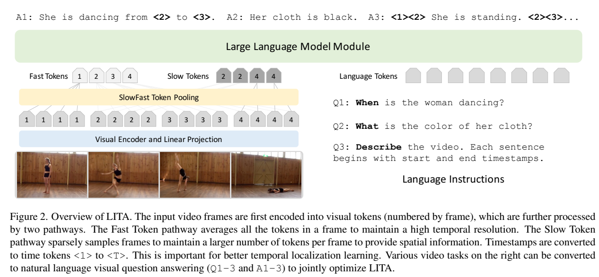
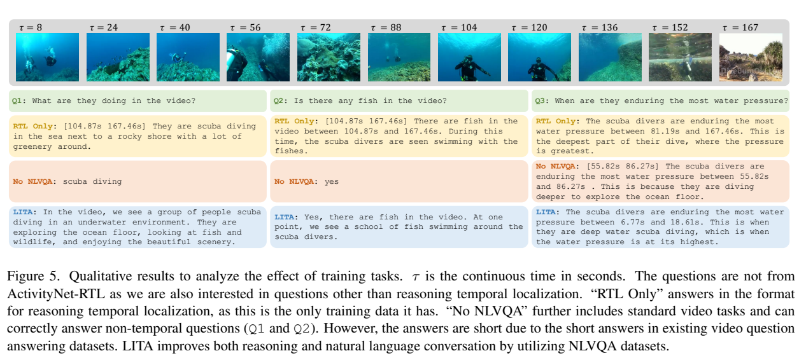
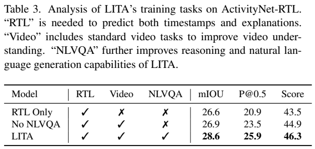
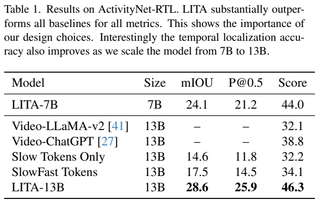
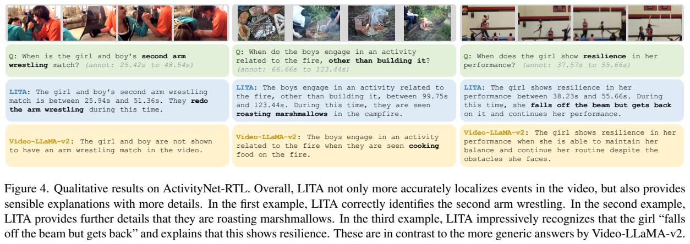
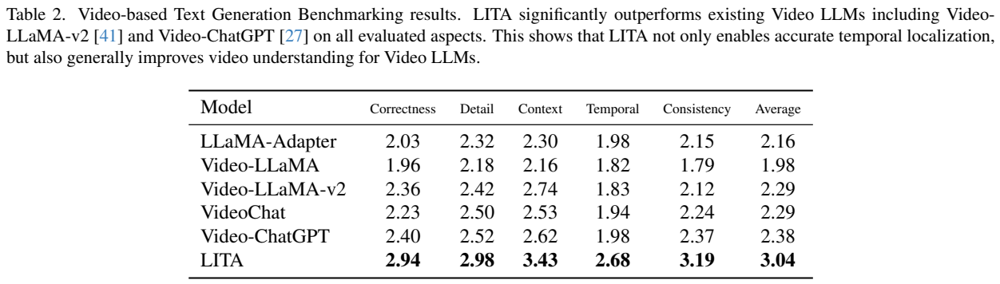

<!-- article-header:start -->
[项目首页](../../../README.md) › [模型系列](../../../reports/model-family-index.md) › [LITA](../README.md)
<!-- article-header:end -->

# LITA：能回答“何时发生”的视频语言助手

<!-- article-toc:start -->

**本篇目录** · [论文定位](#paper-info) · [快速概览](#overview) · [整体架构](#architecture) · [核心原理](#principles) · [数据构建](#data) · [训练流程](#training) · [实验结果](#experiments)
<!-- article-toc:end -->

## 1. 论文信息与模型定位

**LITA: Language Instructed Temporal-Localization Assistant** 由 NVIDIA 的 De-An Huang、Shijia Liao、Subhashree Radhakrishnan、Hongxu Yin、Pavlo Molchanov、Zhiding Yu、Jan Kautz 提出。本介绍依据 [arXiv 2403.19046v1](https://arxiv.org/pdf/2403.19046v1)（2024-03-27，10页），[官方代码](https://github.com/NVlabs/LITA)为NVlabs/LITA。

LITA 在 LLaVA 风格的图像语言模型上增加视频时间表达，使用 CLIP-L-14、线性投影和 Vicuna，实验分别有7B及13B语言模型版本。研究问题是视频助手能描述“什么发生了”，却难以可靠回答“何时发生”。它进一步提出 **Reasoning Temporal Localization（RTL）**：问题不直接命名动作，而要求先推断对应事件，再输出起止时间与解释，例如从舞蹈动作中找出最活跃的片段。这不是直接把已有事件描述配到时间段的同义任务，也不是音频驱动模型。

## 2. 快速概览

| 设计 | 本文作用 |
|---|---|
| 相对时间 token | 100个专用符号表示视频内相对位置，再用视频时长还原秒数 |
| SlowFast视觉输入 | 100帧每帧1个快token，4帧每帧64个慢token，合计356 |
| 多任务指令训练 | 密集描述、事件定位、视频问答、图像自然语言问答、RTL |
| ActivityNet-RTL | 训练33,557问答；人工筛选评测229问答、160视频 |
| 主结果 | 13B的mIoU28.6、P@0.5为25.9；7B分别24.1、21.2 |

三个改动分别解决输出如何表示时间、输入如何保留时间信息、监督从哪里获得的问题。相对位置依赖给定的视频边界；100档的离散化并不保证短动作边界有秒级精度。全文没有报告真实部署吞吐、超长视频扩展或音轨联合理解。

## 3. 整体架构

**读图：** 输入帧先被视觉编码器转成patch特征，左侧快路径对每帧空间特征取均值，保留密集时间序列；慢路径只取少量帧，但留下更多空间位置。两组特征经线性投影后与问题文本一起输入语言模型。图顶端答案含专用时间token，推理结束后再转回真实时间。

实际配置均匀采100帧，每帧CLIP产生256视觉token。快路径得到100个token，慢路径均匀采4帧，以2×2窗口做空间平均，每帧保留64个token，共256。因此输入356个视频token，而不是把100帧全部25600个patch直接塞给LLM（§5.1，PDF第6页）。这里“SlowFast”指token池化方式，原文没有把视频SlowFast卷积网络作为第二个独立视觉编码器。

线性投影用LLaVA预训练权重初始化。输出统一为语言序列：描述问题输出自然语言，定位问题输出专用时间token，推理定位再附解释。模型不依赖外接检测器或单独边界回归模块；不同视频任务共享自回归接口。

语言骨干实际为 **Vicuna**，论文比较 7B 与 13B 两档；连接器是单个线性层，采用 LLaVA 预训练投影初始化。一次定位请求中，视觉侧提供 356 个 SlowFast token，问题侧以文字提出事件条件，Vicuna 生成描述及时间 token；时间 token 的离散时间段含义由视频长度解释。这里应分清两种“100”：100 个采样帧带来 Fast 表示，`<1>`–`<100>` 是新增的时间词表项，二者不是同一批输入 token。（§5.1，PDF 第6页）

## 4. 核心创新与数学原理

时间表示是论文最明确的公式。设视频时长为 $`L`$，时间戳为 $`\tau`$，共 $`T`$ 个专用token，原文§3.2为：

$$
t=\mathrm{round}\left(\frac{\tau(T-1)}{L}\right)+1,\qquad
\hat\tau=\frac{L(t-1)}{T-1}.
$$

$`t=1`$ 对应视频开始，$`t=T`$ 对应结束。模型生成的是位置档，而不是自己从抽帧序列推断未知帧率。按此式推导，最近邻量化误差至多约 $`L/[2(T-1)]`$，这一上界是公式解释，不是作者新增实验：100秒视频在T=100时约0.505秒，时长越大，同样档数的秒级误差越大。相对表达解决接口歧义，但不会恢复输入采样时丢掉的短暂动作。

SlowFast池化的压缩也有明确计算。原序列为 $`T\times M`$，快路径每帧平均得到 $`T`$；慢路径采 $`s^2`$ 帧，每帧空间池化为 $`M/s^2`$，总计 $`M`$，所以视频预算为 $`T+M`$。T=100、M=256、s=2时，视觉token数减少约71.9倍；这是序列长度比，不能直接当成端到端速度或显存提升倍数，因为100帧仍要经过CLIP，LLM还处理文本。

RTL要求“事件推断→片段定位→解释”共同成立。解释是训练答案的一部分，并非单独奖励优化。原文没有引入强化学习、IoU可微损失或额外一致性正则；用指令监督训练生成式模型。将相对时间档当普通数字字符串也不准确：它们是新增专用token。

## 5. 数据构建与处理

ActivityNet-RTL建立在ActivityNet-Captions带人工起止时间的密集描述上。把每段“起止时间+描述”交给GPT-4，辅以人工few-shot示例，要求产生需要推理的时间问题以及时间段与解释（§4.2，PDF第5页）。GPT-4读取的是文字描述及时间注释，而非原视频，因此不能写成“GPT-4看完每段视频进行完整视觉标注”。

训练集由10,009视频生成33,557问答。作者观察到部分题其实直接询问已有描述中的事件，没有额外推理，但为保留标准定位能力仍留在训练集。评测则从ActivityNet-Captions验证集子集出发，人工去掉非推理题，复核时间和解释，得到160视频、229问答。故训练题并非全部人工核验的严格RTL；评测规模也较小，结论不能自动推广到任意视频领域。

其余训练任务使用ActivityNet-Captions与YouCook2约11K视频构建密集描述与事件定位，用描述作查询、时间作目标；视频问答用NExT-QA，图像自然语言问答用LLaVA-150K。密集描述按起始时间排序，每句前加起止token；标准事件定位只输出起止token；短答案视频题显式要求单词或短语，避免这种格式污染自然语言对话。

## 6. 训练流程与目标

模型从已训练的图像语言系统出发，§3.1称微调整个模型，未给出分模块冻结清单，因此不能套用仅训练投影器或LoRA的假定。五个任务各有放回抽取100K样本，总计500K采样项，**并非500K互异视频或原始独立问答**。训练batch128、学习率2e-5、4000步；8张A100下7B约9小时、13B约13小时（§5.1）。这些是设备数量固定时的训练时间，不能误写成9/13 GPU小时。

训练把视频/图像条件及指令映射到任务答案。定位、解释、描述都沿语言序列监督；原文没有列出完整损失mask公式、优化器、warmup、weight decay或调度器，本文不补写默认配置。任务均衡是按采样份额实现，不是公开的可学习loss权重。

**读图：** 只学RTL时，非时间问题也容易输出带时间的固定格式；加入标准视频任务后可以回答一般问答，但常偏短；再加入图像自然语言问答后回答更完整。表3显示从RTL Only到完整模型，mIoU26.6→28.6、P@0.5 20.9→25.9、解释分43.5→46.3。这支持任务组合有收益，不能把自然语言质量变化全部解释为视觉架构单独带来的效果。

## 7. 实验设置与主要结果

RTL定位用预测段与标注段的IoU，mIoU和P@0.5先在每个视频内平均，再在160视频之间平均，避免问答多的视频被过度加权。P@0.5表示IoU超过0.5的比例。解释由GPT-4按帮助性、相关性、准确性、细节打1–10分，再相对标注解释的评分归一化；这一Score不能解释成46.3%的客观推理正确率。表1结果平均三次试验，未给出误差区间（§4.3、§5.2）。

| 模型/消融 | mIoU | P@0.5 | 解释Score |
|---|---:|---:|---:|
| Slow Tokens Only，13B | 14.6 | 11.8 | 32.2 |
| SlowFast Tokens，13B | 17.5 | 14.5 | 34.1 |
| LITA-7B | 24.1 | 21.2 | 44.0 |
| LITA-13B | 28.6 | 25.9 | 46.3 |
| Video-LLaMA-v2，13B | — | — | 32.1 |
| Video-ChatGPT，13B | — | — | 38.8 |

前三种13B配置使用相同五任务训练。慢路径基线没有快token，也没有时间token；SlowFast再加快token；完整LITA再加时间token。这使13B mIoU从14.6提高到28.6，约1.96倍。这里“近乎翻倍”是对该同训练任务基线，不能宣称把Video-ChatGPT的IoU翻倍：后者经常不输出时间，原表使用缺失符号，并未赋零。7B与13B差4.5个mIoU百分点，说明此设置下规模也影响时间推理。

**读图表：** Figure4展示第二次掰手腕、烤棉花糖及跌倒后恢复的时间和解释；这是案例证据而非全数据保证。表2为Video-based Text Generation Benchmarking的GPT评分：LITA正确性2.94、细节2.98、上下文3.43、时间理解2.68、一致性3.19，均值3.04；Video-ChatGPT均值2.38。正确性相对2.40提高22.5%，时间理解相对1.98提高35.4%，对应原文约22%与36%的表述，都是**相对评分变化而非百分点准确率**。

作者还承认即便要求GPT-4忽略解释中的时间，解释评分仍略受时间影响（§5.2）。LITA的证据因此主要支持“时间token、密集快token与时间监督协同改善定位和对话”，并未证明评价裁判完全无偏、短事件定位已解决，或能在未采样到动作时精确恢复边界。

<!-- article-footer:start -->
---

[← 上一篇：MM1](../../mm1/arxiv-2403.09611/README.md) · [按发表时间浏览](../../../reports/paper-reading-guide.md#year-2024) · [下一篇：Mini-Gemini →](../../mini-gemini/arxiv-2403.18814/README.md)

[返回本篇目录](#article-toc) · [返回模型系列](../README.md)
<!-- article-footer:end -->
