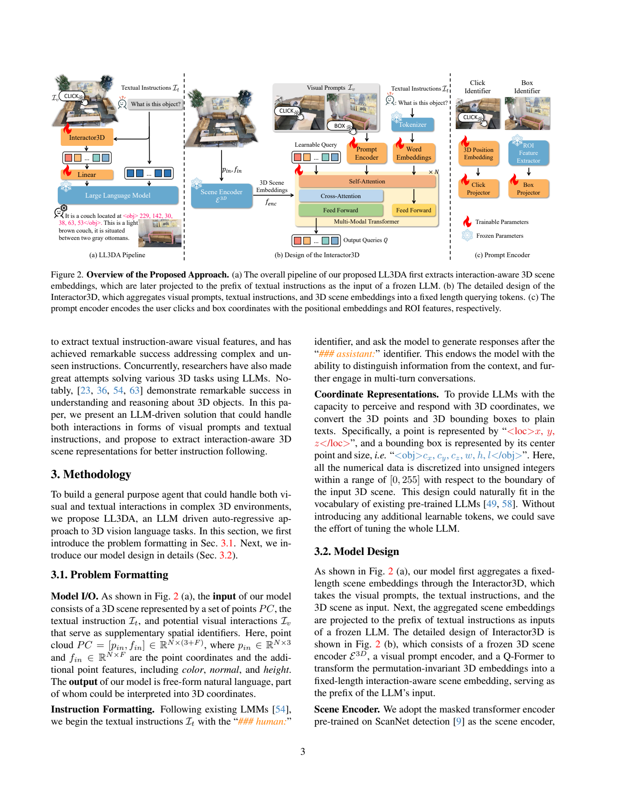
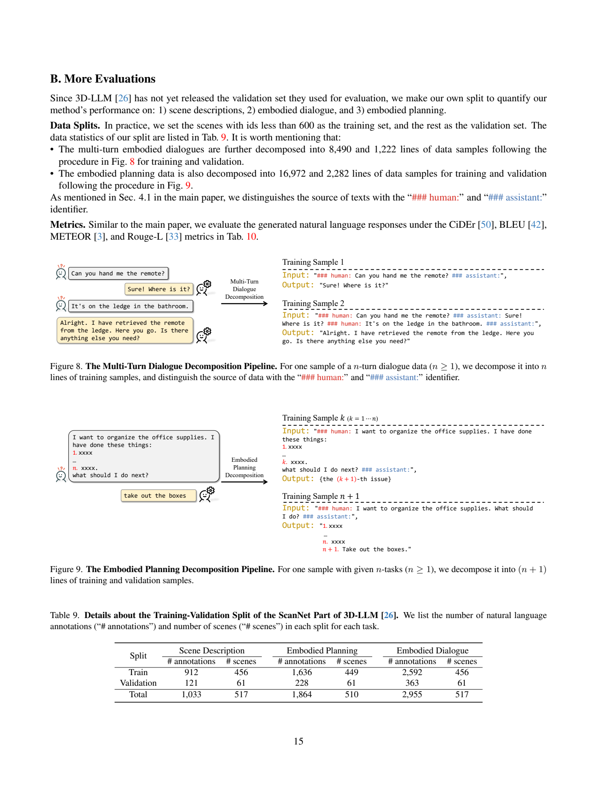
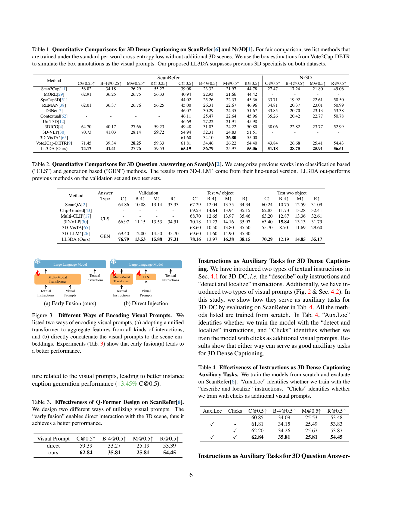
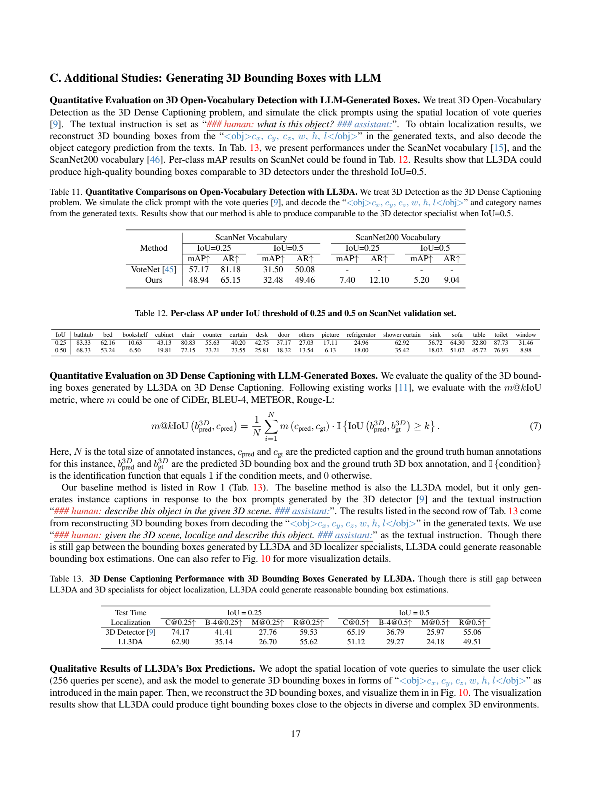

[返回模型家族](../README.md) · [返回仓库](../../../README.md)

# LL3DA：接受点击与框提示的三维语言助手

## 1. 论文信息与模型定位

| 项目 | 内容 |
|---|---|
| 题名 | LL3DA: Visual Interactive Instruction Tuning for Omni-3D Understanding, Reasoning, and Planning |
| 作者 / 机构 | Sijin Chen、Xin Chen、Chi Zhang、Mingsheng Li、Gang Yu 等；复旦大学、腾讯 PCG、新加坡国立大学、A*STAR |
| 采用版本 | arXiv:2311.18651v1，2023-11-30；20 页，含附录 A–E |
| 原文 / 官方代码 | [固定版本 PDF](https://arxiv.org/pdf/2311.18651v1) · [Open3DA/LL3DA](https://github.com/Open3DA/LL3DA) |
| 模型规模 | 冻结 OPT-1.3B；约 111M 可训练参数；未逐项列出整个系统精确总参数 |
| 输入 / 输出 | 三维场景点云、文字指令、可选点击或 3D 框 → 描述、问答、对话、文字计划及文字表示的三维坐标 |
| 核心定位 | 直接编码点云的交互式三维助手；规划评测主要是语言响应质量，未展示机器人真实执行成功率 |

标题中的 Omni-3D 指多种三维理解与交互任务，不是支持任意音视频模态。LL3DA 不先从多视角图像重建视觉语言特征，而是使用预训练点云编码器与交互条件 Q-Former，把点云信息压缩成冻结语言模型可读的前缀。

## 2. 快速概览

在杂乱室内场景里，“那把椅子”可能指多个物体。LL3DA 让用户点击一个空间位置或标出框，再把这类视觉提示与文字指令提前融合，取得与当前交互相关的场景信息。它不是先把整幅点云转换成固定描述再回答，而是在 32 个 learnable query 内综合场景、指令和提示，输出给语言模型。

模型冻结 OPT-1.3B 与点云编码器，只训练约 111M 参数的桥接与交互模块。训练包含 dense caption、问答、场景描述、具身对话和文字计划，另外加入“回答并定位”“描述并定位”等辅助输出，利用文字坐标加强语言与空间关联。坐标采用场景相对的 0–255 整数，以使用原语言词表而不扩展新可学习词项。

经各任务额外微调后，ScanRefer C@0.5 为 65.19，Nr3D 为 51.18；ScanQA val CIDEr 为 76.79，加入测试时点击提示后为 82.91。主 dense caption 结果的框来自 Vote2Cap-DETR，不等同于 LL3DA 自行检测框；用模型文字生成框时 ScanRefer C@0.5 降为 51.12。通用权重对 Nr3D 也明显弱于任务微调版，显示共享助手与专用模型之间仍有差距。[Sections 3–5、Appendix C](https://arxiv.org/pdf/2311.18651v1)

## 3. 整体架构

> 来源：原文 Figure 2，2311.18651v1，PDF 第 3 页；完整三部分模块、图注与坐标定义均保留。

**读图**：左侧为整体点云到回答流程，32 个交互相关 query 经线性层投影，作为文字指令前缀送入冻结 LLM。中间 query、文字与提示先共享 self-attention，再访问点云特征。右侧点击用三维位置编码，框用冻结检测器的 ROI 特征；两种提示各自通过可训练 FFN 投影。雪花表示冻结，火焰表示可训练。

| 环节 | 原文实际设置 |
|---|---|
| 输入点云 | 每场景随机采样 40K 点；坐标之外可含颜色、法向量、高度等点特征 |
| Scene encoder | 预训练 masked Transformer，来自 ScanNet 检测；先 set abstraction 为 2,048 token，再中间下采样为 1,024 token |
| 编码输出 | 1,024×256；三个 Transformer block 的 masking radius 为 0.16、0.64、1.44 |
| 点击提示 | 场景相对 0–1 坐标，经 learnable Fourier 位置编码与 FFN |
| 框提示 | 预训练 3D 检测器提取 ROI 特征，经独立 FFN；每个视觉提示表达为 8 token |
| 多模态 Transformer | 6 层，维度 768，每个注意力层最多 12 heads；32 query，输出 32×768 |
| 语言接入 | 简单线性 projector；冻结 OPT-1.3B 原始参数和嵌入层 |

Q-Former 仅加载 BERT 的文字与位置嵌入，词表 30,522、位置嵌入数 512；作者发现直接使用全部预训练 BERT 权重容易产生重复输出，因此没有整体加载。这里的 512 是交互模块位置嵌入配置，不是全文声明的 OPT 最长上下文。点云顺序不具有普通句子的语义顺序，learnable queries 提供了输出给 LLM 的固定长度有序表示，但不是对任意点采样、编码处理都证明严格数学置换不变性。[Section 3.2、Appendix E](https://arxiv.org/pdf/2311.18651v1)

## 4. 核心创新与数学原理

**在压缩前融合用户交互。** 单独将视觉提示拼在 LLM 输入后，无法改变已提取的整场景前缀。LL3DA 提前将 query、点击/框特征和文字指令放进共享 self-attention，再让 query 与提示经 cross-attention 查询点云。它使“关注哪个对象”影响场景压缩过程，而不只是影响最终文字解码。注意力可用下列标准定义理解，原文没有将其列为新编号公式：

\[
\operatorname{Attn}(Q,K,V)=\operatorname{softmax}(QK^\top/\sqrt d)V.
\]

固定 32 query 限制了送入 LLM 的场景序列长度，query-to-scene 访问成本随 1,024 个场景 token 增加，而场景编码本身仍有计算开销。本文没有端到端速度曲线，不宜把固定查询数量直接等同于已证明的全模型高吞吐。

**将点击转为空间位置特征。** 原文 Equation (2) 为：

\[
\operatorname{pos}(p)=
[\sin(2\pi pB);\cos(2\pi pB)],\quad
p\in\mathbb R^3,\ B\in\mathbb R^{3\times d/2}.
\]

\(p\) 在场景范围内归一化，\(B\) 可学习；正弦与余弦拼接给出 d 维表示。随后 Equation (3) 用两种独立 FFN 转换点击位置编码和框 ROI 特征。位置编码输入是连续 0–1 值，输出文字中的坐标却是离散 0–255，这两种尺度不能混用。

**用已有文字词表表达三维空间。** 点表达为 `<loc>x,y,z</loc>`，框表达为 `<obj>cx,cy,cz,w,h,l</obj>`，后者是中心与尺寸，不能当作两个对角点。原文按输入场景边界将数值离散到无符号整数 0–255，不新增可学习坐标词。以单轴坐标为例，以下为帮助理解的线性量化示意，并非原文规定的取整代码：

\[
q\approx\operatorname{round}\left(255\frac{x-x_{min}}{x_{max}-x_{min}}\right),
\quad
x\approx x_{min}+\frac{q}{255}(x_{max}-x_{min}).
\]

区间被划为 255 个间隔，细节精度受场景范围与取整影响；原文未给出退化轴、越界裁剪和尺寸量化完整实现。文字标签本身由已有 tokenizer 切分，不表示每个整数都有专门单 token。

**同时评价定位与文字质量。** 原文 Equation (7) 的 \(m@kIoU\) 把 caption 分数乘以定位成功条件，再对实例平均：

\[
m@kIoU=\frac1N\sum_{i=1}^N
m(c_i^{pred},c_i^{gt})\,
\mathbf1[\operatorname{IoU}(b_i^{pred},b_i^{gt})\ge k].
\]

若框没有达到重叠阈值，该实例 caption 分数归零。C@0.5 因而是带定位门槛的 CIDEr，不是“65.19% 的对象框正确”。句子相似性高也不保证几何准确，正确理解这一指标是区分外部框与语言生成框的关键。[Section 5.2、Appendix C](https://arxiv.org/pdf/2311.18651v1)

## 5. 数据构建与处理

| 数据 | 训练 / 评测口径 | 用途 |
|---|---|---|
| ScanNet | 1,201 train、312 val、100 test 场景 | 三维点云基础场景 |
| ScanRefer | 训练 36,665 描述、7,875 对象、562 场景；验证 9,508 描述、2,068 对象、141 场景 | 对象定位与描述 |
| Nr3D | 训练 32,919 描述、4,664 对象、511 场景；验证 8,584 描述、1,214 对象、130 场景 | 对象描述 |
| ScanQA | 训练 25,563 QA 对/562 场景；val 4,675 对/71 场景；test w/object 4,976 问题/70 场景；test w/o object 6,149 问题/97 场景 | 场景问答 |
| 3D-LLM 的 ScanNet 子集 | 1,033 场景描述、1,864 计划条目、2,955 多轮对话；均来自 ScanNet train 场景 | 场景说明、对话和文字计划 |

任务转成统一 human/assistant 文本形式。Dense caption 随机用点击或框指向对象，并分别训练“描述”“定位并描述”；QA 可以“回答”“定位相关对象并回答”，训练中也会随机添加相关对象视觉提示。场景描述无需对象提示，多轮对话保留前文来源标识。这类辅助任务增加输出多样性，但没有新增环境状态转移或机器人控制监督。

> 来源：原文 Figures 8–9、Table 9，PDF 第 15 页；两种样本展开流程与全部划分统计完整保留。

**读图**：n 轮对话展开成 n 个“历史 → 下一回答”样本；计划展开为下一步预测及整段计划生成。作者按 scene id<600 与其余场景分 train/val，而不是沿用一个已公开的 3D-LLM 验证集。对话展开后为 8,490 train /1,222 val 条，计划为 16,972/2,282 条；原始对话 2,592/363 条、计划 1,636/228 条与展开后数量不是同一单位。

该自建验证集来自 ScanNet 的原 train 场景集合，冻结场景编码器又在 ScanNet 检测任务预训练；它不应被称为模型从未见过场景几何的严格零样本评测。原文没有完整披露任务混合权重、全部点特征预处理和标签清洗阈值。[Section 4、Appendices B、D](https://arxiv.org/pdf/2311.18651v1)

## 6. 训练流程与目标

| 阶段 | 优化与输入 | 更新 / 冻结 |
|---|---|---|
| 多任务助手训练 | 各任务统一条件文字生成，约 100K iterations | 更新交互 Transformer、提示编码/投影及语言接入；冻结点云骨干与 OPT |
| 专用任务适配 | 每个评测任务再约 30K iterations | 在通用权重上继续更新可训练模块，非完整语言模型微调 |
| 从零适配器消融 | 为控制比较，部分模块实验从未训练的桥接模块开始 | 使用同一已预训练冻结骨干；“scratch”不等同重新训练 OPT |

原文 Equations (5)–(6) 最大化回答序列似然，实际使用回答 token 交叉熵：

\[
\mathcal L(\theta)=-\sum_{i=1}^{|s|}
\log P(s_i\mid PC,I_v,I_t,s_{<i};\theta).
\]

\(PC\) 为点云，\(I_v,I_t\) 为视觉与文字交互，\(\theta\) 只涵盖可训练部分。坐标在文本输出里同样接受 token 监督，没有另设已披露的 box IoU 或控制策略奖励。

AdamW weight decay=0.1，总 batch=16，学习率以 cosine 从 1e-4 降到 1e-6；每 4K iterations 评测。OPT 以 float16 加载，单个训练过程使用不超过 8 张 RTX3090 24GB，作者报告在一天内完成。未披露 Adam beta、warmup、精确训练样本混合、随机种子或系统总训练成本。常规指标生成使用 beam size=4；长定性输出使用 top-k=50、top-p=0.95，附录长文本评测还禁止重复 4-gram。不同解码设置不应混成一个统一默认值。[Sections 3.2、5.1、5.4、Appendices B、E](https://arxiv.org/pdf/2311.18651v1)

## 7. 实验设置与主要结果

> 来源：原文 Tables 1–4、Figure 3，PDF 第 6 页；保留全部数据列、模型行、阈值、脚注与图注。

**读表**：Table 1 使用 Vote2Cap-DETR 的框作为视觉提示；列是不同 IoU 门槛下的 caption 指标。Table 2 的 CLS 是从预定义答案集合选择，GEN 是自由文本生成；3D-LLM 为其任务微调版本，不能当作未适配基线。

| 任务 / 指标↑ | LL3DA 任务微调版 | 参考 | 结果范围 |
|---|---:|---:|---|
| ScanRefer C@0.5 | 65.19 | Vote2Cap-DETR 61.81 | +3.38 分；LL3DA 使用该检测器框 |
| Nr3D C@0.5 | 51.18 | Vote2Cap-DETR 43.84 | +7.34 分 |
| ScanQA val CIDEr | 76.79 | 3D-LLM 69.40 | +7.39 分；非准确率百分点 |
| ScanQA test w/object CIDEr | 78.16 | 3D-LLM 69.60 | +8.56 分 |
| ScanQA test w/o object CIDEr | 70.29 | 3D-VLP 63.40 | +6.89 分 |

主指标较好不代表所有列都最高：ScanRefer METEOR@0.25 为 27.76，低于 Vote2Cap-DETR 28.25；METEOR@0.5 为 25.97，低于 3D-VisTA 26.80；ScanQA test w/o object BLEU4 为 12.19，低于 3D-VLP 15.84。Table 3 早融合 C@0.5 为 62.84，直接拼接为 59.39；Table 4 在 60.85 的基础上，单加定位辅助为 61.81，单加点击为 62.20，均加为 62.84，支持交互条件参与场景压缩。

通用模型在 Table 5 的 ScanRefer C@0.5=62.98、ScanQA CIDEr=75.67，但 Nr3D C@0.5 仅 23.94，远低于任务微调版 51.18。作者认为未区分 ScanRefer/Nr3D 的任务分布造成倾向性，不能把专用微调结果描述成同一通用 checkpoint 同时达到。Table 8 测试时增加相关点击后，ScanQA CIDEr 从 76.79→82.91，METEOR 15.88→16.74、Rouge-L 37.31→39.97，但 BLEU4 13.53→11.80；信息更多有帮助，指标并非全面提升。

> 来源：原文 Tables 11–13、Equation (7)，PDF 第 17 页；检测词表、IoU 阈值、逐类行与两种定位模式完整保留。

**读表**：LLM 生成框实验以 detector vote query 的空间位置模拟点击，每场景 256 queries；这也不是无候选点提示的全自由检测。ScanNet 词表 mAP@0.5 为 32.48，对 VoteNet 31.50；但 mAP@0.25 为 48.94，对 57.17，召回也较低。ScanNet200 扩大类别后 mAP@0.5 仅 5.20，说明开放词表泛化仍有限。Table 13 的语言框 ScanRefer C@0.5=51.12，外部检测框=65.19，相差 14.07 分，明确揭示模型自身几何定位尚不及该专用器。

附录 Table 10 在自建场景划分中以语言相似性评价描述、对话、计划，beam 下计划 CIDEr 为 196.78、对话 260.07，场景描述 1.32；这些量纲与参考句分布差异很大，不能按高分推断计划实际可执行。定性示例也包含冗余、错误或不合理表达。本文充分支持交互提示与辅助定位监督改善三维文字任务，却没有展示实时机器人闭环、路径执行或真实环境任务成功率。以上来自原文，本介绍未运行系统。
