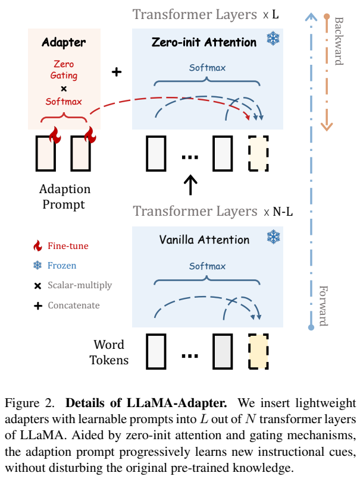
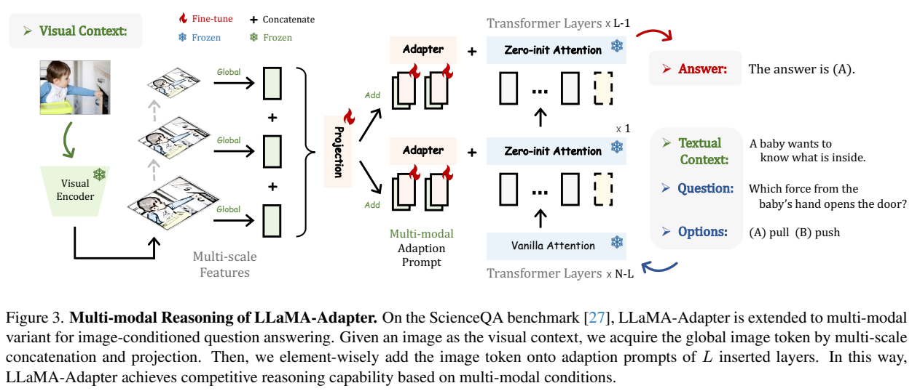
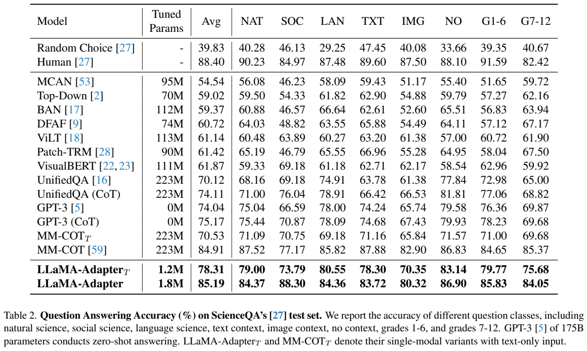
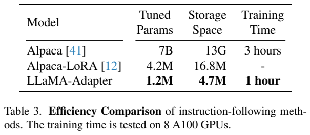
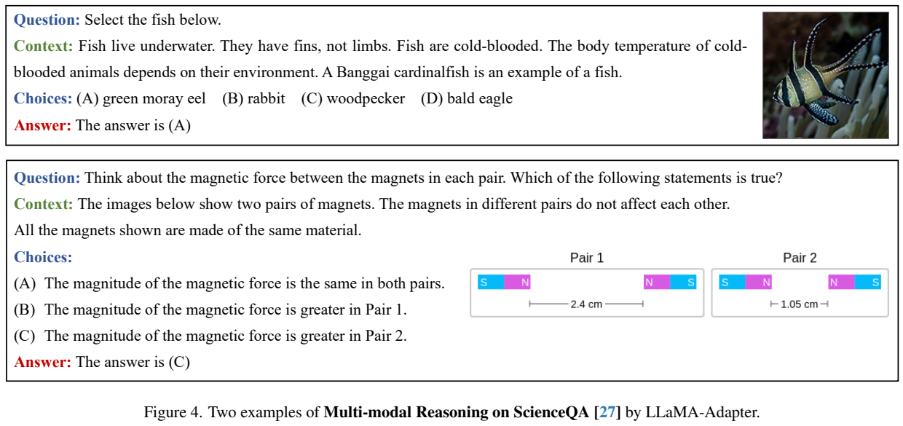
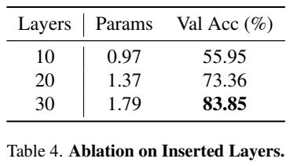
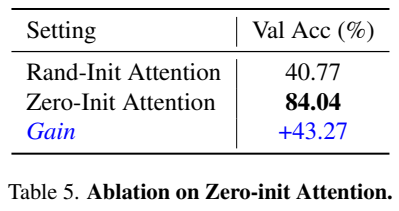
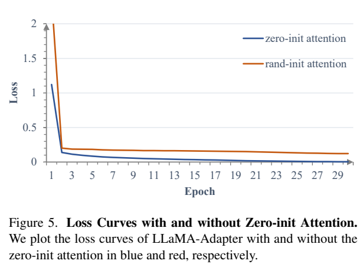

<!-- article-header:start -->
[项目首页](../../../README.md) › [模型系列](../../../reports/model-family-index.md) › [LLaMA-Adapter](../README.md)
<!-- article-header:end -->

# LLaMA-Adapter：用零初始化注意力高效微调语言模型

<!-- article-toc:start -->

**本篇目录** · [论文定位](#paper-info) · [快速概览](#overview) · [整体架构](#architecture) · [核心原理](#principles) · [数据构建](#data) · [训练流程](#training) · [实验结果](#experiments)
<!-- article-toc:end -->

## 1. 论文信息与模型定位

**LLaMA-Adapter: Efficient Fine-tuning of Language Models with Zero-init Attention** 由 Renrui Zhang、Jiaming Han 等提出，作者来自上海人工智能实验室、香港中文大学与UCLA。本介绍依据 [arXiv 2303.16199v1](https://arxiv.org/pdf/2303.16199v1)（2023-03-28，18页），原文代码链接为[ZrrSkywalker/LLaMA-Adapter](https://github.com/ZrrSkywalker/LLaMA-Adapter)，目录收录的仓库地址为[OpenGVLab/LLaMA-Adapter](https://github.com/OpenGVLab/LLaMA-Adapter)。这里介绍最初v1，不混入后续Adapter V2的结构和数据。

这首先是一种参数高效微调方法：在冻结LLaMA上训练少量提示向量与门控，让基础模型学会执行指令。它再扩展到图像条件的ScienceQA多选问答，说明同一接口能注入视觉信息。1.2M指文本适配参数，图像版增加0.6M投影器，共约1.8M可训练参数；完整系统仍依赖7B语言底座与视觉编码器。原文把音频和视频列为未来工作，不是已经验证的全模态模型。

## 2. 快速概览

| 项目 | v1配置或证据 |
|---|---|
| 基础模型 | 冻结LLaMA-7B，32层 |
| 适配提示 | 末30层各10个可训练提示向量 |
| 稳定机制 | 提示与原文字分开softmax，提示注意力乘零初始化门控 |
| 视觉注入 | CLIP多尺度全局特征拼接，MLP映射后逐元素加到提示 |
| 文本数据 | Alpaca-52K；文本训练5 epoch，8 A100约1小时 |
| 多模态结果 | ScienceQA测试总体85.19%，图像子集80.32% |

相比全量微调，主要收益是训练参数、梯度通信与增量权重存储减少；不等于可以免去加载语言底座，也没有证明推理显存降低数千倍。论文的自然语言质量比较以示例为主，多模态定量结论集中在ScienceQA。

## 3. 整体架构

**读图：** 低层仍使用原注意力；高层添加独立的可训练提示。红色提示分支带零初始化门控，原文字分支单独计算softmax。两条分支相加后进入原层，而不是把所有新增提示直接放进同一个归一化分母。语言投影权重保持冻结。

每个被插入的层有 $`P_l\in\mathbb R^{K\times C}`$。它们是隐藏空间中的可训练向量，不是用户书写的自然语言前缀，也不是LoRA对原Q/K/V矩阵的低秩更新。默认K=10、插入L=30层，语言模型共N=32层（§4.1）。每层自己的提示可以学习不同的任务补充信息。

**读图：** CLIP提取多个尺度的全局特征，沿通道拼接后经可训练投影成为一个总体图像向量。该向量重复K次，逐元素加到每层提示，不是把所有图像patch展开为长序列。文字仍提供问题、上下文和选项；视觉条件通过提示分支影响回答。图上视觉编码器与语言底座都标为冻结，新增提示、门控和MLP承担适配。

## 4. 核心创新与数学原理

零初始化机制的重点在于分开归一化。设当前文字query对提示的logit为 $`S_P`$，对已有文字的logit为 $`S_T`$，对应value为 $`V_P,V_T`$。原式(7)–(8)等价于：

$$
o_l=W_o\left[g_l\,\mathrm{softmax}(S_P)V_P+
\mathrm{softmax}(S_T)V_T\right],\qquad g_l(0)=0.
$$

多头注意力的每个head分别学习门控。初始化时提示贡献为零，文字分支不受新增随机提示的softmax分母影响，因此保留原始注意力输出；随后门控与提示逐步学习补充信号。这里“zero-init attention”不表示把原语言注意力全部清零，也不表示所有提示向量必须初始化为零。原文没有将门控定义成softmax概率或必在[0,1]之间的权重，不能额外假定概率约束。

视觉条件按原式(9)–(10)构造：

$$
I_p=\mathrm{Projection}\left(\mathrm{Concat}_c(I_1,\ldots,I_M)\right),\qquad
P_l^v=P_l+\mathrm{Repeat}_K(I_p).
$$

第一个concat沿通道，重复与加法不改变提示长度K。这是很强的压缩：图像由多尺度全局向量注入，细粒度区域关系没有单独的patch token接口。论文未证明这一结构适合小字OCR或高分辨率文档任务。

用冻结原模型作为起点也解释了“少量训练参数仍能答题”：语言能力来自底座，适配参数调节它怎样利用条件，而不是用1.8M参数从零学出7B模型全部知识。原文没有提出新的对比损失或RL训练目标；这是生成式监督微调框架。

## 5. 数据构建与处理

文本实验使用Stanford Alpaca-52K：字段为instruction、可选input与output，约40%样本带input，output由GPT-3.5 text-davinci-003生成；该数据来自175个人工种子示例的Self-Instruct扩增（引言与§4.1）。论文复用数据，没有自建另一套52K人工标注数据，也未披露额外大规模图文预训练。

多模态阶段使用ScienceQA训练数据，包含视觉或文字上下文、题目、选项和答案。作者为简化任务省略lecture与explanation，把文字按问题→文字上下文→选项顺序组织（§5.1）。由于直接使用视觉编码器，明确**不采用ScienceQA的图像caption数据**。纯文字版因此不能描述为仍通过caption间接看图的版本。

原文未在该版本给出完整数据清洗阈值、图像尺寸与多尺度数量、ScienceQA全部样本数及精确split规模；这些可从其他资料查到的细节也不能装作本报告已披露。图像任务是有监督微调后评测，和GPT-3的零样本纯文字结果并非完全同条件比较。

## 6. 训练流程与目标

文本训练仅更新提示和门控，冻结LLaMA。8 A100训练5 epoch，warmup2 epoch、batch64、学习率9e-3、weight decay0.02。文本生成使用temperature0.1、top-p0.75；ScienceQA改用greedy search（PDF第5、7页）。多模态再增加可训练MLP，以图像条件监督输出选项答案。原文没有给出完整token级loss mask或优化器名称，不能补写假定的默认AdamW。

多模态实现说未特别说明时沿用文本配置，但其消融明确展示15、30、60 epoch训练，默认层数实验的30 epoch结果也可见于表6；v1没有清楚标出主测试表85.19%对应的全部训练差异。因此本文保留这些分项设置，不把文本5 epoch和所有多模态实验统一为同一个recipe。

表3的文本效率结果为1.2M增量参数、4.7M存储、8 A100约1小时，Alpaca全量7B为13G与3小时。§4.3正文又写4.9M存储，本文采用表3并保留这项小差异。节省的是适配权重文件，基础模型仍需要单独提供；“1小时”也不是单张A100一小时。

## 7. 实验设置与主要结果

ScienceQA以官方测试集答题准确率为指标。不同类别的结果如下，不能把总体列Avg当成只有图片题的成绩。

| 指标 | 文本LLaMA-Adapter | 多模态LLaMA-Adapter | 同表MM-CoT |
|---|---:|---:|---:|
| 总体 | 78.31 | 85.19 | 84.91 |
| 自然科学NAT | 79.00 | 84.37 | 87.52 |
| 社会科学SOC | 73.79 | 88.30 | 77.17 |
| 语言科学LAN | 80.55 | 84.36 | 85.82 |
| 图像上下文IMG | 70.35 | 80.32 | 82.90 |
| 文字上下文TXT | 78.30 | 83.72 | 87.88 |
| 1–6 / 7–12年级 | 79.77 / 75.68 | 85.83 / 84.05 | 84.65 / 85.37 |

图像条件将总体提升6.88个百分点，IMG提升9.97个百分点；这说明视觉信息确实有用。85.19略高于MM-CoT84.91，但自然科学、图像题等列仍更低，不能宣称所有分组领先。GPT-3零样本74.04与多模态85.19差11.15个百分点，却还包含监督微调和视觉输入的条件差别。

**读图表：** 表4的10/20/30个插入层，验证准确率分别55.95/73.36/83.85；对应参数0.97/1.37/1.79M。按表计算，10→20增17.41个百分点，10→30增27.90；正文把17.41写为10→30的提升，不能照抄这一计算错误。表5随机初始化注意力40.77、零初始化84.04，差43.27个百分点；它与表4的83.85属于不同报告实验值，未披露原因，不能强行改成一致。Figure5表明零初始化初期loss更低并更快下降，提供稳定性证据。

表6验证loss从15 epoch的0.136升到60 epoch的0.282，而准确率82.08→83.94；它说明该任务的分类准确率和生成loss可能不同步，不证明完全不会过拟合。文本指令比较（表1及附录）主要是输出展示，原文承认没有严格统一评价指标；个别案例含事实或代码问题，因此“相当于Alpaca/GPT-3”应理解为作者基于样例的定性判断，而非已建立通用排行榜的统计结论。v1的可靠贡献是零门控实现稳定轻量适配，以及在ScienceQA验证视觉注入有效性。

<!-- article-footer:start -->
---

[← 上一篇：GPT-4](../../gpt/arxiv-2303.08774/README.md) · [按发表时间浏览](../../../reports/paper-reading-guide.md#year-2023) · [下一篇：LLaVA 初代 →](../../llava/arxiv-2304.08485/README.md)

[返回本篇目录](#article-toc) · [返回模型系列](../README.md)
<!-- article-footer:end -->
