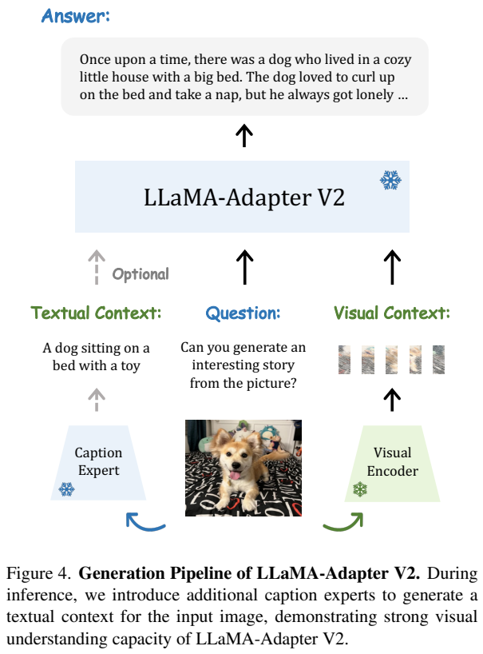
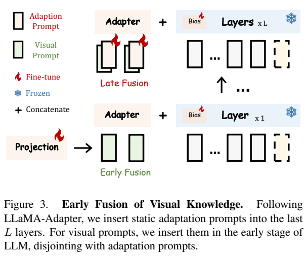
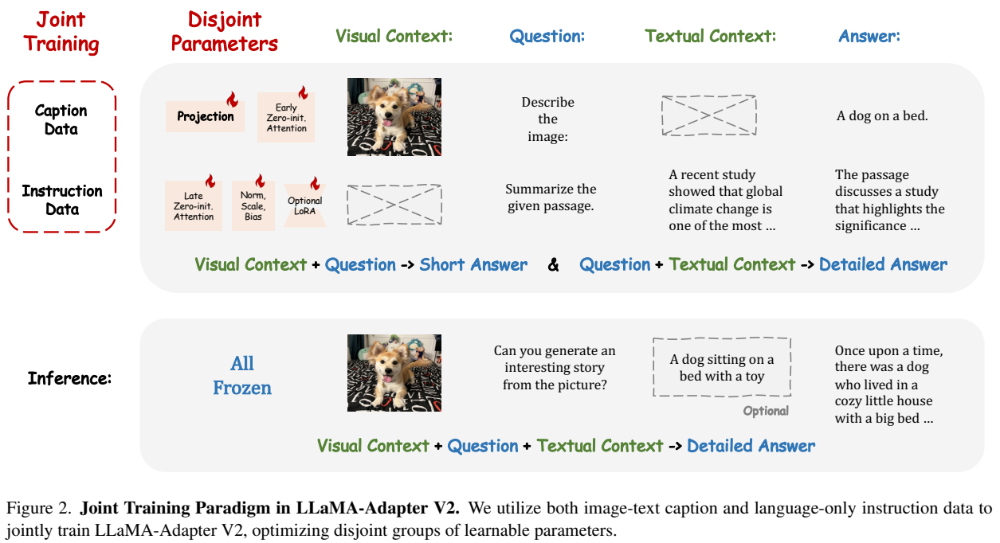
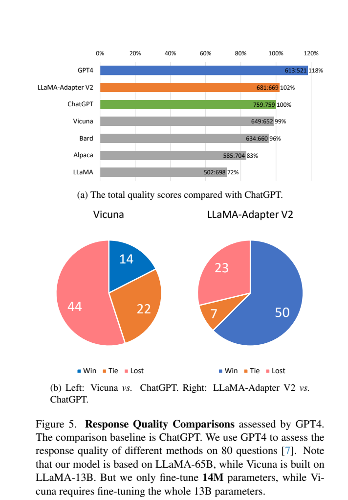
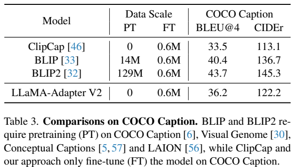
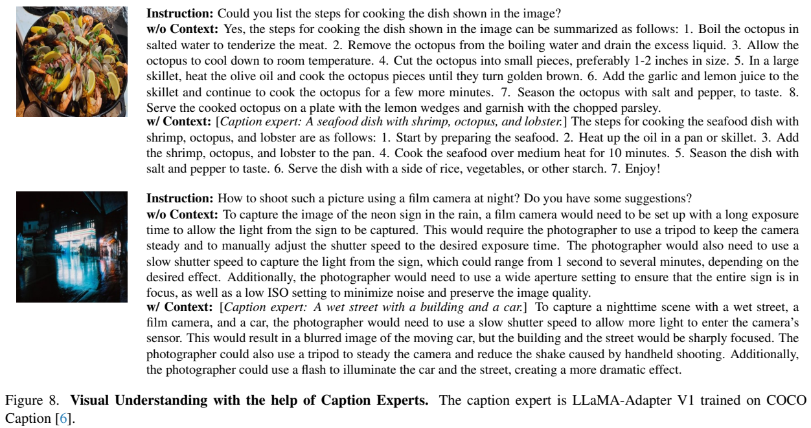
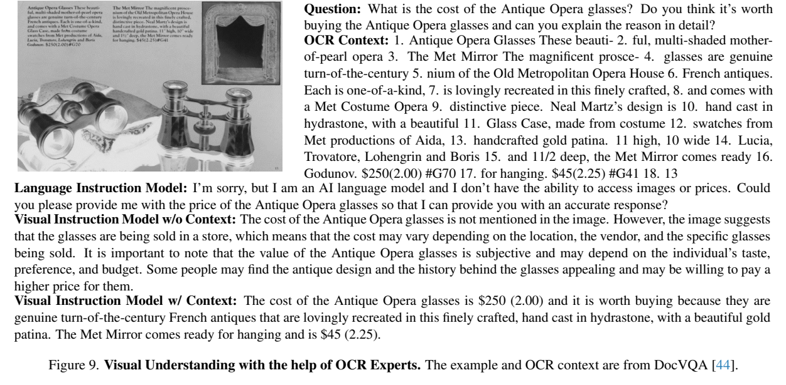

<!-- article-header:start -->
[项目首页](../../../README.md) › [模型系列](../../../reports/model-family-index.md) › [LLaMA-Adapter](../README.md)
<!-- article-header:end -->

# LLaMA-Adapter V2：分离视觉对齐与语言指令的参数高效调优

<!-- article-toc:start -->
<a id="article-toc"></a>

**本篇目录** · [论文定位](#paper-info) · [快速概览](#overview) · [整体架构](#architecture) · [核心原理](#principles) · [数据构建](#data) · [训练流程](#training) · [实验结果](#experiments)
<!-- article-toc:end -->

<a id="paper-info"></a>

## 1. 论文信息与模型定位

| 项目 | 内容 |
|---|---|
| 题名 | LLaMA-Adapter V2: Parameter-Efficient Visual Instruction Model |
| 作者 / 机构 | Peng Gao、Jiaming Han、Renrui Zhang、Ziyi Lin 等；上海人工智能实验室、香港中文大学 MMLab、罗格斯大学 |
| 采用版本 | arXiv:2304.15010v1，2023-04-28；15 页，技术正文主要在第 1–11 页 |
| 原文 / 官方代码 | [固定版本 PDF](https://arxiv.org/pdf/2304.15010v1) · [LLaMA-Adapter](https://github.com/ZrrSkywalker/LLaMA-Adapter) |
| 模型规模 | 视觉实现细节采用 LLaMA-7B；另外展示 7B/65B 语言聊天系统；论文以约 14M 可调参数概括方案，未按每个档位完整拆分 |
| 输入 / 输出 | 图像与文字问题、可选专家文字上下文 → 文字描述、回答与故事等；不输出图像 |
| 核心定位 | 冻结大部分语言权重，以 adaptation prompts、门控、norm、bias/scale 和视觉投影学习图文助手 |

这里的 Adapter 主要指软提示与零初始化注意力，不能套用所有瓶颈 adapter 的定义，也不是默认采用 LoRA 的模型。论文给出的 visual instruction 能力主要从图文 caption 与纯文本指令联合学习转移而来，训练没有使用专门的高质量多模态对话指令集；“zero-shot visual instruction”是这种数据设置，不是模型没训练过图文数据。

<a id="overview"></a>

## 2. 快速概览

初代 LLaMA-Adapter 将动态图像特征加入后部层的静态 adaptation prompts。若继续用大量短 caption 训练，视觉对齐目标会占据本来承载指令跟随的参数，使模型倾向短图像描述。V2 的改动是把视觉提示送入早层，把语言适配提示留在后层，再让两类数据分别更新不同参数组。

除原有提示与门控外，V2 解冻所有 norm，并为语言线性层加入可训练 bias 和 scale，使语言指令的影响不只集中在后部 prompts。视觉分支用 COCO caption 学习图文对齐；后部提示及 norm/bias/scale 用 GPT-4-LLM 的纯文本单轮指令学习较丰富的语言回答。二者在联合训练后用于开放式视觉提问。

原文报告 COCO CIDEr 122.2、BLEU4 36.2，比同表 ClipCap 好，但低于 BLIP/BLIP2。开放式理解主要是案例展示，并明确承认卡通图像等分布外输入会产生严重幻觉。推理时可以加入 caption 或 OCR 专家生成的文字条件，改善信息提取，同时也会把专家的错识别传给语言回答。语言聊天的 GPT-4 裁判评测使用 65B 版本和 80 个问题，不能扩展成全面优于 ChatGPT 或视觉可靠性已经达标的结论。[Sections 4–6](https://arxiv.org/pdf/2304.15010v1)

<a id="architecture"></a>

## 3. 整体架构





> 来源：原文 Figures 3–4，2304.15010v1，PDF 第 6 页；裁图保留所有箭头、模块及可选路径。

**读图**：左侧底部在早期层引入由图像编码器和 projection 得到的视觉 prompts，上部后层引入静态 adaptation prompts。视觉提示不再逐层加到语言适配提示上。右侧图像仍走视觉编码器，另可由 caption expert 变成文字上下文，与问题一起输入已训练的 V2；专家文本是可选输入，不是模型新增的训练标签。

| 组件 | 论文实际设置与作用 |
|---|---|
| 视觉编码器 | 冻结预训练编码器，如 CLIP；多尺度视觉特征经投影接入；本 v1 未完整列出精确 backbone、分辨率与视觉特征维度 |
| 动态视觉 prompts | 对当前图像变化；LLaMA-7B 32 层配置在第一层引入 |
| 静态 adaptation prompts | 数据集共享的可学习提示；7B 实现放在最后 31 层 |
| Zero-initialized attention | 门控初值为零，逐步允许新增提示影响文字隐藏状态 |
| Norm、bias、scale | 全模型 norm 可更新，各线性层添加偏移与缩放；大矩阵原始权重保持冻结 |
| 专家上下文 | 默认 caption expert 是 COCO 训练的 LLaMA-Adapter V1；DocVQA 案例使用 OCR 文字 |

7B 实现给出 prompt length=20，未逐项解释所有提示张量的维度及不同模型档位设置。方法说明曾用“最后 L 层，例如 L=30”，第 5.1 节实际 7B 配置则是最后 31 层，介绍采用明确实验配置。推理阶段各模型参数不更新，不表示没有专家运行、编码器推理或新增推理计算。

| 模块 | 输入与输出 | 公开机制 |
|---|---|---|
| 冻结视觉前端 | 图像 → 多尺度视觉向量 | 预训练编码器、投影形成动态视觉prompts |
| 早层视觉提示 | 视觉向量 → 第一层条件注入 | 7B实现首层早融合，图文caption更新对应接口 |
| 后层静态提示 | 任务适配向量 → 最后31层补充 | prompt长度20，纯文本指令更新提示与门控 |
| 全层轻量调制 | 隐藏状态 → norm/bias/scale变换 | 大矩阵冻结，偏移初值0、缩放初值1，归一化参数更新 |
| 可选专家上下文 | 图像 → caption/OCR文字 → 输入上下文 | 推理附加外部文字证据；默认非新的端到端分支 |


<a id="principles"></a>

## 4. 核心创新与数学原理

### 4.1 bias 与 scale 调整预训练变换

原文 Equations (1)–(2) 将线性层写为：


```math
y=s\cdot(Wx+b),\qquad b\leftarrow0,\quad s\leftarrow1.
```


$`W`$ 是冻结预训练矩阵，$`b,s`$ 是新参数。初始化时输出与原 $`Wx`$ 相同，避免一开始破坏原模型。随着训练，bias 改变输出位置，scale 改变输出大小，norm 参数改变各层归一化后的表达。原文没有完全说明 scale 是标量还是逐通道配置，不能由此自行推导精确全模型参数数目。

作为**解释性推导**，该变换可在推理时表示为有效线性层 $`W'=sW,b'=sb`$；若 s 为逐通道向量，则写成对角矩阵 $`\mathrm{diag}(s)W`$。这只是线性代数等价关系，论文没有以该推导报告合并权重后的速度。它也不同于 LoRA 的 $`BAx`$：bias 不随输入变化，而 LoRA 更新的输出随 x 改变。本文将 LoRA 标成可选未来增强，不应把它写成所有报告结果的默认训练机制。

提示只通过附加注意力影响主干，bias/scale则直接调制每层线性输出，扩展可适配范围。恒等初始化使这种扩展在起点仍与原模型相同；随后更新小参数，不能获得任意全矩阵更新的表达能力。这是参数效率与适配自由度的权衡。[原文 §4.1、Eq. (1)–(2)，PDF 第 5 页](https://arxiv.org/pdf/2304.15010v1#page=5)

### 4.2 视觉早融合与零门控分工

新提示的注意力贡献由初值为零的门控控制。可用“原隐藏分支 + g×提示注意力分支，g 初值为 0”的残差形式理解；这不是本文另外列出的编号式，也不能据此补出具体门控激活函数、head 配置。零值使训练起点更接近预训练语言模型，之后只通过较小参数加入新知识。

V1把全局图像向量加到高层适配提示，caption监督可能覆盖这些提示学到的指令习惯。V2将动态图像条件移到早层，后层保留静态指令提示，让视觉证据先进入语言状态再由高层组织回答。零门控解决起点扰动，早晚分离解决任务职责，两者不是同一措施。[原文 §3、§4.3、Figure 2，PDF 第 4–6 页](https://arxiv.org/pdf/2304.15010v1#page=5)

### 4.3 按数据选择更新参数减少直接竞争

同一系统面对 caption 与纯文本指令，但二者不更新完全相同的参数。设 $`\theta_v`$ 为视觉投影与早层门控，$`\theta_i`$ 为后层提示、门控、norm/bias/scale，下式是对原文训练策略的**概念写法**：


```math
\theta_v\leftarrow\theta_v-\eta_v\nabla_{\theta_v}\mathcal L_{caption},
\qquad
\theta_i\leftarrow\theta_i-\eta_i\nabla_{\theta_i}\mathcal L_{instruction}.
```


重点是按任务选择可更新参数，而不是存在已披露的梯度投影算法或 loss 权重优化。它减少两类任务在同一适配参数上的直接竞争，但视觉信息仍会通过共享冻结网络影响最终输出，不能称为完全没有交互或已证明消除所有任务冲突。原文没有分别量化早融合、bias tuning 和参数分组的全面受控消融。[Sections 3–4](https://arxiv.org/pdf/2304.15010v1)

论文指出500K图文对与50K指令数量不平衡，简单混合会损害指令行为。分组训练使caption误差主要调视觉投影与早层门控，指令误差调后层提示及全层轻量参数；共享冻结骨干仍传递信息，但不接受这两类任务的全量参数更新。[原文 §4.2，PDF 第 5 页](https://arxiv.org/pdf/2304.15010v1#page=5)


<a id="data"></a>

## 5. 数据构建与处理

| 数据 | 数量 / 口径 | 用途 |
|---|---|---|
| GPT-4-LLM | 52K 单轮纯文本 instruction 示例 | 学习指令跟随与较长文字回答 |
| COCO Caption | 567K caption 样本，Table 3 约写 0.6M | 视觉对齐；不是 567K 个独立图像 |
| ShareGPT | 80K conversation 数据 | 另行训练聊天系统，与主单轮视觉配置区分 |
| 专用视觉指令 | Table 1 为 0 | 没有用 LLaVA 式 COCO+GPT-4 多模态指令生成集 |

原文 Table 1 对比 MiniGPT-4、LLaVA 时连同已有语言聊天适配的代价统计训练数据与参数，不表示本方法的全部预训练成本为零。COCO Caption 外还存在预训练 CLIP 和 LLaMA 所包含的知识；Table 3 的 PT=0 只表示该表所计入的额外视觉语言预训练阶段，不能改写成“无需任何预训练”。

本 v1 没有完整披露 COCO 样本的过滤、去重、详细输入模板、图像增强、ShareGPT 清洗、GPT-4 数据质量审查和比例抽样策略。caption 样本约为纯文本指令的十倍是任务冲突的动机，但实际联合训练采样比未列出。专家 OCR 文字在推理中加入；DocVQA 单个示例不能当成本模型另有已训练的 DocVQA 数据阶段。[Table 1、Section 5.1](https://arxiv.org/pdf/2304.15010v1)

<a id="training"></a>

## 6. 训练流程与目标



> 来源：原文 Figure 2 与 Equations (1)–(2)，PDF 第 5 页；完整 caption/指令分支、可选 LoRA 标记和推理部分可见。

**读图**：caption 分支训练 projection 与 early zero-init attention；纯文本 instruction 分支训练 late zero-init attention 和 norm/scale/bias。下部推理把图像、问题及可选文字上下文组合起来，并不再做参数更新。

| 训练 / 使用环节 | 更新 / 冻结 | 目标 |
|---|---|---|
| 图文 caption 与语言指令联合训练 | 两组参数按数据用途分别更新；预训练视觉骨干及语言大矩阵冻结 | 图像到短描述，与纯文本到详细回答共同建立可迁移能力 |
| 聊天配置 | 80K ShareGPT 数据适配轻量参数 | 多轮上下文回答；报告展示 7B/65B |
| 专家增强推理 | 不再训练 V2 或专家 | caption/OCR 文字作为额外输入条件 |

文字生成可用标准回答交叉熵解释，原文没有给出独立编号 loss：


```math
\mathcal L=-\sum_t\log P_\theta(y_t\mid I,Q,C,y_{\lt t}).
```


$`I`$ 是图像条件，$`Q`$ 是指令，$`C`$ 是可能的文字上下文；纯文本分支没有 I。原文未披露 loss mask、优化器、学习率、batch、epoch、warmup、序列长度、训练硬件或耗时，应保留缺项，不复制初代或仓库默认值。

文中同时使用“约 5M 新 bias/norm/scale 参数”“0.04%”和“14M 整体可调参数”等口径，却没有按 7B/65B、视觉投影与提示组完整对齐。它们不能不加区分地当作任何档位的同一个比例。Figure 5 使用 65B 底座，轻量更新虽少，推理仍需运行大型底座；参数高效训练不是 14M 总模型或必然更低推理成本。

<a id="experiments"></a>

## 7. 实验设置与主要结果





> 来源：原文 Figure 5、Table 3，PDF 第 8 页；柱图百分比、分子分母、饼图图例、表头与模型规模说明完整保留。

**读图**：GPT-4 对 80 个语言问题比较回答质量。V2 的 681:669 得分比约为 102%，不是 102% 正确率；胜/平/负为 50/7/23，胜率 62.5%。V2 使用 LLaMA-65B，Vicuna 使用 13B，训练配置不同，也没有独立人类盲测或误差范围。它是该裁判与问题集合上的比较，不能证明 7B 视觉助手全面胜过 ChatGPT。

| COCO Caption 模型 | 表中额外 PT 数据 | FT 数据 | BLEU4↑ | CIDEr↑ |
|---|---:|---:|---:|---:|
| ClipCap | 0 | 0.6M | 33.5 | 113.1 |
| BLIP | 14M | 0.6M | 40.4 | 136.7 |
| BLIP2 | 129M | 0.6M | 43.7 | 145.3 |
| LLaMA-Adapter V2 | 0 | 0.6M | 36.2 | 122.2 |

据原文 Table 3。V2 相对 ClipCap 为 +2.7 BLEU4、+9.1 CIDEr 分，仍低于 BLIP/BLIP2。第 5.3 节解释该表时部分句子写作 LLaMA-Adapter 而未带 V2，这与表行标签不完全一致；本介绍保留表中 V2 标签，不自行制造另一组 V1 数字。论文未清楚列出 caption 测试划分及解码设置。

开放视觉指令主要是 Figure 6–9 案例，不是规模化问答榜单。Figure 6 特意展示卡通分布外失败，生成了并不存在的真人、钓鱼与狗等信息；较长文本并不等于更准确。Figure 7 的景点猜测和交通描述也只是特定演示，不能作为通用定位或自动驾驶能力验证。





> 来源：原文 Figures 8–9，PDF 第 10 页；图像、完整上下文与有/无专家的回答均保留。

**读图**：Figure 8 用 caption 文本补充海鲜及街景信息，说明额外条件可以改变回答关注对象。Figure 9 的 OCR 条件让模型读到 opera glasses 的 250 美元价格，但输出解释又混入同页镜子的材质和金色处理。这同时展示信息提取改善与跨栏目属性混淆，不能仅凭价格正确就称整段回答准确。原文也在结论中承认视觉理解仍弱于 LLaVA，且易受专家错误影响。

该版本证明轻量参数、分组训练和早层视觉接入可以得到开放式图像问答行为，但缺少大规模视觉指令基准与核心设计的完整受控消融。专家增强是推理方案，零新增训练不代表零运行代价或可靠性保证。以上均来自原文，本介绍未运行模型。

<!-- article-footer:start -->
---

[← 上一篇：mPLUG-Owl](../../mplug/arxiv-2304.14178/README.md) · [按发表时间浏览](../../../reports/paper-reading-guide.md#year-2023) · [下一篇：VPGTrans →](../../vpgtrans/arxiv-2305.01278/README.md)

[返回本篇目录](#article-toc) · [返回模型系列](../README.md)
<!-- article-footer:end -->
