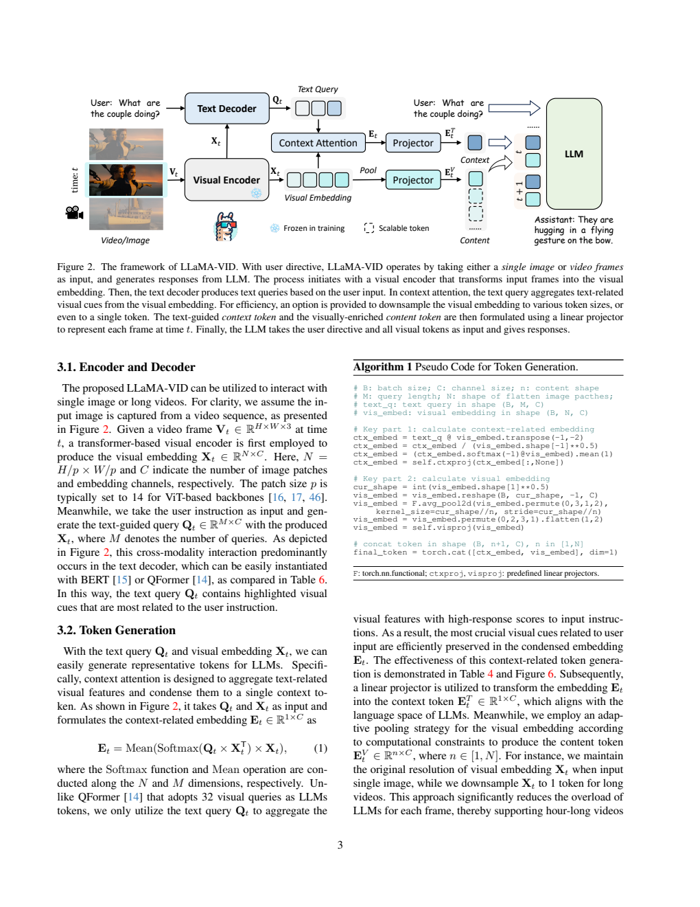
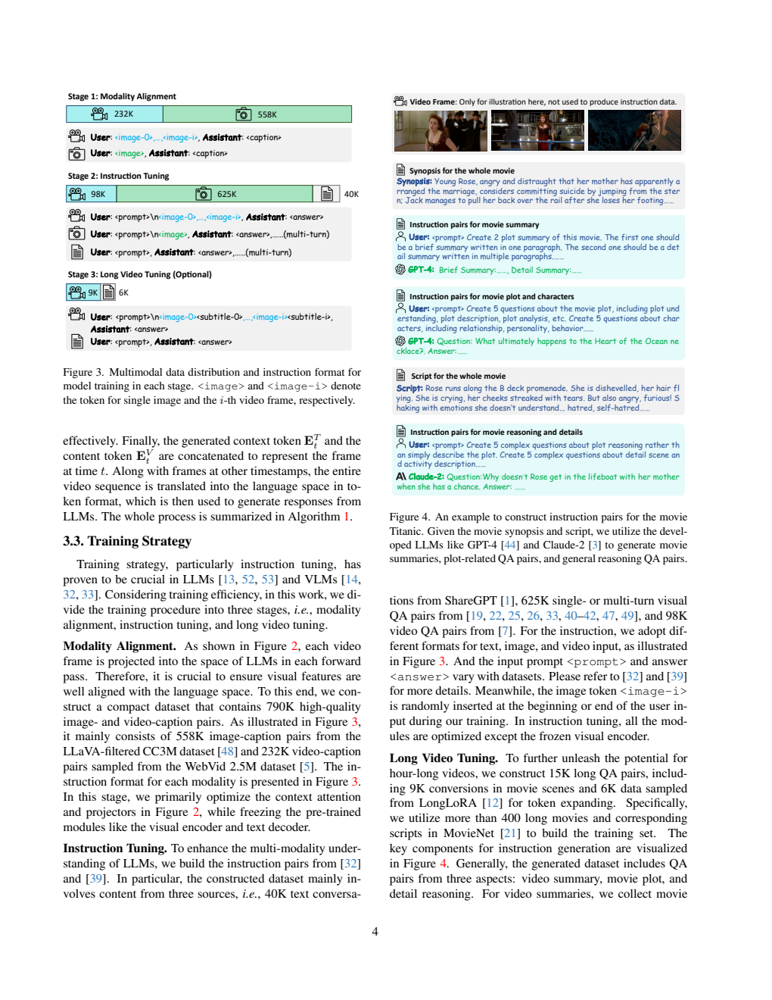
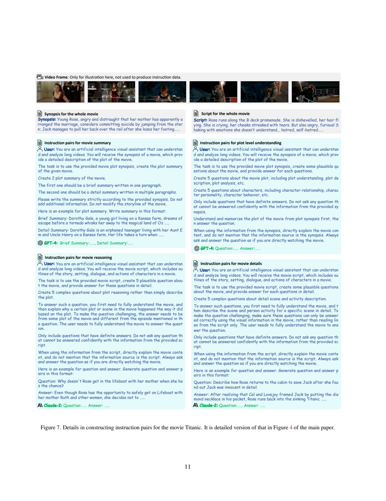
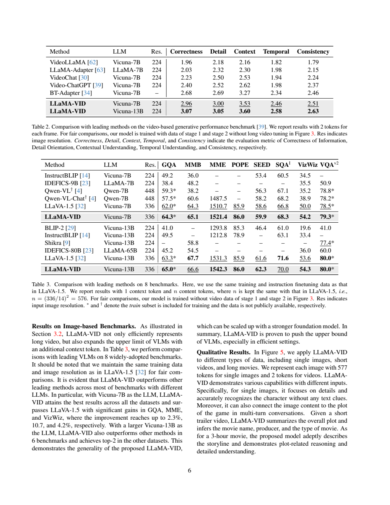

# LLaMA-VID：以问题相关 token 和内容 token 压缩视频帧

## 1. 论文信息与模型定位

**论文：** *LLaMA-VID: An Image is Worth 2 Tokens in Large Language Models*。作者 Yanwei Li、Chengyao Wang、Jiaya Jia，来自香港中文大学和 SmartMore。本篇使用 [arXiv 2311.17043v1](https://arxiv.org/abs/2311.17043v1)，2023 年 11 月 28 日提交，共 18 页。官方仓库是 [dvlab-research/LLaMA-VID](https://github.com/dvlab-research/LLaMA-VID)。

LLaMA-VID 针对图像、短视频和长电影输入的文本问答。核心问题是：若每帧都给 LLM 数百个视觉 token，长视频会迅速超出上下文预算。作者为每帧构建一个随问题变化的 **context token** 和一组表示画面内容的 **content tokens**；视频配置将后者压成一个，于是每帧总共两个。

这不是说所有实验都仅用两个 token。图像主结果在 336 分辨率下保留 **576 个 content tokens + 1 个 context token = 577**；长电影示例还输入字幕并扩展到 64K 上下文。理解这些配置差异，是阅读本报告的前提。[原文 §3–4，PDF 第 3–6 页](https://arxiv.org/pdf/2311.17043v1#page=3)

## 2. 快速概览

| 项目 | 实现与含义 |
|---|---|
| 默认骨干 | 固定 EVA-G 视觉编码器、预训练 QFormer、Vicuna-7B/13B |
| Context token | 用户指令引导的查询对视觉 patch 加权聚合，压为一个向量 |
| Content tokens | 对原始视觉特征做空间平均池化，数量按计算预算调整 |
| 视频设置 | 每秒采一帧，每帧 2 个视觉 token；视觉编码器仍需逐帧运行 |
| 图像设置 | 主表使用 577 个 token，不是两 token 压缩成绩 |
| 长电影设置 | 可选第三阶段，MovieNet 合成问答、字幕、LongAlpaca 与 64K 上下文 |
| 证据层次 | 短视频与图像有量化基准；数小时电影主要是问答示例 |

两个 token 分工不同：一个尽量回答“用户在这一帧想找什么”，另一个保留“这一帧整体有什么”。后者不依赖具体提问，前者则需要根据用户输入重新产生；因而不是一次预计算后适用于任意问题的全部视觉表示。

## 3. 整体架构

**原图：Figure 2、Algorithm 1，PDF 第 3 页。** 从左边帧进入视觉编码器后，特征分两路：上路与用户指令生成的 Text Query 做 Context Attention；下路经过 Pool。两个 Projector 把输出送入 LLM，虚线 content 区域表示可伸缩数量。图中“Text Decoder”是用于跨模态查询的模块，不是最后生成回答的 Vicuna。

第 \(t\) 帧经过 EVA-G 产生 \(X_t\in\mathbb R^{N\times C}\)。QFormer 接收用户指令与视觉特征，输出 \(M\) 个问题相关查询 \(Q_t\in\mathbb R^{M\times C}\)。Context Attention 再用查询从视觉特征中取出相关内容，并平均成一个 context 表示。

另一条路径对 \(X_t\) 的空间网格做平均池化，生成 \(n\) 个 content 表示，\(1\le n\le N\)。视频令 \(n=1\)，图像可保留全部 patch。两个独立线性投影将表示转到语言输入空间，帧 token 按时间顺序与用户文字一起进入 LLM；长电影配置还穿插字幕 token。

这种压缩发生在**视觉编码器之后、LLM 之前**，减少 LLM 的视觉序列长度，但不等于视觉骨干只看两个 patch。它也没有通过跨帧时序编码器证明每个动作细节完整保留；低帧率抽样和空间池化都可能丢失信息。[原文 §3.1–3.2，PDF 第 3–4 页](https://arxiv.org/pdf/2311.17043v1#page=3)

## 4. 核心创新与数学原理

原文式 (1) 定义 context 表示：

\[
E_t=\operatorname{Mean}_{M}\!left[
\operatorname{Softmax}_{N}(Q_tX_t^\top)X_t\right].
\]

\(Q_tX_t^\top\) 得到每个查询对每个 patch 的匹配分数，softmax 沿 patch 维归一化；每个查询获取一份视觉加权和，最后沿查询维求平均，得到 \(1\times C\) 向量。Algorithm 1 的代码还在 softmax 前除以 \(\sqrt C\)，而正文公式省略该缩放；具体实现解读应以代码为准，不能把二者写成完全相同的公式。

相比直接把 QFormer 的多个查询输出全部交给 LLM，这里查询充当“如何汇聚原始视觉特征”的中介，最终只输出一个 context token。问题不同，查询及关注区域也可变化。注意力热图只显示匹配响应，不能自动视为模型推理因果的证明。[原文式 (1)、Algorithm 1、Figure 6，PDF 第 3、8 页](https://arxiv.org/pdf/2311.17043v1#page=3)

Content 路径可概括为 \(E_t^V=P_V(\operatorname{Pool}_n(X_t))\)，context 路径为 \(E_t^T=P_T(E_t)\)，再拼接为 \([E_t^T;E_t^V]\)。这两式是本文对图和伪代码的整理，不是论文另外编号的目标。\(n=1\) 是全局平均，\(n=N\) 保留空间特征。代价与信息取舍集中在 \(n\) 的选择，而非新增一套文字损失。

以 224 输入、patch 14 的 256 个视觉 token 为参照，视频的 2 个 token 在**视觉输入数量**上是 1/128。但 LLM 还有问题、字幕和输出 token，且视觉编码及 QFormer 开销仍存在，所以不能把这个比例描述成已经测得的整套系统 128 倍提速。更少 token 也不是无损编码。

长电影的另一必要机制是上下文扩展：附录采用位置插值将 RoPE 的原 4K 范围扩到 64K，然后进行监督微调。按 1 FPS 粗算，三小时电影约 10,800 帧，两个视觉 token/帧约 21,600 个，仍需为字幕及问答留空间；这些数是按采样率推算，真实长度随电影时长和字幕变化。[原文 §4.3、附录 B，PDF 第 7–9 页](https://arxiv.org/pdf/2311.17043v1#page=9)

## 5. 数据构建与处理

**原图：Figure 3、Figure 4，PDF 第 4 页。** 左侧三层分别是对齐、普通指令、可选长视频阶段，图片/视频/文字各有输入格式。右图顶部明确写着视频帧只用于展示，不用于生成指令；教师真正读取的是 synopsis 和 script。这决定了电影监督的信息来源。

第一阶段约 **790K 描述配对**，由 LLaVA 过滤的 CC3M 图像 558K 和从 WebVid2.5M 采样的视频 232K 组成。输入图像或视频帧，目标是对应 caption。

第二阶段包含 **40K ShareGPT 文本对话、625K 图像视觉问答、98K 视频问答**。图像部分沿用 LLaVA-1.5 等数据组织，包含通用问答、区域指代、OCR 和知识任务。图像 token 随机放在用户输入的开头或结尾。视频问答的来源包含 ActivityNet；因此报告所称 zero-shot 是其基准评测设置，不能进一步理解为从未见过该数据集的任何训练样本。

可选第三阶段为 **15K Long-VideoQA**：9K 电影对话与 6K LongAlpaca 长上下文数据。作者从 MovieNet 取超过 400 部电影及对应故事梗概、剧本。GPT-4 根据梗概生成约 1K 简短/详细摘要、4K 剧情与人物问答；Claude-2 根据长剧本生成约 4K 推理和细节问答。

**原图：Figure 7，PDF 第 11 页。** 四个区域依次给出摘要、剧情、推理、细节生成指令。提示要求以正在观看电影的语气回答，但教师输入是文字表示；底部要求“需要视觉信息”的问题也不能证明教师实际读取了视觉内容。数据可能继承剧本与最终画面的差异、教师幻觉或电影常识。

训练长视频时，模型输入每帧视觉 token 与相应字幕，并预测问答目标。该设计同时利用画面与语言线索，论文未通过大规模字幕移除或已知电影排除实验，严格量化各自贡献。也未披露电影样本的完整测试隔离及教师数据错误率。[原文 §3.3、附录 B，PDF 第 4–5、9–11 页](https://arxiv.org/pdf/2311.17043v1#page=4)

## 6. 训练流程与目标

三个阶段采用条件文本生成的监督学习，原文没有另设 context/content 重建或对比损失。若记模型视觉 token 序列为 \(H\)、用户提示为 \(q\)、目标回答为 \(y\)，可解释为 \(-\sum_t\log p_\theta(y_t\mid H,q,y_{<t})\)；这是对训练描述的数学归纳。

| 配置 | 阶段 1：对齐 | 阶段 2：指令 | 阶段 3：可选长视频 |
|---|---|---|---|
| 全局 batch | 256 | 128 | 8 |
| 学习率 | \(10^{-3}\) | \(2\times10^{-5}\) | \(2\times10^{-5}\) |
| 最大序列长度 | 2048 | 2048 | 65536 |
| 视觉编码器 | 冻结 | 冻结 | 冻结 |
| QFormer 文本查询模块 | 冻结 | 训练 | 再冻结以省显存 |
| 语言模型 | 冻结 | 训练 | 随长上下文监督调整 |

第一阶段优化视觉 token 接口、投影等可训练部分；若消融采用随机初始化的两层 BERT，则它与预训练 QFormer 的冻结设置不同。第二阶段除视觉编码器外训练各模块。第三阶段进一步固定文本查询模块并扩展语言上下文，不能把“全模块开放”照搬到长视频阶段。

附录 Table 7 给出每阶段 1 epoch、AdamW、cosine 学习率、warm-up ratio 0.03、weight decay 0、DeepSpeed stage 2。视频以 **1 FPS** 抽帧，所有模型使用 **8 张 A100**。引言称可在两天内完成训练，但没有逐阶段时长、精度、显存容量和全部 AdamW 参数，本文不由显卡型号推断这些配置。[原文 §4.1、附录 A、Table 7，PDF 第 5、9 页](https://arxiv.org/pdf/2311.17043v1#page=9)

## 7. 实验设置与主要结果

短视频基准的模型只完成阶段 1–2，**未做长电影微调**，每帧 2 tokens、224 分辨率。Table 1 的三项开放问答结果如下；Score 是其问答评估分数，与准确率分开报告。

| 模型 | MSVD-QA Acc / Score | MSRVTT-QA Acc / Score | ActivityNet-QA Acc / Score |
|---|---:|---:|---:|
| BT-Adapter 7B | 67.5 / 3.7 | 57.0 / 3.2 | 45.7 / 3.2 |
| LLaMA-VID 7B | 69.7 / 3.7 | 57.7 / 3.2 | 47.4 / 3.3 |
| LLaMA-VID 13B | 70.0 / 3.7 | 58.9 / 3.3 | 47.5 / 3.3 |

7B 准确率增量为 2.2、0.7、1.7 个百分点，分数有两项持平；不能说所有指标都严格提高。不同基线的骨干、预训练数据不完全一致，该表是系统比较。论文沿用 Video-ChatGPT 的开放式评估协议，未在本篇提供完整评委版本和重复采样不确定性。[原文 Table 1，PDF 第 5 页](https://arxiv.org/pdf/2311.17043v1#page=5)

**原表：Table 2、Table 3，PDF 第 6 页。** 上表是视频回答质量的五个维度；下表是图像模型，caption 明确使用 1 context + 576 content，并排除普通视频训练数据以与 LLaVA-1.5 对齐。带星号的任务把对应训练划分加入了训练，不能都称为跨数据集零样本测试。

视频生成评估中，7B 的 correctness/detail/context/temporal/consistency 为 **2.96/3.00/3.53/2.46/2.51**，13B 为 **3.07/3.05/3.60/2.58/2.63**。它们超过表中 BT-Adapter 的对应分数，但这些是评委维度分，不是动作定位或时间戳误差。

图像 7B 模型的 GQA/MMBench/MME/POPE/SEED/ScienceQA-Image/VizWiz/VQAv2 为 **64.3/65.1/1521.4/86.0/59.9/68.3/54.2/79.3**，比相同分辨率的 LLaVA-1.5 多项提高。13B 并非全面提高：MMBench 为 66.6，低于 LLaVA-1.5 的 67.7；ScienceQA-Image 70.0 低于 71.6；VQAv2 同为 80.0。这是额外 context token 的收益证据，不是 2 token 无损代替全部 patch 的证据。

压缩消融更清楚揭示取舍：224 输入的 256 content tokens、无 context 时，GQA/TextVQA 为 61.9/53.0；增加 context 变为 63.0/53.8。压到 1 context + 1 content 后则为 **55.5/49.0**，存在明显细节损失，ScienceQA-Image 却为 68.8，高于原 67.5。Context/content 单独使用的 GQA 为 54.3/53.3，结合为 55.5，说明互补而非单一路径解决全部问题。[原文 Table 4–6，PDF 第 7–8 页](https://arxiv.org/pdf/2311.17043v1#page=7)

数小时电影展示证明模型可以容纳相关输入并生成回答，报告没有给这一时长下的大型独立量化基准。附录与 LLaMA2/LongLoRA 的比较还是选例，且输入信息不完全相同。Figure 8 的 Titanic 摘要自身含与后续问答冲突的票来源等叙述，表明长输入能力不等于长电影事实全部可靠。字幕、电影知识、文本合成教师与压缩视觉共同影响结果，不能只凭熟悉电影的正确回答证明每个结论源自画面。
