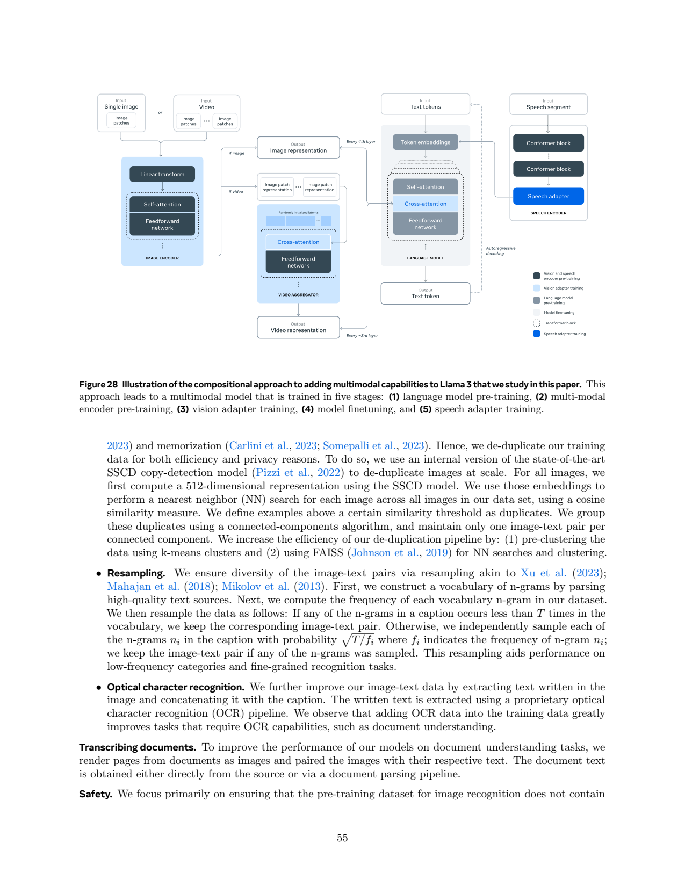
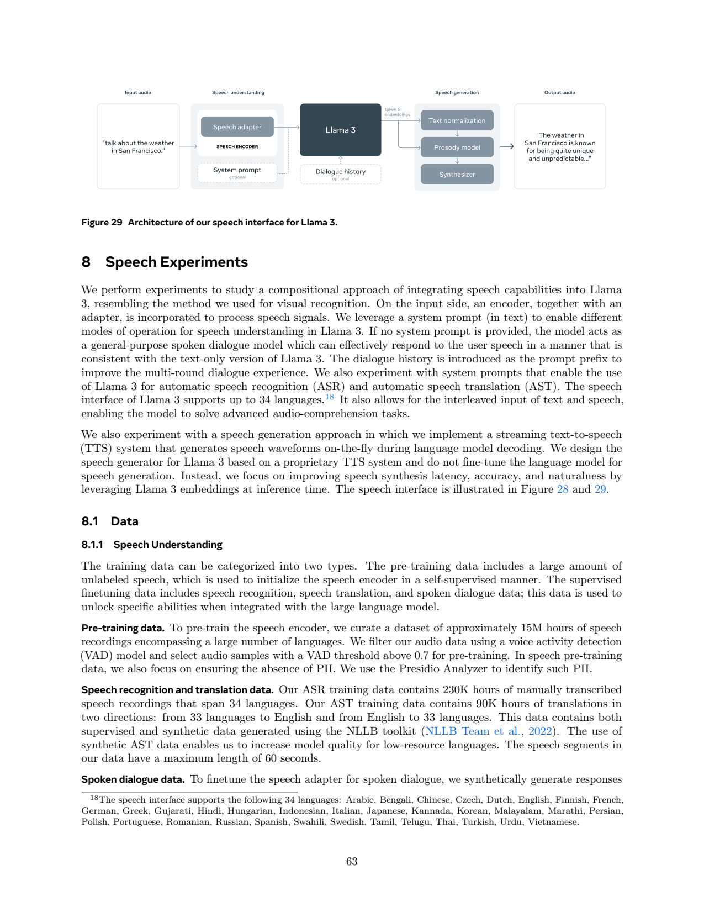
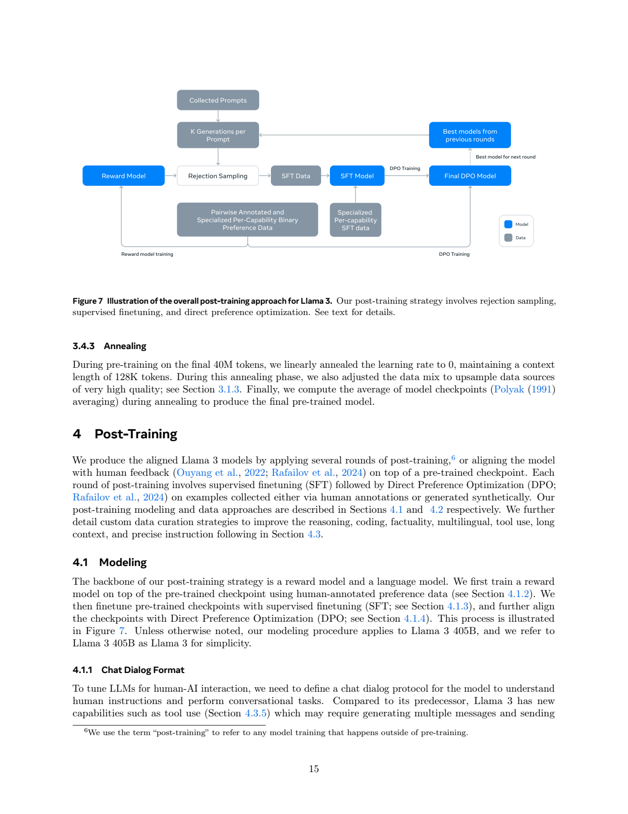
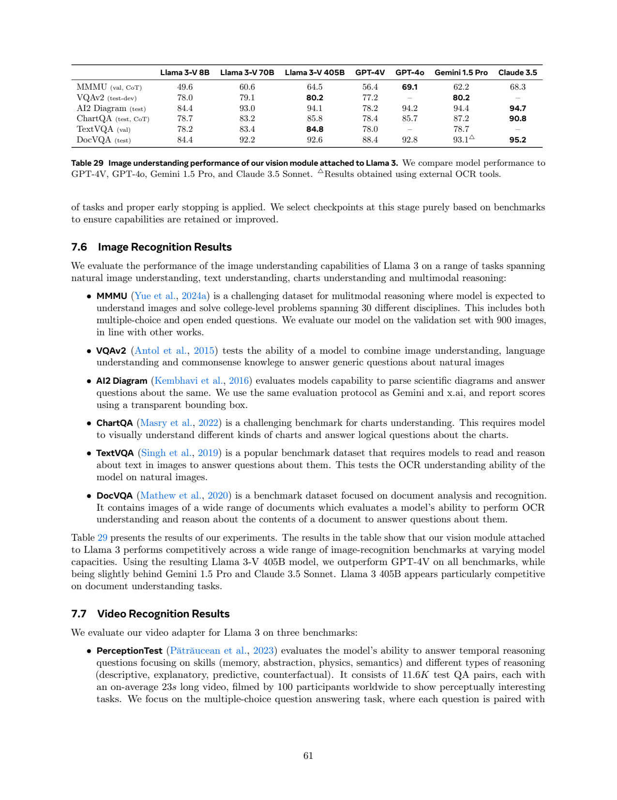

# Llama 3：大规模稠密语言模型与组合式视觉、语音扩展

## 1. 论文信息与模型定位

| 项目 | 信息 |
|---|---|
| 原文 | *The Llama 3 Herd of Models*，Llama Team, AI @ Meta |
| 固定版本 | [arXiv:2407.21783v1](https://arxiv.org/pdf/2407.21783v1)，2024-07-31 提交；报告首页日期为 2024-07-23 |
| 语言模型 | 8B、70B、405B，稠密 Transformer，最长 128K 上下文 |
| 版本口径 | 原文简称“Llama 3”，但明确所有报告结果对应 Llama 3.1 |
| 多模态范围 | 组合式图像、视频识别与语音理解/生成实验；当时仍在开发，尚未广泛发布 |
| 官方入口 | [Meta Llama](https://llama.meta.com/)、[官方代码组织](https://github.com/meta-llama) |

这份报告首先解释如何用约 15T 级文本数据、数据质量管理与大规模训练构建语言模型，然后讨论在冻结语言骨干的条件下加入视觉和语音模块。它不是一份从头联合训练所有模态的单一模型报告。发布的语言权重与报告中尚未发布的 Llama 3-V、语音接口，必须分开理解。[PDF 第 1–4 页](https://arxiv.org/pdf/2407.21783v1#page=1)

405B 旗舰语言模型使用 15.6T 文本 token 与约 $3.8\times10^{25}$ FLOPs 预训练。对于多模态扩展，视觉使用跨注意力注入图像特征，语音使用映射后的连续嵌入进入语言模型。作者强调模块化开发与保留文字能力；相应代价是额外编码器、适配器参数和独立数据流程。本文以原文当时的实验状态介绍，未把后续 Llama 产品能力反推到此版本。

## 2. 快速概览

| 主线 | 机制与意义 |
|---|---|
| 语言底座 | 稠密模型、8 个 KV 头的 GQA、128K 词表、更高 RoPE 基频 |
| 数据与扩展规律 | 多级文本清洗、分类配比、小模型预测大模型表现 |
| 对齐 | 六轮奖励模型、拒绝采样、SFT、DPO，强化代码、工具与多语能力 |
| 图像 | 多层 ViT 特征与周期性跨注意力，语言骨干保持冻结 |
| 视频 | 时间聚合器将多帧压缩为少量有效帧，再由视频跨注意力读取 |
| 语音 | Conformer 与适配器形成输入嵌入；文字归一化和韵律模块负责输出 |

旗舰语言模型在 HumanEval 的 pass@1 为 89.0；实验性 Llama 3-V 405B 在 MMMU validation+CoT 为 64.5，ChartQA test+CoT 为 85.8；70B 视频版本 PerceptionTest 为 60.8。语音接口在 FLEURS 的 34 语言评测中达到 8.2 的错误率口径，部分语言使用字符错误率。它们评估的对象、拆分和指标不同，不应拼成一个统一“多模态总分”。[PDF 第 3、61–67 页](https://arxiv.org/pdf/2407.21783v1#page=61)

## 3. 整体架构

语言模型延续 Llama 系列的稠密 Transformer。8B/70B/405B 分别为 32/80/126 层，隐藏维度 4096/8192/16384，FFN 维度 14336/28672/53248，查询头数 32/64/128，KV 头数均为 8。激活使用 SwiGLU，RoPE 基频为 500,000。训练序列中的不同文档通过注意力 mask 隔离，避免把拼接边界当成真正连续上下文。[PDF 第 6–7 页](https://arxiv.org/pdf/2407.21783v1#page=6)

**图怎么读。** 左侧图像经 ViT 编码，视频再通过时间聚合器形成压缩表示；中间文字骨干周期性插入跨注意力，主动读取视觉信息。右侧语音经过 Conformer 和适配器后进入 token embedding 路径。图中颜色标示不同训练阶段，说明视觉与语音采用不同的接入方式。具体视频插入频率按正文第 57 页的实现说明解读，不能由示意图标签反推出另一套训练配置。

图像编码器最初是 630M 参数的 ViT-H/14，在 2.5B 图文对上训练五轮，输入 224×224。除了最后一层，还提取第 4、8、16、24、31 层特征，以补回对比学习表示容易丢失的细粒度位置。作者额外插入 8 个门控自注意力层，使编码器达到 40 个 Transformer block、约 850M 参数，每个 patch 的多层拼接特征维度为 7680。后续视觉训练中编码器不冻结。[PDF 第 56–57 页](https://arxiv.org/pdf/2407.21783v1#page=57)

图像跨注意力位于骨干每四个自注意力层之后。它并不让全部图像 patch 经过每层语言 FFN，因而节约部分运算；但参数开销并不小：405B 语言骨干对应的图像适配器约有 100B 参数。表中“Llama 3-V 405B”以骨干规模命名，不能说整个视觉系统只有 405B。

视频输入最多 64 个均匀采样帧，每帧先用图像编码器处理，再用 Perceiver resampler 聚合。正文介绍每 32 帧聚成一个有效帧，视频跨注意力插在每四个图像跨注意力层之前。预训练实际使用 16 帧并按 16 聚合为一个有效帧，SFT 使用 64 帧、按 32 聚合为两个。原文第 57 页的一处“7B”命名与全报告 8B 模型不一致，本文沿正式模型命名，保留具体训练描述的阶段差别。

**图怎么读。** 输入语音经编码器与适配器交给 Llama 3，系统提示选择识别、翻译或对话模式。输出文字及隐藏嵌入送入 text normalization、prosody model 与 synthesizer，再形成波形。这里存在明确的文字及专用 TTS 中间模块，不能据此称模型原生直接预测最终音频波形。

语音编码器为约 1B 参数、24 层 Conformer，80 维 mel 特征先以 stride 4 压缩到 40ms；约 100M 适配器再用卷积压缩至 80ms，并经 Transformer 和线性层映射到语言嵌入维度。语音输出实验只用 Llama 3 8B 的第 16 层隐藏状态增强文本归一化和韵律预测，声学模型与 WaveRNN 声码器最终合成声音。[PDF 第 64–68 页](https://arxiv.org/pdf/2407.21783v1#page=64)

## 4. 核心创新与数学原理

**GQA 减少缓存而保持多个查询头。** 若 $h_q$ 为查询头数、$h_{kv}$ 为 KV 头数，每组查询共享一组 K/V。为解释此机制，可写 $A_j=\operatorname{softmax}(Q_jK_{g(j)}^\top/\sqrt d+M)V_{g(j)}$。这是标准注意力的解释式，原文贡献是其具体配置及规模化实践。缓存主要随 KV 头数增长，因此 405B 的 128 个查询头无需各自保留独立的 128 份 K/V；计算仍是因果自注意力，不能称为线性注意力。

**先预测损失，再预测任务准确率。** 作者用 $6\times10^{18}$ 到 $10^{22}$ FLOPs 的小规模实验拟合 IsoFLOPs 曲线，寻找同预算下的最优模型与 token 数。原文给出 $N^\star(C)=AC^\alpha$，其中 $N^\star$ 是最优训练 token 数，不能把它误读成参数量。文中舍入拟合为 $\alpha\approx0.53,A\approx0.29$，图例更精细为 0.537、0.299；外推至旗舰预算得到约 402B 参数和 16.55T token 的候选。[PDF 第 7–9 页](https://arxiv.org/pdf/2407.21783v1#page=7)

报告进一步建立训练算力→下游正确答案负对数似然→准确率的两段关系，后一步使用 sigmoid 拟合并加入 Llama 2 实验。这样比直接把语言建模损失下降等同于能力提升更明确；但其成功案例主要是特定任务与数据配方，不能将系数当作所有多模态模型的通用定律。

**组合式视觉读取。** 用解释式 $\operatorname{CrossAttn}(H,V)=\operatorname{softmax}((HW_Q)(VW_K)^\top/\sqrt d)VW_V$ 可理解视觉适配器：文字隐藏状态 $H$ 提问，视觉特征 $V$ 提供信息。冻结语言权重使文字路径得到保护，视觉编码器及新跨注意力学习如何满足该骨干的特征需求。多层特征缓解语义抽象和位置精度的矛盾；它没有提供生成图像的解码器。

**拒绝采样与 DPO 的作用不同。** 奖励模型先筛选回答，再用标准目标 token 交叉熵进行 SFT。为解释 DPO，可用标准式 $\mathcal L_{\mathrm{DPO}}=-\mathbb E\log\sigma(\beta[\log\frac{\pi_\theta(y^+\mid x)}{\pi_{\mathrm{ref}}(y^+\mid x)}-\log\frac{\pi_\theta(y^-\mid x)}{\pi_{\mathrm{ref}}(y^-\mid x)}])$。该式是所用 DPO 的通用数学表达，原文还明确修改格式 token 的参与方式，并添加 chosen 序列 NLL 正则。视觉 DPO 另采用每隔若干步 EMA 更新 reference，不能把语言 DPO 与视觉 DPO 的细节完全合并。[PDF 第 16、60 页](https://arxiv.org/pdf/2407.21783v1#page=16)

**语音自监督与输出流式化。** BEST-RQ 对 mel 输入遮挡并预测固定随机量化目标；随机投影和码本不被训练，编码器学的是从上下文恢复被遮挡的声学类别。语音生成则用有限前瞻与因果 mask，让 phone 级特征和 token 级隐藏状态在不同速率下对齐。两者目标不同，报告没有使用一个统一音频 token 生成损失覆盖整个接口。

## 5. 数据构建与处理

文字数据处理保留数学和代码结构，特别保留图片 alt 中的公式文字；按 URL、文档 MinHash 和行三个层面去重，再用重复 n-gram、异常 token 分布和模型质量评分删除低质内容。语言识别覆盖 176 种语言，但正式支持及安全调优主要是八种，不能把识别范围当作已充分验证的输出支持范围。最终预训练配比约为一般知识 50%、数学推理 25%、代码 17%、多语 8%，训练中还会调整。[PDF 第 4–6 页](https://arxiv.org/pdf/2407.21783v1#page=4)

后训练多数目标来自模型合成。每个拒绝采样 prompt 通常生成 10–30 个回答，用奖励模型选择；质量过滤结合 RM 或模型评分，而不是要求两者必然同时通过。语义去重将对话聚类，按质量×难度排序后保留不相似样本。代码专项分支继续预训练约 1T、超过 85% 代码数据，再用于生成高质量样本；SFT 共使用超过 2.7M 合成代码实例。执行反馈与单元测试能发现一些错误，但报告明确并非完备正确性证明。[PDF 第 17–23 页](https://arxiv.org/pdf/2407.21783v1#page=17)

长上下文数据通过 8K 分块问答、分层摘要和仓库依赖恢复构造；SFT 混入约 0.1% 长样本，Table 7 的具体例数占比为 0.11%。这是按样本统计，不代表只用 0.1% 的训练 token。工具数据同时覆盖调用、执行结果和后续推理，工具专项未发现拒绝采样增益，因此不能说所有能力都用相同筛选流程。

视觉语料经过 CLIP 对齐过滤、SSCD 512 维特征近邻去重和长尾 n-gram 重采样。图中的 OCR 被附加到 caption，文档页被渲染为图像并与全文配对。图像适配器预训练使用约 6B 图文对；退火集合约 500M，其中 350M 来自原语料重采样，150M 补充 grounding、HTML 截图解析、问答、合成描述和结构化图像。坐标既可通过图上标记表达，也可作为归一化框写入文本。[PDF 第 54–58 页](https://arxiv.org/pdf/2407.21783v1#page=54)

视频过滤文字质量、语言、叠加文字、图文及视频文本对齐和低运动片段。原文没有按美学或分辨率再次筛视频；平均 21 秒，超过 99% 不到一分钟。这说明训练分布以短片段为主，即使评测含更长视频，也不应称其训练覆盖任意长时序。

语音编码器用约 15M 小时无标注录音预训练，VAD 阈值大于 0.7。ASR 有 230K 小时、34 语言人工转写，AST 有 90K 小时双向翻译，包含合成数据；口语对话使用 ASR 子集中的 60K 小时生成回答，另从文字 SFT 数据合成 25K 小时语音。这些来源可能属于不同子集和扩展，不能简单相加为去重后的总小时数。TTS 韵律训练使用 50K 小时专业录音，文本归一化使用 55K 样本。[PDF 第 63–64 页](https://arxiv.org/pdf/2407.21783v1#page=63)

## 6. 训练流程与目标

语言 405B 初始阶段用 AdamW，峰值学习率 $8\times10^{-5}$，8000 步 warm-up，余弦降至 $8\times10^{-7}$，调度覆盖 1.2M 步。batch 从 4M token 增至 8M、16M，序列从 4096 增至 8192。随后用约 800B token 在六个阶段逐步扩展至 128K，要求短任务恢复并通过对应长度的 needle 检索。固定 v1 第 15 页写最终 40M token 线性退火至零并做 checkpoint averaging；第 6 页用于数据价值测试的是 40B，二者不可替换。[PDF 第 14–15 页](https://arxiv.org/pdf/2407.21783v1#page=14)

训练最多使用 16,384 块 H100，而基础集群拥有约 24K，不是全部同时训练本模型。张量、上下文、流水线和 FSDP 构成四维并行，BF16 MFU 为 38–43%；梯度累积与部分梯度通信采用 FP32。报告统计的 54 天窗口用于运行可靠性分析，不能作为完整训练历时。[PDF 第 9–14 页](https://arxiv.org/pdf/2407.21783v1#page=9)

**图怎么读。** 先采集 prompt，再用上一轮模型生成多个回答，奖励模型筛选后组成 SFT 数据。SFT 模型经偏好数据做 DPO，再成为下一轮候选生成器。蓝色是模型，灰色是数据；奖励模型主要负责筛选，报告最终对齐方法并不是直接把 RM 分数作为 PPO 优化目标。

语言 SFT 只对目标 token 计算损失，最大模型学习率 $10^{-5}$、约 8.5K–9K 步。DPO 学习率也是 $10^{-5}$、$\beta=0.1$，排除共同格式 token 并加入系数 0.2 的 chosen NLL 项。以上流程迭代六轮，DPO 主要采用最近的偏好数据以减少分布偏移。[PDF 第 16–18 页](https://arxiv.org/pdf/2407.21783v1#page=16)

| 多模态阶段 | 可训练模块与主要配置 |
|---|---|
| 图像适配预训练 | 语言冻结，视觉编码器与适配器训练；约 6B 对，每图最多四块 336×336，batch 16,384，初始 LR $10^{-3}$、余弦、WD 0.01；长训练中另有 LR 调整 |
| 图像退火 | 提高分辨率；重新 warm-up 至 $2\times10^{-5}$，余弦 |
| 图像 SFT | 语言权重替换为指令模型并保持冻结，训练 ViT 与适配器；多组配置搜索后平均优胜权重 |
| 视频预训练 | 仅视频聚合器与视频跨注意力训练；16 帧，每帧四块 448×448，batch 4096、长度 190、LR $10^{-4}$ |
| 视频 SFT | 只训练视频模块；64 帧压为两个有效帧 |
| 语音编码器预训练 | BEST-RQ，500K 步，batch 2048，16 个固定随机码本 |
| 语音理解 SFT | 语言冻结；8B 接口 650K 更新、batch 512、LR $10^{-4}$；70B 接口 600K、batch 768、LR $4\times10^{-5}$ |

视觉后训练另含奖励模型、DPO、拒绝采样与小规模质量微调。最终答案正确并不足够，作者还过滤容易出现错误解释的样本，用奖励模型选择多个优质推理。语音韵律模块独立训练，冻结 Llama 3 8B，用 1M 更新、batch 1024、LR $9\times10^{-4}$。这些精细流程揭示了组合模型的优势与工程成本，但报告并未给出完整多模态训练总算力或适配器全部超参数。[PDF 第 58–66 页](https://arxiv.org/pdf/2407.21783v1#page=58)

## 7. 实验设置与主要结果

语言模型结果区分 base 与 instruct；代码评测采用 pass@1，HumanEval 405B 为 $89.0\pm4.8$，HumanEval+ 为 $82.3\pm5.8$。MMLU 5-shot 为 87.3，0-shot CoT 为 88.6，不能把两种设置合并。报告为部分简单均值指标提供 95% 置信区间，也承认这主要刻画有限样本误差，不能涵盖全部评测波动。[PDF 第 29、35–39 页](https://arxiv.org/pdf/2407.21783v1#page=29)

**表怎么读。** 三个 Llama 3-V 列标注语言骨干规模，列间不是只有“总参数”这一变量。MMMU 与 ChartQA 明确有 CoT；DocVQA 中 Gemini 的三角标记代表外部 OCR。缺失结果用横线表示，不能当作零分。

| 图像任务 | 8B 骨干 | 70B 骨干 | 405B 骨干 |
|---|---:|---:|---:|
| MMMU val，CoT | 49.6 | 60.6 | 64.5 |
| VQAv2 test-dev | 78.0 | 79.1 | 80.2 |
| AI2 Diagram test | 84.4 | 93.0 | 94.1 |
| ChartQA test，CoT | 78.7 | 83.2 | 85.8 |
| TextVQA val | 78.2 | 83.4 | 84.8 |
| DocVQA test | 84.4 | 92.2 | 92.6 |

405B 视觉扩展优于表中 GPT-4V 各项结果，但 MMMU 仍低于 GPT-4o 的 69.1 和 Claude 3.5 的 68.3，DocVQA 低于 Claude 的 95.2。因此结论是组合式扩展具有竞争力，不能概括为视觉能力全面领先。MMMU 使用 900 图 validation；AI2 Diagram 使用透明框提示，这些协议应与后续其他报告的同名数字分开。

视频只报告 8B 与 70B。70B 在 PerceptionTest 为 60.8，TVQA 为 87.9，NExT-QA 为 30.3，ActivityNet-QA 为 56.3。TVQA 推理输入包含字幕；NExT-QA 使用 WUPS，ActivityNet-QA 使用 GPT-3.5 判断短回答正确性。最多 64 帧意味着长视频会稀疏采样，不能将表中性能解释成逐帧充分理解。[PDF 第 61–62 页](https://arxiv.org/pdf/2407.21783v1#page=61)

语音评测使用 greedy decoding 与 Whisper 文本归一化。70B 接口在 MLS English 错误率 4.4、LibriSpeech test-other 3.1、VoxPopuli 5.7、FLEURS 8.2；中日韩泰使用字符错误率。翻译的 FLEURS 33 语言→英语 BLEU 为 33.7，CoVoST2 的 15 语言子集为 38.8。不能据此称它所有语言方向都同等可靠。文本归一化在三个 token 前瞻下从不使用 Llama 嵌入的 73.6% 提升到 90.7%；韵律人评相对流式 phone-only 基线获 60.0% 偏好，与非流式基线相比为 63.6%。[PDF 第 66–69 页](https://arxiv.org/pdf/2407.21783v1#page=66)

报告还检查数据污染、对抗题、人工偏好与系统防护。8-gram 污染检测无法可靠估计所有基准，部分数据集存在明显污染相关增益；对抗数学与问答仍显著弱于普通题。Llama Guard 3 能减少违规，但增加误拒绝，不能将其系统结果视为原始模型独立表现。人评也有标注偏好与背景带来的局限。本文没有独立复现实验；原文的冻结边界、接口参数、任务协议与发布状态，比把不同指标统一排序更能解释其多模态设计的实际意义。
