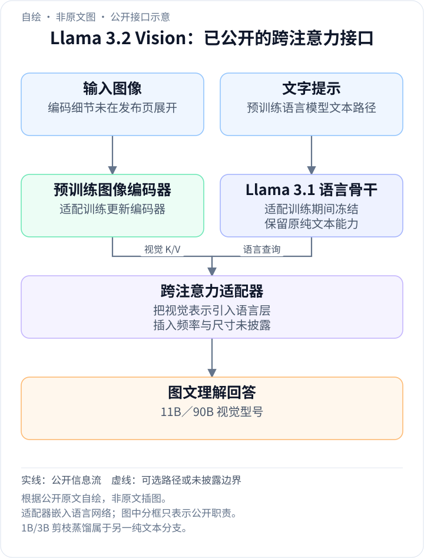
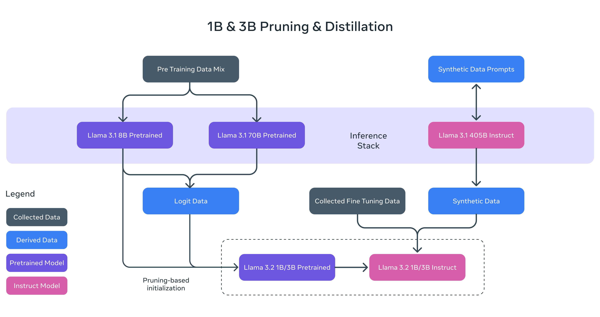
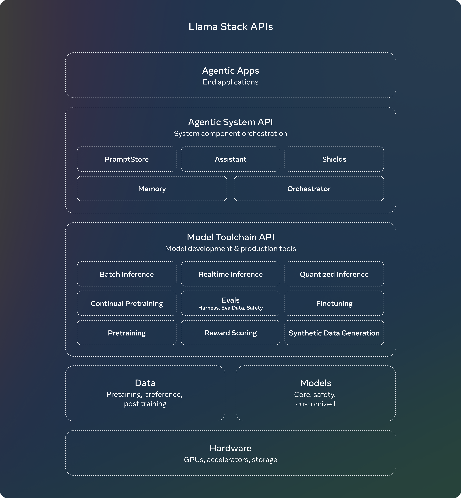
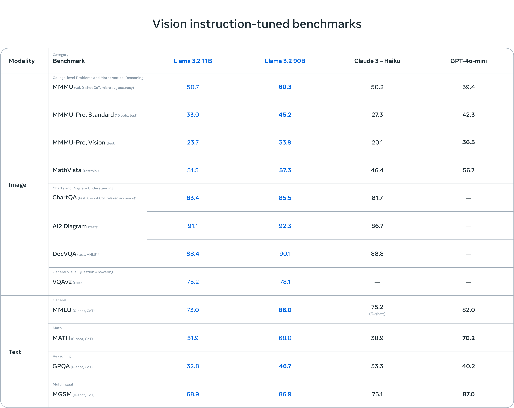
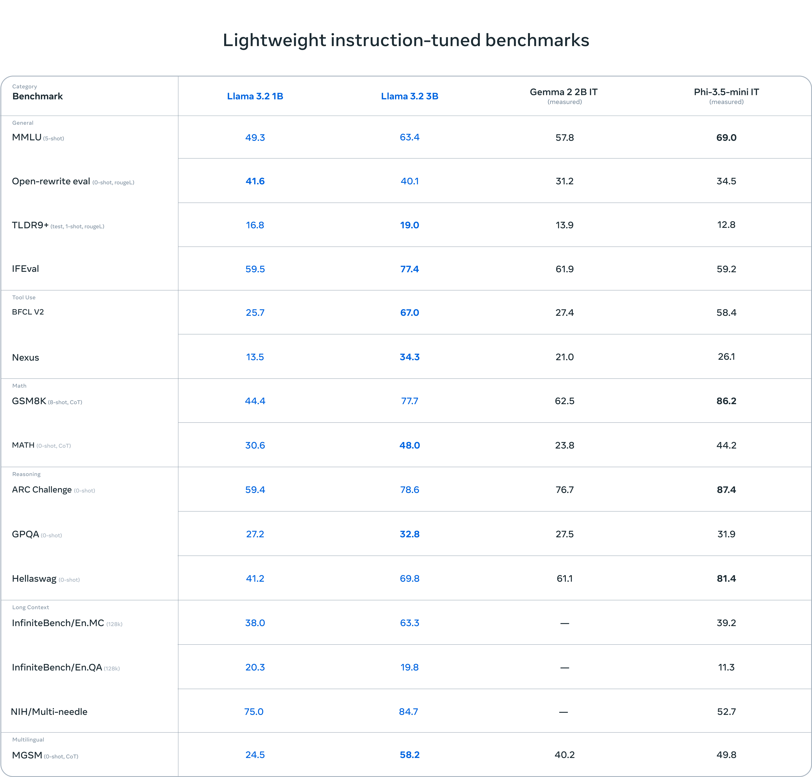

<!-- article-header:start -->
[项目首页](../../../README.md) › [模型系列](../../../reports/model-family-index.md) › [Llama](../README.md)
<!-- article-header:end -->

# Llama 3.2：冻结语言骨干的视觉扩展与轻量模型

<!-- article-toc:start -->

**本篇目录** · [论文定位](#paper-info) · [快速概览](#overview) · [整体架构](#architecture) · [核心原理](#principles) · [数据构建](#data) · [训练流程](#training) · [实验结果](#experiments)
<!-- article-toc:end -->

## 1. 论文信息与模型定位

- **原始来源**：[Llama 3.2: Revolutionizing edge AI and vision with open, customizable models](https://ai.meta.com/blog/llama-3-2-connect-2024-vision-edge-mobile-devices/)，Meta，**2024-09-25**。
- **版本范围**：视觉模型 **11B、90B**；纯文本轻量模型 **1B、3B**，均提供预训练与指令调优版本。
- **本文依据**：2026-10-08 保存的官方发布页正文与原图。该材料不是完整训练技术报告，披露内容不足以逐项复现。

本条目是一个模型集合。多模态重点为 11B/90B，1B/3B 的端侧定位不能误写成四个规模都能看图。原文给出的轻量模型 128K 上下文也不在本文直接扩展为所有视觉配置的规格。

## 2. 快速概览

Llama 3.2 的两条路线解决不同问题。视觉分支在已有 Llama 3.1 文本模型上接入预训练图像编码器，通过多层 cross-attention 适配器融合图像特征；适配阶段更新图像编码器与适配器，同时有意保持语言模型不变。它支持图表、文档、图片描述及视觉定位等理解任务。

轻量分支从 Llama 3.1 8B 进行一次结构化剪枝，再用 8B/70B 教师的 token logits 蒸馏以恢复能力，面向摘要、改写、指令遵循和工具使用。这不是把视觉 11B 直接压缩成能够看图的 1B。

发布还包含 Llama Stack 的接口和分发方案，用于推理、工具使用、RAG 和定制训练。这个工程栈帮助构建应用，性能不能与模型自身的视觉基准混称。

## 3. 整体架构

<!-- derived-architecture:start -->

*自绘公开接口示意（非原文图）。依据下述公开资料归纳；方框表示功能组件，不代表逐层实现。*

依据：[官方发布页 Vision models 段落](https://ai.meta.com/blog/llama-3-2-connect-2024-vision-edge-mobile-devices/)。
<!-- derived-architecture:end -->

视觉分支有三个明确部件：预训练语言模型、预训练图像编码器、把视觉表示输入语言模型的跨注意力适配器。图像编码器输出不必直接挤进文本词表；语言特征可以在跨注意力层查询视觉表示。

适配训练的冻结语言骨干有明确目的：尽量保持已有纯文本能力，使模型可替换对应文本版本。原文没有在本页给出图像编码器名称、层数、输入切片、视觉 token 数以及 cross-attention 插入位置，也未明确后训练所有阶段的参数冻结范围，本文不补造。

**读图**：左侧 Llama 3.1 8B 给出剪枝初始化，8B 与 70B 产生 logit 数据；右侧 405B Instruct 用于合成数据，与收集到的微调数据共同训练 1B/3B Instruct。这张图属于纯文本轻量分支，不是视觉模型网络结构图。

**读图**：应用在顶层，代理系统 API 编排提示、记忆、助手和防护，模型工具链 API 管理推理、训练、奖励评分及数据生成，底层为模型、数据和硬件。图里列出的训练接口是栈的能力，并非每个模型都使用全部接口的训练证明。

公开训练接口从 **Llama 3.1 纯文本模型**出发：图像经预训练图像编码器得到表示，语言层通过新增 cross-attention 适配器读取它，同时处理原有文字提示，最后生成图文问题的文本回答。适配阶段更新图像编码器和适配器、冻结语言模型；这解释了视觉信息从何处进入，也避免把“冻结语言骨干”误解为图像编码器同样始终冻结。发布页仅公开这些部件职责，自绘图按该接口表达，不推定具体编码器型号和跨注意力层数。（官方发布页“Vision models”）

## 4. 核心创新与数学原理

视觉路线的核心是**在语言骨干外增加可训练的视觉接口**。用一般跨注意力形式解释：

$$
\mathrm{CrossAttn}(H,E)=\mathrm{softmax}
\left(\frac{(HW_Q)(EW_K)^\top}{\sqrt d}\right)EW_V,
$$

$`H`$ 是语言侧隐状态，$`E`$ 是图像编码特征。这是对原文“跨注意力适配器”的原理说明，不是该发布页给出的完整层公式；门控、残差、归一化和层布局并未公开。冻结语言参数使视觉学习主要通过接口及图像表示完成，而非重写所有语言权重。

轻量路线结合结构剪枝与蒸馏。剪枝改变网络本身的结构和大小；蒸馏让学生学习教师在每个 token 上的分布，而不只学习教师生成的最终答案。两种步骤互补：前者获得小网络，后者补回损失的知识。来源没有蒸馏温度、KL 权重或被裁剪层/通道比例，不将通用蒸馏公式当作已知训练配方。

后训练使用 SFT、rejection sampling 和 DPO：学习高质量回答、从候选中选更好的回答、根据偏好改善输出。原文未给每项独立消融，因此不能断言某个环节贡献了全部视觉或轻量收益。

## 5. 数据构建与处理

视觉预训练先使用大规模、较嘈杂的图文对，再转向中等规模、高质量的领域及知识增强图文对。这样的阶段划分先覆盖广泛视觉语言对应，再提高特定知识及任务质量。原文没有具体样本量、来源清单、重复检测和知识增强生成步骤。

视觉后训练使用 Llama 3.1 在领域图像上的问答进行过滤与扩增，并通过奖励模型给候选回答排序，形成质量更高的微调数据；另加入安全缓解数据。不能把“领域图像”全部解释为人工标注真值，也不能认为文本模型可以直接看到图片而无需额外信息，因为发布页没有展开问答生成接口。

轻量模型的预训练加入教师 logits；后训练混合经过处理过滤的合成数据与收集的微调数据，兼顾摘要、改写、指令、推理和工具使用。原图明确标出 405B Instruct 的合成数据角色，但没有给出各类占比。

发布页称评测覆盖超过 150 个数据集及多种语言，但原图只展示选出的任务。数据集总数量不是每个视觉任务的样本数，也不提供训练污染检测结论。

## 6. 训练流程与目标

视觉模型从 Llama 3.1 文本预训练权重起步，加入图像编码器和适配器，在上述两类图文数据阶段训练；适配阶段图像编码器与适配器更新，语言模型不更新。随后进行多轮 SFT、拒绝采样和 DPO 对齐。后训练参数更新细节在本页未全面披露。

1B/3B 则先从 8B 一次结构化剪枝，结合教师 token 分布继续预训练恢复性能，再经过多轮相同类型的对齐。在轻量后训练中扩展至 **128K** 上下文。两条路线的预训练对象不同，不能把轻量分支的教师蒸馏直接移植到视觉分支。

发布权重采用 **BFloat16**。网页的端侧演示注明来自**未发布的量化模型**，因此不能拿演示延迟直接代表当日 BF16 权重的手机性能。该来源未提供优化器、学习率、批大小、训练 GPU 数、视觉阶段准确 token 数或统一延迟测量。

安全组件包括 Llama Guard 3 11B Vision 和轻量 Guard 3 1B。后者从 2,858 MB 缩到 438 MB 是**防护模型**经剪枝量化的大小变化，不是 Llama 3.2 1B 主模型发布文件的大小。

## 7. 实验设置与主要结果

**读表**：前两列为 Llama 3.2 11B、90B 指令版本；后两列为 Claude 3 Haiku、GPT-4o-mini。图像任务和文本任务分块排列，不同任务的 shot、CoT、划分和评价指标标在任务名后。

| 视觉任务 | 11B | 90B | Claude 3 Haiku | GPT-4o-mini |
|---|---:|---:|---:|---:|
| MMMU val，0-shot CoT，micro accuracy | 50.7 | 60.3 | 50.2 | 59.4 |
| MMMU-Pro Standard，test，10 options | 33.0 | 45.2 | 27.3 | 42.3 |
| MMMU-Pro Vision，test | 23.7 | 33.8 | 20.1 | 36.5 |
| MathVista testmini | 51.5 | 57.3 | 46.4 | 56.7 |
| ChartQA test，0-shot CoT，relaxed accuracy | 83.4 | 85.5 | 81.7 | 未列出 |
| AI2 Diagram test | 91.1 | 92.3 | 86.7 | 未列出 |
| DocVQA test，ANLS | 88.4 | 90.1 | 88.8 | 未列出 |
| VQAv2 test | 75.2 | 78.1 | 未列出 | 未列出 |

90B 在图中这些视觉任务都高于 11B，但 MMMU-Pro Vision **33.8 低于 GPT-4o-mini 的 36.5**；11B DocVQA **88.4 低于 Haiku 的 88.8**。因此官方关于竞争力的概括不能扩写成每项全面领先。ChartQA、AI2 Diagram、DocVQA 在原图带星号，本发布页没有完整星号解释，本文不据此宣称“未见过的零样本测试”。DocVQA 的 ANLS 也不能直接写成普通准确率。

**读表**：这张图仅为纯文本 1B/3B。改写和摘要使用 ROUGE-L，MMLU 是 5-shot，数学和长上下文另有设置，不能全部合称同一准确率。

3B 的 IFEval 为 **77.4**，高于 Gemma 2 2B IT 的 61.9 和 Phi-3.5-mini 的 59.2；BFCL V2 为 **67.0**，对照为 27.4/58.4；TLDR9+ 为 **19.0**，对照为 13.9/12.8。它在部分端侧目标任务更强，但 MMLU **63.4** 低于 Phi 的 **69.0**，GSM8K **77.7** 低于 Phi 的 **86.2**。

也不是所有任务随 1B→3B 提升：Open-rewrite 从 **41.6 降到 40.1**，InfiniteBench/En.QA 从 **20.3 降到 19.8**。128K 下 En.MC 为 38.0/63.3，En.QA 为 20.3/19.8，说明支持长输入与能准确回答各种长文问题不是同一件事。

本材料没有视觉接口、语言冻结和数据阶段的组件消融，亦没有端侧视觉模型的统一速度/内存结果。可确认的是视觉适配与轻量压缩两条清晰路线，以及选定协议下的任务成绩；端侧纯文本演示、视觉理解与系统栈各自的证据应分别阅读。

<!-- article-footer:start -->
---

[← 上一篇：Qwen2-VL](../../qwen/arxiv-2409.12191/README.md) · [按发表时间浏览](../../../reports/paper-reading-guide.md#year-2024) · [下一篇：Molmo 与 PixMo →](../../molmo/arxiv-2409.17146/README.md)

[返回本篇目录](#article-toc) · [返回模型系列](../README.md)
<!-- article-footer:end -->
