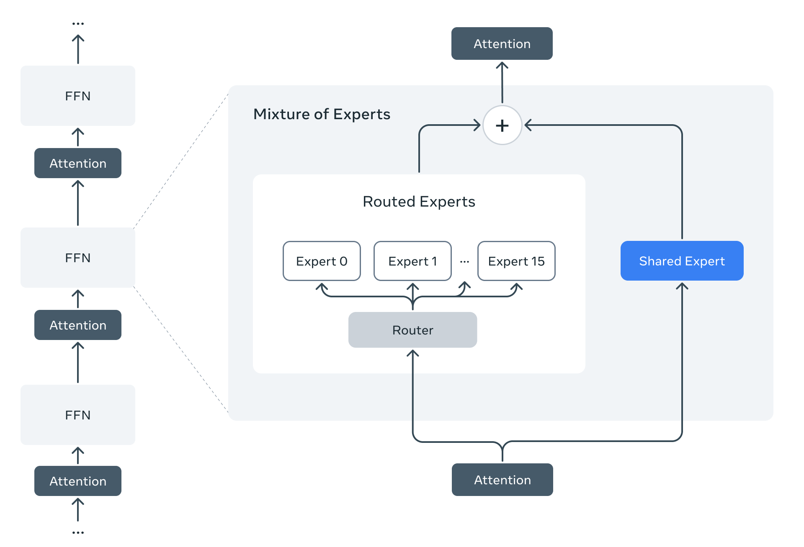
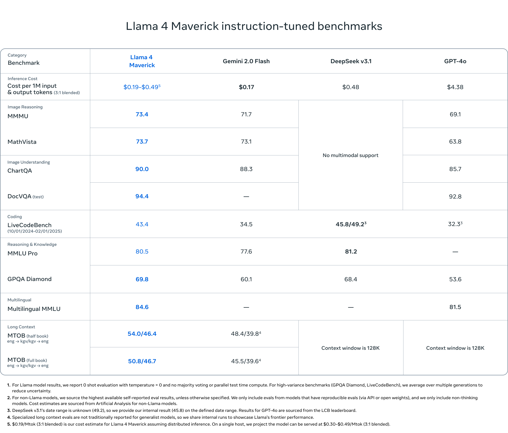
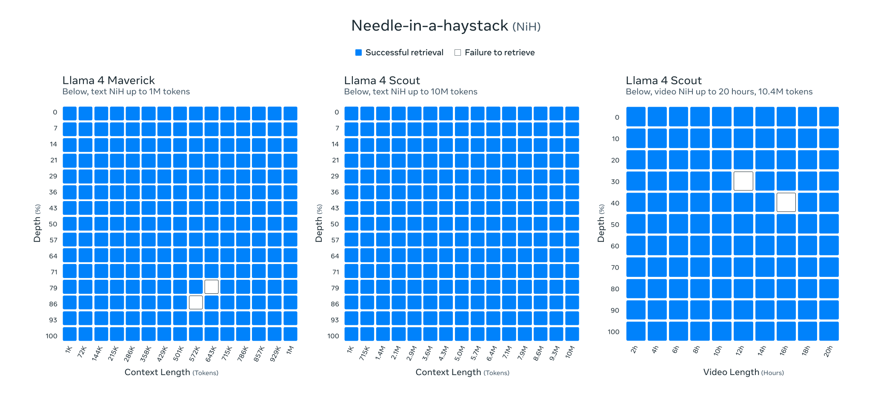
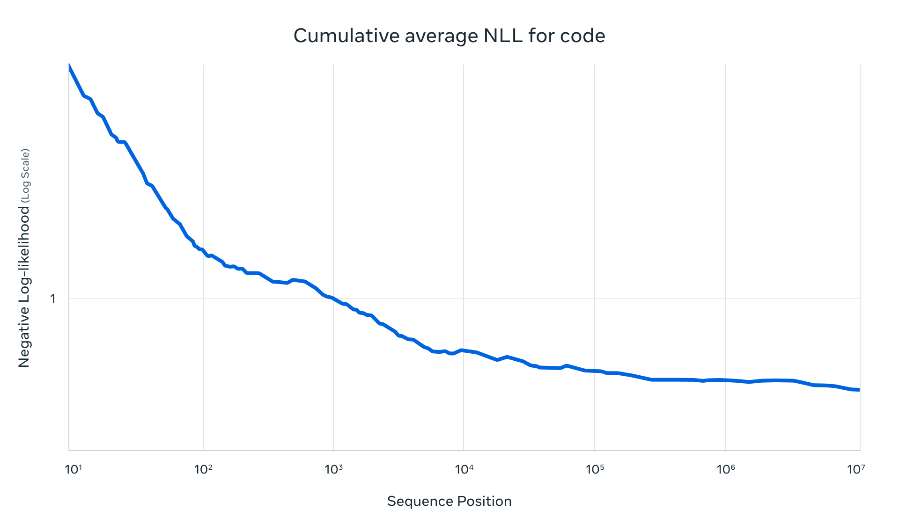

<!-- article-header:start -->
[项目首页](../../../README.md) › [模型系列](../../../reports/model-family-index.md) › [Llama](../README.md)
<!-- article-header:end -->

# Llama 4：原生多模态 MoE、长上下文与在线强化学习

<!-- article-toc:start -->

**本篇目录** · [论文定位](#paper-info) · [快速概览](#overview) · [整体架构](#architecture) · [核心原理](#principles) · [数据构建](#data) · [训练流程](#training) · [实验结果](#experiments)
<!-- article-toc:end -->

## 1. 论文信息与模型定位

| 项目 | 内容 |
|---|---|
| 原文 | The Llama 4 herd: The beginning of a new era of natively multimodal AI innovation |
| 发布方与标注日期 | Meta，2025 年 4 月 5 日 |
| 材料 | [官方发布说明](https://ai.meta.com/blog/llama-4-multimodal-intelligence/)，本介绍依据 2026-10-08 保存的页面版本 |
| 模型家族 | Llama 4 Scout、Maverick，以及当时仍在训练的教师模型 Behemoth |
| 核心定位 | 开放权重的图像与文本理解模型，以 MoE 降低每 token 激活计算量，以长上下文覆盖多文档、代码和多图输入 |

| 模型 | 激活参数 | 总参数 | 路由专家数 | 原文定位 |
|---|---:|---:|---:|---|
| Scout | 17B | 109B | 16 | 较小档位，支持 10M 输入上下文 |
| Maverick | 17B | 400B | 128 | 通用助手、图像理解与创意写作主力档位 |
| Behemoth | 288B | 接近 2T | 16 | 多模态 MoE 教师模型，发布时仍在训练 |

**激活参数不是总存储量。** Scout 的单 H100 部署描述包含 Int4 量化条件；Maverick 的“单 H100 host”指一个主机系统，不能读成单张 H100。开放权重也不等于训练数据、优化细节及全套运行日志均已开放。

页面日期和页面内容要分别看待：缓存版本的 Maverick 对照表已出现 DeepSeek v3.1，而页面仍标注 2025-04-05。本介绍忠实整理该快照中的表格，不把其全部内容断言为首发当天的原始版本。实验聊天版本在 LMArena 的 Elo 1417，也不能直接当作所有下载权重的相同评测成绩。

## 2. 快速概览

Llama 4 的方法由三条线组成。第一条是 **稀疏计算**：在模型中交替使用稠密与 MoE 层，路由让一个 token 只经过少量专家，但整个模型仍需保存全部专家权重。第二条是 **多模态共同预训练**：文本和视觉 token 在统一主干中早期融合，训练覆盖文本、图像与视频帧。第三条是 **能力扩展与后训练**：通过 mid-training 扩展上下文，再以少量高质量 SFT、在线 RL 和轻量 DPO 平衡推理、编码、图像理解及对话风格。

长上下文方面，Scout 的预训练及后训练上下文长度是 **256K**，发布说明宣称支持 **10M** 输入长度，并以检索测试和代码累积平均 NLL 展示长度泛化。训练长度、支持长度与所有复杂任务的有效长度是不同概念，不能直接把 10M 理解成训练每条样本长度。

多模态方面，预训练最多包含 48 张图像，后训练测试报告在最多 8 张图像下得到良好结果。它说明了多图与时间活动理解的训练覆盖和测试范围，不是“48 张任意高分辨率图像均可完美理解”的成功率保证。发布说明也没有把视频训练帧等同于原生音频或视频生成输出。

## 3. 整体架构

官方图左侧是 Attention 与 FFN 的层序列，右侧展开其中一个 MoE 模块：输入分别进入共享专家及路由分支，输出相加后进入后续注意力。图的路由分支绘成 Expert 0 到 Expert 15，展示的是 **16 专家规模的示意**；正文对 Maverick 另明确给出 128 个路由专家，不能按这幅示意把 Maverick 改写成 16 专家。

Maverick 的每个 token 进入共享专家，同时进入 128 个路由专家中的 **一个**。因此，它是共享路径加 top-1 路由路径，而不是一个 token 同时计算全部 128 个专家。发布说明没有提供路由器温度、门控权重归一化、容量因子、负载均衡损失和精确层数。

视觉侧采用基于 MetaCLIP 的视觉编码器。原文说明对编码器作了改进，并在一个冻结的 Llama 模型配合下单独训练，使视觉表征更好适配语言模型；随后又描述文本、图像和视频数据的共同预训练。这是一项具体的编码器适配说明，不能扩展成“整个预训练和后训练期间语言模型始终冻结”。视觉 token 与文本 token 早期进入统一主干，视觉 patch 数、切图规则、投影器形状及视频采帧规则未在博客中披露。

Scout 的 iRoPE 在多数层采用旋转位置编码，同时交错加入不使用位置嵌入的注意力层，并在推理时对注意力进行温度缩放。其目标是提高长度泛化。博客没有给出交错频率、缩放函数、局部窗口设置或 KV cache 配置，因此不能由“iRoPE”名称推导一个已经验证的无限上下文能力或线性复杂度结论。

## 4. 核心创新与数学原理

原文用文字描述算法，没有编号公式。以下公式用于解释已披露机制，属于本文的标准数学表达，具体实现中的系数和函数需要额外技术资料才能复现。

对某个 MoE 层的 token 表征 $`h`$，可将共享专家和单路由专家概括为：

$$
k(h)=\arg\max_i r_i(h),\qquad
u(h)=E_{\mathrm{shared}}(h)+g_{k(h)}(h)E_{k(h)}(h).
$$

这里 $`r_i`$ 表示路由分数，$`g`$ 是概括性门控权重；原文确认了两条路径和 top-1 选择，但没有公布 $`g`$ 的精确定义。稀疏路由减少的是专家部分的每 token 计算量，而全部注意力、共享专家、稠密层及存储通信仍有成本。Maverick 的 17B/400B 约为 4.25%，只能作为激活参数与总参数的比例，不能直接当成运行成本下降至稠密模型 4.25% 的公式。

位置编码可以用标准 RoPE 表达解释：将查询与键施加位置相关旋转 $`R_m,R_n`$，内积可写成 $`(R_mq)^\top(R_nk)=q^\top R_{n-m}k`$，其中相对位置影响注意力分数。iRoPE 的无位置层则不通过这一旋转注入位置。注意力温度缩放可概括为 $`\mathrm{softmax}(QK^\top/(\sqrt d\,\tau))`$，但博客没有说明 $`\tau`$ 与长度的关系，本文不补造函数或参数。无位置层有助于减少对训练位置范围的直接依赖，是对设计动机的解释；长序列复杂任务能否受益仍须实测。

另一个重点是 **教师共蒸馏**。Behemoth 为 Maverick 提供软目标，原文称训练中动态调整软、硬目标权重。通常可以用 $`\alpha_t\mathcal L_{\mathrm{hard}}+(1-\alpha_t)\mathcal L_{\mathrm{soft}}`$ 理解这种权衡，但这只是示意，发布说明未公开实际蒸馏损失、温度或权重调度。共蒸馏将多数学生训练数据上生成教师目标的昂贵计算摊销；对后来新加入的数据，则额外运行教师前向计算，不能把这项成本视为免费。

最后，连续在线 RL 把训练策略和数据筛选构成循环：模型更新后重新评估提示难度，保留中等到困难的提示，继续训练。与固定一次筛选相比，难度边界随策略变化。Behemoth 用 pass@k 分析采样较难提示，并过滤零优势提示；这不意味着它只学习完全答不出的题，原文也未给出 pass@k 阈值或具体奖励算法。

## 5. 数据构建与处理

总体预训练混合包含 **超过 30T token**，覆盖多样的文本、图像和视频数据；这一数字是总体混合规模，博客没有列出 Scout、Maverick、Behemoth 各自独立消耗的完整 token 清单。多语言覆盖 200 种语言，其中超过 100 种语言各有超过 1B token，多语言 token 总量约为 Llama 3 的 10 倍。

视觉数据包含图像与视频帧静态图，目标覆盖时间活动及相关图像之间的联系。这种多图训练可以让模型结合帧间证据回答问题，但没有公开帧率、时间位置编码、图像分辨率、去重或样本来源比例。mid-training 引入用于长上下文扩展的专门数据集，同样没有给出来源、长度分桶和混合权重。

后训练的关键是质量与难度筛选。Maverick 的 SFT 数据中，被 Llama 评审模型判为容易的部分删除超过 50%，对留下的较难集合做轻量 SFT；在线 RL 又持续过滤提示，保留中等到困难样本。Behemoth 则裁去约 95% SFT 数据，并使用逐渐加难的提示课程。百分比对应各自的候选 SFT 数据，并不表示整个预训练数据只保留 5% 或两个模型最后的数据量可直接比较。

安全处理贯穿预训练过滤、后训练及系统层。Llama Guard 是输入输出安全模型，Prompt Guard 识别攻击和注入，CyberSecEval 提供风险评测；它们是可集成的外围工具，不能视作 MoE 主干中的三个固定神经模块。原文还描述用自动与人工对抗测试将发现反馈到后训练，但没有公开完整数据或过滤损耗率。

## 6. 训练流程与目标

公开流程可以组织为：视觉编码器适配与多模态预训练、mid-training 能力扩展、后训练课程。MetaP 用于选择每层学习率和初始化尺度，并称超参数可在 batch size、宽度、深度及训练 token 改变时迁移；博客没有给出参数化公式或实际配置，所以 MetaP 不能据此被复刻成一套确定超参数。

预训练采用 FP8 提高效率。Behemoth 的描述是使用 **32K GPU、390 TFLOPs/GPU**；该数字属于指定的大模型训练系统表现，不能赋给 Scout 的单卡训练速度。GPU 型号、训练时间和总体能耗未在此完整报告。

Maverick 的后训练次序明确为 **轻量 SFT → 在线 RL → 轻量 DPO**。作者认为过多 SFT/DPO 约束会限制 RL 的探索，尤其影响推理、编码和数学，因此先减少容易的监督数据，在多模态在线 RL 中选难提示并持续更新筛选，最后用轻量 DPO 改善回答质量中的特殊情况。正文没有公布奖励项、采样数、KL 系数和 DPO 温度；不能把 PPO、GRPO 或具体奖励模型结构写成已确认配置。

Behemoth 采取轻量 SFT 后接大规模 RL，混合多种能力提示构造训练 batch，并采样多种系统指令维持指令遵循。其完全异步在线 RL 基础设施允许不同模型分配到不同 GPU，以各模型计算速度平衡资源；官方称相对前代训练效率约提高 10 倍。这是基础设施相对结果，不是模型准确率提高 10 倍，博客也未给出可统一比较的完整计时基准。

## 7. 实验设置与主要结果

表中 Llama 成绩采用 0-shot、temperature=0，不做多数投票或并行测试时计算；高方差的 GPQA 与 LiveCodeBench 在多次生成间取平均。其他模型主要采用可复现 API 或开放权重模型的最高公开自报结果，只纳入非 thinking 模型，因此这不是统一训练、统一运行环境的严格受控实验。表底部的推理价格是历史估算且包含 3:1 输入输出混合条件，不能当作当前服务报价。

| 基准 | Maverick | Gemini 2.0 Flash | GPT-4o | 主要观察 |
|---|---:|---:|---:|---|
| MMMU | 73.4 | 71.7 | 69.1 | 分别高 1.7、4.3 分 |
| MathVista | 73.7 | 73.1 | 63.8 | 对 Flash 优势较小，对 GPT-4o 较大 |
| ChartQA | 90.0 | 88.3 | 85.7 | 图表理解提升 |
| DocVQA test | 94.4 | 未报告 | 92.8 | 不把缺失值当作零 |
| LiveCodeBench，图示日期范围 | 43.4 | 34.5 | 32.3 | 低于 DeepSeek v3.1 的内部同日期范围结果 45.8；其自报 49.2 的日期范围未知 |
| MMLU Pro | 80.5 | 77.6 | 未报告 | 低于表中 DeepSeek v3.1 的 81.2 |
| GPQA Diamond | 69.8 | 60.1 | 53.6 | 高于表中 DeepSeek v3.1 的 68.4 |
| Multilingual MMLU | 84.6 | 未报告 | 81.5 | 体现多语言问答能力 |

图像类比较中 DeepSeek v3.1 标注无多模态支持，不能按空白表格声称 Maverick 提高了多少百分点。长上下文 MTOB 以两个翻译方向分别报告：Maverick 半本为 54.0/46.4，整本为 50.8/46.7；Flash 分别为 48.4/39.8、45.5/39.6。方向与条件应保留，不宜先平均后解释。

检索图横轴为上下文长度或视频时长，纵轴为插入目标的深度，蓝格成功、白格失败。Maverick 文本测试到 1M token，有两个失败格；Scout 文本测试到 10M token，在这张图的采样格上均成功；Scout 视频测试到 20 小时、约 10.4M token，也出现两个失败格。这里考查的是特定目标检索，不能据此保证长视频中所有时间推理、多跳综合及细粒度动作任务都成功，也不能直接扩展为任意视频的统一抽帧策略。

代码图展示序列位置增加到 $`10^7`$ 时，累积平均 NLL 下降。标准解释是 $`\overline{\mathcal L}_N=-N^{-1}\sum_{t=1}^{N}\log p(x_t\mid x_{<t})`$，这是本文的指标定义，不是原文新损失。它说明在该代码序列上，随着上下文增多，平均预测代价改善；曲线不是新增每个 token 的单点 NLL，也不是代码功能正确率或内存、延迟曲线。原图没有给出完整代码集合和置信区间，不能据其形状证明全任务的无限长度泛化。

发布页还称争议政治社会话题上的拒答率从 Llama 3.3 的 7% 降至不足 2%，但题集、评审和样本数在博客中未完整披露，宜作为官方特定测试的观察。总体上，这份材料提供了较丰富的架构与训练思想，以及图像、语言、编码、长上下文结果；精确训练复现仍缺少超参数、数据明细及奖励定义。本文未运行模型。

<!-- article-footer:start -->
---

[← 上一篇：Qwen2.5-Omni](../../qwen/document-1093f7b31e5b/README.md) · [按发表时间浏览](../../../reports/paper-reading-guide.md#year-2025) · [下一篇：Kimi-VL →](../../kimi/arxiv-2504.07491/README.md)

[返回本篇目录](#article-toc) · [返回模型系列](../README.md)
<!-- article-footer:end -->
