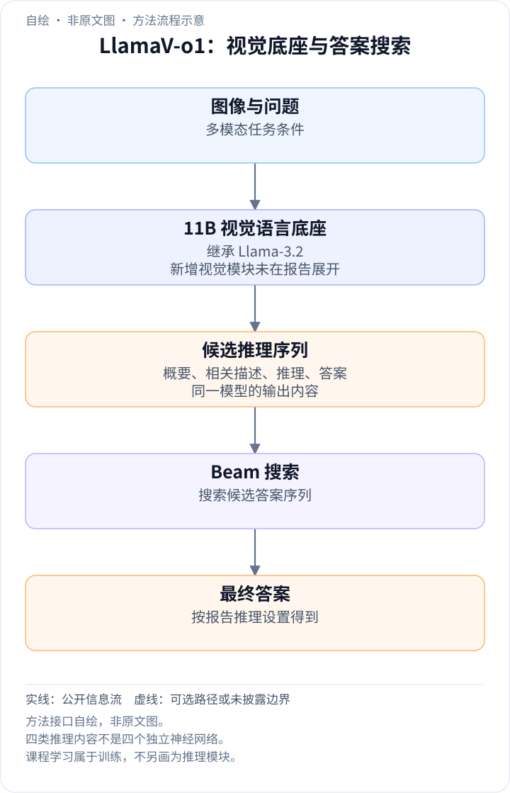
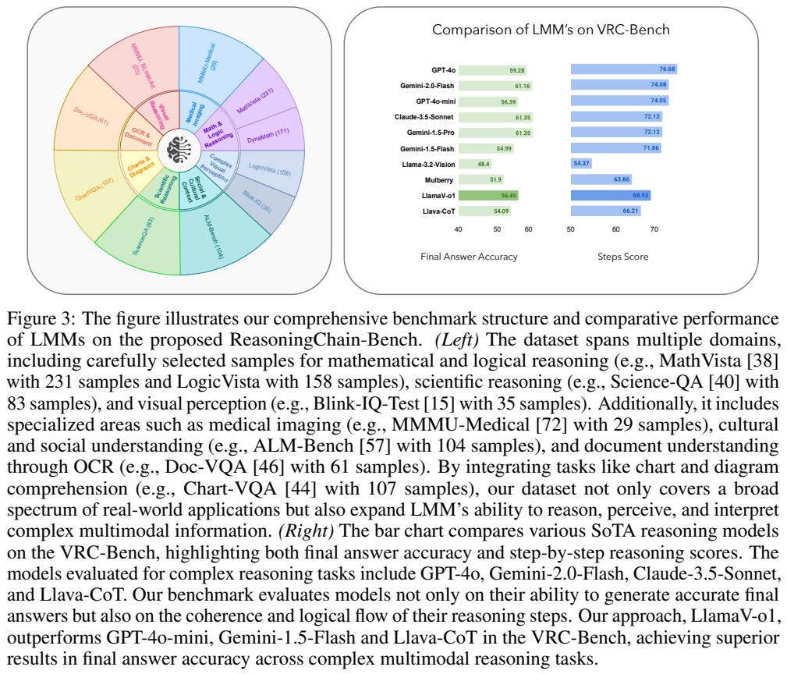
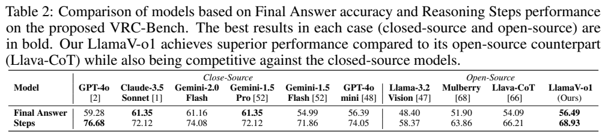
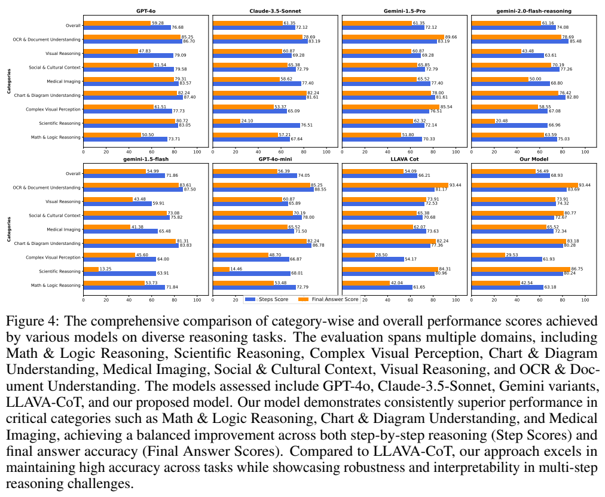
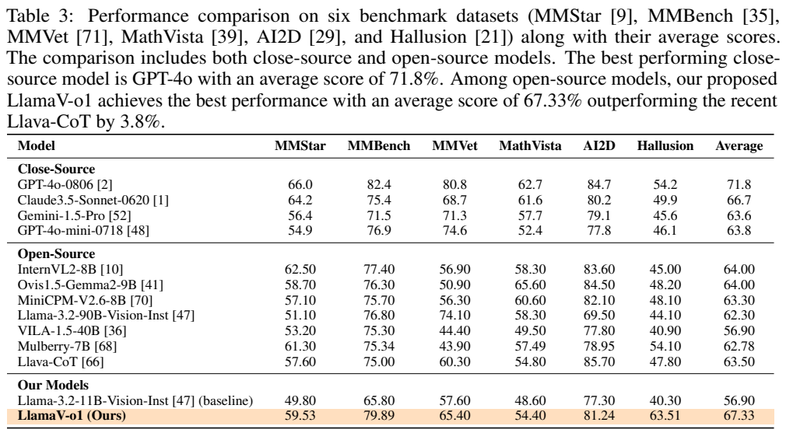
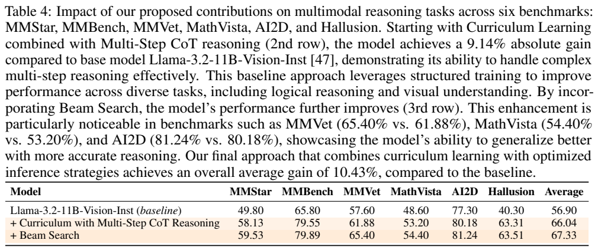
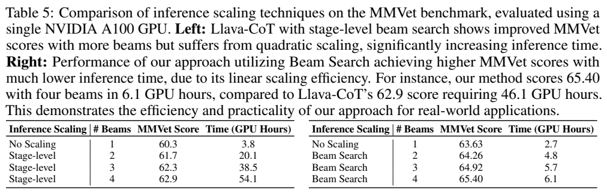

<!-- article-header:start -->
[项目首页](../../../README.md) › [模型系列](../../../reports/model-family-index.md) › [LlamaV-o1](../README.md)
<!-- article-header:end -->

# LlamaV-o1：以课程学习和搜索改进逐步视觉推理

<!-- article-toc:start -->
<a id="article-toc"></a>

**本篇目录** · [论文定位](#paper-info) · [快速概览](#overview) · [整体架构](#architecture) · [核心原理](#principles) · [数据构建](#data) · [训练流程](#training) · [实验结果](#experiments)
<!-- article-toc:end -->

<a id="paper-info"></a>

## 1. 论文信息与模型定位

**LlamaV-o1: Rethinking Step-by-step Visual Reasoning in LLMs** 由 Omkar Thawakar、Dinura Dissanayake 等提出，研究团队以MBZUAI为主，另有UCF、Linköping University和ANU作者。本介绍依据 [arXiv 2501.06186v1](https://arxiv.org/pdf/2501.06186v1)（2025-01-10，27页）。[官方项目](https://mbzuai-oryx.github.io/LlamaV-o1/)、[代码](https://github.com/mbzuai-oryx/LlamaV-o1)与[模型](https://huggingface.co/omkarthawakar/LlamaV-o1)均在首页列出。

模型在Llama-3.2-11B-Vision-Instruct上做全参数监督微调，重点是图像问题的逐步推理，不是重新预训练视觉骨干或新增11B专家。论文同时提供VRC-Bench和参考推理链评价方法。名字中的“o1”表达研究定位，不能理解为复现某个专有模型的架构、训练数据或内部算法。

<a id="overview"></a>

## 2. 快速概览

| 项目 | v1披露 |
|---|---|
| 底座 | Llama-3.2-11B-Vision-Instruct，全参数SFT |
| 课程顺序 | 先学解题概要与相关图像描述，再学详细推理和最终答案 |
| 初阶段数据 | PixMo Cap-QA 18K、Geo170K来源57K |
| 后阶段数据 | LLaVA-CoT约99K结构化样本 |
| 推理 | Beam Search并行保留多个候选，实验1–4 beams |
| VRC-Bench | 8类、千余样本、4,173个人工核验推理步骤 |
| 主要结果 | 六基准平均67.33；VRC答案56.49、步骤68.93 |

贡献集中于训练顺序、生成组织、推理搜索和评测，而不是新的视觉编码器或注意力公式。正文的平均提升有对应消融，但该v1在训练超参数与评测裁判身份上披露不足；本文按可核验的原表陈述结果。

<a id="architecture"></a>

## 3. 整体架构

<!-- derived-architecture:start -->


*自绘方法流程示意（非原文图）。依据下述公开资料归纳；方框表示功能组件，不代表逐层实现。*

依据：[2501.06186v1; §3 / §4.2.1 / multi-turn examples](https://arxiv.org/pdf/2501.06186v1)。
<!-- derived-architecture:end -->

模型继承Llama-3.2的图像—文字条件生成能力，本报告没有给出新的视觉编码器、连接器尺寸或完整底座结构图，也未改变视觉token数量的公开说明。可核实的系统流程是：图像和问题进入已具视觉能力的11B底座，模型按课程训练获得“解题概要→问题相关描述→逻辑推理→答案”的组织能力，推理时用beam搜索候选答案序列。不要把这四种输出内容画成四个独立训练的神经网络。

PDF第9页的例子采用多轮指令：先要求说明解题方法，再生成相关图像caption，再依据caption推理，最后只返回答案。§4.2.1还把任务理解列为前置步骤，因此“有五项描述”与“四类显式生成内容”是不同抽象层次，不应凭数量差异发明额外模块。论文同时称推理不要求LLaVA-CoT那样严格的结构化输出，这说明训练示范格式与推理输出约束也不能完全等同。



**读图：** 左侧是VRC-Bench来源分布，并非模型架构；右侧将最终答案与步骤分开显示。MathVista、DynaMath、LogicVista等不同来源进入多类评测。基准及裁判是评测系统，不是语言模型推理时必须调用的外部工具。图中Llama-3.2步骤数值与表2略有不一致，本文使用表2的58.37作为基线步骤分。

| 模块 | 输入与输出 | 公开机制 |
|---|---|---|
| Llama-3.2 视觉语言底座 | 图像与问题 → 条件隐藏表示 | 11B 既有多模态能力，报告未公开新的视觉连接器尺寸 |
| 课程监督阶段一 | 问题与图像 → 方法概要及相关 caption | 先学习选择所需视觉内容和解题路线，是训练数据安排 |
| 课程监督阶段二 | 相关视觉与概要 → 逻辑链及答案 | 补完整多步示范；各步由同一模型生成，非四个独立神经模块 |
| Beam 搜索 | 当前生成前缀 → 多候选响应 | 作者采用并行候选策略；评分、剪枝和长度惩罚未完整给出 |
| VRC-Bench 裁判 | 模型步骤与参考链 → 属性评分 | 评测组件，不是推理时必调用工具；与最终答案准确性分别统计 |


<a id="principles"></a>

## 4. 核心创新与数学原理

### 4.1 从相关视觉描述到推导的监督链

训练示例先要求说明如何解题，再描述问题相关内容，再据 caption 推理并给最终答案。相关 caption 把感知信息显式化，便于检查读取了哪些标签或数值；但若这一环读错，后续推理仍可在错误前提下自洽。课程示范强化的是输出组织与监督路径，不能证明语言步骤等同内部思维过程。[原文 §4.1、§4.2.1，PDF 第 7–9 页](https://arxiv.org/pdf/2501.06186v1#page=9)

课程学习不是新的网络算子，而是监督难度的时间安排。阶段1要求理解问题和相关视觉内容；阶段2增加完整逻辑链及答案。直观上，先学会“该看什么”，再学会“怎样利用它推导”，比直接要求复杂输出提供更明确的训练路径。表4把课程与多步CoT合在一个增量实验，没有单独只更换数据顺序的控制，因此不能把全部增益归因于课程顺序本身。

### 4.2 答案和步骤分开评价暴露不同失败

最终值正确可能来自偶然猜测，步骤完整也可能含错误数值或冗余，因此评测同时看终答案和多属性参考链匹配。裁判依据自然语言语义评分，存在其它正确解法与裁判偏好带来的不确定性。属性平均只是汇总操作，不构成对每步逻辑有效性的符号证明。[原文 §3.2；本节保留原属性评分出处](https://arxiv.org/pdf/2501.06186v1#page=7)

步骤评价以参考链为依据，在faithfulness、信息完整性、重复、幻觉、冗余、语义覆盖、推理对齐、常识和缺步等10个属性分别给1–10分；按§3.2及附录A.2–A.3，综合分是属性均值：

```math
S_{\mathrm{overall}}=\frac1{10}\sum_{j=1}^{10}S_j.
```

“幻觉”和“缺步”字段也是高分更好，代表更少问题，不是越高越严重。表格将步骤分以较大数值展示，68.93不能当作68.93%的步骤经符号验证正确；这仍是语言模型裁判对参考链的评分。参考链还可能存在同题的其他正确解法，评分不等于证明生成的自然语言解释忠实反映模型内部机制。

### 4.3 并行候选降低调用串行性但仍增加搜索计算

作者放宽严格阶段输出格式，意图减少逐阶段多次调用的负担；beam 候选本身仍需维护分支和计算 token。调用数的阶数、每条链长度与硬件耗时属于不同层次，原文相互冲突的复杂度说法不能代替实测。报告也未披露过程奖励模型，不能补画一个验证器来解释候选选择。[原文 §4.2.3，PDF 第 10–11 页](https://arxiv.org/pdf/2501.06186v1#page=11)

Beam Search在生成过程中保留多个候选，作者以并行生成减少阶段搜索的多次调用。本报告没有给出明确的beam评分公式、长度惩罚或剪枝细节，因此不补写过程奖励模型或外部验证器。文中复杂度说法也有冲突：第11页写本文O(n)、对手O(n²)，第15页又按调用数写本文O(1)、对手O(n)。调用数量、token计算和GPU耗时不是同一个量；表5耗时随beam数增长，因此不能推导“增加beam不增加计算成本”。

<a id="data"></a>

## 5. 数据构建与处理

训练阶段1使用PixMo Cap-QA的18K问题相关描述样本与Geo170K来源57K几何问答；阶段2使用原LLaVA-CoT约99K样本，涵盖ShareGPT4V、ChartQA、A-OKVQA、DocVQA、PISC、CLEVR以及GeoQA+、AI2D、ScienceQA、CLEVR-Math（§4.2.2）。总结、caption、reasoning、answer组成课程目标。文中也简写初阶段只使用PixMo，本文保留详细数据段中的Geo来源，不把99K和100K称谓差异当成另一个独立数据集。

VRC-Bench另从多个现有评测数据来源选题，经GPT-4o生成步骤，再人工审阅并修正，超过25%样本被改动。少于三步的题多数删除，部分MathVista两步题例外，最终4,173步骤、千余题，覆盖8类（§3.1）。这与模型的SFT数据不是同一条制作管线，不能说4,173步骤就是全部训练数据。

所选来源包括数学逻辑、科学、OCR、图表、文化、医学基础图像等。论文没有给出完整去重清单、所有训练与评测之间的污染审计，亦未说明人工标注者一致性指标。它提供参考链质量检查，但不能据此断言完全不存在数据重叠或裁判偏好。

<a id="training"></a>

## 6. 训练流程与目标

以llama-recipes进行两阶段全参数SFT，使用8张A100-80GB（§4.2.2、§5.1）。阶段1先学概要和caption，阶段2再加入细致推理与最终答案；没有报告GRPO、RLHF或偏好优化，也未报告单独过程奖励模型。生成目标可理解为条件自回归监督，但原文未明确全部token损失mask和不同子任务损失权重，本文不写未经披露的精确损失recipe。

正文声称epoch、学习率、optimizer、batch在附录列出，然而该v1附录A.1–A.5实际提供生成/评价提示与裁判代码，没有相应训练超参数表。故这些数值在本版本**未能核验**，不能用模型常见默认设置填上。论文亦未报告完整训练GPU小时或分阶段壁钟耗时。

推理扩展实验有1、2、3、4 beams。表3的完整模型MMVet65.40与表5四beam相同；表4的课程版MMVet61.88却不同于表5单beam63.63。这是不同表格的实验配置或结果差异，原文没有明确解释，不能直接把两行合成一条无歧义的实验链。

<a id="experiments"></a>

## 7. 实验设置与主要结果





VRC-Bench分别评最终答案与推理步骤。表2中LlamaV-o1为56.49/68.93，LLaVA-CoT54.09/66.21，Llama-3.2 Vision48.40/58.37。答案分别增加2.40、8.09个百分点，步骤分提升2.72、10.56分。但GPT-4o答案59.28、步骤76.68，Claude-3.5-Sonnet答案61.35，说明本文并未全面超过较强闭源模型。

正文称GPT-4o担任裁判；附录A.4/A.5代码却明确调用 **gpt-4o-mini**，temperature0，步骤max_tokens500、答案max_tokens10。最终答案也是裁判按语义给0/1，并非所有题均做严格字符串或数学验证。正文与代码的裁判身份不一致，使复现需要进一步确认；本文如实记录，不自行假定其中一者才是实验实际配置。





| 基准 | LlamaV-o1 | LLaVA-CoT | Llama3.2-11B基线 |
|---|---:|---:|---:|
| MMStar | 59.53 | 57.60 | 49.80 |
| MMBench | 79.89 | 75.00 | 65.80 |
| MMVet | 65.40 | 60.30 | 57.60 |
| MathVista | 54.40 | 54.80 | 48.60 |
| AI2D | 81.24 | 85.70 | 77.30 |
| Hallusion | 63.51 | 47.80 | 40.30 |
| 六项算术平均 | 67.33 | 63.50 | 56.90 |

六基准按VLMEvalKit评测。67.33比LLaVA-CoT高3.83平均分，比底座高10.43；MathVista和AI2D仍低于LLaVA-CoT，所以平均更高不等于逐项领先。课程+多步CoT的表4均值66.04，进一步搜索到67.33，增加1.29；正文另写66.08，本文按表4。不同基准评分口径不同，这个均值是作者的汇总办法，不能替代某个任务的准确率。



**读表：** 单张A100-80GB测MMVet。本文1→4 beams评分63.63→65.40，时间2.7→6.1 GPU小时；LLaVA-CoT1→4 beams为60.3→62.9、3.8→54.1 GPU小时。四beam表值比约8.9倍，但图注把对手写46.1，正文又把本文写4.2小时，均与表格不同。摘要“5倍”也未明确对应哪一统一设置，不能作为所有请求的固定速度优势。可靠结论是该报告的表格显示搜索精度改善、成本也增长，并且本文在这些设置下比阶段级搜索更省时间；具体倍率和复杂度仍须结合实现重新确认。

<!-- article-footer:start -->
---

[← 上一篇：VITA-1.5](../../vita/arxiv-2501.01957/README.md) · [按发表时间浏览](../../../reports/paper-reading-guide.md#year-2025) · [下一篇：VideoLLaMA 3 →](../../videollama/arxiv-2501.13106/README.md)

[返回本篇目录](#article-toc) · [返回模型系列](../README.md)
<!-- article-footer:end -->
