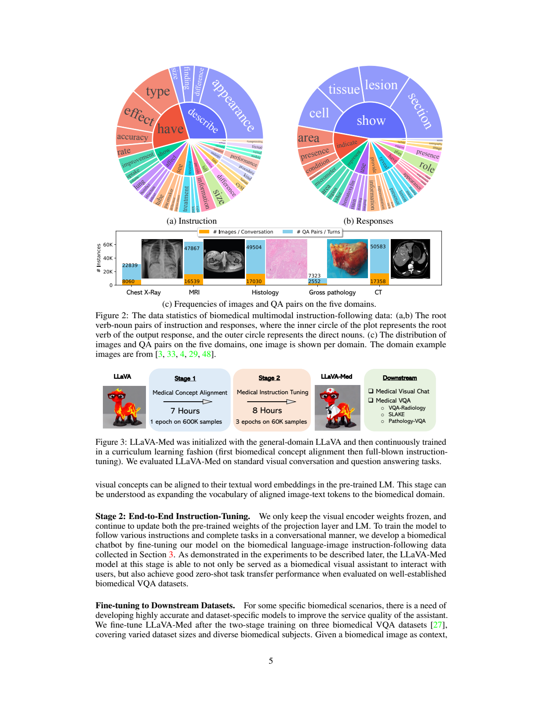
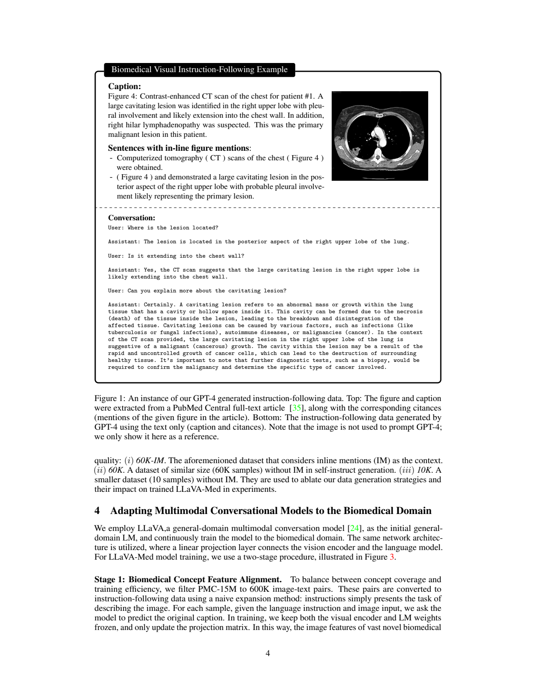
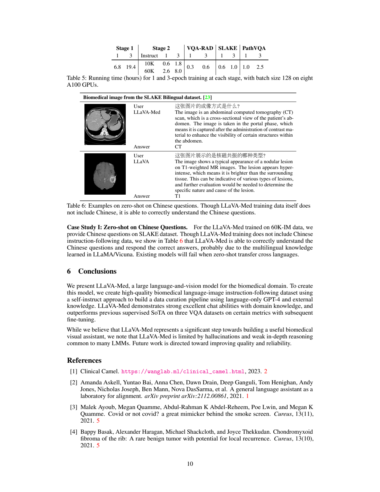
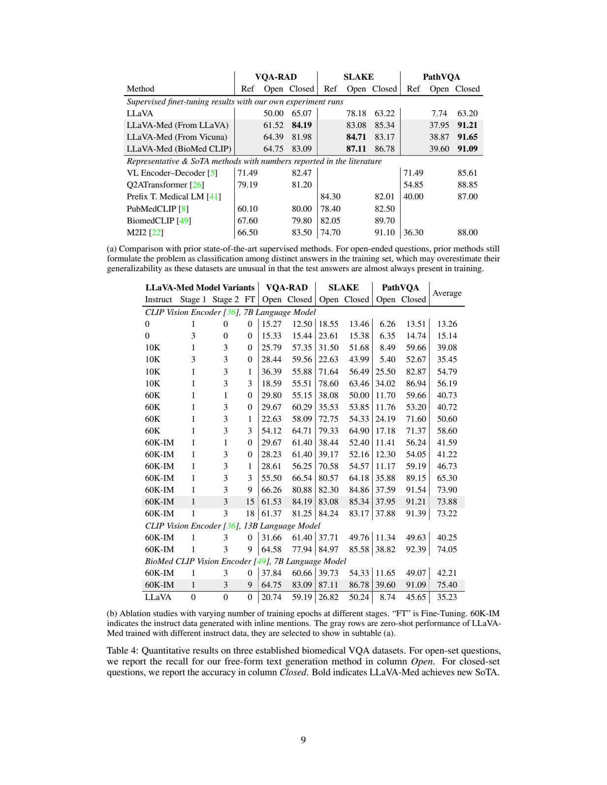

# LLaVA-Med：用医学图文与合成指令适配视觉语言助手

## 1. 论文信息与模型定位

**LLaVA-Med: Training a Large Language-and-Vision Assistant for Biomedicine in One Day** 由 Microsoft 的 Chunyuan Li、Cliff Wong、Sheng Zhang 等提出。本介绍依据 [arXiv 2306.00890v1](https://arxiv.org/pdf/2306.00890v1)（2023-06-01，17页），[官方代码](https://github.com/microsoft/LLaVA-Med)为microsoft/LLaVA-Med。

它在通用LLaVA上做生物医学领域适配，主设置为7B语言模型，另有13B、Vicuna初始化和BioMedCLIP视觉编码器变体。目标是对论文中的医学图像进行开放式问答和对话，再适配特定医学VQA数据集。该研究报告的指标来自离线问答与合成对话评价，没有报告临床使用结果，不能把“医学术语回答更好”推导为已验证真实诊断能力。

## 2. 快速概览

| 方面 | 本版本披露 |
|---|---|
| 架构 | 视觉编码器→线性投影→因果语言模型，沿用LLaVA |
| 数据母库 | PMC-15M，来自PubMed Central的15M图文对 |
| 阶段1 | 600K图文，学习描述与概念对齐，只训练投影 |
| 阶段2 | 60K多轮合成对话，冻结视觉，训练投影与语言模型 |
| 文本教师 | 语言版GPT-4根据caption及原文图像引用句生成问答 |
| 时间 | 8张A100-40GB，阶段1约6.8小时、阶段2约8.0小时 |
| 评价 | 193题对话、VQA-RAD、SLAKE英文、PathVQA；区分零样本与再微调 |

核心是将领域知识对齐和对话能力学习分开。PMC-15M不是本模型实际使用15M样本全部训练的数量；600K图文与60K对话才是两阶段主要规模。论文标题的“一天”也是复用已有通用模型后的领域适配时间，不包括底座预训练或数据制作全部成本。

## 3. 整体架构

**读图：**Figure3下方从LLaVA出发，先600K图文概念对齐，再60K医学指令，最后进入视觉对话和医学问答。它画的是训练流程，不是两个独立视觉专家。Figure2显示胸片、MRI、组织学、宏观病理和CT；蓝色问答轮数多于橙色图像/会话数，因此60K是图像对话规模，不能称为60K单轮问题总数。

视觉编码器提取图像特征，线性映射到语言隐藏空间，再与文本问题条件共同生成答案。主方法没有引入单独疾病分类头、检索器或外接分割器。§2指出区别于将医学caption模型输出交给文字LLM的工具串联系统：LLaVA-Med直接接收视觉特征进行条件生成。

BioMedCLIP是可替换的领域视觉初始化，Vicuna是语言初始化的另一种选择；它们在实验中分行出现，不应把所有最好指标拼成一个同时具备全部设置的模型。原文没有给图像token数、完整patch配置和全系统精确参数分解，不能从“7B语言模型”估计整套模型正好7B。

## 4. 核心创新与数学原理

课程式领域适配的第一步只改变视觉—语言连接，让已有医学图像特征对应到语言词汇；第二步学习如何按问题组织答案。若把视觉特征记为 $f_v(I)$、线性投影为 $W$，条件表征为 $H_v=Wf_v(I)$，生成目标可以解释为：

$$
p_\theta(A\mid I,Q)=\prod_t p_\theta(a_t\mid H_v,Q,a_{<t}).
$$

这是对§4生成式训练的数学解释，原文没有另外提出特殊医学损失或明确列出逐tokenmask公式。阶段1的目标A是原始caption，阶段2则是多轮助手回复。与将全部答案视作分类标签不同，模型能生成训练答案集合外的文字，但也因此更难按完全匹配评测。

领域知识从caption和图像引用句进入合成问答：图像的原文说明常包含病变位置、成像类型或研究事实。教师以这些文本组织问题，并非视觉读取器，所以它不能自己校验所有描述是否可由原图直接观察。增加inline mentions（IM）扩充上下文，是数据生成阶段的知识支持，而非模型推理时自动检索PubMed原文。

第三个关键是评价口径：开放问题使用生成文本对标注token的召回率，闭集问题使用准确率。召回率关注“标注中的词出现了多少”，并不惩罚所有多余或不准确陈述；不能把开放分数与短答案分类准确率等同。论文没有证明生成的医学解释受到形式化事实约束。

## 5. 数据构建与处理

**读图：**上部来自论文的CT图及caption，另附提到该图的原文句子；下部是GPT-4依据文字生成的多轮问答。图注明确说图像没有送入GPT-4。本图的回答用于说明数据构造，不是本文重新诊断图像或模型临床测试。

概念对齐从PMC-15M抽600K图文，随机配“简短描述”或“详细描述”指令；caption少于30词时采用简短指令，原数据约25%低于此阈值（§3）。这一训练样本只有一种描述任务，领域词汇丰富，但不提供多种对话意图。

指令数据先筛出单图/单plot内容，再从胸片、CT、MRI、组织病理和宏观病理抽60K图文。以caption和原文图像引用句为输入，配人工few-shot范例，语言版GPT-4生成多轮对话。形成60K-IM、有同等规模但不含IM的60K、以及不含IM的10K对照。正文将10K版本一处写成“10 samples”，与名称、训练表和全文规模矛盾，本文采用明确的10K配置而不复述该笔误。

这是合成标注加人工prompt设计，而非60K对话全部逐条由医生标注。论文未披露完整医师复核流程、全部排重比例或生成错误率。附录生成提示要求围绕可从图像推断的内容、避免过度确信；这些指令不能保证合成回答完全正确。

## 6. 训练流程与目标

阶段1冻结视觉和语言模型，只训练线性投影；阶段2保持视觉冻结，更新投影和语言模型（§4）。主流程为阶段1一轮、阶段2三轮；还测试不同epoch和数据规模。随后可对VQA-RAD、SLAKE、PathVQA做独立监督微调，闭集问题在prompt提供候选答案，开放问题保持自由生成。下游适配是第三项工作，不属于阶段2零样本模型的同一个成绩。

**读表：**batch128、8 A100，阶段1一轮6.8小时、三轮19.4；60K阶段2一轮2.6小时、三轮8.0。6.8+8.0=14.8小时，与标题的不到15小时对应，设备总时间约118.4 A100小时，是据表计算的资源量，不能误写14.8 GPU小时。下游训练另计，如PathVQA一/三轮约1.0/2.5小时。v1没有披露完整学习率、优化器和调度器，本文不补常见默认值。

表6展示中文问题并由模型用英文回复，说明某些跨语言输入可被理解；它不是中文VQA系统评测。下游头对头实验只用SLAKE英文部分，不能把英语分数记成中英双语性能。

## 7. 实验设置与主要结果

开放对话测试从PMC-15M取50个未见图文，构造143个对话问题和50个详细描述问题，共193题。语言版GPT-4依据黄金caption及引用句给参考回复，随后对模型回复打1–10分并取相对参考得分（§5.1，表1）。通用LLaVA总36.1，仅阶段1为23.3，10K指令39.9，60K49.4，60K-IM50.2。概念描述训练单独损伤对话能力，阶段2恢复并改善；IM相对60K只多0.8总分，详细描述反而36.9→36.4，不能声称IM逐项提高。50.2是**相对文本教师的回复评分**，不是50.2%医学诊断正确率；教师看到黄金文本，模型面对图像，条件不对等。

| 经过下游监督微调的设置 | VQA-RAD Open/Closed | SLAKE Open/Closed | PathVQA Open/Closed |
|---|---:|---:|---:|
| 通用LLaVA | 50.00 / 65.07 | 78.18 / 63.22 | 7.74 / 63.20 |
| Med从LLaVA初始化 | 61.52 / 84.19 | 83.08 / 85.34 | 37.95 / 91.21 |
| Med从Vicuna初始化 | 64.39 / 81.98 | 84.71 / 83.17 | 38.87 / 91.65 |
| Med用BioMedCLIP | 64.75 / 83.09 | 87.11 / 86.78 | 39.60 / 91.09 |

Open为token召回率，Closed为准确率。SLAKE开放87.11高于同表Prefix Medical LM84.30；但VQA-RAD开放64.75低于Q2ATransformer79.19，PathVQA开放39.60低于Q2ATransformer54.85。某些闭集成绩优于之前报告，却不能说所有数据集的开放和闭集指标都超过SOTA。

表4(b)必须看FT列区分零样本。7B CLIP、60K-IM、阶段1一轮/阶段2三轮、FT=0时，六项平均41.22；同配置FT=9为73.90。BioMedCLIP FT=0平均42.21，FT=9为75.40，这些高分不是直接零样本迁移。表注把灰色行称为零样本，但灰色选中行实际包含FT=15和FT=9；本文按明确的FT数值解释，而不按颜色猜测。

训练时长与规模也非单调获益：7B CLIP的60K-IM下游9→15→18轮平均73.90→73.88→73.22；13B同指令零样本平均40.25低于7B41.22，虽13B FT=9提高到74.05。报告的可靠发现是领域数据和指令学习对多种医学问答有帮助，而非越久、越大必然越好。原文仍承认幻觉与深入推理不足，现有数据集问答和文本教师评价无法单独证明实际科研或临床工作中的可靠性。
