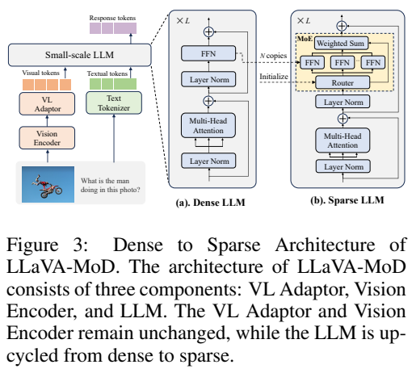
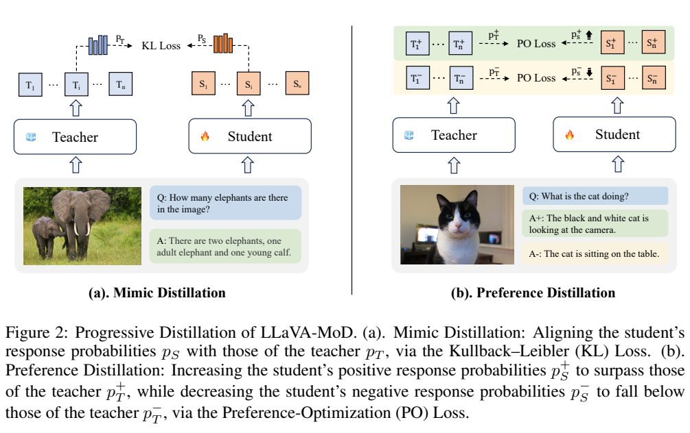
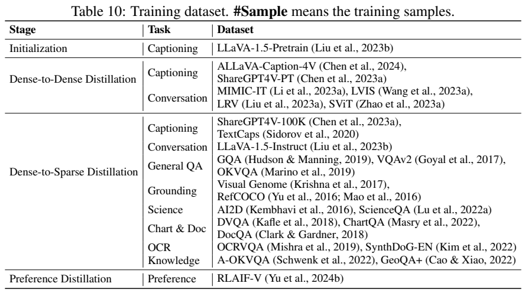
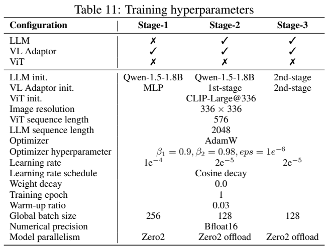
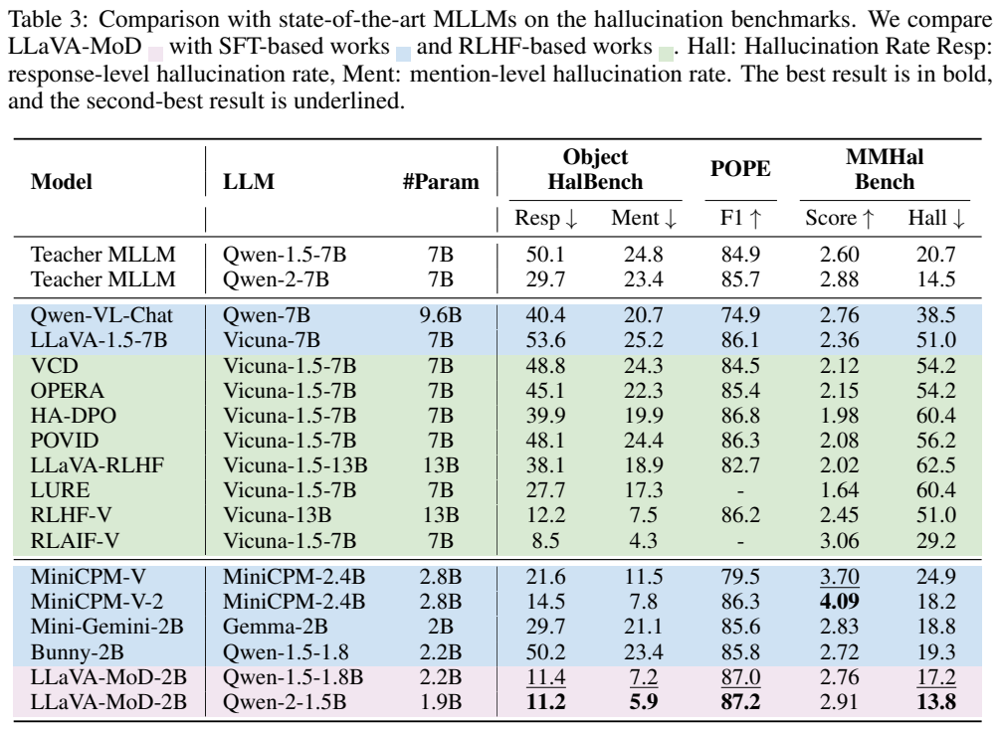

<!-- article-header:start -->
[项目首页](../../../README.md) › [模型系列](../../../reports/model-family-index.md) › [LLaVA-MoD](../README.md)
<!-- article-header:end -->

# LLaVA-MoD：通过稀疏专家与渐进蒸馏训练小型视觉语言模型

<!-- article-toc:start -->
<a id="article-toc"></a>

**本篇目录** · [论文定位](#paper-info) · [快速概览](#overview) · [整体架构](#architecture) · [核心原理](#principles) · [数据构建](#data) · [训练流程](#training) · [实验结果](#experiments)
<!-- article-toc:end -->

<a id="paper-info"></a>

## 1. 论文信息与模型定位

| 项目 | 信息 |
|---|---|
| 原文 | LLaVA-MoD: Making LLaVA Tiny via MoE Knowledge Distillation |
| 作者与机构 | Fangxun Shu、Yue Liao 等；Alibaba、CUHK、CPII、北京航空航天大学 |
| 版本 | arXiv:2408.15881v1，2024 年 8 月 28 日；20 页技术报告 |
| 来源 | [原文 PDF](https://arxiv.org/pdf/2408.15881v1)、[项目代码](https://github.com/shufangxun/LLaVA-MoD) |
| 定位 | 从同一 Qwen 家族的大型教师中蒸馏小型图文理解模型；不以扩大视觉编码器或原始预训练语料为主 |

报告关注两个问题：小学生网络如何具有足够容量接收教师知识，以及蒸馏如何从模仿答案分布进一步改善错误答案的偏好。方案将小语言模型的 FFN 扩展为稀疏专家，依次进行稠密模仿、稀疏模仿和偏好蒸馏。教师在训练中被冻结。

“1B/2B”是报告用于小模型档位与激活规模的简称。原文对总参数、可训练参数和激活参数的称呼有混用，未给出每层专家的完整存储参数分解；不能宣称一个 MoE 文件仅含 2B 总参数或内存一定等同于 2B 稠密模型。名称中的 MoD 指 Mixture-of-Expert Knowledge Distillation，不是跳过网络层的 Mixture of Depths。

<a id="overview"></a>

## 2. 快速概览

| 要点 | 实际做法 |
|---|---|
| 学生/教师 | 学生采用 Qwen1.5 的 0.5B、1.8B，或 Qwen2 的 0.5B、1.5B；教师为同家族 7B |
| 视觉输入 | CLIP ViT-L/14，336×336，576 个视觉 token，两层 MLP 投影 |
| 稀疏化 | 复制已训练 FFN 为多个专家，路由逐 token 选择 top-k；消融常用 4 专家、选 2 |
| 模仿 | 对齐教师与学生的回答分布；稀疏阶段还加入真实答案监督 |
| 偏好 | 将教师作为 DPO 参考分布，而非把学生旧检查点作为默认参考 |
| 数据与资源 | 报告称约 5M 阶段样本、16 张 A100、约 960 GPU 小时；不包含基础模型已有预训练成本 |
| 主要边界 | 同词表教师要求、双模型训练的显存开销、偏好阶段的理解能力回退、超参数记载冲突 |

真正显著的提升体现在幻觉指标，而不是所有理解任务。使用 Qwen1.5 学生时，偏好蒸馏将 Object HalBench 的回答级幻觉率从 39.1 降至 11.4，但多项一般问答得分有所下降。

<a id="architecture"></a>

## 3. 整体架构



*原文 Figure 3，PDF 第 5 页图表区域裁切，配图展示路由结构；路由公式与初始化见本节说明。*

图文输入先经过 CLIP 与两层 MLP，再与文本 token 共同进入小型 Qwen。336/14=24，因此视觉网格为 24×24=576。学生不是减少视觉 token 的高分辨率压缩模型；主要节省来自小语言主干与稀疏激活。报告没有加入视频或音频分支。

Figure 3 中被改变的是语言网络的 FFN：将其权重复制成多个初始相同的专家，增加路由器，让不同 token 通过不同专家组合。注意力、视觉编码器和投影器的基本结构保留。此处“结构保留”不能理解为投影参数始终冻结，它在各阶段都可以更新。

教师与学生同属一个语言模型家族，保证词表空间一致，便于逐词概率比较。Qwen1.5 实验配对其自身的教师，Qwen2 实验也配对 Qwen2 教师，不能随意交叉教师词表并声称标准 KL 仍可直接计算。报告结尾将异构家族蒸馏列为未来方向。

正文未提供统一的 MoE 层插入频率、各档完整专家参数量和端到端部署延迟，所以架构图支持“稀疏 FFN 学生”的机制，但不足以推出每台设备的速度或内存占用。

| 模块 | 输入与输出 | 公开机制 |
|---|---|---|
| CLIP视觉塔 | 336×336图像 → 576 patch | 视觉前端保留，压缩主要在语言主干规模与稀疏激活 |
| 两层连接器 | 视觉特征 → Qwen语言嵌入 | 初始化阶段仅更新连接器，后续阶段仍可训练 |
| 小型 Qwen骨干 | 图文序列 → token概率 | 同家族教师学生保持一致词表以比较分布 |
| 稀疏 FFN | token状态 → top-k专家加权结果 | 复制稠密FFN初始化N专家，线性router选取，不改attention结构 |
| 蒸馏教师 | 同一上下文 → 软分布和偏好参考 | 教师全程冻结，模仿与偏好阶段承担不同监督 |


<a id="principles"></a>

## 4. 核心创新与数学原理

### 4.1 复制 FFN 提供共同起点再学习分工

对某个隐藏 token $`h`$，按 Eq. (2)–(4) 可将路由写清楚为：


```math
r=\mathrm{softmax}(hW_r),\quad
\tilde r_i=r_i\mathbf 1[i\in\mathrm{TopK}(r)],\quad
z=\sum_{i=1}^{N}\tilde r_i E_i(h).
```


这里用 $`h`$ 避免与完整图文输入 $`x`$ 混淆，并补上原文 Eq. (4) 权重缺失的下标。未选专家的权重为零；原文公式未写 top-k 后重新归一化，也未给负载均衡损失，不能自动添加成作者配方。E4T2 表示四个专家、激活两个。减少的是每次 token 计算的专家数量，所有专家的权重仍需存储。

专家初始权重相同，路由器随后按token分配不同梯度，才逐渐形成条件化变换。复制扩大可存储容量，并未缩减视觉序列或删除注意力。稀疏激活优势也依赖路由、设备通信和专家利用率，不能仅由E4T2命名推断端到端两倍加速。[原文 §3.1、Figure 3，PDF 第 5 页](https://arxiv.org/pdf/2408.15881v1#page=5)

### 4.2 模仿学习软分布而非只抄答案



*原文 Figure 2，PDF 第 4 页图表区域裁切；保留两支数据流与完整图注。*

左侧模仿蒸馏利用教师软分布，而不只是复制最终答案。相同上下文下，标准的正向 KL 定义为：


```math
D_{\mathrm{KL}}(p_T\Vert p_S)
=\sum_{v\in V}p_T(v)\log\frac{p_T(v)}{p_S(v)}.
```


它最小时两者分布相同，教师对候选词的相对偏好也能传给学生。报告 Eq. (6)、(7) 在该对数比期望前写了负号，与正文“最小化 KL”相矛盾；按字面最小化负 KL 会推开分布。因此这里给出标准定义来解释意图，明确不将负号照抄成可执行的正确损失，也不声称已经核验训练代码的符号。

初始化和真实答案监督应以数据 token 为目标。原文 Eq. (5) 将期望写成从学生分布采样，按字面更像熵，而正文说它是图文 caption 交叉熵；可据实际监督意图解释为 $`-\sum_t\log p_S(y_t\mid y_{\lt t},x)`$。稀疏模仿则意图同时使用真实答案交叉熵和教师 KL，避免只复刻教师已有偏差。报告没有给出温度、KL 与交叉熵的额外权重，本文不补造。

逐词KL要求两边词表项语义对齐，同家族条件使教师某个候选词概率能与学生对应项比较。它传递未被选作最终答案的替代词信息，但教师偏差也会进入信号，因此同时保留真实目标监督具有不同作用。报告公式符号矛盾已在上文标出，阅读机制时不应将负KL照抄为可最小化实现。[原文 §3.2，PDF 第 5–6 页](https://arxiv.org/pdf/2408.15881v1#page=5)

### 4.3 偏好蒸馏约束相对优势

右侧偏好蒸馏使用同一问题的优选与劣选答案，将教师作为参考。原文 Eq. (8) 为：


```math
\mathcal L_{\mathrm{PD}}=-\mathbb E_D\log\sigma\left[
\beta\left(\log\frac{\pi_S(y^+\mid x)}{\pi_T(y^+\mid x)}
-\log\frac{\pi_S(y^-\mid x)}{\pi_T(y^-\mid x)}\right)\right].
```


$`\beta`$ 控制相对参考的偏好差，报告未给具体值。序列概率是回答 token 条件概率的乘积，计算时用 log 概率求和。这个目标鼓励学生相对教师增加优选与劣选的差距，**不分别保证** $`\pi_S(y^+)\gt \pi_T(y^+)`$ 和 $`\pi_S(y^-)\lt \pi_T(y^-)`$。作者的两条绝对不等式与 Figure 2 的箭头更适合作为动机示意，而不是由 DPO 损失严格推出的数学性质。

偏好目标比较的是优选和劣选序列的相对log概率差，再减去教师的相对差。两条序列概率可能同时升高或同时降低，只要相对差朝正确方向变化，损失仍可能改善；因此箭头表示优化动机，不能当作每条序列绝对概率的单独约束。[原文 §3.2、Eq. (8)，PDF 第 6 页](https://arxiv.org/pdf/2408.15881v1#page=6)


<a id="data"></a>

## 5. 数据构建与处理





*原文 Table 10、Table 11，PDF 第 20 页图表区域裁切；所有来源行、超参数行与表头完整。*

各阶段使用不同的数据组合。初始化为 LLaVA-1.5-Pretrain 约 0.6M caption；稠密模仿约 2.4M，包含 ALLaVA-Caption-4V、ShareGPT4V-PT 的描述，以及 MIMIC-IT、LVIS、LRV、SViT 的对话。稀疏模仿约 1.4M，增加 GQA、VQAv2、OKVQA、Visual Genome、RefCOCO、AI2D、ScienceQA、图表与文档问答、OCR 和知识题。

偏好蒸馏使用 RLAIF-V，正文称约 0.8M。优选与劣选共用问题与图像，目的是对错误回答产生相对概率约束。本文将它称为报告采用的偏好阶段规模，不把这一数字推广为外部 RLAIF-V 项目所有版本的统一样本数。原文没有提供逐源过滤阈值、去重后的独立图像数、偏好标注细节或每个源的抽样比例。

这些阶段近似数量相加约 5.2M，作者汇总称 5M，表明它是近似的训练样本口径。多个数据集可共用图像，不能称为五百万互不重复的新图。教师和学生语言、视觉主干都已经预训练，因此与其他模型的总训练语料比较，也不能排除已有基础模型与教师成本。

<a id="training"></a>

## 6. 训练流程与目标

首先冻结视觉编码器和 LLM，只更新投影器，通过 caption 交叉熵建立图文接口。随后稠密模仿冻结视觉编码器，更新投影和稠密 LLM；学到通用描述与对话后，才复制 FFN 进入稀疏阶段。稀疏模仿及偏好蒸馏只更新专家相关参数与投影器，保留视觉编码器及非专家主干参数。所有蒸馏阶段的教师均冻结。

正文给出的配置为：初始化 batch 512、学习率 1e-4；模仿 batch 256、2e-5；偏好 batch 256、2e-6。所有阶段一轮，16 张 NVIDIA A100，共约 960 GPU 小时，正文称 Adam。但附录 Table 11 写的是 AdamW、$`\beta_1=0.9,\beta_2=0.98,\epsilon=10^{-6}`$、权重衰减 0、余弦衰减、3% warmup、bfloat16、语言长度 2048；batch 是 256/128/128，最后阶段学习率则为 2e-5。

这两套记录在 batch、优化器名称和偏好学习率上冲突。Table 11 也只列三个大阶段，未逐列拆开两次模仿。本文同时保留正文和附录，不擅自选一套作为已证实的最终训练脚本。附录还给对齐使用 ZeRO2，后续使用 ZeRO2 offload。没有这些条件和实现细节，仅凭“960 GPU 小时”不能预测其他硬件成本。

训练必须同时获得教师与学生分布，因此即便最终学生较小，蒸馏本身仍有教师显存和计算开销。报告将预提取教师输出作为可能的后续优化，不是已实施的所有实验流程。

<a id="experiments"></a>

## 7. 实验设置与主要结果

理解评测包含 GQA、VizWiz、ScienceQA 图像测试、TextVQA val、MMBench dev 与中文 dev。Table 2 将 MME 归一化为百分数；其平均值不是原始 MME 总分与各百分数直接相加。幻觉采用 Object HalBench、POPE 和 MMHal-Bench，指标方向各不相同。

| 理解指标（Table 2） | Qwen1.5 学生 2B 档 | Qwen2 学生 2B 档 |
|---|---:|---:|
| GQA | 58.7 | 58.8 |
| VizWiz | 39.2 | 40.4 |
| ScienceQA 图像 | 68.0 | 69.2 |
| TextVQA | 58.5 | 59.9 |
| MMBench / 中文 | 66.3 / 61.9 | 68.9 / 64.4 |
| 表中 AVG | 59.9 | 61.6 |

Qwen2 档改善了多数学生结果，但仍低于其教师在 Table 1 的 AVG 64.5；“超过教师”不能用于全部理解任务。它也低于 MiniCPM-V-2 的 AVG 66.9。作者将相对 Qwen-VL-Chat 的改善汇总为 8.8%，这属于其报告口径，不是每一任务提升 8.8 个百分点；Table 2 的 Qwen-VL-Chat AVG 56.7 与同一行所列七项的简单平均并不吻合，因此不以该汇总数字替代逐项判断。



*原文 Table 3，PDF 第 9 页图表区域裁切；保留全部教师、对照模型及指标方向。*

Qwen2 学生的 Object HalBench 回答级/提及级幻觉率为 11.2/5.9，明显低于教师 29.7/23.4；POPE F1 为 87.2，高于教师 85.7；MMHal 幻觉率 13.8，低于教师 14.5。这些结果支持针对幻觉的偏好训练可以使学生在该类测量中超过教师，但它的 Object HalBench 幻觉率仍高于 RLAIF-V 的 8.5/4.3，MMHal 得分 2.91 也低于 MiniCPM-V-2 的 4.09。

对 RLHF-V 的回答级 12.2，11.2 减少的是 1.0 个百分点，相对下降约 8.2%；提及级 7.5→5.9 是 1.6 个百分点、约 21.3% 相对下降。将报告中的 8.2% 与 21.3% 写成百分点会大幅夸大效果。

消融进一步揭示取舍：Qwen1.5 模仿→偏好后，AVG 60.2→59.9，GQA 59.3→58.7、MME 68.4→66.7；同时回答级幻觉 39.1→11.4。相同 E4T2 配置，SFT→KD 的 AVG 55.7→60.2；只蒸馏回答相比回答加指令为 60.2 对 58.4。相同激活规模下，E4T1 稀疏对稠密为 59.2 对 57.1，支持容量扩展的作用，但没有证明任意专家数量都改善。

LLaVA-MoD 的贡献是把稀疏学生、分步概率模仿和教师参考偏好训练结合起来。报告足以解释方法及幻觉收益，也留下损失记号、训练超参数和汇总统计的核验问题。本文明确区分标准数学解释与原文记载，没有运行模型或验证代码实际损失实现。

<!-- article-footer:start -->
---

[← 上一篇：EAGLE](../../eagle/arxiv-2408.15998/README.md) · [按发表时间浏览](../../../reports/paper-reading-guide.md#year-2024) · [下一篇：LongLLaVA →](../../longllava/arxiv-2409.02889/README.md)

[返回本篇目录](#article-toc) · [返回模型系列](../README.md)
<!-- article-footer:end -->
