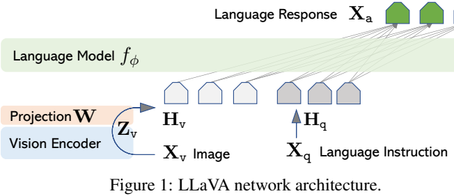
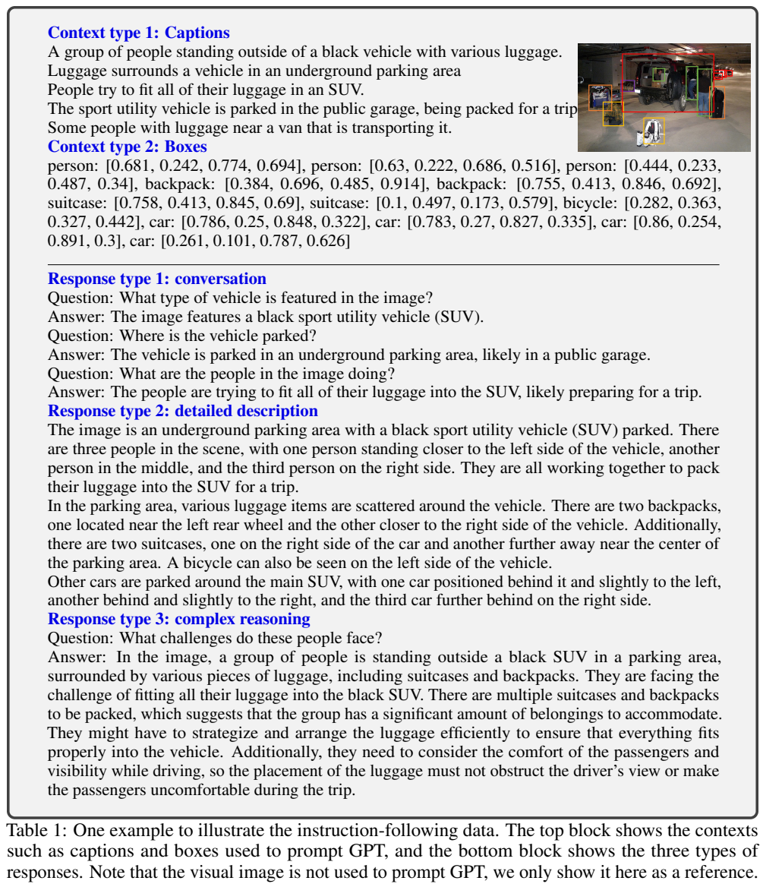
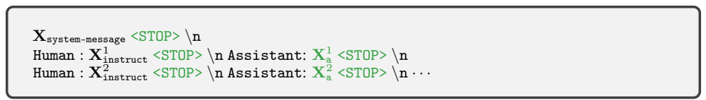
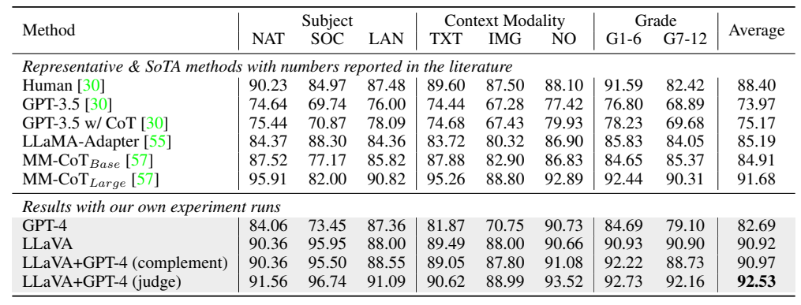

[返回模型家族](../README.md) · [返回仓库](../../../README.md)

# LLaVA 初代：从文字教师生成视觉指令，到端到端语言适配

## 1. 论文信息与模型定位

| 项目 | 内容 |
|---|---|
| 题名 | Visual Instruction Tuning |
| 作者 / 机构 | Haotian Liu、Chunyuan Li、Qingyang Wu、Yong Jae Lee；威斯康星大学麦迪逊分校、微软研究院、哥伦比亚大学 |
| 采用版本 | arXiv:2304.08485v1，2023-04-17；19 页，初始预印本 |
| 原文 / 官方项目 | [固定版本 PDF](https://arxiv.org/pdf/2304.08485v1) · [LLaVA 项目](https://llava-vl.github.io) |
| 模型组件 | CLIP ViT-L/14、单层线性投影、LLaMA 系语言模型；ScienceQA 主实验为 13B，另有 7B 消融，未给出精确系统总参数 |
| 输入 / 输出 | 单图像与多轮文字指令 → 自然语言回答、描述、推理和选择题答案 |
| 定位与开放 | 开放视觉助手与视觉指令调优方法；论文公开合成数据、模型、训练及数据生成代码和聊天演示 |

本文是 LLaVA 初代固定 v1，不包含后续 LLaVA-1.5 的 MLP projector、更大指令混合或 OneVision 的多图/视频能力。v1 正文把语言骨干称为 LLaMA，不能从后续仓库配置补写其采用版本为某个 Vicuna checkpoint。

## 2. 快速概览

图文 caption 教会模型“描述什么”，却未必教会它“根据用户想做的事怎样回答”。初代 LLaVA 的主要贡献是在简单视觉—语言连接器上加入视觉指令数据：使用文字版 GPT-4，把已有 COCO captions 与对象框变成多轮对话、详细描述和复杂推理。教师不接收图像像素，只通过标注的符号信息模拟视觉助手，因此数据质量受原标注覆盖与教师推断共同影响。

视觉特征先经线性映射变为语言嵌入，训练分两步：先冻结 CLIP 和 LLM，仅对齐 projector；再保持 CLIP 冻结，更新 projector 与全部语言骨干，学习回答方式。合成指令共 158K 条，来自约 80K 独立图像；另有一条 ScienceQA 专用训练分支，不能与聊天模型混为同一个万能 checkpoint。

在 30 张 COCO 验证图片、90 道合成问题的 GPT-4 裁判实验中，完整指令数据的相对分为 85.1，没有指令调优时为 21.5。ScienceQA 单模型为 90.92%，GPT-4 在两模型分歧时重新判断可达 92.53%。前者是主观评分比，后者是带外部语言模型的选择题准确率；都不等于模型达到多模态 GPT-4 的通用能力。[Sections 3–5](https://arxiv.org/pdf/2304.08485v1)

## 3. 整体架构

> 来源：原文 Figure 1、Equation (1)，2304.08485v1，PDF 第 4 页；完整架构、图注与线性映射式保留。

**读图**：图像 \(X_v\) 经 CLIP 得到网格特征 \(Z_v\)，投影 W 产生视觉嵌入 \(H_v\)；文字指令 \(X_q\) 编码成 \(H_q\)，与视觉 token 一起进入自回归语言模型，输出回答 \(X_a\)。图中线性层只是维度桥接，没有额外 query 压缩、cross-attention 插层或独立像素生成头。

| 组件 | 原文实际内容 | 意义 |
|---|---|---|
| 视觉编码器 | CLIP ViT-L/14；比较最后层及其前一层的 grid 特征 | 以预训练图像特征提供空间分布信息 |
| Projector | 单层可训练线性矩阵 W | 映射到语言词嵌入维度 |
| LLM | LLaMA 系自回归语言模型；Stage 2 完整更新语言参数 | 解释视觉条件并生成指令响应 |
| 对话组织 | 第一轮随机选择图像在问题前或后；之后各轮只加入问题 | 保留共同图像条件与对话历史 |
| 输出 | assistant 文字及停止标记 | 同一生成方式处理描述、问答与 ScienceQA |

v1 没有明确列出图像输入分辨率、visual token 总数、特征维度或最终上下文长度，不能据 patch14 自行宣称采用 224 或 336 输入。本版本也未展示动态分辨率、视频帧采样、区域坐标输出的检测能力。用于数据生成的框信息不是推理时要求用户提供的输入框。[Sections 4.1–4.2](https://arxiv.org/pdf/2304.08485v1)

## 4. 核心创新与数学原理

**用符号视觉背景组织指令监督。** 合成教师看到 captions、对象类别和空间框，由此回答“有什么”“相对位置怎样”“为什么需要这样做”等问题。学生训练时接收图像本身和问题，并学习教师的回答。这是数据层面的教师监督，不是匹配教师隐藏层或 logit 的知识蒸馏损失；本文没有逐样本人工审查或保证生成答案均由像素证实。

**简单连接器，突出数据作用。** 原文 Equation (1) 为：

\[
Z_v=g(X_v),\qquad H_v=WZ_v.
\]

视觉特征经线性映射取得语言嵌入维度，映射本身并不将图像量化到文字词表，也没有把每个 patch 赋予明确的词义。原文邻近一处文字把输出误记为 Hq，公式与 Figure 1 的视觉输出是 Hv；这里采用公式口径。Stage 1 在冻结语言模型下优化 W，使生成 caption 的梯度指导视觉特征进入语言模型能够处理的空间。

**以多轮回答为目标，而不预测所有输入。** Equation (2) 指定第一轮随机排列问题与图像，之后每轮加入新问题；同一图像影响所有后续回答。Equation (3) 用回答序列的自回归条件概率表示监督：

\[
p(X_a\mid X_v,X_{instruct})=
\prod_{i=1}^{L}p_\theta(x_i\mid X_v,X_{instruct,<i},X_{a,<i}).
\]

这里 i 遍历需要预测的回答 token；system、用户问题、此前停止标记等也是上下文条件，原式为简洁省略它们。与监督方式一致，可将优化解释为回答 token 的负对数似然：

\[
\mathcal L=-\sum_{i\in\mathcal A}\log p_\theta(x_i\mid\text{此前完整上下文}).
\]

后式是对 Equation (3) 的解释性写法，\(\mathcal A\) 为 assistant 回答与相应停止目标位置。Table 2 明确强调预测回答和何时停止，不能把视觉输入、用户问题、全部 system message 都当作普通 next-token loss 标签。本文视觉输入只提供条件，没有预测视觉 token 或图像重建目标。

**先兼容，再改变语言模型。** 冻结大骨干进行初始对齐，避免刚初始化的视觉映射同时改变语言参数；随后完整语言更新让模型学会较复杂的视觉指令。论文的 ScienceQA 消融支持对齐阶段重要，但它不是比较所有冻结/解冻策略的全面证明，也没有偏好优化或显式强化学习阶段。[Section 4、Table 7](https://arxiv.org/pdf/2304.08485v1)

## 5. 数据构建与处理

> 来源：原文 Table 1，PDF 第 3 页；完整 captions、对象框、三种响应、图像参考及表注保留。

**读图**：上方图像只给读者参考，不发送给教师。下方对话关注车辆和人，长描述补充空间关系，复杂推理讨论行李装载与舒适/视野问题。可观察信息与常识推断同时进入训练目标，因此不能把生成的所有理由当作原图直接证实的事实。

| 阶段 / 类型 | 来源 | 数量与构建 |
|---|---|---|
| 特征对齐 | CC3M 子集 | 595K 图文对；随机简短描述指令 → 原 caption |
| Conversation | COCO 标注，少样本 prompt，GPT-4 合成 | 58K，多轮问答，强调可明确回答的视觉问题 |
| Detailed description | COCO caption/框，随机长描述问题 | 23K，单轮较全面描述 |
| Complex reasoning | 相同符号背景，教师生成推理题与回答 | 77K，单轮常识与分步推理 |
| ScienceQA | 现有多模态科学选择题及 lecture/explanation | 12,726 train、4,241 val、4,241 test；专用任务训练 |

三种合成数据合计 158K，正文描述覆盖约 80K 独立图像；样本与图像数不同。人工只提供少量 seed 示例，正文认为 GPT-4 比早期尝试的 ChatGPT 数据质量好，但没有给出完整人工一致性评测。Prompt 限制不能确信的问题，然而教师只见标注，仍可能遗漏未标对象、混淆对象与推断，不能称为经过像素核验的数据。

CC3M 过滤并非只按 caption 长度。附录用 spaCy 提取名词短语并计数，忽略频次<3 的短语；从较低频但保留的概念开始，把含该短语的 captions 放入候选集，对频次>100 的短语随机最多取 100 个 captions。得到约 595K 对，Figure 2 的独立名词短语数为原始 108,182、过滤后 31,423。该策略旨在平衡覆盖与训练量，不是保留所有罕见概念或证明彻底去重；全文没有完整记录数据损坏、跨集重复与污染审查。[Section 3、Appendices A–B](https://arxiv.org/pdf/2304.08485v1)

## 6. 训练流程与目标

> 来源：原文 Table 2、Equations (2)–(3)、Section 4.2，PDF 第 5 页；绿色目标位置、对话标记和完整训练段落均保留。

**读图**：human 与 assistant 轮次交替，停止符当前实现用 `###` 表示；绿色目标强调回答及停止学习。Stage 1 只训练 projector，Stage 2 冻结视觉骨干，但 projector 和语言模型都更新。“End-to-End”不能据此读成 CLIP 也被解冻。

| 阶段 | 数据与目标 | 更新 / 冻结 | 已披露条件 |
|---|---|---|---|
| 1 对齐预训练 | 595K CC3M 对，图像加简短描述指令 → caption | 只更新 W；CLIP 与 LLM 冻结 | 单轮，随机采样简述模板 |
| 2 聊天适配 | 158K 合成视觉指令 → 单轮/多轮回答 | 更新 W 与语言参数 phi；CLIP 冻结 | 原文称数据 uniform sampling，未给出完整类别采样实现 |
| 2 ScienceQA 适配 | 问题与图像/文字上下文 → 理由与答案 | 同样更新 W、phi | 主结果 13B，使用 CLIP 最后一层前的特征，先理由后答案，12 epochs |

聊天与 ScienceQA 是作者列出的两个适配用途，并不表示每个聊天 checkpoint 又串行在 ScienceQA 训练。ScienceQA 的“scratch”消融跳过视觉对齐，不是把 CLIP 或 LLaMA 从随机权重重训。v1 没有完整披露学习率、optimizer、batch、训练硬件、时长、精度、warmup、聊天 epoch 或生成采样配置，不能用后续修订版超参数填补。损失就是第 4 节的回答自回归监督，不涉及图像生成、DPO 或 RLHF。[Section 4.2、5.2](https://arxiv.org/pdf/2304.08485v1)

## 7. 实验设置与主要结果

**合成聊天评测。** 作者随机抽 30 张 COCO Val2014 图像，每张生成对话、描述、复杂推理问题各一，共 90 问。LLaVA 接收像素，文本 GPT-4 参考模型接收真实 captions 和框；GPT-4 裁判还使用这些符号背景评价双方答案的帮助程度、相关性、准确性及细节，按 1–10 打分。这个教师、问题生成与裁判相关联的代理评测，不能等同于独立人类评价或多模态 GPT-4 对照。

| 数据配置 | 对话相对分 | 描述相对分 | 推理相对分 | 总相对分 |
|---|---:|---:|---:|---:|
| 全部三类 | 83.1 | 75.3 | 96.5 | 85.1 |
| 描述 + 推理 | 81.5 | 73.3 | 90.8 | 81.9 |
| 对话 +5% 描述 +10% 推理 | 81.0 | 68.4 | 91.5 | 80.5 |
| 仅对话 | 76.5 | 59.8 | 84.9 | 73.8 |
| 无指令调优 | 22.0 | 24.0 | 18.5 | 21.5 |

据原文 Table 3。85.1 是相对于文本 GPT-4 参考评分的数值，不是 85.1% 的问题答对，更不是“达到 GPT-4 所有能力的 85.1%”。完整数据比无指令调优提高 63.6 个相对评分点；少量描述/推理比仅对话提高 6.7 分，支持数据内容多样性。模型间没有统计置信区间，样本很少，教师符号背景和学生像素的信息条件也不同。

> 来源：原文 Table 6、Table 7 的续文，PDF 第 9 页；全部科目、模态、年级列和组合策略结果完整可见。

**读表**：ScienceQA 是选择题准确率。TXT、IMG、NO 是上下文类型，非三个独立模型；平均列不能仅代表图像题。GPT-4 实验为文本输入的 2-shot，遇到依赖图像的题可能因信息不足失败。LLaVA 主模型独立生成理由与答案。

| 方法 | 全集 Acc%↑ | 图像上下文 Acc%↑ | 设置 |
|---|---:|---:|---|
| MM-CoT Large | 91.68 | 88.80 | 文献中的任务专用基线 |
| GPT-4 | 82.69 | 70.75 | 文本 2-shot，无相同像素输入 |
| LLaVA | 90.92 | 88.00 | 13B，ScienceQA 任务微调 |
| LLaVA+GPT-4 complement | 90.97 | 87.80 | GPT-4 无法回答时使用 LLaVA 预测 |
| LLaVA+GPT-4 judge | 92.53 | 88.99 | 答案分歧时 GPT-4 结合两个输出重新决策 |

92.53 是组合系统，比 LLaVA 单模型提高 1.61 个百分点；简单补全只提高 0.05。LLaVA 单模型全集也低于 MM-CoT Large 0.76 个百分点。组合策略不要求两个模型分别独立复核真实图像，不能称为像素级互相纠错。

Table 7 的最后层特征为 89.96，最后层前特征的最佳版本为 90.92；跳过初始对齐为 85.81，降低 5.11 个百分点；7B 为 89.84，比 13B 低 1.08。答案在理由前的实验表列为最后层特征下 89.77，不能把它与不同特征的最佳版本差值全归因于 CoT 顺序。正文关于 reasoning-first 在 6 epochs 达到 89.77 后不再提高的说明，与最佳 90.92 的条件未完全对齐；可支持其收敛讨论，不能补出不存在的完整训练曲线。

Tables 4–5 和附录 Figures 3–5 展示图像异常解释、食品建议、艺术与影视知识连接等能力，同时存在过度推断和细节错误。原文自身把扩大概念/OCR 覆盖、接入更多视觉模型列为未来方向。此篇最清楚的证据是合成视觉指令改善回答行为及 ScienceQA 适配结果；精确检测、OCR、视频和实际任务执行没有在本版完成系统评测。以上来自论文，本介绍未运行模型。
