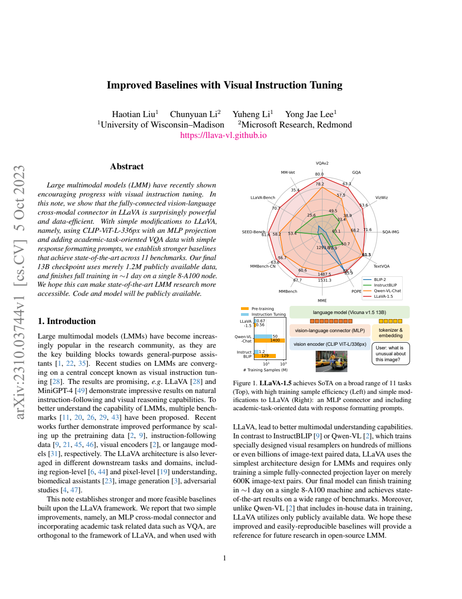
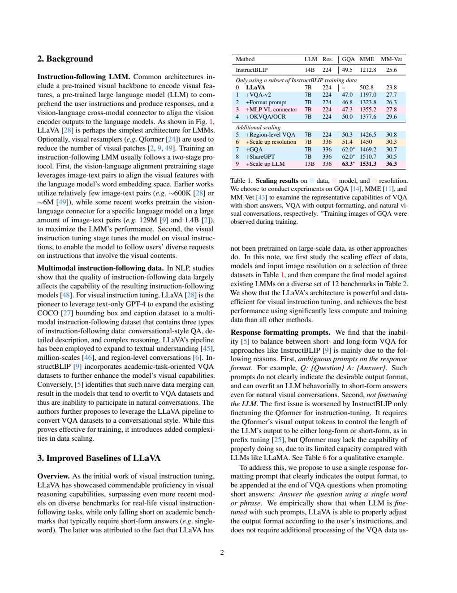
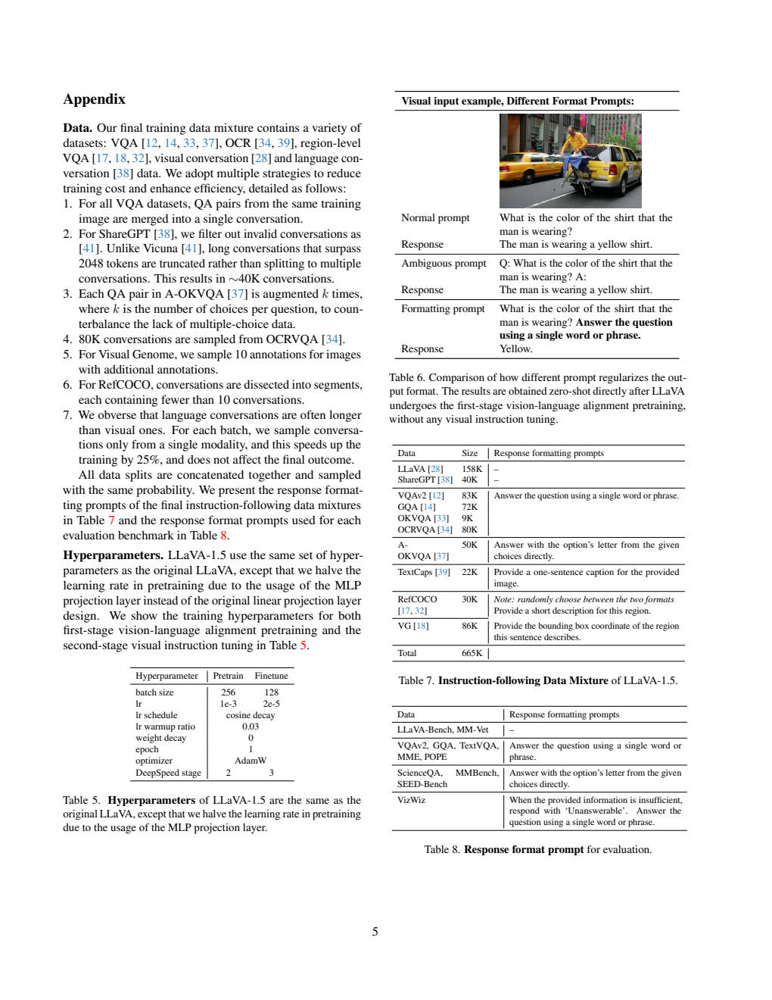
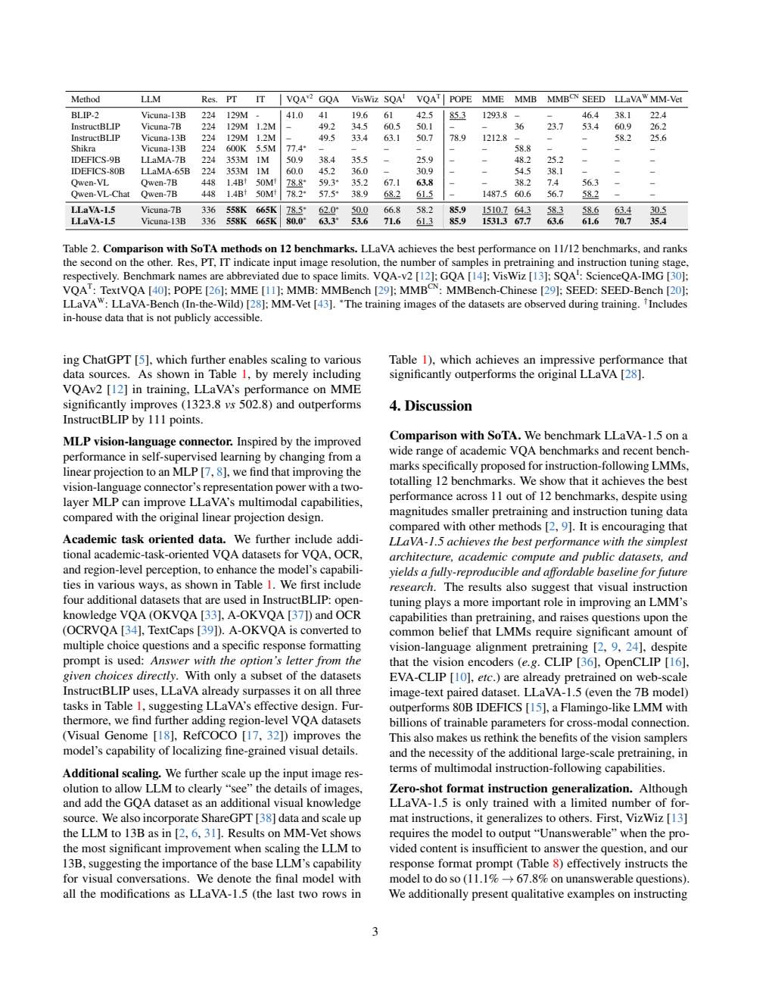

[返回 LLaVA 家族](../README.md) · [返回项目](../../../README.md)

# LLaVA-1.5：用简单连接器与可复核数据建立强基线

> 对应论文 **Improved Baselines with Visual Instruction Tuning**，固定采用 [arXiv:2310.03744v1](https://arxiv.org/abs/2310.03744v1)。这是七页短报告，本文按其信息量介绍，避免混入后续 LLaVA-NeXT 的分块高分辨率和多图能力。

## 1. 论文信息与模型定位

| 项目 | 内容 |
|---|---|
| 原题 | Improved Baselines with Visual Instruction Tuning |
| 机构 | Wisconsin–Madison、Microsoft Research Redmond |
| 首次提交 | 2023-10-05，v1 |
| 模型 | LLaVA-1.5，7B 与 13B |
| 核心组件 | CLIP ViT-L/336px、两层 MLP、Vicuna v1.5 |
| 输入输出 | 单张图片加文字，输出自然语言 |
| 主训练资料 | 558K 对齐样本、665K 指令样本 |
| 官方资源 | [固定 PDF](https://arxiv.org/pdf/2310.03744v1) · [项目页](https://llava-vl.github.io) · [代码](https://github.com/haotian-liu/LLaVA) |

本篇不是提出全新大规模基础预训练模型，而是在已有 CLIP 与语言模型上研究连接器、图像尺寸、数据和回答格式如何组合成较强视觉助手。文中“仅约 120 万公开样本”指新增视觉语言对齐和指令训练，不能把它写成整个系统从头到尾只见过 120 万样本：CLIP、Vicuna 背后已有大规模预训练。[原文摘要、§2–4](https://arxiv.org/pdf/2310.03744v1#page=3)

## 2. 快速概览

早期 LLaVA 能自然对话，但在要求短答案的学术 VQA 基准上不够强。把大量短答案数据直接混入对话，可能又使模型习惯过短回答。论文发现一个简单接口能缓解这个问题：在需要简答的问题末明确写只输出一个词或短语，选择题明确要求选项字母，而开放对话不强加这个格式。

模型侧将原来的线性连接改为两层 MLP，增强视觉特征到语言空间映射能力；分辨率从 224 增至 336，增加小物体与文字细节。数据侧加入常识 VQA、OCR、区域任务和纯语言 ShareGPT，并继续更新语言端适应任务要求。论文不需要额外复杂视觉重采样器，也不通过生成所有像素 token 训练图像输出。

递增实验表明，添加数据和格式提示的增益很大，MLP 与分辨率也有作用，但不是每次改动都改善所有基准。最终 13B 在原表十二项基准中取得多项最好结果，训练约 6 小时对齐加 20 小时指令，在八张 A100 上完成。实际可借鉴的是公开配方与逐步对照；不能把某个时期一组对照的结果写成永久 SOTA。[原文 §3–4](https://arxiv.org/pdf/2310.03744v1#page=4)

## 3. 整体架构

*来源：原文 Figure 1，PDF 第 1 页；[原页](https://arxiv.org/pdf/2310.03744v1#page=1)。右下展示视觉骨干、MLP 与语言模型，上部雷达图的各轴指标尺度不同，不宜以面积当统一总分。*

输入图片被 CLIP ViT-L/336px 编码为视觉 patch 特征；两层 MLP 将每个特征投影到语言模型嵌入空间，和用户文本的 token embedding 一同送入 Vicuna v1.5。输出是自回归回答，图片本身作为条件。图里没有额外 Q-Former 或 Perceiver，因此主模型保留完整视觉 patch 序列。

图片尺寸提升并非原文提出任意分辨率分块系统。主结果明确为 336 输入，仍是单图方案；§4 承认由于指令数据与上下文限制，模型尚不能处理多个图像。不能因后来 LLaVA 系列扩展了视频、多图或高分辨率拼块而回写进本篇。

按 ViT-L 的 14 像素 patch，336×336 图像对应 24×24 个空间 patch，较 224 的 16×16 增加至 2.25 倍；这是结构推算，不是文中另报的性能或总上下文长度。保留更长视觉序列帮助细节输入，也让语言端计算更贵，论文实际报告训练约为原 LLaVA 的两倍。[原文 §2、§4](https://arxiv.org/pdf/2310.03744v1#page=4)

## 4. 核心创新与数学原理

本篇的两层 MLP 可用机制解读式表达：

$$z_i=W_2\,\phi(W_1x_i+b_1)+b_2.$$

$x_i$ 是视觉特征，$z_i$ 是语言侧输入，$\phi$ 是非线性。比单层线性投影多了非线性表示能力，但原报告没有列出完整维度与激活公式，本文不额外指定。它改变通道表达，并不减少 patch 数；不能把这层称为视觉 token 重采样器。

训练本质仍是条件文字生成，常见辅助写法是：

$$\mathcal L=-\sum_t\log p_\theta(y_t\mid V,q,y_{<t}).$$

$V$ 为视觉表示，$q$ 为指令，$y$ 为参考回答。论文没有给独立损失编号式或完整 masking 定义，式子只说明监督来自下一个回答 token。加入明确格式句使同一个问题可携带输出长度或选项格式约束，而不需要为简答/长对话另造分类头。

*来源：原文 Table 1，PDF 第 2 页；[原页](https://arxiv.org/pdf/2310.03744v1#page=2)。蓝色对应数据，粉色对应模型，黄色对应输入分辨率；每行是在前一组合上继续增加设置。*

从基线到加入 VQAv2，MME 从 502.8 到 1197.0；再明确格式，到 1323.8。随后 MLP 将 MME 到 1355.2、MM-Vet 从 26.3 到 27.8，GQA 从 46.8 到 47.3。因而把最终大幅提升全部归给 MLP 不符合递增证据。格式提示也并非无条件提高：MM-Vet 在该一步从 27.7 降到 26.3，说明训练/任务混合间存在权衡。

分辨率提高时 GQA 从 50.3 到 51.4、MME 从 1426.5 到 1450，MM-Vet 却从 30.8 到 30.3。13B 语言端带来更明显自然对话增益，但 Table 1 的 MM-Vet 末行写 36.3，主结果 Table 2 写 35.4，本文按所在表分别记录，不将二者合并或自行修正。[原文 §3、Table 1/2](https://arxiv.org/pdf/2310.03744v1#page=3)

## 5. 数据构建与处理

对齐资料 LCS-558K 来自 LAION-CC-SBU 子集，使用 BLIP 描述。指令混合最终 665K 对话，原 Table 7 的来源如下：

| 来源 | 数量 | 主要用途 |
|---|---:|---|
| LLaVA 原始对话 | 158K | 开放图像对话、描述与推理 |
| ShareGPT | 40K | 纯语言对话 |
| VQAv2 / GQA / OKVQA | 83K / 72K / 9K | 一般视觉问答、推理与知识 |
| OCRVQA / TextCaps | 80K / 22K | 文字阅读与一句话描述 |
| A-OKVQA | 50K | 多选视觉知识问题 |
| RefCOCO / Visual Genome | 30K / 86K | 区域描述与定位 |

这些数字按最终对话条目统计。相同训练图片的多个 VQA 对合并为一次对话，不能将条目数当独立图像数，也不能把 558K＋665K 当去重后唯一图片数。作者把公开数据转换成统一指令，而不是从头采集所有视觉标签。

ShareGPT 过滤无效对话，超过 2,048 token 的长对话被截断，而不拆成多段。A-OKVQA 按每题选项数扩增，增加多选格式覆盖；OCRVQA 采样 80K 对话；VG 对多标注图像采样十条；RefCOCO 将对话拆为不足十轮的段落。最后拼接、按相同概率采样，不能凭条目比例断言相同 token 或算力份额。

数据模板用于控制答案形式：简答、选项字母、一句话描述，以及区域短描述或坐标。纯语言对话通常较长，每个 batch 只采样一种模态；作者报告这使训练加快 25%，属于该硬件和配方下观察，不是普遍吞吐保证。论文没有提供所有数据重复、基础模型训练污染或全域版权逐条核验，本文不补造这些结论。[原文附录 Data、Table 7，第 5 页](https://arxiv.org/pdf/2310.03744v1#page=5)

## 6. 训练流程与目标

*来源：原文附录 Table 5–8，PDF 第 5 页；[原页](https://arxiv.org/pdf/2310.03744v1#page=5)。左下是训练表，右下两表分别是数据格式与评测格式，不能把评测提示当额外训练数据。*

| 超参数 | 视觉语言对齐 | 指令微调 |
|---|---:|---:|
| 样本 | 558K | 665K |
| batch size | 256 | 128 |
| 学习率 | $10^{-3}$ | $2\times10^{-5}$ |
| epoch | 1 | 1 |
| DeepSpeed stage | 2 | 3 |

两阶段均 AdamW、cosine decay、warmup比例0.03、weight decay=0。与原 LLaVA 相比，MLP 对齐学习率减半。背景说明沿用先视觉语言对齐、再指令训练的方案；报告强调更新语言模型以适配答案格式，但没有在 Table 5 完整单列每个组件冻结情况。仅依据本篇不能为所有语言或视觉子模块指定不存在的冻结清单。[原文 §2–3、附录 Hyperparameters](https://arxiv.org/pdf/2310.03744v1#page=5)

13B 主模型在八张 A100 上约六小时对齐、二十小时指令训练。摘要概括约一天，详细时间相加约二十六小时，本文保留近似表述。这个成本包含新增两阶段训练，不包含 CLIP 和 Vicuna 原始预训练；样本高效也不意味着完整基础模型制造成本同样低。

论文既提供学术问答训练，又保留开放对话。在训练简答资料时写清输出格式，之后开放问题可得到长回答，达到同一模型切换输出形式。它在 VizWiz 还使用不可回答提示，拒答行为结果依赖提示条件，不能单独将提高数字解释为无提示时已经自动识别所有不可答情况。

## 7. 实验设置与主要结果

*来源：原文 Table 2，PDF 第 3 页；[原页](https://arxiv.org/pdf/2310.03744v1#page=3)。星号明确表示训练时见过该数据集训练图像，PT/IT表示额外对齐/指令样本。*

| 基准 | LLaVA-1.5 7B | LLaVA-1.5 13B | 原表对照与含义 |
|---|---:|---:|---|
| VQAv2 | 78.5 | 80.0 | 训练含对应训练图像，非完全无该任务资料 |
| GQA | 62.0 | 63.3 | 同上，添加 GQA 训练会影响解读 |
| VizWiz | 50.0 | 53.6 | 问答中包含不可答提示 |
| ScienceQA-IMG | 66.8 | 71.6 | 多选输出格式 |
| TextVQA | 58.2 | 61.3 | 13B 低于原表 Qwen-VL 的63.8 |
| POPE | 85.9 | 85.9 | 该指标13B未比7B提升 |
| MME | 1510.7 | 1531.3 | 分数不是准确率百分比 |
| MMBench / 中文 | 64.3/58.3 | 67.7/63.6 | 单项基准结果 |
| SEED-Bench | 58.6 | 61.6 | 依原报告基准版本 |
| LLaVA-Bench / MM-Vet | 63.4/30.5 | 70.7/35.4 | 对话与综合视觉能力 |

表 2 支持本次选定对照中大部分指标领先，但 TextVQA仍低于Qwen-VL。MME 与准确率、不同模型未报告项不可混合算统一排名。MM-Vet 在表 1/2 有数字差异，应以本文逐表记录为准。

另外，“中文能力零样本”指没有专门中文多模态指令调整；训练中 ShareGPT 含多语言文字指令，因此不能写成整个系统没见过中文。报告正文称 63.6 相比56.7高7.3%，但两数差实际为6.9个分数点，本文直接保留表中值，不照搬该减法。

定性输出展示JSON字段抽取与识别问题错误前提，但原文同时承认仍有字段错误和幻觉，样例不是可靠性保证。v1缺少多图能力、长视觉patch增加成本、专业问题求解仍有限。它的研究价值在于说明简单MLP、合适的回答格式和多样公开任务资料已能建立强基线；不能据此否定其它任务中的大规模预训练或视觉压缩。本文未运行模型或复现训练，所有成绩来自固定原文。
