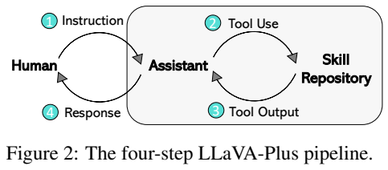
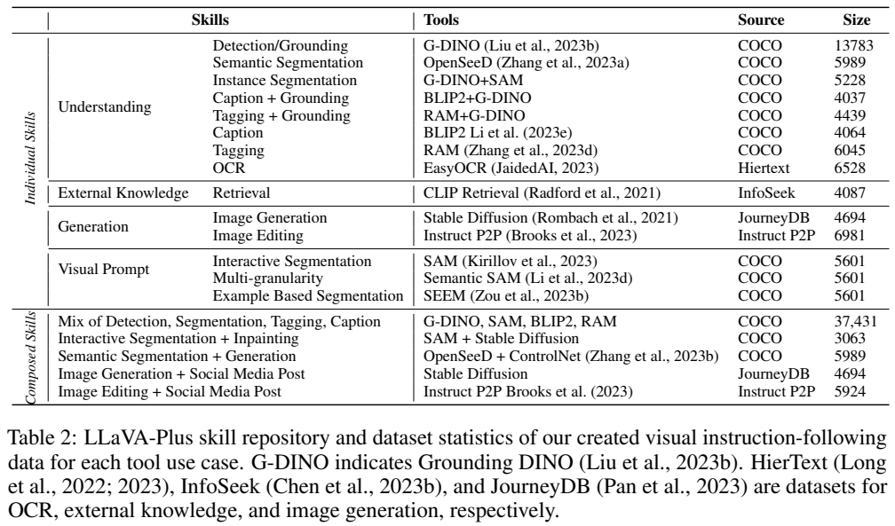
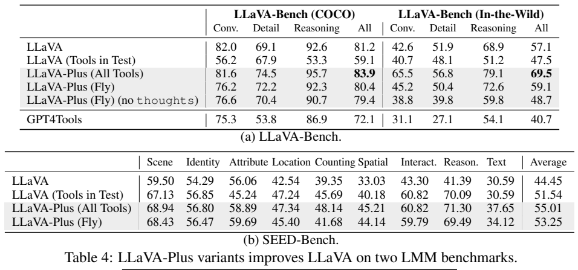
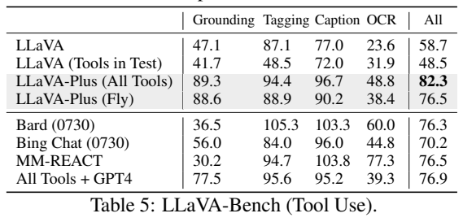
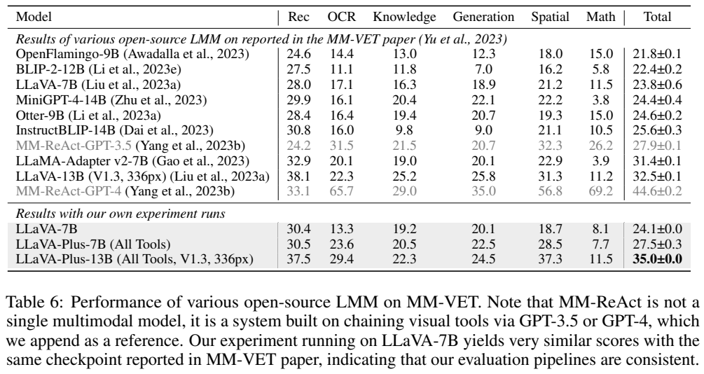
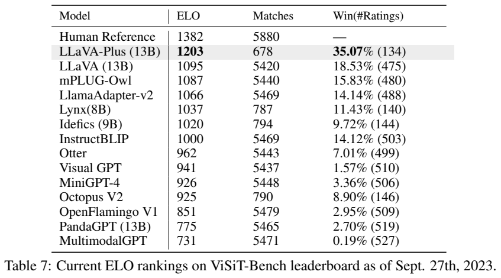

# LLaVA-Plus：学习调用视觉工具的多模态智能体

## 1. 论文信息与模型定位

**LLaVA-Plus: Learning to Use Tools for Creating Multimodal Agents** 由 Shilong Liu、Hao Cheng、Haotian Liu 等提出，作者来自清华大学、Microsoft Research、UW–Madison、HKUST与IDEA Research。本介绍依据 [arXiv 2311.05437v1](https://arxiv.org/pdf/2311.05437v1)（2023-11-09，25页）。[项目页](https://llava-vl.github.io/llava-plus/)与[官方代码](https://github.com/LLaVA-VL/LLaVA-Plus-Codebase)对应本条目。

LLaVA-Plus把已有LLaVA视觉语言模型作为规划器，学习选工具、写参数和综合结果，实验有7B与13B语言规模。模型能完成检测、分割、图像生成等任务，但这些能力由外部专家工具执行；不能将它整理成一个统一token模型原生预测图像或mask的报告。“端到端训练”指以生成式指令监督学习规划输出，不表示所有工具和语言模型一起反向传播训练。

## 2. 快速概览

| 组成 | 职责 |
|---|---|
| 视觉语言规划器 | 持续结合原始图像、问题和历史，选择技能并生成回复 |
| 技能库 | Grounding DINO、SAM、OpenSeeD、BLIP-2、RAM、EasyOCR等理解工具 |
| 扩展工具 | CLIP检索、Stable Diffusion、Instruct-Pix2Pix、ControlNet等 |
| 统一输出 | thoughts、actions、value；不调用工具时actions为空列表 |
| 训练数据 | LLaVA-158K加工具使用数据；定量模型采用81K理解数据 |
| 两种设置 | All Tools预先补齐识别信息；Fly按需调用相关工具 |

主要技术价值是让“能看图”的模型学习使用专业能力，而不是只给文字模型一次图像caption后再让它调工具。每次调用仍受专家工具的识别错误、参数错误和多工具冲突影响，原文结论明确承认这些限制。

## 3. 整体架构

**读图：**①用户输入图像与指令；②助手生成工具名和参数；③执行器调用技能并返回结果；④助手结合原始图像和结果输出回复。原图展示的是系统循环，并非新增Transformer内部层。图像在会话中持续作为条件，工具返回的框、类别、OCR或检索文字也进入历史。

输出包含三个字段。thoughts说明当前需要什么信息；actions为JSON函数调用列表，含API name与API params；value为面向用户的自然语言。最终没有待执行工具时actions为空。检测+分割可封装为Grounding DINO+SAM组合技能，Stable Diffusion类工具负责图像生成；规划器生成的是调用和生成提示，不直接计算扩散去噪。

系统基于FastChat，由网页服务、模型workers和controller协调。§2.3称7B规划器与工具可以一起加载到一张80GB GPU上服务，未给出完整并发负载或吞吐；这不意味着13B配置也有同样显存预算，更不等于80GB是模型权重的精确大小。

## 4. 核心创新与数学原理

新增训练信号是“技能对话”。原文式(2)把一次交互整理为用户图像和问题、助手工具调用、工具结果作为后续输入、助手最终回复。损失只覆盖助手生成的子序列，既学习调用，也学习答案及停止时机。将原文文字目标写成紧凑表达为：

$$
\mathcal L=-\sum_{t\in\mathcal A}\log p_\theta(y_t\mid I_q,\text{dialogue}_{<t}),
$$

其中 $\mathcal A$ 代表工具请求与最终回复的助手token位置，不包括工具执行结果。这是§2.1自回归监督的表达，不是论文另外引入的强化学习奖励公式。工具输出是条件数据，不能说对SAM mask或扩散图像的像素误差直接优化LLaVA。

统一格式也决定了“何时不用工具”的学习。原LLaVA问答转成value，补thoughts和空actions，避免模型只能模仿调用而忘记正常对话（附录A）。需要图像相关参数的技能，则让规划器从图像与语言判断目标类别或编辑提示。因此跨模态规划可以同时利用原图与符号工具信息，但不自动保证每次函数调用的语法与内容正确。

All Tools把多数视觉理解工具的输出预先加入训练和评测条件，Fly只为当前指令提供相关输出。这是不同信息与成本条件；表中All Tools更好不能单独证明“规划算法更强”。报告未提出可微工具选择器或专门数学规划损失，也没有给工具调用总延迟的定量成本模型。

## 5. 数据构建与处理

**读表：**COCO提供检测、分割、caption、tagging与组合样本；HierText提供OCR，InfoSeek用于检索，JourneyDB用于生成，Instruct-Pix2Pix数据用于编辑。检测13,783条、实例分割5,228条、OCR6,528条、检索4,087条是相应使用案例的统计，不能将各行直接解释成同样数量的独立图像，组合会话可能重用源图。

无额外参数的技能先用GPT-4生成多样问题，再改写预设thoughts/value，actions由已知工具确定，工具结果按固定规则整理并重复原问题。最终回复由**语言版GPT-4**结合caption、类别、框和工具结果生成，不是GPT-4逐张读取原图进行视觉标注。需要概念参数的技能从图像类别填模板，或用两个完整人工种子对话做few-shot生成更丰富调用（§2.2）。

检索数据只保留答案能从检索知识提取或推导的InfoSeek子集，经ChatGPT比较答案与结果筛选；这会偏向检索确有帮助的样本（附录B）。视觉点击位置转成文字坐标，SAM或Semantic-SAM执行分割；语义布局配OpenSeeD+ControlNet，交互分割配SAM+SD inpainting。上述组合样本教模型安排操作顺序，不是自动合成一个统一视觉网络。

原LLaVA-158K也转换为三字段格式。定量理解模型使用81K理解数据与原问答，demo系统采用完整技能数据。所有生成/编辑demo能力不能直接归到仅81K理解数据训练的定量checkpoint上。

## 6. 训练流程与目标

以LLaVA模型为起点做工具使用指令微调；训练目标是统一对话里的助手自回归输出。All Tools和Fly分别构造条件，前者除分割外利用多个理解工具提取符号信息，后者降低无关调用。不同模型规模在MMVet和VisIT-Bench中分项报告，13B的一项结果明确标注V1.3、336px。

该v1没有完整列出epoch、optimizer、学习率、batch size、冻结层或各模块参数更新策略，也未给训练GPU小时。因而不能把其他LLaVA版本的标准recipe直接填成Plus原文的披露。技能库复用已训练专家，论文未声称重新共同训练CLIP、SAM、扩散模型或OCR引擎。

服务阶段执行actions，回填工具结果后再生成value；用户界面主要展示回复与视觉输出。若新增技能，论文建议收集对应指令与执行结果再微调，并非只把新工具名加入列表就能保证零样本掌握所有API。判断系统改善要同时考虑新增数据、额外工具证据与规划训练，不能当成纯语言模型内部能力的无条件提高。

## 7. 实验设置与主要结果

LLaVA-Bench COCO有30图90问，In-the-Wild有24图60问，用gpt4-0314相对参考回复评分；SEED-Bench约19K多选问题。表4显示：

| 设置 | COCO总分 | In-the-Wild总分 | SEED平均 |
|---|---:|---:|---:|
| LLaVA | 81.2 | 57.1 | 44.45 |
| 测试时直接加工具 | 59.1 | 47.5 | 51.54 |
| Plus All Tools | 83.9 | 69.5 | 55.01 |
| Plus Fly | 80.4 | 59.1 | 53.25 |

All Tools在这三项均高于原模型；Fly在COCO总分80.4却低于81.2，不能复述“所有变体所有指标一致提高”。直接加工具在开放回复评分下降，但SEED从44.45升至51.54，所以未经训练的工具信息也并非在所有评价里都无效。Fly去掉thoughts使In-the-Wild59.1降至48.7，提供统一中间说明格式的消融证据。

工具专项仅44题，分grounding10、tagging12、caption12、OCR10。All Tools总82.3，Fly76.5，原LLaVA58.7，GPT-4链工具76.9；这是相对回复分，可以超过100，不是API调用成功率。例如All Tools OCR48.8低于MM-REACT77.3；专项总体领先不意味着每种工具更强。

**读表：**MMVet上作者复跑LLaVA-7B为24.1±0.0，Plus-7B All Tools27.5±0.3，提高3.4分；13B Plus35.0±0.0，对公开LLaVA-13B32.5±0.1提高2.5。7B OCR13.3→23.6、空间18.7→28.5较明显，但数学8.1→7.7略降。MM-REACT-GPT4总44.6仍更高，且它是另一工具系统，不能遗漏。

VisIT-Bench包括592问、1159图、70指令族；原文表7固定于2023-09-27快照。Plus-13B Elo1203，对LLaVA1095提高108；对人工核验参考回复的胜率35.07%（134次评分）高于LLaVA18.53%（475次），不是Plus与LLaVA直接交手35.07%的胜率，也不是本文写作时的最新排名。比较匹配次数不同，仍有评测覆盖边界。

附录表11在COCO caption上Plus CLIP score0.815高于BLIP-2 0.788，但CIDEr31.0远低于BLIP-2 123.5，显示更丰富回复与标准短caption匹配并不一致。表12的100张COCO验证图中检测假阳性实例90→20、受影响图片41→12，是局部实验的计数，未证明彻底消除幻觉。整体证据支持学习工具使用可以扩展系统能力，但效果依赖任务、信息预算和工具可靠性。
