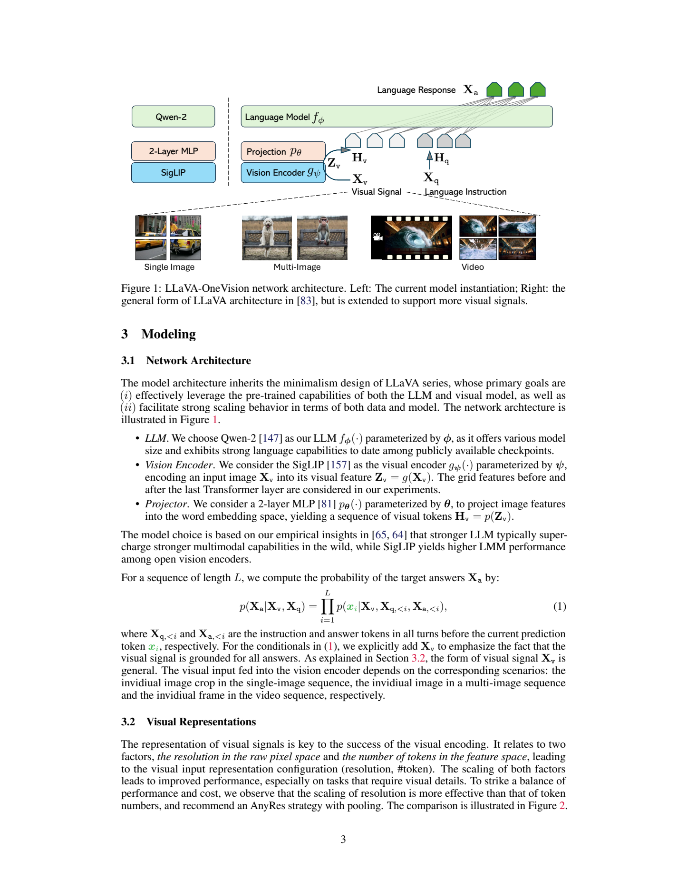
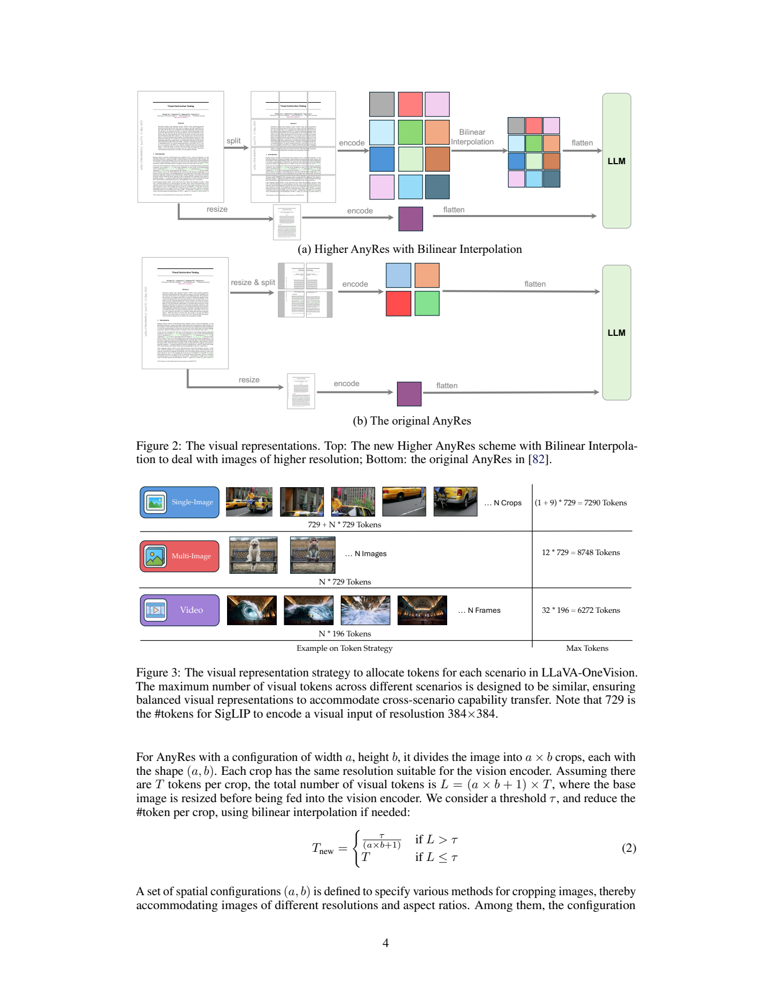
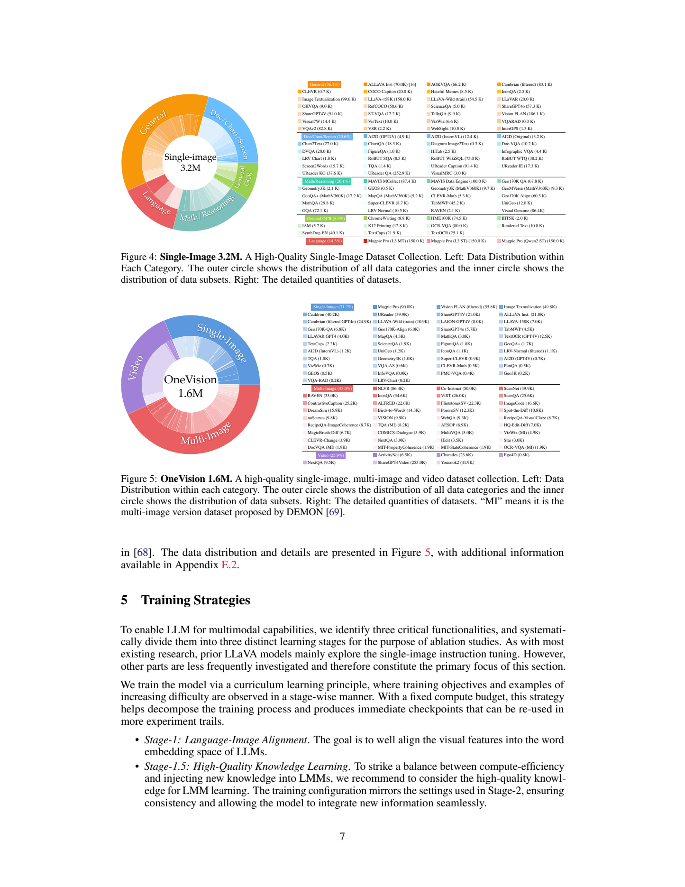
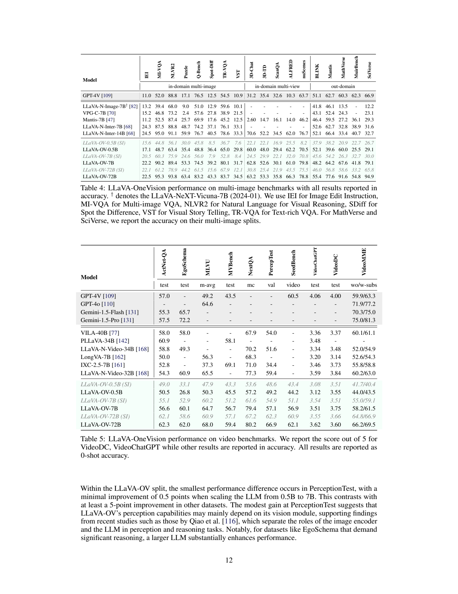

# LLaVA-OneVision：用统一视觉表示连接单图、多图与视频任务

## 1. 论文信息与模型定位

| 项目 | 信息 |
|---|---|
| 原文 | LLaVA-OneVision: Easy Visual Task Transfer |
| 作者与机构 | Bo Li、Yuanhan Zhang、Dong Guo 等；ByteDance、NTU、CUHK、HKUST |
| 版本 | arXiv:2408.03326v1，2024 年 8 月 6 日；本文以这一 43 页版本为准 |
| 原文与项目 | [论文 PDF](https://arxiv.org/pdf/2408.03326v1)、[项目说明](https://llava-vl.github.io/blog/llava-onevision) |
| 模型定位 | 可理解单张图像、交错多图与视频帧的开放视觉语言助手，输出语言而非生成视频 |

这篇报告整合了 LLaVA-NeXT 系列在分辨率、语言主干、合成数据和多图训练上的经验。它要解决的问题是：如何用一个模型覆盖不同视觉输入，同时让单图学到的 OCR、图表和推理能力迁移到多图与视频，而不是分别训练三套系统。

模型家族以 0.5B、7B、72B 标识语言主干档位，不能把这些简称当成整个系统的精确参数量。Table 1 的完整模型约为 0.8B、8.0B、73.2B；其中语言主干一栏为 0.5B、7.6B、72.7B。报告的核心是训练与视觉序列组织方式，不是提出一种新的 Transformer 算子。

## 2. 快速概览

| 要点 | 实际设计 |
|---|---|
| 语言与视觉主干 | Qwen2 与 SigLIP SO400M，以两层 MLP 连接 |
| 单图 | Higher AnyRes 保留高分辨率，通过特征插值限制视觉序列长度 |
| 多图 | 每张图使用基础分辨率表示；训练最多 12 张，不逐图做高分辨率多裁块 |
| 视频 | 每帧编码后压缩为 196 个 token，训练最多 32 帧 |
| 课程 | 图文对齐→高质量知识学习→单图指令→混合 OneVision 指令 |
| 主要证据 | 7B 从单图阶段到混合阶段，NExT-QA 从 61.6 到 79.4，Video-MME 无字幕从 55.0 到 58.2 |
| 重要限制 | 部分单图成绩下降；任务迁移的定性示例不等于可靠的代理或自动驾驶执行系统 |

OneVision 的“统一”主要体现为三个场景共用视觉编码器、连接器和语言模型。它同时采用不同的视觉 token 预算：单图强调空间细节，视频强调更多帧，多图控制总序列长度。统一并不意味着所有输入采用相同的原始分辨率或每帧 token 数。

## 3. 整体架构

*原文 Figure 1，PDF 第 3 页完整页面，保留架构图、图注与 Eq. (1)。*

图左侧给出实际组件，右侧说明数据流。视觉编码器 \(g_\psi\) 将图像、裁块或视频帧转成网格特征 \(Z_v\)，两层 MLP \(p_\theta\) 将它映射到语言词嵌入空间：\(H_v=p_\theta(g_\psi(X_v))\)。这些连续视觉 token 与文字指令一起交给 Qwen2，模型自回归生成回答。报告考虑视觉编码器最后一层之前与之后的网格特征，并未在正文给出每种模型使用哪一层的完整对照，不能统一写成确定的一层。

基础视觉输入是 384×384，每个裁块产生 729 个 token，即 27×27 的特征网格。单图包含缩放后的整体图与高分辨率局部裁块；多图为多段图像特征；视频为多帧特征。语言模型看到的是不同组织方式的视觉序列，单图的多个空间裁块与视频的多个时间帧因此在接口上更接近。

附录 C.2 使用 Qwen2 的 ChatML 格式。`<image>` 是数据中的视觉占位标记，分词后的输入索引为 -200，在视觉嵌入装配时使用；不能把这个负索引理解成普通词表里可预测的词。多图用多个标记与文字交错，视频用开头一个标记指示视频输入。作者还删除了约十条文字或 HTML 中含有同名标记的样本，避免误插入视觉特征。

模型不是原始视频生成器，也没有单独的音频分支。论文示例中的“图像到视频编辑”输出的是创建视频的文字指令，不能据此扩展其输出模态。

## 4. 核心创新与数学原理

### 高分辨率和长序列分开控制

*原文 Figure 2、Figure 3，PDF 第 4 页完整页面；保留所有场景与 Eq. (2)。*

Figure 2 上部先将高分辨率图像切成较多局部裁块，再在编码后的特征网格上做双线性插值；下部是此前的 AnyRes。关键变化是避免先为了减少裁块而过度缩小原图，同时限制送入语言模型的特征数量。插值作用于视觉特征，不能等同于随机丢弃帧或仅缩小原始像素。

原文以横纵裁块数 \(a,b\)、每块 token 数 \(T\) 表示总长度：

\[
L=(ab+1)T,\qquad
T_{\mathrm{new}}=\begin{cases}\tau/(ab+1),&L>\tau,\\T,&L\leq\tau.\end{cases}
\]

“+1”代表整体图。超过预算 \(\tau\) 时，每个局部表示压缩，使总数量受控。这是原文 Eq. (2) 的预算表达；实际网格维度需要整数，不能把分式直接当成可切出小数个 token 的实现。分辨率候选可扩展到 6×6，而最终单图使用 AnyResMax-9 的特征预算，上限按 Figure 3 为 \((1+9)\times729=7290\)。因此，“最大网格搜索范围”“裁块数量”和“最终 token 预算”应分别理解。

### 不同场景保持相近的序列量级

Figure 3 给出三个上限：单图 7290，多图 \(12\times729=8748\)，视频 \(32\times196=6272\)。多图将图像保持宽高比填充到 384×384，编码后移除填充对应的特征，实际数量可更少。视频在 27×27 特征上以 2×2 尺度插值，得到 14×14，也就是 196 个 token；因为整数网格取整，它并非精确的 729/4。

这些预算使单图、多图、视频的输入长度大致接近，有利于在有限算力下联合训练。它没有保证各场景的计算成本完全相等，也没有将语言 Transformer 的全局注意力变成线性复杂度。减少 token 确实会减少注意力矩阵的规模，但图像编码、投影和语言计算都仍然存在。

附录 C.1 最后一段把视频上限写成 \(32\times729\)，与同段的每帧 196、Figure 3 的 6272 不一致。本文按明确图示与压缩后的每帧数量解释，并记录该处笔误，而不把 23,328 当成最终视频 token 上限。

### 迁移依赖统一接口与训练顺序

单图训练已经让模型学习长视觉序列上的详细描述与问答，视频只改变序列中视觉内容的组织方式。随后混合训练补充跨图关系和时间线索。这是作者提出的迁移解释，不是证明空间裁块和时间帧完全等价。比如 ActivityNet-QA 的一些颜色问题只需一个帧即可回答，单图模型的视频得分不能全部归因于真正理解动作时间顺序。

## 5. 数据构建与处理

*原文 Figure 4、Figure 5，PDF 第 7 页完整页面；保留两个分布图、全部数据项和图注。*

高质量知识数据包含重新描述的 COCO118K、BLIP558K、CC3M，使用早期 LLaVA-NeXT-34B 生成详细 caption，正文合计约 3.5M；文档/OCR 数据结合 UReader 的 100K 文本阅读样本与 SynDOG 英中数据，正文约 1.1M；另有 92K 中文详细描述和 143K Evo-Instruct 语言样本。作者称这一知识池约 99.8% 为合成数据。Table 1 的知识学习阶段却列为 4M，无法由上述近似数字直接求和还原；报告没有充分解释去重与筛选后的映射，本文保留两种统计口径。

单图指令集合为约 3.2M，按任务与输出形式双重分类。Figure 4 的任务占比为通用 36.1%、文档/图表/屏幕 20.6%、数学推理 20.1%、通用 OCR 8.9%、语言 14.3%。其中语言样本本来就没有图像，不能将 3.2M 全部称为独立图片。Magpie Pro 约 450K 用于保持 Qwen2 的语言能力。

自由回答主要来自 GPT-4V/o、Gemini 等模型标注，保留原始回答；固定回答来自学术数据，人工检查并统一选择题、短答案和 OCR 等格式。附录说明对新增来源抽取约 100K、加入已有 790K 集合做小模型验证，若成绩下降再检查数据与格式。作者同时根据多项公开评测调整分布，因此结果也反映开发过程中评测反馈的影响。

混合阶段标为 OneVision 1.6M。多图来自 M4-Instruct，覆盖找不同、视觉故事、编辑指令、多视角场景与具身问答。视频除 NExT-QA、ShareGPT4Video，还包含 Charades、ActivityNet、YouCook2、Ego4D；重标注时按 1 FPS 取帧，先让 GPT-4o 生成描述，再由描述产生开放及选择题问答。这里的 1 FPS 是数据标注步骤，不是报告披露的所有推理任务采样率。

原文 Section 4.2 写 560K 多图、350K 视频和 800K 单图，与 Figure 5 的 43.0%、25.9%、31.2% 不一致，前者相加也不是 1.6M。图中各项更像约 560K 多图、338K 视频、406K 单图的近似集合；本介绍不擅自将冲突统计重算成唯一的“正确配方”。此外，部分用户数据和 Azure 标注数据受政策限制，附录 E.4 表示不能直接全部发布。

## 6. 训练流程与目标

| 阶段 | 数据规模与视觉预算 | 更新参数 | Table 1 的学习率 |
|---|---|---|---|
| Stage 1 对齐 | LCS 558K；384×384，729 token | 仅投影层 | 投影层 1e-3 |
| Stage 1.5 知识学习 | 表中 4M；最高 5×729 | 全模型 | 视觉 2e-6，投影/LLM 1e-5 |
| Stage 2 单图指令 | 3.2M；最高 10×729 | 全模型 | 同上 |
| Stage 2 OneVision | 表中 1.6M；多图与视频预算见 Figure 3 | 全模型 | 同上 |

所有阶段列为一轮训练。对齐阶段全局 batch 为 512；后续 0.5B 用 512、7B 与 72B 用 256。Table 1 对被冻结的视觉主干仍列出第一阶段学习率，但“Trainable: Projector”明确实际更新范围，不能据此说视觉主干在对齐阶段训练。后续视觉学习率为其他模块的五分之一，既学习细节与任务，也降低已有视觉表示被快速改变的风险。

原文 Eq. (1) 采用回答序列的条件自回归分解。以负对数似然写其标准训练解释为：

\[
\mathcal L=-\sum_{i\in\mathrm{answer}}\log p(x_i\mid X_v,X_{q,<i},X_{a,<i}).
\]

损失解释是对原文概率分解的标准转换，不是报告另有编号的新公式。模型在视觉条件和对话历史下学习答案，阶段变化主要改变样本与更新参数，并不引入三种不同的视觉生成损失。本文依据的 v1 没有把 DPO 列为 OneVision 主训练阶段；附录回顾早期 NeXT-Video 的 DPO 工作不等于本模型也使用相同配方。

报告未列出统一的优化器、warmup、权重衰减、精度、总 GPU 数与完整训练耗时，不能为了可复现格式自行补齐。三阶段名包含 Stage 1.5，且 Stage 2 内含两个顺序子阶段，阅读时应避免把它缩成一次混合数据微调。

## 7. 实验设置与主要结果

使用 LMMs-Eval，默认 greedy decoding 与零样本；部分对比沿用其他论文公布的成绩，缺失时才以相同工具评测。Table 3 中 GPT-4V 的 ChartQA 是四样本例外。SI 表示完成单图指令训练，OV 表示再完成混合训练；两者的差异可观察混合阶段的收益与代价。

*原文 Table 4、Table 5，PDF 第 12 页完整页面；保留所有列、模型行、字幕条件及图注。*

| 任务 | 7B SI→OV | 72B SI→OV | 含义 |
|---|---:|---:|---|
| 单图 MathVista | 56.1→63.2 | 66.5→67.5 | 混合阶段也可能促进部分单图推理 |
| 单图 MMMU | 47.3→48.8 | 57.4→56.8 | 更大模型并非所有单图指标均改善 |
| 多图 MuirBench | 32.7→41.8 | 33.2→54.8 | 跨图任务明显受益 |
| 多图 BLINK | 45.6→48.2 | 46.0→55.4 | 0.5B OV 为 52.1，超过 7B，不能宣称严格规模单调 |
| 视频 NExT-QA | 61.6→79.4 | 67.2→80.2 | 混合训练增强时间及关系问答 |
| Video-MME 无字幕 | 55.0→58.2 | 64.8→66.2 | 有字幕分别为 59.1→61.5、66.9→69.5 |

72B 的 ChartQA 从 84.9 降到 83.7，DocVQA test 从 91.8 降到 91.3，MM-LiveBench 从 84.4 降到 81.5。因此“覆盖三个场景”并不等于完全避免单图退化。72B 在 MathVista 的 67.5 高于报告中的 GPT-4o 63.8，但 MMMU 56.8 仍低于 69.1，Video-MME 无字幕 66.2 低于 71.9，视觉聊天 Wilder 72.0 也低于 85.9，不能把选定优势扩大为全面超过闭源模型。

多图评测同时包含训练来源的 held-out 划分和域外任务。MathVerse、SciVerse 在 Table 4 采用多图子集，与单图表的成绩不宜混比。VideoDC 和 VideoChatGPT 是五分制评分，其他视频列通常为正确率；Table 2 的 7B VideoChatGPT 为 3.49，Table 5 为 3.51，本介绍不替作者合并这一差异。

正文还称 PerceptionTest 从 0.5B 到 7B 仅提升 0.5 分，但 Table 5 为 49.2→57.1，实际是 7.9 个百分点。这一处叙述不能支撑“语言规模对感知几乎无影响”的定量结论。任务迁移示例展示图表联合理解、视频找不同和视觉提示等，但没有给出这些新任务的完整成功率；个别生成还出现算术或视角数量错误，不能视作已验证的自动操作能力。

LLaVA-OneVision 的可借鉴之处是用不同粒度的视觉表示、较接近的序列预算和逐步扩展的指令训练，让一个简单连接式模型获得多场景能力。证据同时表明，高分辨率、视频训练和大语言模型并不能消除全部退化与复杂推理差距；本文没有运行模型，上述数字均为这一原文版本的报告结果。
