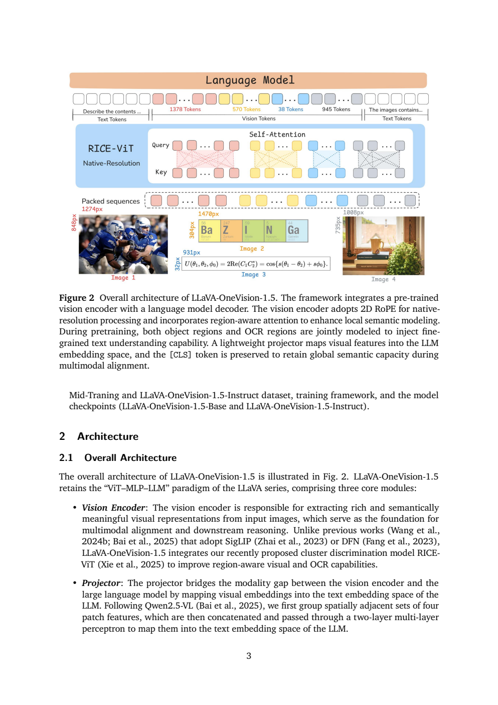
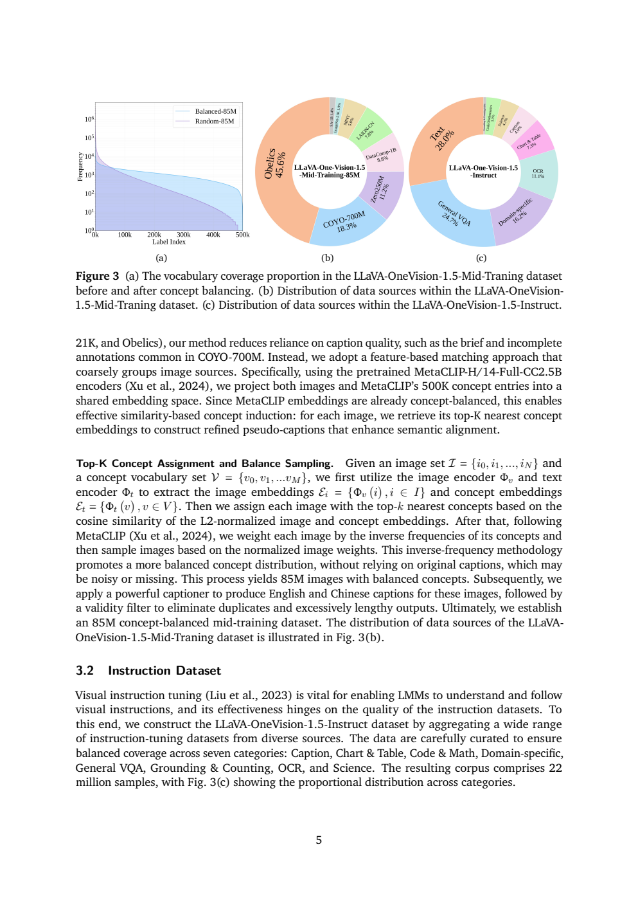
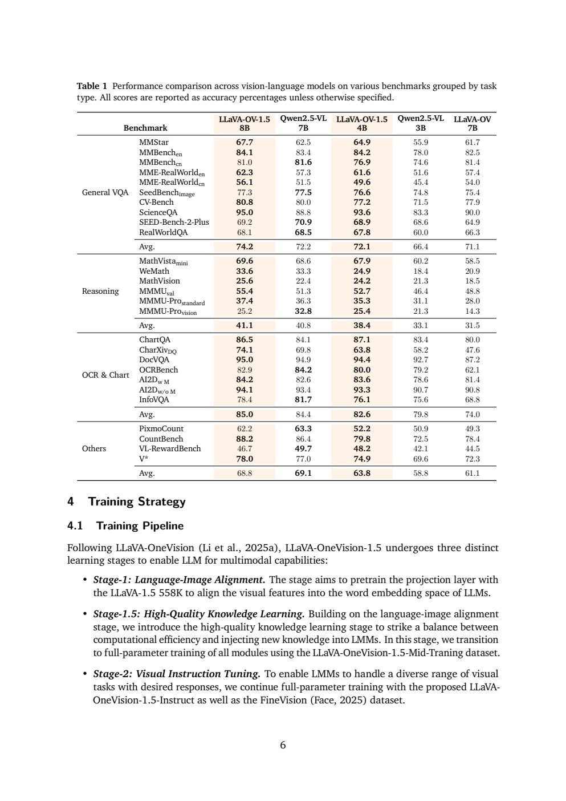
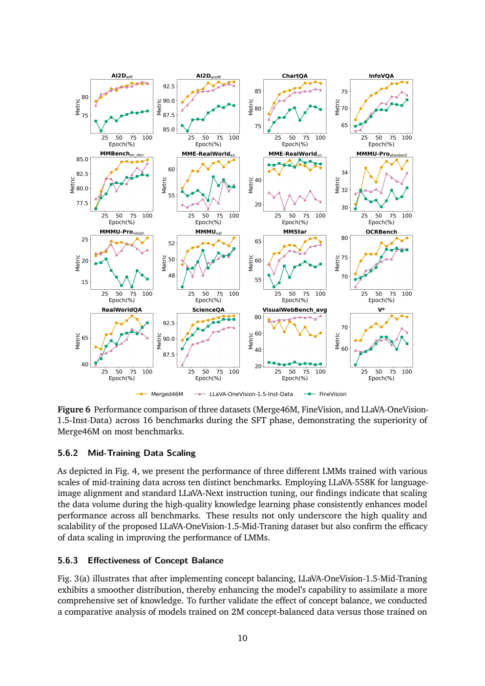

# LLaVA-OneVision-1.5：概念均衡数据与高效中期训练

## 1. 论文信息与模型定位

**论文**：[LLaVA-OneVision-1.5: Fully Open Framework for Democratized Multimodal Training](https://arxiv.org/abs/2509.23661v1)，2025年9月28日v1，共21页；署名为LLaVA-OneVision Community Contributors，附录列出贡献者及项目负责人。[官方代码](https://github.com/EvolvingLMMs-Lab/LLaVA-OneVision-1.5)。本文介绍的是该版本中的4B、8B视觉语言模型、数据和训练框架，原文预告的RL版尚不是已完成实验结果。

这项工作把竞争力主要建立在三件事上：区域语义较强的RICE-ViT、8,500万概念均衡图文数据，以及减少padding开销的离线数据打包。语言骨干采用Qwen3，视觉编码器也使用预训练权重。因此论文所说“from scratch”指开放地构建多模态训练流程，不能理解成从随机初始化训练语言模型、视觉模型及所有标注系统。[§1—2，PDF第2—4页](https://arxiv.org/pdf/2509.23661v1#page=2)。

## 2. 快速概览

| 项目 | 内容 |
|---|---|
| 模型结构 | RICE-ViT → 四邻接patch合并 → 两层MLP → Qwen3 |
| 视觉特点 | 区域感知表征、二维RoPE、按原生宽高处理图像 |
| 数据 | 558K初始对齐；85M中期图文；22M自建指令，进一步与FineVision去重合并至46M |
| 训练 | 投影层对齐 → 全参数知识学习 → 全参数视觉指令微调 |
| 工程 | 离线并行packing与Megatron系框架；8B中期训练8K上下文 |
| 主要比较 | 8B在27项中18项超过Qwen2.5-VL-7B；4B在27项中均超过Qwen2.5-VL-3B |
| 重要边界 | 规模、语言骨干和数据均有变化；16,000美元是作者报告预算，不能视为重建全部预训练资产的成本 |

研究重点是让开放训练配方在有限多模态训练预算下取得较好效果，而不是用复杂新推理模块取代既有视觉语言架构。报告没有给出完整的学习率、每阶段步数和全部优化器配置，仅凭论文仍难以精确复现所有训练细节。

## 3. 整体架构

**Figure 2怎么读。** 底部四张图具有不同宽高，形成不同数量的视觉token；蓝色框是RICE-ViT，自注意力的颜色和分隔展示不同图像各自的视觉序列；顶端再把视觉token与文字token送入语言模型。图中1378、570、38、945是示例图像的序列长度，不是整个模型固定视觉预算。它说明原生分辨率保留了宽高差异，不能把每张图片都当成固定正方形缩放。

RICE-ViT负责视觉特征，基于区域感知聚类判别预训练增强物体区域与OCR区域的表达；二维旋转位置编码支持变化的二维位置。投影器把相邻四个patch特征拼接，经过两层MLP映射到LLM嵌入维度，以减少进入语言模型的视觉序列长度。图注还明确保留`[CLS]`表示，维持全局语义能力。Qwen3把视觉嵌入、指令和对话历史结合，生成回答。[§2、Figure 2，PDF第3—4页](https://arxiv.org/pdf/2509.23661v1#page=3)。

这里的局部区域学习发生在视觉表征阶段，并不等于推理时另有一个独立分割头。报告也没有给出统一图像生成解码器或完整视频评测方案，不应因“OneVision”名称把文本生成回答扩展解释成所有模态都能生成。

## 4. 核心创新与数学原理

**区域表征替代只看全局实例。** 作者认为普通实例对比学习把不同图片一律作为负例，容易忽视语义相近的图片以及局部目标。RICE-ViT以区域聚类判别学习增强局部语义，引用的视觉预训练规模为450M图片、2.4B候选区域。这是上游编码器训练资产，不能并入本论文85M中期数据后声称一共使用535M互不重复的新样本。本文没有展开RICE损失的完整公式和聚类实现，相关细节属于被引用的RICE论文，不能自行补写为本报告的数学定义。

**特征驱动的概念平衡。** 与直接在原始caption里匹配词表不同，报告采用MetaCLIP-H/14-Full-CC2.5B的图像、文字编码器。对图像\(i\)和50万条概念\(v\)得到归一化嵌入，根据余弦相似度

\[
s(i,v)=\frac{\Phi_v(i)^\top\Phi_t(v)}{\|\Phi_v(i)\|_2\|\Phi_t(v)\|_2}
\]

分配top-k概念；再按概念出现频次的倒数加权图片，归一化后采样。以上是原文“L2归一化、cosine、top-k”的等价书写。原文没有给出k的实际值，也没有明确多个概念逆频次如何合成单张图片权重，本文不补造求和、最大值或阈值公式。

这个设计解决了无caption图片、caption过短和交错文档难以用词面匹配归类的问题。罕见概念更有机会被采到；代价是概念质量依赖已有嵌入空间，top-k相似度仍可能把图片分配给不正确的概念。“概念更均衡”不自动等价于没有标注噪声。[§3.1，PDF第4—5页](https://arxiv.org/pdf/2509.23661v1#page=5)。

**四patch合并与packing是不同压缩。** 前者改变视觉输入LLM的长度；后者把多个较短训练样本拼成长度更均匀的序列，减少空白padding。可用\(\eta=\text{有效token数}/\text{分配token槽位数}\)理解利用率，这是本文解释性记号，不是论文定义的指标。packing不会把85M样本的语义内容减少11倍，也不能由“最高11倍压缩”推导端到端速度必然提高11倍。

## 5. 数据构建与处理

**Figure 3怎么读。** 左图纵轴使用对数尺度，均衡后蓝色分布在长尾概念处保留更多样本；中间圆环是85M中期数据来源，Obelics占45.6%、COYO占18.5%，说明Web交错图文与图文对共同构成训练来源；右边是指令混合分布，其中纯文字28.0%、General VQA 24.7%、领域16.2%、OCR 11.1%。不要把右环理解成22M全部是图片问答。

第一阶段使用公开LLaVA-1.5的558K图文对。中期85M数据来自COYO-700M、Obelics、DataComp-1B、LAION-CN、ImageNet-21K、SAM-1B、MINT与Zero250M等来源，约65M英文、20M中文。概念匹配和平衡采样后，再使用强captioner生成中英文描述，做有效性过滤，去除重复与过长输出。v1没有充分披露captioner身份、长文本阈值或所有清洗规则，不能默认为某个商业模型生成。

指令数据自建部分22M、包含124种数据类型；正文列举描述、图表、代码数学、领域问答、通用VQA、定位计数、OCR、科学等类别。正文称“七类”却实际列出八项，图中又单列纯文字，本文不把这一分类数量当作严格互斥定义。随后与FineVision去重合并形成Merged46M；22M与46M分别是自建指令集和扩大后的训练混合规模，不应混写。[§3、§5.6.4，PDF第4—5、11页](https://arxiv.org/pdf/2509.23661v1#page=11)。

附录展示八个原始视觉数据集均有长尾倾向，并用主题分析列出50个突出主题，包括野生动物、服饰、电子设备、网页界面、医疗和建筑等。主题覆盖为数据多样性提供可读描述，但不是按领域独立验证的标注准确率，也没有证明全部测试题都不存在污染。

## 6. 训练流程与目标

| 阶段 | 数据及目的 | 可训练部分 |
|---|---|---|
| Stage 1 | 558K图文，映射视觉特征到词嵌入空间 | 投影层；原文称预训练projection layer |
| Stage 1.5 | 85M概念均衡图文，注入视觉知识 | 视觉、投影、语言全部模块 |
| Stage 2 | 自建指令加FineVision混合，学习多任务回答 | 全参数继续训练 |

视觉指令训练可以按条件自回归损失理解：\(\mathcal L=-\sum_t\log p_\theta(y_t\mid y_{<t},I,x)\)，其中\(I\)是图片、\(x\)是指令、\(y\)是目标回答。该公式是帮助理解图文生成训练的通用表达，v1未给出逐项mask规则及所有训练目标权重，不能据此声称其完整实现已经由论文披露。报告没有呈现GRPO/DPO配方，预告RL版不作为这一版的训练阶段。

离线packing先用哈希桶组织大规模数据，结合多线程与策略感知分批控制打包成功率、样本数和批组成；与运行时在线packing相比，它可处理整份数据或较大连续块，输出较均匀长度。作者报告85M预训练样本最高11倍压缩。框架采用百度云优化的AIAK-Training-LLM，建立在Megatron-LM上，配合Transformer Engine、分布式优化器及uniform recomputation。8B中期训练使用8K上下文、128张A800、3.7天、原生分辨率。[§4，PDF第6—7页](https://arxiv.org/pdf/2509.23661v1#page=7)。

摘要与结论称多模态训练可在16,000美元预算内完成，但正文的具体硬件时间主要对应中期训练；未列出分阶段费用明细，也未把上游RICE、Qwen3、MetaCLIP预训练和caption生成全成本纳入可核验账单。这个数字应作为作者当时环境下的计算预算主张，不能作为今天租用任意云服务的报价。Merge46M消融为保持步数一致将batch翻倍，相当于增加每步样本量；其收益不是严格等总数据或等计算量比较。

## 7. 实验设置与主要结果

**Table 1怎么读。** 四类任务分别列出不同模型规模，Avg只在各组内平均，不能把它当作统一全能分数。8B与7B、4B与3B既有规模差异，也有Qwen3和Qwen2.5语言骨干差异。评测使用LMMs-Eval默认提示。原文报告8B赢18/27、4B赢27/27，后者并不证明视觉设计单一因素贡献了全部增益。

| 基准 | OV-1.5-8B | Qwen2.5-VL-7B | 解读 |
|---|---:|---:|---|
| MMStar | 67.7 | 62.5 | 通用视觉推理提升 |
| MMMU val | 55.4 | 51.3 | 多学科问答提升 |
| ChartQA | 86.5 | 84.1 | 图表问答提升 |
| CharXiv DQ | 74.1 | 69.8 | 真实图表描述问答提升 |
| MMMU-Pro vision | 25.2 | 32.8 | 该更难设置反而明显落后 |
| OCRBench | 82.9 | 84.2 | OCR并非所有项目领先 |
| InfoVQA | 78.4 | 81.7 | 信息图问答仍有差距 |
| VL-RewardBench | 46.7 | 49.7 | 视觉偏好判断未超过对照 |

4B的MMMU val为52.7、MathVista mini为67.9、DocVQA为94.4。为了控制语言骨干，附录另训练Qwen2.5-3B-Instruct版本，超过同骨干Qwen2.5-VL-3B的17/27项；它比主4B的27/27更适合说明骨干差异之外仍有收益。[Table 1、附录A，PDF第6、16页](https://arxiv.org/pdf/2509.23661v1#page=16)。

视觉编码器消融统一采用Qwen2.5-7B、LLaVA-NeXT数据与训练流程，最多2×2加全图切块。336分辨率下RICE在InfoVQA上45.2，相比CLIP 38.9提高6.3个百分点；OCRBench57.5对52.5提高5.0。但不同分辨率、不同编码器参数量以及已经历不同多模态训练的视觉塔比较，仍不能全部视为单变量检验。

**Figure 6怎么读。** 橙色是Merged46M、粉色是自建指令、绿色是FineVision，横轴为epoch百分比。多数任务橙线较好，说明扩展混合数据有用；但MME-RealWorld中文与VisualWebBench等曲线并非统一橙线领先，不应写“全部16项最好”。正文称2M概念均衡采样在27项中赢25项，Figure 4还显示0M、4M到85M中期规模扩大带来收益。这些结果支持数据规模和构成的重要性，而非“单靠更便宜训练即可无限提升”。

总体贡献是提供较完整的公开多模态构建资产与工程方案，并用强视觉表征和高覆盖数据缩小性能差距。v1仍缺少完整训练超参数、成本分解、独立复现、污染审计及更广泛视频/代理结果。本文核对原文与原图，未运行模型，所有分数保持原论文版本和基准口径。
