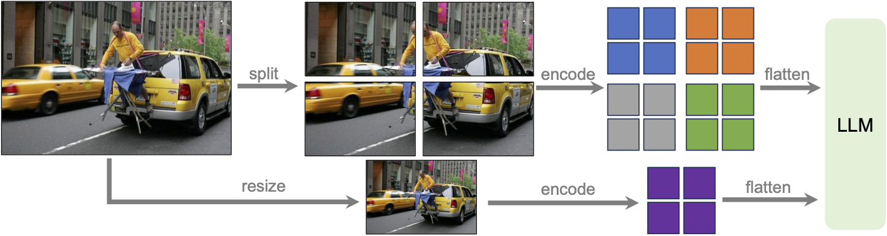
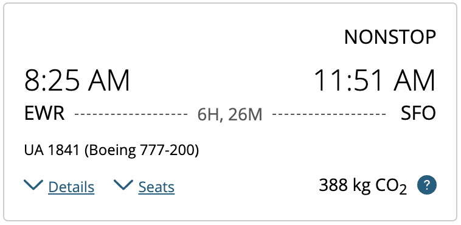

<!-- article-header:start -->
[项目首页](../../../README.md) › [模型系列](../../../reports/model-family-index.md) › [LLaVA（官方研究谱系）](../README.md)
<!-- article-header:end -->

# LLaVA-NeXT：用动态高分辨率与数据配方改善 OCR 和视觉推理

<!-- article-toc:start -->
<a id="article-toc"></a>

**本篇目录** · [论文定位](#paper-info) · [快速概览](#overview) · [整体架构](#architecture) · [核心原理](#principles) · [数据构建](#data) · [训练流程](#training) · [实验结果](#experiments)
<!-- article-toc:end -->

<a id="paper-info"></a>

## 1. 论文信息与模型定位

本条目的原文是 **2024 年 1 月 30 日**发布的官方研究博客 **LLaVA-NeXT: Improved reasoning, OCR, and world knowledge**，作者为 Haotian Liu、Chunyuan Li、Yuheng Li、Bo Li、Yuanhan Zhang、Sheng Shen、Yong Jae Lee。[官方原文](https://llava-vl.github.io/blog/2024-01-30-llava-next/)；[官方仓库](https://github.com/haotian-liu/LLaVA)。本介绍依据 2026 年 10 月 8 日保存的该页面快照；它是发布说明，不能当作提供全部复现细节的独立技术论文。

这次发布对应通常称为 LLaVA-1.6 的 LLaVA-NeXT 图像对话模型，主要提供 Vicuna-7B/13B、Mistral-7B、Nous-Hermes-2-Yi-34B 底座的版本。后续同名系列的视频模型、更多语言底座和新训练方法不属于本文内容。

模型定位是图像与文字输入、文字回答，关注 OCR、图表与文档理解，以及结合视觉信息进行推理。它继续使用简单的视觉编码器—连接器—语言模型结构，核心变化是视觉信息保留方式、指令数据组成和语言底座规模。

<a id="overview"></a>

## 2. 快速概览

相对 LLaVA-1.5，本次发布有三个值得区分的增量。**AnyRes** 把高分辨率图像拆成多个 336 分辨率局部块，同时保留缩小后的整图视图，让小字和局部结构更容易进入语言模型。数据侧引入真实用户请求、较高质量的 GPT-4V 回答以及文档和图表任务。语言侧扩大到 34B，并尝试 Mistral 和 Yi 衍生底座，以增强知识、逻辑与双语能力。

最终指令微调规模为 **760K**，加上连接器阶段 **558K**，模型卡合计 **1.318M 样本**。这里是样本数量，不是 token 数量，也不包括语言模型和视觉编码器各自已有的基础预训练成本。原文“训练数据少”“约一天训练”的描述应放在多模态适配阶段理解。

34B 在 MMMU validation 上为 **51.1**、MathVista 为 **46.5**、MMBench 英文为 **79.3**，相较博客所列 LLaVA-1.5-13B 的 36.4、27.6、67.8 有明显提升。但该对比同时改变视觉配方、数据和底座规模，不能把提升全部归给 AnyRes。

<a id="architecture"></a>

## 3. 整体架构



上图来自原文 **Detailed Technical Improvement / Dynamic High Resolution**，没有独立 Figure 编号。图的上支路把原图切为四个局部块，分别编码后展平；下支路把整图缩小，得到全局特征。两路视觉表示共同送入 LLM。蓝、橙、灰、绿表示不同局部块，紫色表示全局视图；这些颜色不是任务类别或专家路由。

支持的网格为：

```math
\{2\times2,1\times2,2\times1,1\times3,3\times1,1\times4,4\times1\}
```

对应的高分辨率画布包括 **672×672、336×1344、1344×336** 等形式，最多四个局部块，局部块仍适配现有视觉编码器。细长图像无需一律压缩到方形，因此长条截图和文档能够保留更多细节。

模型卡列出的视觉编码器规模为 **303.5M 参数**，连接器在 7B、13B、34B 版本中分别为 **21M、31.5M、58.7M**；总规模分别为 **7.06B、13.35B、34.75B**。这些是该发布页的模型卡数字，不能把“34B”直接视为包含所有组件的精确总参数。发布说明提到复用 LLaVA-1.5 的预训练连接器，并非完全从随机初始化重新训练视觉语言接口。

语言底座并非统一一种：发布页列出 **Vicuna-1.5 7B/13B、Mistral-7B、Nous-Hermes-2-Yi-34B**。无论选择哪一档，用户问题都与投影后的全局视图、局部块表示共同进入该语言主干，输出仍是自回归文本。博客明确复用 LLaVA-1.5 已预训练的连接器，但没有在这页完整展开所有连接器算子与视觉检查点名称；因此不依据 303.5M 这个参数量替它补写一份未经该来源确认的视觉网络表。（官方博客“Scaling LLM backbone”“Model Card”）

| 模块 | 输入与输出 | 公开机制 |
|---|---|---|
| AnyRes预处理 | 原图 → 全局图及最多4局部块 | 七种长宽网格适应文档/截图，局部块保持336尺度。 |
| 视觉与连接器 | 视图 → 投影视觉表示 | 复用LLaVA-1.5预训练连接器，视觉编码器303.5M；内部完整配置本页未列。 |
| 语言底座 | 视觉表示与文字 → 回答 | Vicuna、Mistral或Nous-Hermes-2-Yi，不统一成一种主干。 |
| 训练数据接口 | 文档、图表和用户请求 → 回答监督 | 移除TextCaps图像重叠，增DocVQA、SynthDoG-EN及高质量指令。 |

[模块依据：固定官方博客 Detailed Technical Improvement、Model Card](https://llava-vl.github.io/blog/2024-01-30-llava-next/)。

<a id="principles"></a>

## 4. 核心创新与数学原理

### 4.1 全局与局部的互补输入

AnyRes 的基本作用可用一个解释式表示。令 $`I_g`$ 为全局缩略图，$`I_1,\ldots,I_K`$ 为局部块，$`E`$ 为视觉编码器、$`P`$ 为连接器，则视觉输入由


```math
Z=\mathrm{Join}\bigl(P(E(I_g)),P(E(I_1)),\ldots,P(E(I_K))\bigr)
```


组合得到。**该式是结构解读，原文没有用它定义新算法或严格说明 token 拼接顺序。** 它强调全局和局部信息同时存在：只有局部块时，模型容易失去对象之间的整体关系；只有缩略图时，小文字又可能被缩放消除。局部裁块增加有效视觉细节，同时也增加视觉序列和推理开销。

与直接把整个视觉骨干训练到超大输入尺寸相比，分块方式复用已有编码器和连接器能力。博客以“最多四倍像素”概括局部高分辨率画布；这不能换算为准确的端到端四倍显存或四倍计算，因为还有全局视图、文本长度、特征整理和后端注意力成本。

局部视图保留单块内的有效像素密度，全局缩图给出块之间的布局。它复用已有视觉入口，成本随块数增加，而不是要求原编码器一次处理整个大画布。最多四局部块也表明该发布版有明确预算边界，不能用后续LLaVA版本的更大网格覆盖本篇设置。 [Dynamic High Resolution](https://llava-vl.github.io/blog/2024-01-30-llava-next/)

### 4.2 清理图像重叠与扩充专项能力

第二个改进是把 OCR 学习和 OCR 测试的边界清理得更明确。原数据中的 TextCaps 与 TextVQA 使用同一组训练图像，作者移除 TextCaps，改用 DocVQA 与 SynthDoG-EN。这样开发时的 TextVQA 结果更能反映未直接见过该组图像的文字理解，而不会把图像重叠造成的收益误作泛化。

移除TextCaps针对的是开发评测中训练图像重叠的问题，不是认为caption数据没有价值。DocVQA与SynthDoG-EN继续补文字读取，ChartQA、DVQA和AI2D扩展图表及图解理解。数据变更同时影响任务覆盖和评测解释，所以OCR收益不能全部归给AnyRes。 [Data Mixture](https://llava-vl.github.io/blog/2024-01-30-llava-next/)

### 4.3 语言底座、监督和分辨率共同扩展

第三个改进来自语言底座。强语言模型可以更好地把识别到的时间、文本和图表信息组织成回答，但识别准确性和后续推理是两件事。发布页没有提供把分辨率、数据、底座三个变量完全分离的消融矩阵，因此其主要证据是最终模型整体比较，不能据此推断每个因素的独立贡献。

用户指令数据强调真实请求多样性及高质量回答，语言底座负责把所见内容组织成有用输出，AnyRes提供更细视觉证据。模型卡还区分连接器训练和第二阶段全模型训练，说明最终能力来自组合配方。不同规模的连接器参数随主干维度改变，不能仅用“7B/34B”名称比较全部组件成本。 [Scaling LLM backbone、Model Card](https://llava-vl.github.io/blog/2024-01-30-llava-next/)

<a id="data"></a>

## 5. 数据构建与处理

指令数据质量被定义为两个方面：请求覆盖真实用户意图，回答足够准确且有帮助。已有来源包括 **LAION GPT-V** 和 **ShareGPT4V**；此外收集 **15K** 来自 LLaVA 演示系统的真实图像与请求，经过隐私和有害内容过滤，再用 GPT-4V 生成回答。这 15K 是 760K 指令集合的一部分，不能额外重复加到总量上。


上图是原文 **Qualitative Results** 中的输入图，页面用它说明模型能读取较长文字、解释 AI 项目语境。应关注右侧密集文字和左侧场景同时存在，这正是细节与全局信息共同输入的需求。本文不复制原文的长回答，也不把这个单例解释当成 OCR 准确率测量。

文档与图表数据新增 **DocVQA、SynthDoG-EN、ChartQA、DVQA、AI2D**，分别补充真实/合成文档读取、图表问答和图示理解。原文没有披露全部来源的逐项采样比例、过滤通过率、去重算法或精确 token 数，因此不能根据 760K 反推出这些细节。

发布页称多模态训练只考虑英语数据，MMBench 中文能力被解释为零样本迁移。这是对多模态指令数据语言的说明，并不意味着语言底座没有接触中文，也不表示所有训练语料只含英语。

<a id="training"></a>

## 6. 训练流程与目标

模型卡把适配分为两阶段：**Stage 1：558K 样本，训练连接器；Stage 2：760K 样本，训练模块标为 Full model**。正文同时说明复用已有连接器。理解本次发布时，应将连接器对齐作为继承的配方基础，将新增高分辨率和指令混合作为后续能力提升的重点。

这份博客没有逐组件列出 Stage 2 的冻结设置，本文保留其“Full model”原表述，不用另一个版本的训练代码反推当前快照的视觉编码器冻结关系。学习率、优化器、batch、epoch、序列长度、精度和损失屏蔽细节亦未在该页面完整披露。

生成式指令训练可以概括为条件文本似然：


```math
\mathcal L=-\sum_t\log p_\theta(y_t\mid y_{\lt t},Z,q),
```


其中 $`q`$ 是用户请求，$`Z`$ 是视觉表示，$`y`$ 是目标回答。这只是对监督式对话训练的数学解释，发布页没有增加名为 AnyRes 的独立损失，也没有报告 RLHF/DPO 配方。

计算表分别列 **7B：8 GPU×20 小时，13B：16 GPU×24 小时，34B：32 GPU×30 小时**；正文明确提及最大模型使用 32 张 A100、约一天训练。精确表格的 30 小时与“约一天”是精确记录和近似叙述，不能改写成 24 小时。它们也没有包含基础语言模型与视觉编码器的全部预训练成本。SGLang 用于部署与推理效率，不能据此解释训练分数提升。

<a id="experiments"></a>

## 7. 实验设置与主要结果

下表摘录原文 **Results / Expanded tables** 中的主要结果。MMMU 明确区分 validation 和 test；MME 原表把感知/认知分开，本文不将其合成百分比。

| 模型 | MMMU val | MathVista | MMB 英文 | MM-Vet | SEED-IMG | TextVQA |
|---|---:|---:|---:|---:|---:|---:|
| LLaVA-1.5-13B | 36.4 | 27.6 | 67.8 | 36.3 | 68.2 | 61.3* |
| NeXT-Vicuna-7B | 35.8 | 34.6 | 67.4 | 43.9 | 70.2 | 64.9 |
| NeXT-Vicuna-13B | 36.2 | 35.3 | 70.0 | 48.4 | 71.9 | 67.1 |
| NeXT-Mistral-7B | 35.3 | 37.7 | 68.7 | 47.3 | 72.2 | 65.7 |
| NeXT-34B | 51.1 | 46.5 | 79.3 | 57.4 | 75.9 | 69.5 |

星号按原文表示训练时观察过相应测试任务相关训练图像。它提醒读者：旧模型 TextVQA 的 61.3 与新数据配方下的结果，图像接触口径不同。NeXT-13B 的 MMMU 36.2 并未超过旧 13B 的 36.4，因此“更强”应落实到具体指标。

34B 的 MMMU test 为 **44.7**，不能以 val 的 51.1 替换。与发布页所列 Gemini Pro 相比，34B 的 MMMU val **51.1 / 47.9**、MathVista **46.5 / 45.2** 更高，但 MM-Vet **57.4 / 64.3** 更低；所谓超过商业模型只适用于部分任务。不同商业系统的训练数据、推理设置与版本并未受控制，结果也不能外推到此后更新的产品。



这个原图显示航班到达 SFO 的时间为 **11:51 AM**。原文让模型结合用户住在 San Jose 的条件提出接机出发建议，展示“读图—抽取时间地点—结合常识作答”的链条。通勤时间没有从图片获得，也没有实时交通工具调用；所以它是视觉与常识结合的定性展示，不是可靠的实时出行规划实验。

本次发布最清楚的贡献是：保持简单接口，通过局部高分辨率、任务数据覆盖和语言底座扩展，显著改善若干 OCR 与推理指标。尚缺完整独立消融和所有复现超参数。本介绍核对了发布正文、原表与三幅原图，没有运行模型。

<!-- article-footer:start -->
---

[← 上一篇：MoE-LLaVA](../../moe-llava/arxiv-2401.15947/README.md) · [按发表时间浏览](../../../reports/paper-reading-guide.md#year-2024) · [下一篇：检测与 OCR 增强多模态模型 →](../../enhancing-multimodal-large-language-models-with-vision-e94f5590857f/arxiv-2401.17981/README.md)

[返回本篇目录](#article-toc) · [返回模型系列](../README.md)
<!-- article-footer:end -->
