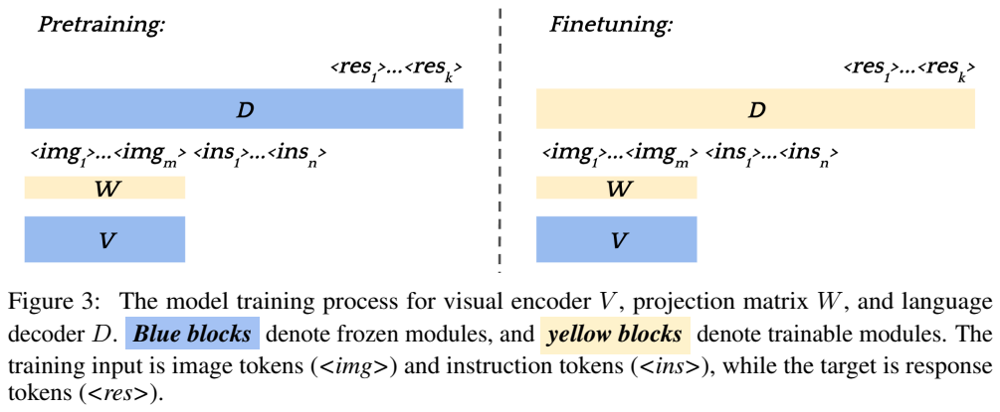
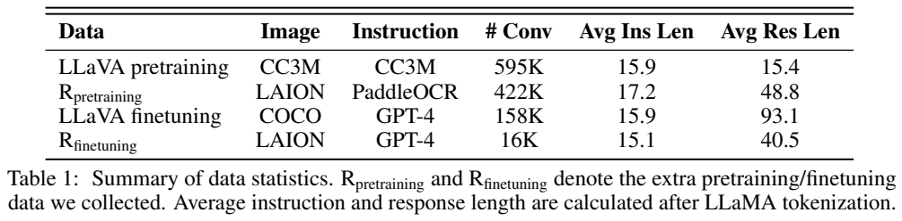
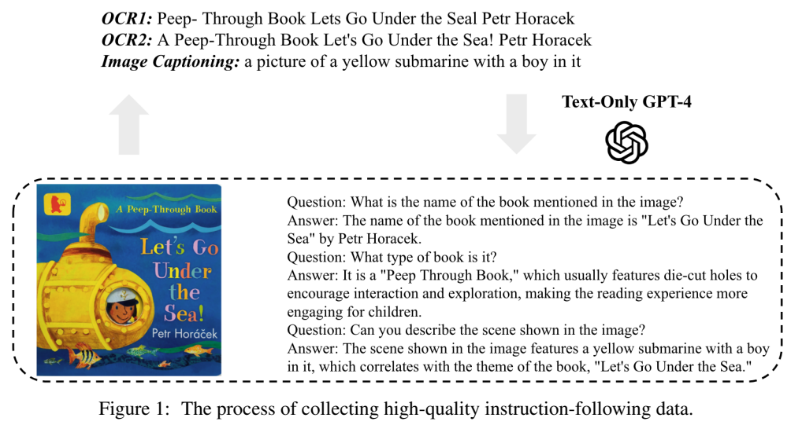
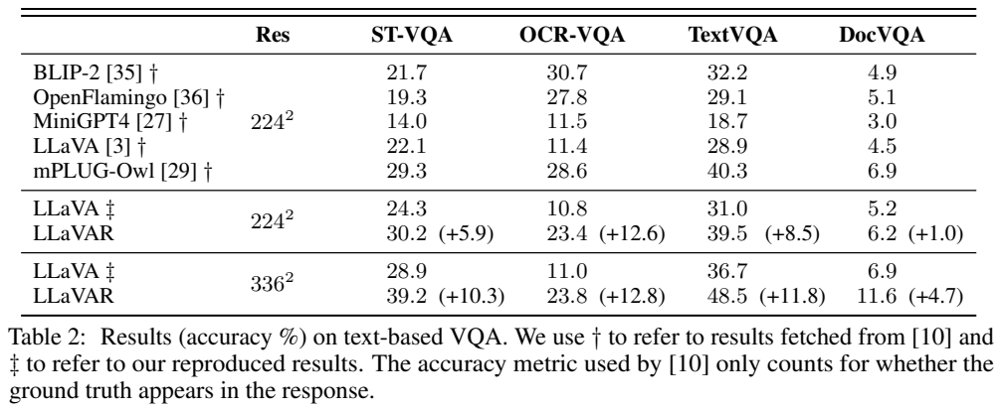
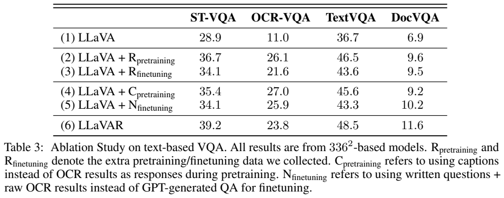
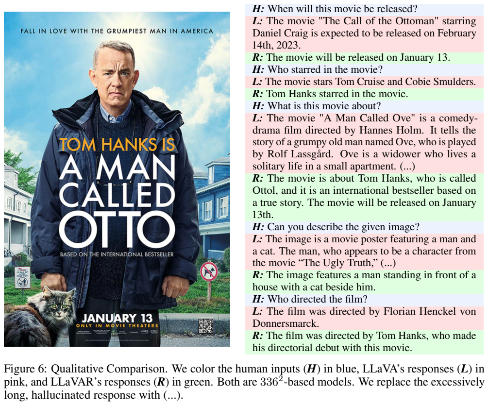

<!-- article-header:start -->
[项目首页](../../../README.md) › [模型系列](../../../reports/model-family-index.md) › [LLaVAR](../README.md)
<!-- article-header:end -->

# LLaVAR：用 OCR 数据与合成对话增强文字密集图像理解

<!-- article-toc:start -->
<a id="article-toc"></a>

**本篇目录** · [论文定位](#paper-info) · [快速概览](#overview) · [整体架构](#architecture) · [核心原理](#principles) · [数据构建](#data) · [训练流程](#training) · [实验结果](#experiments)
<!-- article-toc:end -->

<a id="paper-info"></a>

## 1. 论文信息与模型定位

**论文：** *LLaVAR: Enhanced Visual Instruction Tuning for Text-Rich Image Understanding*。作者 Yanzhe Zhang、Ruiyi Zhang、Jiuxiang Gu、Yufan Zhou、Nedim Lipka、Diyi Yang、Tong Sun，来自 Georgia Tech、Adobe Research 和 Stanford。本文固定使用 [arXiv 2306.17107v1](https://arxiv.org/abs/2306.17107v1)，2023 年 6 月 29 日提交，21 页；官方项目为 [llavar.github.io](https://llavar.github.io/)。

LLaVAR 以早期 LLaVA 为基础，增强模型阅读海报、书封、广告和网页截图中文字的能力。主要贡献是**数据构建及训练数据组织**，不是新的视觉骨干或新的语言模型。OCR 工具用于构建监督，部署时仍由图像编码器和 Vicuna 根据图像回答，无需把 OCR 结果另行拼进用户提示。

报告使用 Vicuna-13B 与 CLIP ViT-L/14，分别实验 224 和 336 分辨率。本篇不混用后来 LLaVA-1.5 的连接器或训练配方；“Read”的 R 表示在 LLaVA 上补足图中文字理解。[原文 §1、§4，PDF 第 1–2、5–6 页](https://arxiv.org/pdf/2306.17107v1#page=1)

<a id="overview"></a>

## 2. 快速概览

| 核心内容 | 具体做法 |
|---|---|
| 问题 | 自然图像描述占主导的视觉指令数据，对图内文字提供的监督不足 |
| 大规模低成本监督 | 422K LAION 文字密集图像，用 PaddleOCR 结果构造识字指令 |
| 较精细的指令监督 | 16K 图像，文字版 GPT-4 接收双 OCR 与图像描述，生成多轮问答 |
| 模型接口 | CLIP 特征经可训练线性投影进入 Vicuna-13B |
| 冻结策略 | 视觉编码器全程冻结；先训练投影，再训练投影和语言模型 |
| 主要证据 | 同分辨率重现 LLaVA 对照；四个文字 VQA 数据集及数据消融 |
| 评测边界 | 文字 VQA 按答案是否出现在回复中判定，可能奖励冗长输出 |

这里“高质量”是作者对 GPT-4 合成数据的命名，不意味着所有答案都经过人工事实审查。论文保留了错误示例，也明确指出 caption 模型、OCR 和回答模型仍会产生幻觉。

<a id="architecture"></a>

## 3. 整体架构





**原图：Figure 3、Table 1，PDF 第 4 页。** 模块 V、W、D 分别是视觉编码器、投影矩阵、语言解码器；蓝色固定、黄色训练。左边只有 W 为黄色，右边 W 与 D 为黄色，说明所谓增强“预训练”并未更新视觉骨干。Table 1 按对话数统计，不能把多轮对话数直接当作问答对数。

图像先补边成为正方形，再缩放到 224×224 或 336×336，以避免中心裁剪掉图边的文字。视觉侧取 CLIP 最后一层 Transformer 之前的网格特征，经投影矩阵 W 转成 Vicuna 输入宽度，与指令 token 拼接。图像 token 可放在第一条用户指令之前或之后，语言模型逐 token 预测回答。

CLIP 的 patch 为 14，因此两种方形输入对应 16×16 与 24×24 的网格；这是按分辨率推导的空间划分，不是论文额外披露的另一种 tokenizer。336 分辨率为较小字体保留更多像素，但固定 CLIP 仍可能压缩文字细节，尤其是整页文档。

作者没有加入独立 OCR 解码分支、字符位置回归、区域裁剪模块或专用文档布局编码器。它把“读文字”变成条件回答训练中的一个任务，以原有图像到语言通路完成。[原文 §4–5，PDF 第 5–7 页](https://arxiv.org/pdf/2306.17107v1#page=5)

<a id="principles"></a>

## 4. 核心创新与数学原理

**首先让视觉输入承担字符信息。** 422K 数据的目标回答是 OCR 转录，促使投影把固定 CLIP 特征中已有的文字信息表达给语言模型。第二阶段改用围绕文字的问答，训练模型选择与问题相关的信息，而不是见到图就输出整段 OCR。

论文没有提出新的复杂损失。若把视觉特征写为 $`Z=V(I)`$，投影后为 $`H=WZ`$，指令为 $`q`$，目标回答为 $`a`$，两阶段的条件生成目标可概括为：


```math
\mathcal L=-\sum_t\log p_D(a_t\mid H,q,a_{<t}).
```


这是对原文 §4 的数学解释，并非原文编号公式。第一阶段只对 W 求梯度，第二阶段对 W 与 D 求梯度，V 固定。目标没有直接监督字符框、阅读顺序或图文对比距离；识字能力来自回答内容需要复现可见文字。

**把教师看到的视觉内容转成文字证据。** GPT-4 使用的是 `gpt-4-0314` 文字版。给它 EasyOCR 与 PaddleOCR 的结果，利用两个工具的互补性；再给 BLIP-2 生成的描述补充非文字视觉元素。教师由这些代理信息生成问题和回答，学生真正接收的仍是原图。这是一种通过文字中介构造视觉指令的方案，不能称为 GPT-4 直接审阅原始图片。

为了使 BLIP-2 关注画面而非再次描述字符，作者先根据 OCR 框遮掉文字并做 inpainting，再生成 caption。这个设计尝试将“文字证据”和“画面证据”分开，但修补后的模糊形状和 caption 本身可能带来幻觉。双 OCR 也不能保证共同错误被纠正。[原文 §3–4，PDF 第 4–6 页](https://arxiv.org/pdf/2306.17107v1#page=4)

原文消融强调一个细节：识字分数高不等于指令遵循好。只用“请读出全部文字”微调时，模型可能忽略具体问题而完整抄写图中文字；若评价只检查目标字符串是否出现，这种回答仍可能得分。构建专门的问题答案因此同时影响选择性阅读和回复方式。

<a id="data"></a>

## 5. 数据构建与处理



**原图：Figure 1，PDF 第 2 页。** 左下是书封，顶端是两个 OCR 版本与图像描述，右下是文字版 GPT-4 产生的对话。阅读时注意教师输入并非底部原图；问题除了直接读标题，还会询问类型和画面，展示识字监督如何扩展为视觉指令。

候选图片来自 LAION 高分辨率子集。作者以自然图片和文档组成二分类数据，用基于 RVL-CDIP 微调的 DiT-base 构建文字密集图像筛选器，保留预测概率大于 0.8、LAION watermark 概率小于 0.8、unsafe 概率小于 0.5 的图片。文档分类器只是代理筛选，作者指出结果仍有噪声。

再从中随机取 50K，使用 CLIP ViT-B/32 特征聚成 100 类，人工检查后选出 14 类文字密集图片，包括封面、广告、海报、信息图与标志。用聚类模型归类扩展到 422K，单个类最多保留 52K，以减轻某类主导问题。附录的示例位于 Figure 8；原文没有公布完整去重规则和所有域的精确再加权比例。

**422K 噪声指令数据。** PaddleOCR 在短边缩放为 384 像素后的图片上运行，而非直接读取原始 1024 分辨率。这避免监督要求模型读出自身 224/336 输入根本看不到的极小字体。根据几何规则把单词合成段落，从 10 个同义“读出图中文字”提示中随机抽取一个，OCR 段落作为回答。彩色背景、艺术字体和识别缺字会使该数据含噪。

**16K GPT-4 对话。** 从 14 类中进一步选择 4 类含足够连贯文字的图片，每类 4K，与 422K 图片不重叠。输入是两个 OCR、处理后的 caption、系统提示和两个 few-shot 示例，生成可多轮的对话。Book cover 与 quote image 比例因此更高；16K 是对话/图像规模，不是固定仅 16K 个问答。生成温度 1.0，报告成本约 300 美元。

附录提示要求问题可由可见内容确定，并避免依赖与 OCR 冲突的 caption，也允许相关背景解释。教师并未逐条人工核验所有产物，因此这些约束是生成意图。论文没有报告精确 OCR 错误率、教师幻觉率或跨评测集全面污染审计。[原文 §3、Table 1、附录 B，PDF 第 3–5、15–16 页](https://arxiv.org/pdf/2306.17107v1#page=3)

<a id="training"></a>

## 6. 训练流程与目标

第一阶段将早期 LLaVA 的 **595K CC3M** 数据与新增 **422K OCR** 数据混合，共名义约 1.017M 对话，只训练 W。冻结语言模型使这个阶段主要学习视觉输入接口，作者认为可容忍较多识别噪声；这不是证明错误标签没有负面作用。

第二阶段混合 LLaVA 的 **158K COCO GPT-4 指令**与 **16K 新增 GPT-4 对话**，名义约 174K，对 W 和 Vicuna-13B 训练。CLIP 两阶段都固定。两种监督分别补入原有两个阶段，并没有单独训练一个 OCR 模型再调用它。[原文 §4，PDF 第 6 页](https://arxiv.org/pdf/2306.17107v1#page=6)

训练沿用 LLaVA 参数，本文明确的变化是第一阶段最大序列长度设为 **1024**，以及补边后缩放的图像处理。报告说明使用 NVIDIA A100 80GB，但没有在本篇列出确切卡数、batch、学习率、epoch、优化步数、精度和总训练时长。不能把当前 LLaVA 仓库的后来默认值补作 2023 年本实验配置。

需要区分模型采样与教师采样：论文给出文字 VQA 评估的模型温度 0.9、指令遵循评估 0.7、其他定性演示 0.2；GPT-4 生成评测题的温度 0.7，作为评委时温度 0.2。这些不等于训练学习率或模型损失参数。

ScienceQA 结果来自另一路专门实验：从 336 分辨率的第一阶段模型出发，进一步在 ScienceQA 上微调；不是通用对话模型零样本得到 91.42。[原文 §5、§5.1，PDF 第 6–7、9 页](https://arxiv.org/pdf/2306.17107v1#page=6)

<a id="experiments"></a>

## 7. 实验设置与主要结果





**原表：Table 2、Table 3，PDF 第 5 页。** 上表区分引用他人结果与作者重现结果，按 224/336 分辨率分组；括号是对同分辨率 LLaVA 的百分点增量。下表改变训练数据，所有模型使用 336 分辨率。OCR-VQA 一列显示完整方案并非每项消融中的最高分。

| 模型 | ST-VQA | OCR-VQA | TextVQA | DocVQA |
|---|---:|---:|---:|---:|
| LLaVA 224，重现 | 24.3 | 10.8 | 31.0 | 5.2 |
| LLaVAR 224 | 30.2 | 23.4 | 39.5 | 6.2 |
| LLaVA 336，重现 | 28.9 | 11.0 | 36.7 | 6.9 |
| LLaVAR 336 | 39.2 | 23.8 | 48.5 | 11.6 |

336 同分辨率对照增量为 10.3、12.8、11.8、4.7 个百分点。摘要的“up to 20%”不能直接当成这组受控比较提高 20 个百分点。DocVQA 即使提升后仍仅 11.6，说明完整文档文字理解困难没有解决。

评测沿用所引协议，检查**参考答案字符串是否出现在生成回复中**，并非所有数据集官方指标的同义表达，更不是整段回答完全正确率。Table 3 中只补 OCR 预训练，OCR-VQA 达 26.1；改用 caption 预训练达 27.0，均高于完整 LLaVAR 的 23.8。作者指出长回答会被这种召回式指标偏爱，专门微调为问答可能改善回复质量却不提高每个识别得分。因此不能把结果写为所有数据消融均证明全流程最优。[原文 Table 2–3 与脚注 9，PDF 第 5、9 页](https://arxiv.org/pdf/2306.17107v1#page=5)

ScienceQA 专门微调平均准确率 **91.42**，对 LLaVA 的 90.92 提高 0.50 个百分点；自然科学 91.79 对 90.36，提高 1.43，而社会科学 93.81 低于 95.95。与 MM-CoT-Large 的 91.68 等结果也不构成全面超越。[原文 Table 4，PDF 第 6 页](https://arxiv.org/pdf/2306.17107v1#page=6)

GPT-4 评估在 30 张 COCO 图片的 90 个问题以及 50 张文字密集图片上进行。336 模型的 conversation/detail/complex/read 相对分数由 LLaVA 的 83.9/78.2/95.3/87.9 变为 **84.5/78.9/96.5/91.7**。这是相对文字 GPT-4 回复的打分，100 不是准确率上限；教师信息和评委偏好也会影响结果，样本数较小。[原文 Table 5–6，PDF 第 7、9–10 页](https://arxiv.org/pdf/2306.17107v1#page=7)



**原图：Figure 6，PDF 第 9 页。** 蓝色是用户问题，粉色为 LLaVA，绿色为 LLaVAR。LLaVAR 正确读取发行日期和主演，却在图中未给出导演信息时仍编造导演。这张图同时说明数据增强的价值与边界：能读出关键文字不代表已学会对未知事实拒答。图中的文字也有拼写错误。

字体大小实验仅围绕一个海报和一个日期问题，每个尺寸试 10 次：低于约 6 像素时 LLaVAR 无法稳定识别，336 版本在大于 6 像素的测试中较稳健。这是局部案例，不是任何字体、语言、背景下通用的 6 像素保证。本文提供的是通过数据增强改善文字理解的早期证据，未解决小字、布局、文档完整转录与视觉事实幻觉的全部问题。[原文 §5.2–5.3，PDF 第 10 页](https://arxiv.org/pdf/2306.17107v1#page=10)

<!-- article-footer:start -->
---

[← 上一篇：Shikra](../../shikra/arxiv-2306.15195/README.md) · [按发表时间浏览](../../../reports/paper-reading-guide.md#year-2023) · [下一篇：mPLUG-DocOwl →](../../mplug/arxiv-2307.02499/README.md)

[返回本篇目录](#article-toc) · [返回模型系列](../README.md)
<!-- article-footer:end -->
