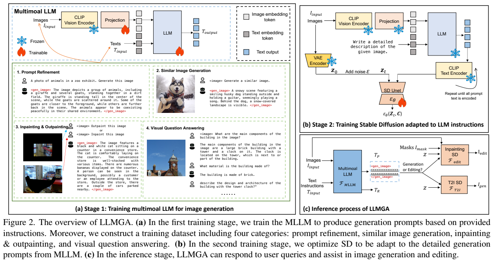
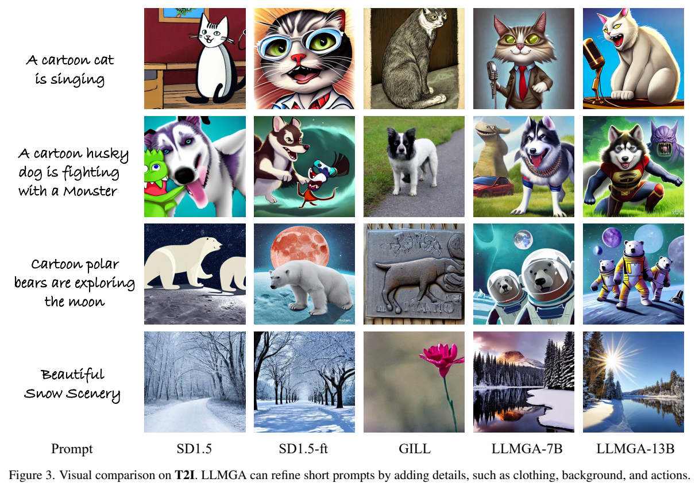
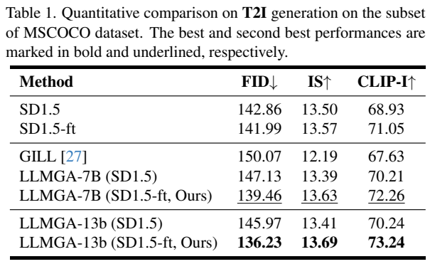
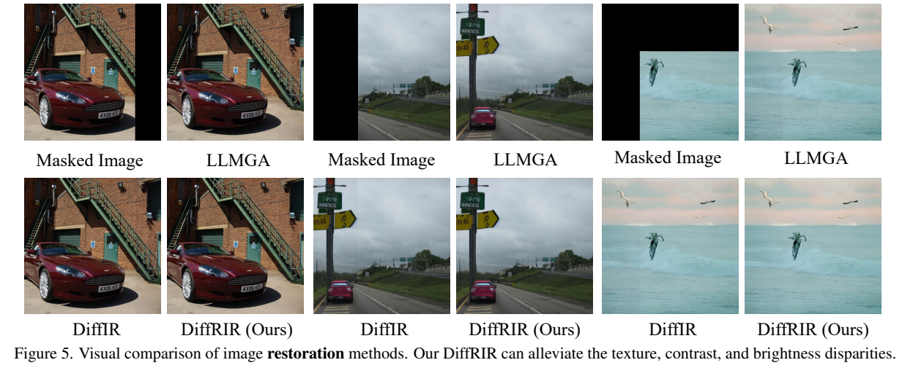
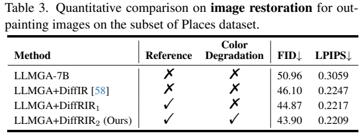
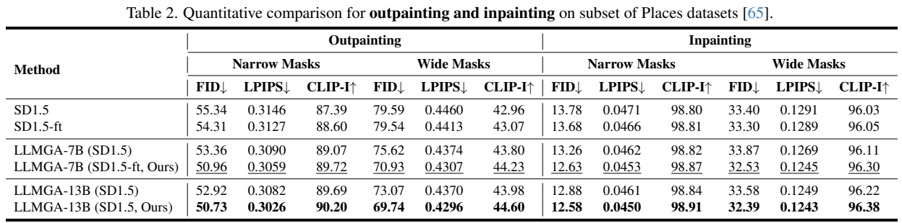
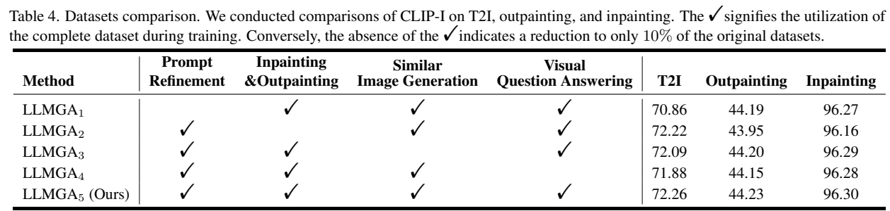
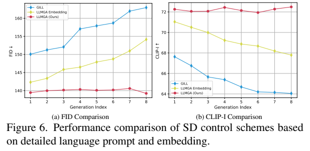

<!-- article-header:start -->
[项目首页](../../../README.md) › [模型系列](../../../reports/model-family-index.md) › [LLMGA](../README.md)
<!-- article-header:end -->

# LLMGA：用多模态语言模型组织生成提示与图像编辑

<!-- article-toc:start -->
<a id="article-toc"></a>

**本篇目录** · [论文定位](#paper-info) · [快速概览](#overview) · [整体架构](#architecture) · [核心原理](#principles) · [数据构建](#data) · [训练流程](#training) · [实验结果](#experiments)
<!-- article-toc:end -->

<a id="paper-info"></a>

## 1. 论文信息与模型定位

**LLMGA: Multimodal Large Language Model based Generation Assistant**，作者 Bin Xia、Shiyin Wang、Yingfan Tao、Yitong Wang、Jiaya Jia，来自香港中文大学与字节跳动。本文依据 [arXiv 2311.16500v1](https://arxiv.org/abs/2311.16500v1)（2023 年 11 月 27 日，21 页，含补充材料）整理。[项目页](https://llmga.github.io/)与[代码](https://github.com/dvlab-research/LLMGA)提供进一步资料。

它把预训练 LLaVA 7B/13B 与 Stable Diffusion 连接起来，支持文生图、参考图生成、局部重绘、扩图和连续编辑。模型首先理解用户与图像，再写出扩散模型使用的详细提示。图像像素仍由扩散模型产生；重绘区域由输入掩码指定，论文没有提出由语言模型直接预测像素掩码的方法。

<a id="overview"></a>

## 2. 快速概览

- **接口选择**：用可读的自然语言提示连接多模态语言模型与图像生成器，使用户能理解和继续修改生成意图。
- **适配方式**：先训练 LLaVA 的生成助手行为，再以它产生的长提示微调扩散模型，缓解提示分布变化。
- **编辑质量**：额外加入 DiffRIR 修复器，利用保留区域作为参照，处理扩图的纹理、亮度与接缝问题。
- **评测范围**：COCO 子集测文生图，Places 子集测重绘与扩图，另做训练数据和多轮对话实验。正文结果主要基于 SD 1.5，补充材料的 SDXL 图例属于另一配置。

<a id="architecture"></a>

## 3. 整体架构



原文 Figure 2 将过程分为语言助手训练与扩散模型适配。用户文本以及可选参考图进入 LLaVA；CLIP 视觉编码器提取图像特征，投影层将其映射到语言模型的输入空间。输出同时包含普通回答和供生成器使用的提示，后者由专门的起止标记包围。正文与图例对标记的拼写存在差异，因此这里以其功能说明接口，不把某一种拼写当作全文统一规范。

详细提示经 CLIP 文本编码器送入扩散 U-Net。普通 CLIP 文本窗口只能容纳约 75 个内容 token，而 LLMGA 的描述常超过 150 token；作者把文本分块、重复编码，直到全部内容被编码。论文没有完整给出跨块位置与嵌入聚合的实现公式。正文一处将文本编码器写为 VAE，但 Figure 2 与方法总览明确使用 CLIP 文本编码器；VAE 在这里负责图像与潜变量转换。

文生图仅依赖提示和随机噪声；重绘与扩图还需要原图、掩码及掩码图像的潜变量。生成结果可再次输入助手开展下一轮修改。DiffRIR 位于编辑结果之后，保留原图的未编辑区域作为修复参照；它是图像质量修复组件，不能保证所有语义编辑都正确。

<a id="principles"></a>

## 4. 核心创新与数学原理

语言阶段采用自回归目标（原文式 4）：

```math
\mathcal L_{\rm MLLM}=-\sum_i\log p_\theta(y_i\mid y_{\lt i},T_{\rm in},I_{\rm in}).
```

普通回答和生成提示都在同一输出序列中学习。显式语言接口让下一轮可以修改描述中的对象、属性与关系，而不用完全依赖隐藏生成嵌入。作者认为这种接口能减轻多轮嵌入误差累积；这是设计解释与实验观察，并非经过证明的无误差性质。

扩散适配使用噪声预测平方误差（原文式 5）：

```math
\mathcal L_{\rm SD}=\mathbb E\Vert \epsilon-\epsilon_\theta(z_t,C)\Vert _2^2,\qquad
z_t=\sqrt{\bar\alpha_t}z_0+\sqrt{1-\bar\alpha_t}\epsilon.
```

$`C`$ 包括详细提示，编辑时还包括掩码和被遮罩图像的编码。长提示改变条件分布，因此只改提示而不适配生成器未必改善所有指标，这一点在实验中可以直接看到。

DiffRIR 则把初始编辑结果与保留区域沿通道拼接（式 6）：

```math
I_{\rm HQ}=F_R\!\left(\mathrm{concat}[I_{\rm LQ},(1-I_{\rm mask})I_{\rm GT}]\right).
```

式中的 $`I_{\rm GT}`$ 是训练表述中的参考原图；实际编辑依赖可取得的保留区域，不要求知道待生成区域的真实答案。训练退化进一步加入 $`D_2(x)=c_1x+c_2`$，其中 $`c_1\in[0.94,1.06]`$、$`c_2\in[-0.05,0.05]`$，让修复器学习亮度与对比度变化。损失沿用 DiffIR 的 GAN 修复训练，论文未列出新的完整权重配方。

<a id="data"></a>

## 5. 数据构建与处理

四类语言训练数据按 **0.5:1:1:1** 混合。提示优化数据把 COCO 的短描述变为详细描述；相似图生成数据结合 COCO、LAION-Aesthetics 的图像与详细描述，让助手从参考图生成提示；重绘与扩图数据用遮罩图像配完整图像描述；视觉问答使用 LLaVA-Instruct-150K，保留一般理解能力。

详细描述由 LLaVA 生成，并借助原始短描述保留专有名称等信息。样本会随机采用“描述图像”或“生成图像”式请求，只有生成请求需要输出生成提示标记。编辑数据使用框状、不规则及边界掩码。150K 是问答部分的规模，论文没有完整报告其他三类的去重后数量，不能把它当作整个训练集的大小。自动生成的详细描述也不等于逐条人工核验的图像事实。

<a id="training"></a>

## 6. 训练流程与目标

第一阶段以预训练 LLaVA 初始化，冻结视觉编码器，更新投影层和语言模型。AdamW 学习率 $`2\times10^{-5}`$、权重衰减 0、余弦调度，训练 6 个 epoch；每设备批量 16，补充材料给出总批量 128。原文没有充分给出设备型号及完整训练时长。

第二阶段冻结语言助手、CLIP 文本编码器和 VAE，只更新扩散 U-Net；助手产生的提示可以预先缓存。SD 1.5 的文生图与编辑模型分别训练，学习率 $`10^{-5}`$、批量 32、50K 次迭代。因此阶段二的“联合”适配不意味着同时更新语言模型权重。

DiffRIR 使用 DIV2K 与 Flickr2K，沿用 DiffIR 退化，加入上述颜色变化；学习率 $`2\times10^{-4}`$、批量 64、低质量图块 $`64\times64`$、400K 次迭代。补充材料的 SDXL 版本采用 LAION-Aesthetics、$`1024\times1024`$ 图块，扩散适配同为 50K 次迭代。正文没有完整披露采样步数、CFG 与推理调度器，本文不补写默认值。

<a id="experiments"></a>

## 7. 实验设置与主要结果





Table 1 在 COCO 子集比较 FID、IS 和 CLIP-I。FID 越低越好，后两者越高越好；这里的 CLIP-I 衡量生成图与参考图的图像内容相似度，并非提示文本匹配分数。原文没有给出子集样本数。

| 配置 | FID ↓ | IS ↑ | CLIP-I ↑ |
|---|---:|---:|---:|
| 原始 SD 1.5 | 142.86 | 13.50 | 68.93 |
| SD 1.5 微调 | 141.99 | 13.57 | 71.05 |
| GILL | 150.07 | 12.19 | 67.63 |
| LLMGA 7B，原始 SD | 147.13 | 13.39 | 70.21 |
| LLMGA 7B，微调 SD | 139.46 | 13.63 | 72.26 |
| LLMGA 13B，微调 SD | 136.23 | 13.69 | 73.24 |

只把 7B 助手的长提示交给原始 SD，CLIP-I 提升，但 FID 从 142.86 变为 147.13，反而下降。适配扩散模型后才同时改善这些指标。Figure 3 给出视觉例子，可用于理解细节表达，不是大规模用户偏好实验。







Table 2 将 Places 编辑分为扩图/重绘以及窄/宽掩码，不能跨列比较。7B 微调配置的扩图窄掩码 FID/LPIPS/CLIP-I 为 **50.96/0.3059/89.72**，原始 SD 为 **55.34/0.3146/87.39**；宽掩码对应 **70.93/0.4307/44.23**，对照 **79.59/0.4460/42.96**。重绘窄掩码为 **12.63/0.0453/98.87**，宽掩码为 **32.53/0.1245/96.30**。Table 2 最后一条 13B 行标签未写“-ft”，与周围配置表达不完全一致；这里用清楚标出的 7B 微调行作为主要比较。

Table 3 在窄掩码扩图上逐步增加修复：不修复 FID/LPIPS **50.96/0.3059**；DiffIR **46.10/0.2247**；加入参考区域的 DiffRIR **44.87/0.2217**；再加入颜色退化 **43.90/0.2209**。这支持两个修复设计的作用。Figure 5 的接缝与纹理例子解释了改进方向，但不能证明修复总能保持所有原始内容。





Table 4 是将某一类数据降到 **10%**，不是完全移除。完整数据的文生图 CLIP-I 为 72.26；降低提示优化数据后为 70.86，降低问答数据后为 71.88。降低编辑数据使宽掩码扩图 CLIP-I 从 44.23 降至 43.95。各类数据的作用不同，且一些差值较小，原文未给出重复运行方差。

Figure 6 展示 1–8 轮的曲线：LLMGA 的 FID 和 CLIP-I 相对稳定，GILL 与嵌入式基线随轮数增加退化。图没有对应的逐点精确数值表，因此这里只描述趋势。论文展示了显式语言接口、扩散适配及参考修复的组合价值；它没有提供覆盖所有编辑指令的人类评测，也没有证明自然语言中间表示能消除幻觉或语义漂移。

<!-- article-footer:start -->
---

[← 上一篇：ChartLlama](../../chartllama/arxiv-2311.16483/README.md) · [按发表时间浏览](../../../reports/paper-reading-guide.md#year-2023) · [下一篇：LLaMA-VID →](../../llama-vid/arxiv-2311.17043/README.md)

[返回本篇目录](#article-toc) · [返回模型系列](../README.md)
<!-- article-footer:end -->
