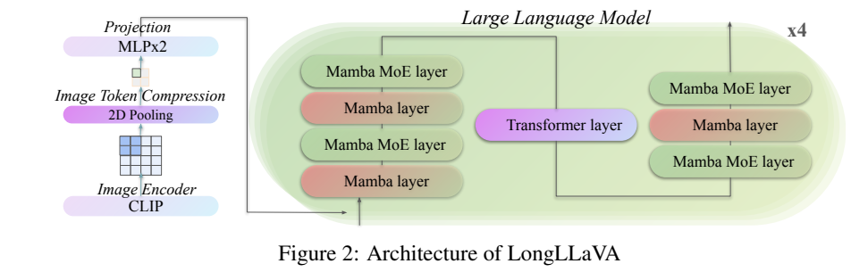
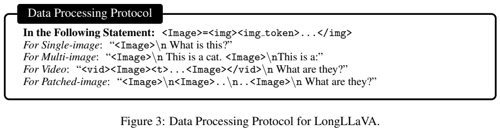
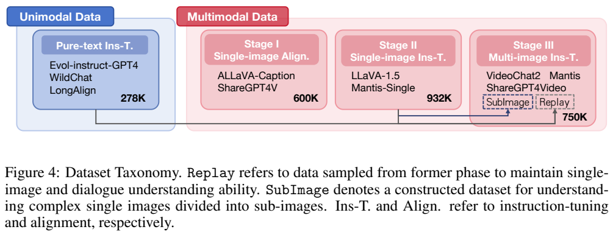
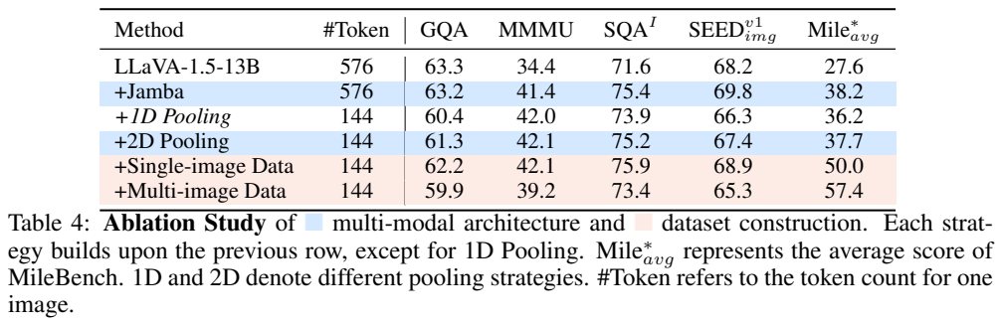
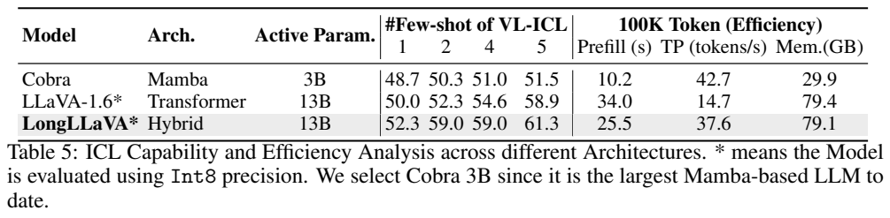
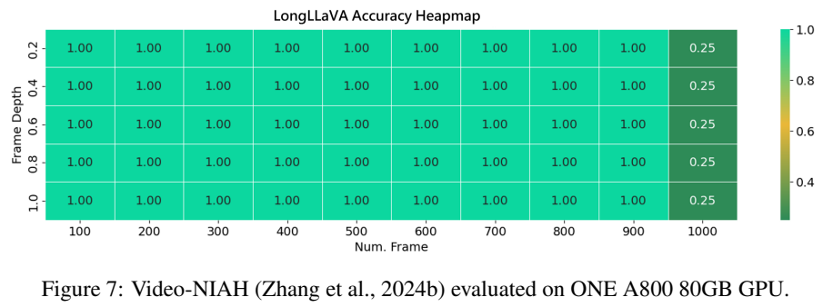

<!-- article-header:start -->
[项目首页](../../../README.md) › [模型系列](../../../reports/model-family-index.md) › [LongLLaVA](../README.md)
<!-- article-header:end -->

# LongLLaVA：用 Mamba、注意力与视觉压缩扩展多图上下文

<!-- article-toc:start -->

**本篇目录** · [论文定位](#paper-info) · [快速概览](#overview) · [整体架构](#architecture) · [核心原理](#principles) · [数据构建](#data) · [训练流程](#training) · [实验结果](#experiments)
<!-- article-toc:end -->

## 1. 论文信息与模型定位

| 项目 | 信息 |
|---|---|
| 原文 | LongLLaVA: Scaling Multi-modal LLMs to 1000 Images Efficiently via Hybrid Architecture |
| 作者与机构 | Xidong Wang、Dingjie Song、Shunian Chen、Chen Zhang、Benyou Wang；香港中文大学（深圳）、深圳市大数据研究院 |
| 版本 | arXiv:2409.02889v1，2024 年 9 月 4 日，19 页 |
| 来源 | [PDF 原文](https://arxiv.org/pdf/2409.02889v1)、[代码与模型项目](https://github.com/FreedomIntelligence/LongLLaVA) |
| 定位 | 长多图、视频帧与高分辨率裁块的理解模型；主要输出自然语言 |

LongLLaVA 将视觉 token 压缩、混合序列网络与多图数据协议结合起来，目标是在有限单卡内存上读入更多视觉内容。模型名称的 13B 对应约 13B 激活参数；原文列出语言网络总参数约 53B，不能将其文件存储或全部可训练权重称为 13B。

本篇以 v1 为准。其“1000 张图几乎满分检索”叙述与 Figure 7 的实际数字存在明显冲突：图中 100–900 帧各深度均标 1.00，1000 帧则均为 0.25。本文将这一差异保留，避免把标题和摘要当成已验证的全部实验结论。

## 2. 快速概览

| 设计 | 目的与实际设置 |
|---|---|
| 视觉压缩 | 将 576 个网格 token 池化为 144，保留二维空间关系 |
| 混合语言网络 | 大部分层为 Mamba，少数层为 Transformer 注意力；沿用 Jamba 风格的混合主干 |
| MoE | 每隔一层使用 16 个专家，逐 token 激活 top-2 |
| 输入协议 | 区分一般图像、视频帧及同一高分辨率图的空间裁块 |
| 训练 | 278K 纯文字指令后，600K 单图对齐、932K 单图指令、750K 多图指令 |
| 长度 | 训练打包为 40,960 token；进一步训练到 140K 是未来计划 |
| 收益与代价 | 多图能力明显提高，但多图训练使单图得分回退；混合网络仍含全局注意力 |

这是一项扩大多图理解能力的系统方案，不意味着千张图像都能保持原始分辨率、也不意味着从此消除了长上下文遗忘。原文 Figure 1 在 Int8 单卡条件下记录普通配置最多 933 张；千图检索实验还额外将每图压到 36 个 token，属于更强压缩的另一设置。

## 3. 整体架构

*原文 Figure 2，PDF 第 4 页图表区域裁切；保留网络图、说明和视觉模型脚注。*

图像先经 CLIP 编成二维特征，在投影之前聚合相邻 2×2 网格，从 24×24=576 降为 12×12=144。两层 MLP 将这些连续特征映射到语言嵌入空间，然后与文字共同进入混合 LLM。Figure 2 每组画出七个 Mamba 类层、一个 Transformer 层，重复四组；正文“Transformer and Mamba … 7:1”的顺序措辞容易反读，本文按实际图示说明为 **Mamba:Transformer≈7:1**。

注意力层采用 GQA，主干还有 RMSNorm、SwiGLU，并在每隔一层的 FFN 使用 16 专家、top-2 激活。报告称不使用显式位置嵌入，不能据此说网络没有顺序信息：Mamba 的状态递推本身依赖输入次序。

视觉编码器的具体身份记载不够一致。正文以 336 像素、576 token 和二维 24×24 网格说明处理，但脚注链接却写 `openai/clip-vit-base-patch32`；该名称不能直接解释同一网格配置。本文保留“CLIP + 报告所述 576→144”这一事实，不擅自把脚注改成另一检查点或凭惯例认定为 ViT-L/14。

纯 Mamba 层主要用状态递推压缩过去信息，注意力层保留显式跨 token 关联，二者共同工作。它并非用 Mamba 替代视觉编码器，也不是把每个图像单独转成描述后只让 LLM 读文字。

## 4. 核心创新与数学原理

### 混合主干降低注意力层占比

报告没有编号方法公式。为了理解计算特性，可用标准状态空间记号说明 Mamba 类层：

$$
h_t=\bar A_t h_{t-1}+\bar B_t x_t,\qquad o_t=C_t h_t+D x_t.
$$

这是状态空间模型的解释性写法，不是论文新提出的方程，也未展开 Mamba 的门控、卷积和并行扫描实现。相关系数可以由输入决定；状态携带历史信息，降低为每个历史 token 存储注意力 KV 的需求。但固定状态也可能难以保留全部细节，所以混合主干仍插入注意力层。

若序列长度为 $`n`$，Mamba 层数为 $`L_M`$，全局注意力层数为 $`L_A`$，忽略宽度常数的标准量级解释为：

$$
\mathrm{cost}(n)\sim O(L_Mn+L_An^2).
$$

在注意力层数固定且非零时，整体渐近复杂度仍包含二次项。原文将混合架构概括为“Quasi-Linear”，更适合理解为实际长度范围内减少大量注意力计算，而不能读成严格线性定理。FlashAttention 或缓存能改善实现效率，也不改变全局注意力关系本身的计算性质。

Table 1 对 Mamba 的 ICL 标为“无”，但 Table 5 的 Cobra 实验仍有非零表现并随样本增加而变化。这是报告对相对弱点的简化，不应解释成所有状态空间模型在逻辑上无法做上下文学习。

### 二维压缩减少序列，也减少细节

默认每图 144，相比 576 少 75%。将网格按二维位置压缩而不是简单沿展平序列处理，能更自然地保留邻接关系。若其它输入占用忽略不计，视觉序列下降到四分之一，会显著降低注意力对数；但文本长度、视觉编码和主干的线性计算仍存在，不能声称端到端总耗时一定下降到十六分之一。

千图试验进一步由 144 降到 36：1000×36=36,000，才能在 40,960 的训练长度量级中留下文字和特殊符号空间。这与默认配置的 1000×144=144,000 完全不同。更强池化有利于输入容纳，却可能丢失小目标、文字及精细空间信息，不能把千图检索效果直接套到 OCR 或高分辨率问答。

### 明确图与图之间的关系

*原文 Figure 3、Figure 4，PDF 第 5 页图表区域裁切；保留全部四种输入示意和训练阶段。*

每张图用 `` 和 `</img>` 包围；视频整体再用 `<vid>` 和 `</vid>` 包围，帧间加入 `<t>`。高分辨率图先放整体图，再按左上到右下排列裁块，用换行分隔裁块行。Figure 3 的重点是让相同的视觉序列接口具有不同的时间或空间语义。`<t>` 是帧间标记，报告没有将它定义为精确时间戳，也未披露按秒编码的公式。

## 5. 数据构建与处理

纯文字阶段采用 Evol-instruct-GPT4、WildChat、LongAlign 共 278K，覆盖不同长度的指令，为已有语言主干补充指令遵循能力。它不是从零预训练混合网络。

单图对齐使用 ALLaVA-Caption 和 ShareGPT4V，约 600K caption；单图指令采用 LLaVA-1.5 和 Mantis-Single，约 932K 问答。多图阶段精确列出六部分：Mantis 200K、VideoChat2 200K、ShareGPT4Video 50K、前阶段单图回放 200K、纯文字回放 50K，以及构造的 SubImage 50K，总计 750K。

SubImage 从前一单图阶段抽样，经过 padding 和分割，生成 336×336 局部图，再按 Figure 3 的空间排列协议组织。回放和裁块数据复用了旧样本，所以不能把四阶段规模之和称为独立的新图像数量。回放的目的在于抑制多图训练造成的单图和纯文字能力遗忘，实验显示仍未完全解决。

训练随机拼接样本，以 `<eos>` 分隔，直到 40,960 token。原文没有说明所有样本之间的注意力是否采用独立块掩码、长视频训练抽帧率、各源去重或样本过滤阈值，因此不添加“严格隔离打包”或固定 FPS 的假设。评测附录明确 Video-MME 均匀抽 128 帧、无字幕，这是该评测的条件；VNBench 的计算量估计则基于平均约 54 帧、1 FPS，不是同一种设置。

## 6. 训练流程与目标

训练顺序为纯文字指令→单图对齐→单图指令→多图指令。对齐只更新投影层，冻结视觉编码器与 LLM；单图指令冻结视觉编码器，更新投影与 LLM。多图阶段继承单图检查点并进行长视觉序列指令训练，不过正文未像前两个阶段那样单独列出完整的参数冻结表，不能把未明确的视觉更新范围写成经过代码验证的事实。

报告使用三个节点、每个八张 A800，共 24 张；DeepSpeed ZeRO-3，余弦学习率、3% warmup、学习率 1e-5、一轮训练。未完整公布优化器、全局 batch、权重衰减、精度、每阶段步数和耗时。不能由硬件数量反推训练总 GPU 小时，也不能将推理的 Int8 精度写成训练精度。

训练目标可按视觉语言指令学习的一般方式理解为回答 token 的负对数似然：

$$
\mathcal L_{\mathrm{SFT}}=-\sum_t\log p(y_t\mid y_{<t},X_v,X_q).
$$

这一式子为标准解释，原文没有明确列出该损失、标签掩码和 MoE 辅助损失细节。该工作没有将教师 KL、偏好 DPO 或视频重建列为主训练目标；不能因主干含 MoE 就补上没有披露的负载均衡系数。

## 7. 实验设置与主要结果

模型以 Int8、temperature=0 评测。MileBench 测试时间、语义和信息检索，Video-MME 与 MVBench 测视频，VNBench 用合成任务测检索、排序与计数。不同模型的参数规模、基础训练和输入策略不完全相同，结果是系统比较，不能将全部差异单独归因于 Mamba。

| Table 2 任务 | LongLLaVA | 参考对照 |
|---|---:|---|
| MileBench 平均 | 57.4 | OmChat 45.9、GPT-4V 63.7、GPT-4o 69.5 |
| MileBench 信息检索 | 67.5 | Phi-3-Vision 18.7、GPT-4o 88.8 |
| Video-MME 无字幕 | 51.6 | LongVILA 50.5、Video-LLaMA2 47.8、GPT-4o 64.7 |
| Video-MME 短/中/长 | 60.9 / 49.7 / 44.1 | 128 帧设置下的子集结果 |
| MVBench | 54.6 | VideoChat2 51.9、Video-LLaMA2 34.1 |
| 128 图计算量 | 0.22 PFLOPs | OmChat 3.90、VideoChat2 0.24；并非对所有模型均低一个数量级 |

VNBench 平均为 52.1，高于 GPT-4V 48.9，低于 GPT-4o 64.4 和 Gemini 66.7。部分检索为 100，但排序与计数仍明显较低；对少数简单检索满分不能概括为全部时间关系处理都很强。

*原文 Table 4、Table 5，PDF 第 8 页图表区域裁切；保留所有消融行与 100K 效率列。*

加入 Jamba 后 MMMU 34.4→41.4、MileBench 27.6→38.2，但 GQA 63.3→63.2，并非所有指标上升。二维池化后 token 576→144，GQA 63.2→61.3，SEED 69.8→67.4。与一维池化相比它更好，但仍有细节损失。增加多图训练使 MileBench 50.0→57.4，同时 GQA 62.2→59.9、MMMU 42.1→39.2、SEED 68.9→65.3；扩展能力伴随单图回退。

100K 输入的 Table 5 中，LLaVA-1.6 与 LongLLaVA 首次处理时间分别为 34.0 秒、25.5 秒，吞吐为 14.7、37.6 token/s，约 2.56 倍；最大显存是 79.4、79.1GB，差值只有 0.3GB。不能将状态空间 KV 优势夸大为该系统实测总显存大幅下降。吞吐按 $`(1000-1)/(t_{1000}-t_1)`$ 计算，与直接用含 prefill 的总生成时长不同。Cobra 的 10.2 秒、42.7 token/s、29.9GB 更快更省，但其激活参数只有 3B，比较并非同容量控制实验。

Figure 5 的 V* 裁块数量增加先改善后回退，而且裁块大小也同时从 448 到 336、224、168 改变，所以不能把它当作只改变图像数量的严格缩放规律。Figure 6 增帧总体有益，但长视频也存在局部下降，并非每增加一次帧数都提升。

*原文 Figure 7，PDF 第 10 页图表区域裁切；保留数量轴、深度轴、颜色刻度与每格数字。*

该原图明确写在一张 A800 80GB 上测量。100–900 帧在列出的五种深度均为 1.00，1000 帧均为 0.25，与 Section 6 “1000 图接近 100%”的文字不一致；没有单独的原始结果可以消除这一冲突。训练长度之外的性能下降和更强视觉压缩都值得关注，因此本篇不将“千图接近满分”作为无条件结论。

LongLLaVA 展示了以混合网络和压缩表示增加可处理视觉上下文的可行性；最明确的实证是多图成绩与解码效率提高。千图的可靠性、单图遗忘、视觉编码器身份和部分实验叙述仍需结合原始脚本进一步核验。本文未运行模型，未将原文示意或未来计划写成已完成能力。

<!-- article-footer:start -->
---

[← 上一篇：LLaVA-MoD](../../llava-mod/arxiv-2408.15881/README.md) · [按发表时间浏览](../../../reports/paper-reading-guide.md#year-2024) · [下一篇：ChartMoE →](../../chartmoe/arxiv-2409.03277/README.md)

[返回本篇目录](#article-toc) · [返回模型系列](../README.md)
<!-- article-footer:end -->
